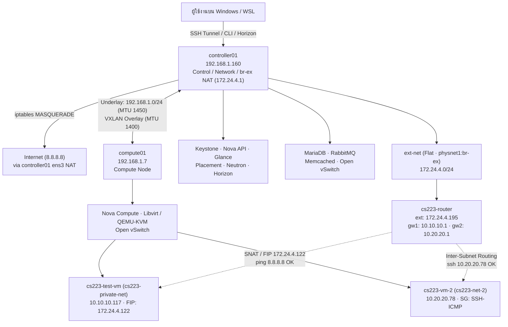
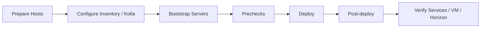
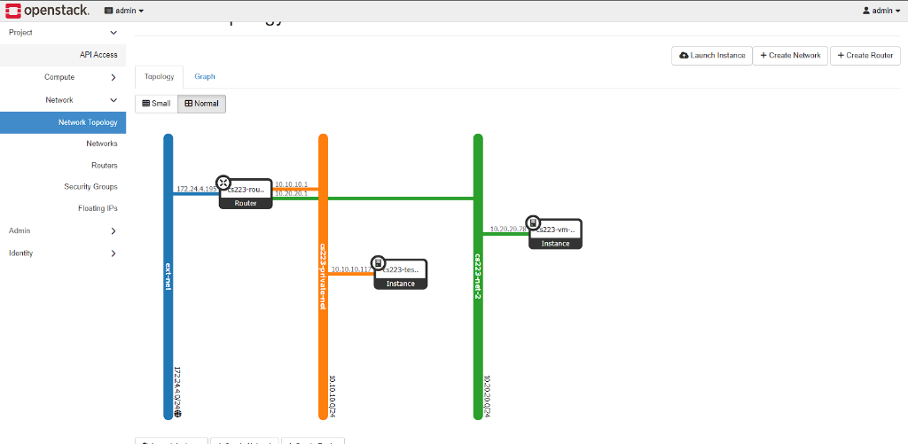

# CS223 Term Project — OpenStack Multinode Deployment

> **โครงงานรายวิชา CS223 Virtualization Technology**  
> ติดตั้งและทดสอบ Private Cloud ด้วย **OpenStack 2026.1** ผ่าน **Kolla Ansible** บน Ubuntu Server จำนวน 2 Nodes

## สถานะโครงงาน

**Deployment และการทดสอบระบบ: สำเร็จครบวงจร** (อัปเดตผลการทดสอบล่าสุด ณ วันที่ 18 พฤศจิกายน 2026)

- ✅ `bootstrap-servers`, `prechecks`, `deploy` และ `post-deploy` สำเร็จ
- ✅ บริการหลักของ OpenStack ทำงาน และ `controller01` มองเห็น `compute01`
- ✅ สร้าง VM จาก CirrOS Image ได้จริง โดย VM อยู่ในสถานะ `ACTIVE`
- ✅ VM Boot ได้ เข้าถึงผ่าน noVNC และได้รับ IPv4 จาก Neutron DHCP
- ✅ เข้าสู่ระบบ Horizon Dashboard ด้วยบัญชีผู้ดูแลระบบได้
- ✅ สร้าง Router (`cs223-router`), Security Group (`SSH-ICMP`), Key Pair (`cs223-key`) และทดสอบ Ping ข้ามโฮสต์ถึง Gateway (`10.10.10.1`) สำเร็จ
- ✅ ทดสอบ Virtual Routing ข้าม 2 เครือข่าย (`cs223-private-net` `10.10.10.0/24` ↔ `cs223-net-2` `10.20.20.0/24`) และ `ssh` จาก `cs223-test-vm` ไปยัง `cs223-vm-2` (`10.20.20.78`) สำเร็จ
- ✅ ตั้งค่า External Network (`ext-net` `172.24.4.0/24` บน `physnet1:br-ex` + runtime NAT/Forwarding บน `controller01`), ผูก Floating IP (`172.24.4.122`), ทดสอบ `ssh cirros@172.24.4.122` และ `ping -c 4 8.8.8.8` (`0% packet loss`) สำเร็จ
- ✅ ทดสอบงาน Admin (`Project-A`, `A-user`, Role `member` RBAC และ Quota) ผ่านทั้ง Horizon และ OpenStack CLI
- 📄 จัดทำเอกสาร `docs/` ครบ 9 ไฟล์, Configuration Examples 4 ไฟล์ และ Verification Script แล้ว
- 📸 รวบรวมหลักฐานจริงครบ **11/11 ภาพพื้นฐาน** พร้อมภาพทดสอบฝั่ง QA/Admin/Networking ของคนที่ 3 อีก **22 ภาพ** (รวม **33 ไฟล์** ใน `evidence/`)

> **ขอบเขตสำคัญ:** ระบบนี้ออกแบบเป็น **Single Controller + Single Compute Node** สำหรับการเรียนและการทดลอง ไม่ใช่ระบบ Production หรือ High Availability (HA) และสำหรับ Lab External Uplink (`ext-net` `172.24.4.0/24` บน `br-ex` ซึ่งผูก `dummy0` ไว้ใน Kolla) ได้ตั้งค่า IP Gateway (`172.24.4.1/24`), `ip_forward=1` และ `iptables MASQUERADE` ออกทาง `ens3` แบบ **Runtime (ชั่วคราวใน RAM ของ `controller01`)** เพื่อให้ทดสอบ Floating IP และออกอินเทอร์เน็ตได้จริงโดยไม่แก้ Interface `ens3` ของกลุ่ม (ค่า Host NAT จะไม่คงอยู่หาก `controller01` รีบูต)

---

## สารบัญ

1. [ภาพรวมและวัตถุประสงค์](#ภาพรวมและวัตถุประสงค์)
2. [สถาปัตยกรรมระบบ](#สถาปัตยกรรมระบบ)
3. [เทคโนโลยีและสภาพแวดล้อม](#เทคโนโลยีและสภาพแวดล้อม)
4. [บริการ OpenStack ที่ติดตั้ง](#บริการ-openstack-ที่ติดตั้ง)
5. [ลำดับการติดตั้ง](#ลำดับการติดตั้ง)
6. [ผลการทดสอบระบบ](#ผลการทดสอบระบบ)
7. [การเข้าถึง Horizon และ OpenStack CLI](#การเข้าถึง-horizon-และ-openstack-cli)
8. [โครงสร้าง Repository และเอกสาร](#โครงสร้าง-repository-และเอกสาร)
9. [หลักฐานการทดสอบ (Evidence)](#หลักฐานการทดสอบ-evidence)
10. [ตรวจสอบระบบด้วยสคริปต์](#ตรวจสอบระบบด้วยสคริปต์)
11. [ปัญหาที่พบและแนวทางแก้ไข](#ปัญหาที่พบและแนวทางแก้ไข)
12. [ข้อจำกัดและสิ่งที่ยังไม่ได้ทดสอบ](#ข้อจำกัดและสิ่งที่ยังไม่ได้ทดสอบ)
13. [ความปลอดภัยและการส่งมอบงาน](#ความปลอดภัยและการส่งมอบงาน)

## ภาพรวมและวัตถุประสงค์

โครงงานนี้ศึกษาแนวทางสร้าง **Private Cloud Infrastructure** โดยใช้ OpenStack ซึ่งเป็นแพลตฟอร์มสำหรับจัดการทรัพยากร Compute, Network และ Image ผ่าน API และ Web Dashboard การติดตั้งใช้ **Kolla Ansible** เพื่อ Deploy บริการ OpenStack ในรูปแบบ Container พร้อมจัดการ Configuration และการทำงานร่วมกันของหลายเครื่อง

เป้าหมายของโครงงานมีดังนี้

1. ติดตั้ง OpenStack แบบ **Multinode** โดยแยกบทบาท Controller และ Compute Node
2. ใช้ Ansible/Kolla Ansible ในการเตรียมระบบ ตรวจสอบความพร้อม และ Deploy บริการ
3. ตรวจสอบการทำงานของ Keystone, Nova, Neutron, Glance, Placement และ Horizon
4. สร้าง Virtual Network และทดลอง Boot VM จริงบน Compute Node
5. บันทึกขั้นตอน Configuration ผลทดสอบ และปัญหาที่พบ เพื่อให้สมาชิกในกลุ่มตรวจสอบและรับงานต่อได้

## สถาปัตยกรรมระบบ



### Nodes และ Network

| รายการ | `controller01` | `compute01` |
|---|---|---|
| หน้าที่หลัก | Control, Network, Deployment | Compute |
| ระบบปฏิบัติการ | Ubuntu Server 24.04.3 LTS | Ubuntu Server 24.04.3 LTS |
| Management IP (ภายใน Lab) | `192.168.1.160` | `192.168.1.7` |
| Network Interface หลัก | `ens3` | `ens3` |
| Container Runtime | Docker | Docker |
| Virtualization | รัน OpenStack Services | QEMU/KVM ผ่าน Libvirt |

การตั้งค่า Network สำคัญ:

- **Underlay Network:** `192.168.1.0/24` โดยมี MTU 1450
- **Tenant/Internal Network 1:** `cs223-private-net` (`cs223-private-subnet` `10.10.10.0/24`, Pool `10.10.10.100`–`10.10.10.200`, VXLAN MTU `1400`)
- **Tenant/Internal Network 2:** `cs223-net-2` (`cs223-subnet-2` `10.20.20.0/24`, VXLAN MTU `1400`)
- **Virtual Router (`cs223-router`):** เชื่อม Internal Interfaces `10.10.10.1` + `10.20.20.1` และ External Gateway `172.24.4.195` (`enable_snat: true`)
- **External Network (`ext-net`):** ชนิด Flat (`physnet1:br-ex`), Subnet `172.24.4.0/24`, Pool `172.24.4.100`–`172.24.4.200`, Gateway `172.24.4.1` (ตั้งค่า IP บน OVS `br-ex` คู่กับ `dummy0` และ `iptables MASQUERADE` ออกทาง `ens3` แบบ Runtime บน `controller01`)
- **Floating IP ที่ทดสอบ:** `172.24.4.122` ผูกกับ `cs223-test-vm` (`10.10.10.117`) สำหรับ SSH เข้า VM และทดสอบ Internet Egress (`ping 8.8.8.8`)

> IP ข้างต้นใช้บันทึกสภาพแวดล้อมที่ทดสอบจริงใน Lab เท่านั้น ไม่ใช่ชุด IP ที่จำเป็นต้องใช้กับทุก Deployment

รายละเอียดเพิ่มเติม: [Architecture](docs/02-architecture.md)

## เทคโนโลยีและสภาพแวดล้อม

| ส่วนประกอบ | เทคโนโลยี / เวอร์ชันที่ใช้ |
|---|---|
| Cloud Platform | OpenStack **2026.1** |
| Deployment | Kolla Ansible **22.2.1.dev36** |
| Automation | Ansible Core **2.19.15** |
| Operating System | Ubuntu Server **24.04.3 LTS** |
| Language / Runtime สำหรับ Deployment | Python 3.12 และ Virtual Environment |
| Containers | Docker + Kolla Container Images |
| Virtualization | QEMU/KVM, Libvirt |
| Networking | Neutron + Open vSwitch + VXLAN |
| Test Image | CirrOS **0.6.3** (`qcow2`) |
| OpenStack CLI | python-openstackclient **9.0.1** (แยก Virtual Environment) |

ระบบ Kolla Ansible ใช้ Virtual Environment ของตัวเอง (`~/kolla-venv`) และแยก OpenStack CLI ไว้อีก Environment (`~/openstack-cli-venv`) เพื่อลดความเสี่ยงจากการชนกันของ Dependencies

รายละเอียดเพิ่มเติม: [Environment Setup](docs/03-environment-setup.md)

## บริการ OpenStack ที่ติดตั้ง

| Service | หน้าที่ | ผลการตรวจสอบ |
|---|---|---|
| **Keystone** | Identity และ Authentication | ผ่านการขอ Token |
| **Nova** | Compute API, Scheduling, Conductor และ Compute Agent | Compute Services `up`; สร้าง VM ได้ |
| **Neutron** | Virtual Network, DHCP, L3 และ Metadata | Agents 5/5 ตัวเป็น `UP` และ `Alive` |
| **Glance** | Image Management | Upload CirrOS Image สถานะ `active` |
| **Placement** | จัดการข้อมูลทรัพยากรที่ใช้ Scheduling | Service ทำงาน; Nova สร้าง VM สำเร็จ |
| **Horizon** | Web Dashboard | เปิดหน้าเว็บและ Login ได้ |
| **MariaDB** | Database Backend | Container `healthy` |
| **RabbitMQ** | Message Broker | Container `healthy` |
| **Memcached** | Caching | Container `healthy` |
| **Open vSwitch** | Virtual Switching | Containers/Agents ทำงานทั้งสอง Nodes |

> การติดตั้งนี้ปิด HA/Load Balancer และ ProxySQL เพื่อให้เหมาะกับรูปแบบ Single Controller ที่ใช้ใน Lab จึงไม่รองรับ Failover แบบ HA

## ลำดับการติดตั้ง

กระบวนการติดตั้งหลักของโครงงาน:



ตัวอย่างลำดับคำสั่ง Kolla Ansible **บน `controller01` ภายใน `kolla-venv`** (ใช้เป็นเอกสารอ้างอิง ไม่ควรรันซ้ำบนระบบที่กำลังใช้งาน):

```bash
kolla-ansible bootstrap-servers -i ~/multinode
kolla-ansible prechecks -i ~/multinode
kolla-ansible deploy -i ~/multinode
kolla-ansible post-deploy -i ~/multinode
```

ไฟล์ตั้งค่าหลักประกอบด้วย `~/multinode`, `/etc/kolla/globals.yml`, `/etc/kolla/passwords.yml` และ Neutron Configuration Overrides ภายใต้ `/etc/kolla/config/neutron/`

**อย่าใช้คำสั่งชุดนี้ Deploy ใหม่บนระบบที่กำลังใช้งานโดยไม่ตรวจสอบผลกระทบก่อน** และห้ามนำไฟล์ Configuration ที่มี Credentials จริงขึ้น Public Repository ให้ใช้ไฟล์ตัวอย่างใน [`config/`](config/) แทน

รายละเอียดเพิ่มเติม: [Kolla Deployment](docs/04-kolla-deployment.md)

## ผลการทดสอบระบบ

ผลต่อไปนี้เป็นสิ่งที่ได้ทดสอบจริง ไม่ใช่เพียงแผนงาน

| รายการทดสอบ | ผลลัพธ์ | สถานะ |
|---|---|---|
| Kolla Ansible Prechecks | `failed=0`, Exit Status `0` | ✅ ผ่าน |
| Kolla Ansible Deploy | `failed=0`, Exit Status `0` | ✅ ผ่าน |
| Kolla Ansible Post-deploy | `localhost: failed=0` | ✅ ผ่าน |
| Controller Containers | บริการหลักทำงาน / รายการที่มี Health Check แสดง `healthy` | ✅ ผ่าน |
| Compute Containers | `nova_compute`, `nova_libvirt`, OVS ทำงาน | ✅ ผ่าน |
| Keystone Authentication | ขอ Token ได้สำเร็จ | ✅ ผ่าน |
| Nova Compute Services | `nova-scheduler`, `nova-conductor`, `nova-compute` เป็น `enabled / up` | ✅ ผ่าน |
| Nova Hypervisor | `compute01` เป็น `enabled / up` | ✅ ผ่าน |
| Neutron Agents | 5 Agents แสดง `Alive :-)` และ `UP` | ✅ ผ่าน |
| Glance Image | `cirros-0.6.3` เป็น `active` | ✅ ผ่าน |
| Test VM | `cs223-test-vm` เป็น `ACTIVE` บน `compute01` | ✅ ผ่าน |
| DHCP ใน Guest OS | `eth0` ได้รับ `10.10.10.117/24` | ✅ ผ่าน |
| noVNC Console | Login เข้าสู่ CirrOS Shell ได้ | ✅ ผ่าน |
| Horizon Dashboard | Login และเปิด Overview ได้ | ✅ ผ่าน |
| Inter-Subnet Virtual Routing | `cs223-test-vm` (`10.10.10.117`) `ssh` ข้าม `cs223-router` ไปยัง `cs223-vm-2` (`10.20.20.78`) สำเร็จ | ✅ ผ่าน |
| External Network & Floating IP SSH | `ext-net` (`172.24.4.0/24`), `ssh cirros@172.24.4.122` จาก `controller01` เข้า `cs223-test-vm` สำเร็จ | ✅ ผ่าน |
| Guest Internet Egress | ใน `cs223-test-vm` สั่ง `ping -c 4 8.8.8.8` ได้ `0% packet loss` ผ่าน `br-ex` NAT | ✅ ผ่าน |

### Test Instances

| รายการ | VM #1 (`cs223-test-vm`) | VM #2 (`cs223-vm-2`) |
|---|---|---|
| Image | `cirros-0.6.3` | `cirros-0.6.3` |
| Flavor | `cs223.tiny` (1 vCPU / 512 MB / 1 GB) | `cs223.tiny` (1 vCPU / 512 MB / 1 GB) |
| Compute Host | `compute01` | `compute01` |
| Network & Fixed IP | `cs223-private-net` (`10.10.10.117/24`) | `cs223-net-2` (`10.20.20.78/24`) |
| Floating IP / Key Pair | `172.24.4.122` / Security Group `SSH-ICMP` | Key Pair `cs223-key` / Security Group `SSH-ICMP` |
| Status | `ACTIVE` | `ACTIVE` |

ใน CirrOS Console ได้ตรวจสอบด้วยคำสั่ง:

```bash
ip -4 addr show eth0
```

พบ `inet 10.10.10.117/24` และ Interface มีสถานะ `UP, LOWER_UP` ซึ่งสอดคล้องกับ IP ที่ Neutron จัดสรรไว้

รายละเอียดผลทดสอบ: [Deployment Verification](docs/05-deployment-verification.md) และ [หลักฐานที่กู้คืนได้](#หลักฐานการทดสอบ-evidence)

## การเข้าถึง Horizon และ OpenStack CLI

### Horizon Dashboard

Horizon ทำงานบน Controller และในการทดลองเข้าถึงผ่าน **SSH Local Port Forwarding** จาก Windows/WSL แทนการเปิด HTTP Port สู่ภายนอกโดยตรง

ตัวอย่างคำสั่งบน **Windows WSL** (แทนชื่อไฟล์ SSH Key และ IP ที่ใช้เข้าเครื่อง Controller ตามสภาพแวดล้อมของผู้ใช้งาน):

```bash
ssh -i ~/.ssh/YOUR_SSH_KEY \
  -o IdentitiesOnly=yes \
  -o ExitOnForwardFailure=yes \
  -N \
  -L 127.0.0.1:8080:192.168.1.160:80 \
  ubuntu@YOUR_CONTROLLER_SSH_IP
```

ขณะที่ SSH Tunnel ทำงาน ให้เปิด Browser ไปที่ **http://127.0.0.1:8080/** และ Login ด้วยบัญชี OpenStack ที่ได้รับอนุญาต

> `127.0.0.1:8080` ใช้งานได้เฉพาะเครื่องที่เปิด SSH Tunnel อยู่ ไม่ใช่ URL สาธารณะที่สมาชิกคนอื่นเปิดได้ทันที และต้องได้รับสิทธิ์ SSH กับ Credentials แยกต่างหาก

### OpenStack CLI

CLI ถูกติดตั้งแยกไว้ที่ `~/openstack-cli-venv` บน `controller01` ตัวอย่างการตรวจสอบที่ไม่แสดงข้อมูลลับ:

```bash
(
  source /etc/kolla/admin-openrc.sh
  ~/openstack-cli-venv/bin/openstack compute service list
  ~/openstack-cli-venv/bin/openstack network agent list
  ~/openstack-cli-venv/bin/openstack server list
)
```

ไฟล์ `/etc/kolla/admin-openrc.sh` มี Credentials **ห้ามเผยแพร่หรือ Commit** และควรใช้เฉพาะผู้มีสิทธิ์เท่านั้น

## โครงสร้าง Repository และเอกสาร

โครงสร้างของ Repository (แสดงไฟล์เอกสาร, Configuration Examples และหลักฐานภาพจริงทั้ง 33 ไฟล์ที่จัดเก็บแล้ว):

```text
CS223-TermProject/
├── README.md
├── .gitignore
├── docs/
│   ├── 01-project-overview.md
│   ├── 02-architecture.md
│   ├── 03-environment-setup.md
│   ├── 04-kolla-deployment.md
│   ├── 05-deployment-verification.md
│   ├── 06-troubleshooting.md
│   ├── 07-handover.md
│   ├── 08-qa-test-cases-and-admin.md
│   └── 09-final-report-draft-and-demo-script.md
├── config/
│   ├── multinode.example
│   ├── globals.example.yml
│   └── neutron/
│       ├── neutron.conf.example
│       └── ml2_conf.ini.example
├── evidence/
│   ├── 01-deployment/
│   │   ├── 01-prechecks.png
│   │   ├── 02-deploy-recap.png
│   │   └── 03-post-deploy.png
│   ├── 02-services/
│   │   ├── 01-controller-containers.png
│   │   ├── 02-compute-containers.png
│   │   ├── 03-nova-services.png
│   │   ├── 04-neutron-agents.png
│   │   ├── 05-horizon-hypervisors.png
│   │   ├── 06-horizon-network-agents.png
│   │   └── 07-cli-services-resources.png
│   ├── 03-vm-validation/
│   │   ├── 01-instance-active.png
│   │   ├── 02-cirros-console.png
│   │   ├── 03-cirros-network.png
│   │   ├── 04-cirros-ping-gateway.png
│   │   ├── 05-instance-paused.png
│   │   ├── 06-vm-ssh-inter-subnet.png
│   │   ├── 07-controller-br-ex-nat-floating-ip-ssh.jpg
│   │   ├── 08-vm-ping-internet.png
│   │   └── 09-cli-multi-network-floating-ip.png
│   ├── 04-horizon/
│   │   ├── 01-horizon-dashboard.png
│   │   ├── 02-security-group-ssh-icmp.png
│   │   ├── 03-network-topology.png
│   │   ├── 04-key-pairs.png
│   │   ├── 05-horizon-images.png
│   │   ├── 06-horizon-flavors.png
│   │   ├── 07-horizon-networks-ext.png
│   │   ├── 08-horizon-router-interfaces.png
│   │   ├── 09-horizon-network-topology-ext.png
│   │   ├── 10-horizon-floating-ips.png
│   │   └── 11-horizon-instances-multi.png
│   └── 05-admin/
│       ├── 01-project-a-edit-quotas.png
│       ├── 02-a-user-rbac-overview.png
│       └── 03-cli-router-secgroup-rbac-quota.png
└── scripts/
    └── verify-deployment.sh
```

| เอกสาร | สิ่งที่อธิบาย |
|---|---|
| [Project Overview](docs/01-project-overview.md) | โจทย์ วัตถุประสงค์ ขอบเขต และบทบาทสมาชิก |
| [Architecture](docs/02-architecture.md) | Nodes, Services, Data/Control Plane และ Network Topology |
| [Environment Setup](docs/03-environment-setup.md) | การเตรียม Ubuntu, Docker, Python และ Ansible |
| [Kolla Deployment](docs/04-kolla-deployment.md) | Inventory, Configuration และ Workflow การติดตั้ง |
| [Deployment Verification](docs/05-deployment-verification.md) | คำสั่งตรวจสอบ เกณฑ์ผ่าน และผลทดสอบ |
| [Troubleshooting](docs/06-troubleshooting.md) | ปัญหาที่พบ การวิเคราะห์สาเหตุ และแนวทางแก้ไข |
| [Handover](docs/07-handover.md) | วิธีเข้าใช้งาน ตรวจสอบระบบ และข้อมูลส่งมอบสมาชิกคนที่ 3 |
| [QA Test Cases & Admin](docs/08-qa-test-cases-and-admin.md) | ตาราง Test Cases (`TC-01`–`TC-14`) และขั้นตอน Admin ตามตำราอาจารย์ |
| [Report Draft & Demo Script](docs/09-final-report-draft-and-demo-script.md) | ร่างเล่มรายงาน PDF (TH Sarabun) และบทพูด Demo Video |

Configuration Examples: [Ansible Inventory](config/multinode.example) · [Kolla Globals](config/globals.example.yml) · [Neutron MTU](config/neutron/neutron.conf.example) · [Neutron ML2](config/neutron/ml2_conf.ini.example)

## หลักฐานการทดสอบ (Evidence)

ภาพหลักฐานจริงทั้งหมด **33 ไฟล์** ถูกตรวจสอบและจัดเก็บครบถ้วนแล้ว (ตัดส่วน Address Bar ที่มี noVNC Token, ซ่อนข้อมูลลับ และไม่แสดง Outer Floating IP เพื่อความปลอดภัยสำหรับ Public Repository)

### ภาพหลักฐาน Baseline ของการติดตั้งและระบบหลัก — 11 ภาพ (ครบ 11/11)

| หมวด | ภาพหลักฐาน | สิ่งที่ยืนยัน |
|---|---|---|
| Deployment | [01-prechecks.png](evidence/01-deployment/01-prechecks.png) | Kolla Ansible Prechecks `failed=0`, `unreachable=0` |
| Deployment | [02-deploy-recap.png](evidence/01-deployment/02-deploy-recap.png) | Kolla Ansible Deploy Recap (`compute01 failed=0`, `controller01 failed=0`) |
| Deployment | [03-post-deploy.png](evidence/01-deployment/03-post-deploy.png) | สิทธิ์ไฟล์ `clouds.yaml` และ `admin-openrc.sh` (`600 ubuntu:ubuntu`) |
| Services | [01-controller-containers.png](evidence/02-services/01-controller-containers.png) | รายการ Docker Containers บน `controller01` สถานะ `Up / healthy` |
| Services | [02-compute-containers.png](evidence/02-services/02-compute-containers.png) | รายการ Docker Containers บน `compute01` และอุปกรณ์ `/dev/kvm` |
| Services | [03-nova-services.png](evidence/02-services/03-nova-services.png) | สถานะ Nova Services รวมถึง `nova-compute` บน `compute01` |
| Services | [04-neutron-agents.png](evidence/02-services/04-neutron-agents.png) | สถานะ Neutron Agents ทั้ง 5 ตัวที่ Alive/UP |
| VM Validation | [01-instance-active.png](evidence/03-vm-validation/01-instance-active.png) | สถานะ VM `cs223-test-vm` เป็น `ACTIVE` บน `compute01` |
| VM Validation | [02-cirros-console.png](evidence/03-vm-validation/02-cirros-console.png) | CirrOS Boot และ Login ผ่าน noVNC |
| VM Validation | [03-cirros-network.png](evidence/03-vm-validation/03-cirros-network.png) | `eth0` ของ VM มี IP `10.10.10.117/24` และ MTU 1400 |
| Horizon | [01-horizon-dashboard.png](evidence/04-horizon/01-horizon-dashboard.png) | Login และแสดงหน้า Horizon Overview ได้ |

### ภาพหลักฐานการทดสอบเพิ่มเติมและงาน Admin (คนที่ 3) — 13 ภาพ

| หมวด | ภาพหลักฐาน | สิ่งที่ยืนยัน |
|---|---|---|
| Services (UI) | [05-horizon-hypervisors.png](evidence/02-services/05-horizon-hypervisors.png) | หน้า Horizon *Admin > Hypervisors* เห็น `compute01` สถานะ `Enabled / Up` |
| Services (UI) | [06-horizon-network-agents.png](evidence/02-services/06-horizon-network-agents.png) | หน้า Horizon *System Information > Network Agents* ครบ 5 Agents |
| Services (CLI) | [07-cli-services-resources.png](evidence/02-services/07-cli-services-resources.png) | ผล CLI `token issue`, `service list`, `image list`, `flavor list`, `network list` |
| VM Network | [04-cirros-ping-gateway.png](evidence/03-vm-validation/04-cirros-ping-gateway.png) | ทดสอบ `ping` ข้ามโฮสต์ถึง DHCP (`10.10.10.100`) และ Router (`10.10.10.1`) |
| VM Lifecycle | [05-instance-paused.png](evidence/03-vm-validation/05-instance-paused.png) | ทดสอบ Pause Instance `cs223-test-vm` เปลี่ยนสถานะเป็น `Paused` สำเร็จ |
| Horizon | [02-security-group-ssh-icmp.png](evidence/04-horizon/02-security-group-ssh-icmp.png) | Security Group `SSH-ICMP` เปิดกฏ ICMP และ SSH (Port 22) |
| Horizon | [03-network-topology.png](evidence/04-horizon/03-network-topology.png) | แผนผัง Network Topology เชื่อม `cs223-router`, `cs223-private-net` และ VM |
| Horizon | [04-key-pairs.png](evidence/04-horizon/04-key-pairs.png) | การสร้าง Key Pair `cs223-key` บน Horizon |
| Horizon | [05-horizon-images.png](evidence/04-horizon/05-horizon-images.png) | หน้า Horizon *Compute > Images* เห็น `cirros-0.6.3` (`Active`, `QCOW2`) |
| Horizon | [06-horizon-flavors.png](evidence/04-horizon/06-horizon-flavors.png) | หน้า Horizon *Admin > Flavors* เห็น `cs223.tiny` (1 vCPU, 512MB, 1GB) |
| Admin (RBAC) | [01-project-a-edit-quotas.png](evidence/05-admin/01-project-a-edit-quotas.png) | การปรับตั้งค่า Compute Quota ของ `Project-A` (5 Instances, 4 vCPUs, 4096 MB) |
| Admin (RBAC) | [02-a-user-rbac-overview.png](evidence/05-admin/02-a-user-rbac-overview.png) | ล็อกอินด้วย `A-user` เข้า `Project-A` (ไม่มีแท็บ Admin และ Quota ตรงตามกำหนด) |
| Admin (CLI) | [03-cli-router-secgroup-rbac-quota.png](evidence/05-admin/03-cli-router-secgroup-rbac-quota.png) | ผล CLI ยืนยัน `router`, `SSH-ICMP`, `role assignment` และ `quota show Project-A` |

### ภาพหลักฐานเพิ่มเติม — Virtual Router 2 วง, External Network, Floating IP & Internet Egress (18 พ.ย.) — 9 ภาพ

| หมวด | ภาพหลักฐาน | สิ่งที่ยืนยัน |
|---|---|---|
| Inter-Subnet SSH | [06-vm-ssh-inter-subnet.png](evidence/03-vm-validation/06-vm-ssh-inter-subnet.png) | SSH จาก `cs223-test-vm` (`10.10.10.117`) ข้าม `cs223-router` ไป `cs223-vm-2` (`10.20.20.78`, `mtu 1400`) |
| `br-ex` NAT & FIP SSH | [07-controller-br-ex-nat-floating-ip-ssh.jpg](evidence/03-vm-validation/07-controller-br-ex-nat-floating-ip-ssh.jpg) | ตั้ง `br-ex` (`172.24.4.1/24`), `iptables` NAT/Forward และ `ssh cirros@172.24.4.122` เข้า `cs223-test-vm` |
| Internet Egress | [08-vm-ping-internet.png](evidence/03-vm-validation/08-vm-ping-internet.png) | จาก `cs223-test-vm` รัน `ping -c 4 8.8.8.8` ได้ผล `4 received, 0% packet loss` |
| CLI Summary | [09-cli-multi-network-floating-ip.png](evidence/03-vm-validation/09-cli-multi-network-floating-ip.png) | ผล CLI `network list`, `router show cs223-router`, `floating ip list`, `server list` |
| Horizon Networks | [07-horizon-networks-ext.png](evidence/04-horizon/07-horizon-networks-ext.png) | หน้า *Networks* แสดงครบ 3 วง (`ext-net`, `cs223-private-net`, `cs223-net-2`) |
| Router Interfaces | [08-horizon-router-interfaces.png](evidence/04-horizon/08-horizon-router-interfaces.png) | หน้า *cs223-router > Interfaces* แสดง `10.10.10.1`, `10.20.20.1` และ External Gateway `172.24.4.195` |
| Network Topology (Full) | [09-horizon-network-topology-ext.png](evidence/04-horizon/09-horizon-network-topology-ext.png) | ผังรวม `ext-net` ↔ `cs223-router` ↔ `cs223-private-net` (`cs223-test-vm`) + `cs223-net-2` (`cs223-vm-2`) |
| Floating IPs | [10-horizon-floating-ips.png](evidence/04-horizon/10-horizon-floating-ips.png) | หน้า *Floating IPs* แสดง `172.24.4.122` ผูกกับ `cs223-test-vm 10.10.10.117` (`Active`) |
| Horizon Instances (2 VMs) | [11-horizon-instances-multi.png](evidence/04-horizon/11-horizon-instances-multi.png) | หน้า *Instances* แสดง `cs223-vm-2` (`10.20.20.78`) และ `cs223-test-vm` (`10.10.10.117, 172.24.4.122`) |

**ตัวอย่างภาพหลักฐาน — Network Topology แบบ 2 Tenant Networks + External Network (`ext-net`):**



ตัวอย่าง **Deployment Log Excerpt** ที่กู้คืนจากไฟล์ข้อความเดิม:

```text
PLAY RECAP
compute01    : ok=93   unreachable=0 failed=0
controller01 : ok=283  unreachable=0 failed=0
localhost    : ok=4    unreachable=0 failed=0
DEPLOY EXIT STATUS: 0
```

ข้อมูลใน Log เป็นผลจากการ Deploy ที่บันทึกไว้เดิม ส่วนไฟล์ใน `evidence/` ทั้ง 33 ไฟล์เป็นหลักฐานที่บันทึกจากการทดสอบจริงของกลุ่ม

## ตรวจสอบระบบด้วยสคริปต์

Repository เตรียม [scripts/verify-deployment.sh](scripts/verify-deployment.sh) สำหรับตรวจสอบสถานะ OpenStack หลัง Deploy โดยตั้งใจให้อยู่ในขอบเขต **Read-only** (ไม่ Restart, Deploy หรือ Reconfigure)

บน `controller01` ที่มีเครื่องมือ CLI และสิทธิ์ตามเอกสาร Handover ให้รัน:

```bash
cd ~/CS223-TermProject
bash scripts/verify-deployment.sh
```

สคริปต์มีเป้าหมายตรวจ Horizon, Keystone, Nova, Neutron, Glance, Flavor, VM และตรวจ Container บางส่วนเมื่อมีสิทธิ์ ผลลัพธ์จากการรันสคริปต์ในระบบจริง **ยังต้องแนบเพิ่มเติมหากใช้เป็นหลักฐาน** ไม่ควรนำผล Mock Test มาอ้างว่าเป็นผลตรวจล่าสุดของ Controller

รายละเอียดขั้นตอนตรวจสอบทีละรายการ: [Deployment Verification](docs/05-deployment-verification.md)

## ปัญหาที่พบและแนวทางแก้ไข

ระหว่างการติดตั้งพบปัญหาที่นำมาศึกษาและบันทึกเป็นส่วนหนึ่งของโครงงาน ได้แก่:

1. **MariaDB ไม่สามารถ Bind Port 3306 ได้** — พบว่า ProxySQL ใช้งานพอร์ตเดียวกันกับ MariaDB บน Controller
2. **Port 3306 ยังถูกใช้งานหลังปรับ Configuration** — บริการ ProxySQL ที่ค้างจาก Runtime State เดิมถูกควบคุมโดย systemd ทำให้ต้องหยุด Unit ก่อน Deploy รอบถัดไป
3. **การจัดการ Single Controller / Non-HA** — ปรับค่า Load Balancer/Proxy ใน Kolla Configuration ให้สอดคล้องกับ Lab และหยุด Services ที่ไม่ใช้
4. **noVNC/Horizon เข้าถึงจาก Windows ไม่ได้โดยตรง** — ใช้ SSH Tunnel เพื่อเชื่อมต่อบริการที่ Listen บน IP ภายใน

วิธีตรวจสอบและแก้ไขพร้อมคำสั่งอยู่ใน [Troubleshooting](docs/06-troubleshooting.md)

## ข้อจำกัดและสิ่งที่ยังไม่ได้ทดสอบ

- ระบบมี **Controller เพียงเครื่องเดียว** จึงไม่มี High Availability หรือการ Failover ของ Control Plane
- การออกอินเทอร์เน็ต (`ext-net` `172.24.4.0/24` → `br-ex` `172.24.4.1/24` + `iptables MASQUERADE` ออก `ens3`) เป็นการตั้งค่า **Runtime NAT บน `controller01`** สำหรับทดสอบ Floating IP และการออกอินเทอร์เน็ต (`ping 8.8.8.8`) หาก `controller01` รีบูตค่า IP บน `br-ex` และกฎ `iptables` จะไม่คงอยู่จนกว่าจะสั่งใหม่ (เพื่อรักษา `ens3` ให้ปลอดภัยและไม่แก้ Network Host แบบถาวร)
- ไม่ได้เปิดใช้ Cinder Block Storage และ Heat Orchestration ใน Deployment นี้
- ผลการทดสอบเป็น **Functional Test** (รวม East–West Inter-subnet SSH และ North–South Floating IP / Internet Egress) ไม่ใช่ Performance Benchmark, Security Audit หรือ Production Readiness Assessment

## ความปลอดภัยและการส่งมอบงาน

Repository นี้เป็น **Public Repository** จึงต้องตรวจสอบข้อมูลก่อน Commit ทุกครั้ง

**ห้าม Commit หรือเผยแพร่:**

- `/etc/kolla/passwords.yml`, `/etc/kolla/admin-openrc.sh`, `/etc/kolla/clouds.yaml`
- SSH Private Key, Password, API Token, Session Token และ URL ของ noVNC ที่มี Token
- Raw Deployment Logs ที่มี Credentials ฝังอยู่ หรือ Screenshot ที่เห็นรหัสผ่าน/Token
- ข้อมูลสำหรับเข้าถึง Controller จากภายนอกที่ไม่จำเป็นต้องเปิดเผย

ใช้เฉพาะไฟล์ `config/*.example` ที่ตรวจทานข้อมูลแล้วแทนไฟล์จริง; ก่อน `git add` ให้ตรวจ `git status` และเนื้อหาภาพทุกภาพด้วยตนเอง ส่วน Credentials และสิทธิ์ SSH ของสมาชิกที่รับงานต่อให้ส่งผ่านช่องทางปลอดภัยแยกจาก GitHub

เอกสารส่งมอบ: [Handover](docs/07-handover.md)

---

**Repository:** [ronnakrit303/CS223-TermProject](https://github.com/ronnakrit303/CS223-TermProject)  
**Course:** CS223 — Virtualization Technology  
**Scope:** OpenStack Multinode Installation, Deployment, Basic Functional Verification และการจัดเก็บหลักฐาน

**Evidence status:** 33 files verified in repository (11/11 baseline + 22 Member 3 QA/Admin & Advanced Networking)
