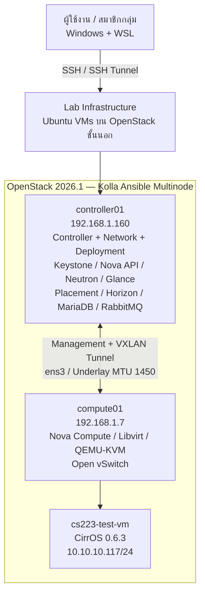
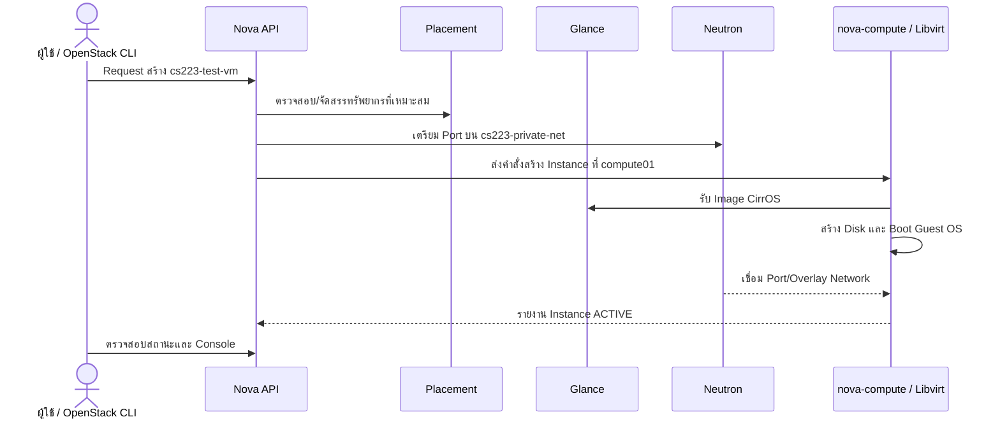

# 01 — Project Overview

> **CS223 Virtualization Technology | OpenStack Multinode Deployment**  
> เอกสารภาพรวมโครงงาน วัตถุประสงค์ ขอบเขต สถาปัตยกรรมระดับสูง ผลลัพธ์ที่ตรวจสอบแล้ว และการส่งมอบงาน  
> **สถานะ ณ วันที่ 17 พฤศจิกายน 2026:** ติดตั้งและทดสอบฟังก์ชันพื้นฐานสำเร็จ; อยู่ระหว่างจัดทำเอกสารและรวบรวมหลักฐาน

[← กลับหน้า README](../README.md) · [Architecture](02-architecture.md) · [Deployment](04-kolla-deployment.md) · [Verification](05-deployment-verification.md) · [Handover](07-handover.md)

---

## 1. บทสรุปโครงงาน (Executive Summary)

โครงงาน **CS223 Term Project — OpenStack Multinode Deployment** เป็นการศึกษาและลงมือสร้างระบบ **Private Cloud Infrastructure** ขนาดเล็ก โดยใช้ **OpenStack 2026.1** สำหรับจัดการทรัพยากร Virtual Machine (VM), Virtual Network และ Image ผ่าน OpenStack API และ Web Dashboard

การติดตั้งใช้ **Kolla Ansible** ซึ่งอาศัย Ansible ในการตั้งค่าและจัดการบริการ OpenStack ภายใน Docker Containers โดยออกแบบเป็นระบบ **2 Nodes** ที่แยกบทบาทชัดเจน ได้แก่ `controller01` สำหรับ Control Plane และบริการเครือข่าย กับ `compute01` สำหรับรัน Virtual Machine ผ่าน Libvirt/QEMU/KVM

ผลการดำเนินงานที่ตรวจสอบแล้วประกอบด้วยการ Deploy บริการหลักสำเร็จ การยืนยันตัวตนผ่าน Keystone การมองเห็น Compute Node ใน Nova การสร้าง Network แบบ VXLAN พร้อม DHCP การอัปโหลด CirrOS Image ไปยัง Glance และการสร้าง VM จริงบน `compute01` ซึ่ง Boot สำเร็จ ได้รับ IPv4 ผ่าน DHCP และสามารถเข้าใช้งานผ่าน noVNC Console ได้ นอกจากนี้ยังเข้าสู่ระบบ Horizon Dashboard ด้วยบัญชีผู้ดูแลระบบได้สำเร็จ

> **ข้อสรุปสำคัญ:** ระบบผ่านการทดสอบด้านการติดตั้งและการใช้งาน VM ขั้นพื้นฐาน (*basic functional verification*) แต่ **ยังไม่ได้รับการทดสอบด้าน High Availability, External Network, Floating IP, ประสิทธิภาพ หรือความพร้อมสำหรับ Production**

## 2. ที่มาและแนวคิด (Background & Motivation)

การใช้งาน Virtualization แบบทั่วไปมักเริ่มจากการสร้าง VM บน Hypervisor เครื่องเดียว แต่การจัดการ Infrastructure ระดับ Cloud ต้องมีส่วนประกอบเพิ่มเติม เช่น ระบบระบุตัวตน ผู้จัดสรรทรัพยากร ระบบจัดการ Image และเครือข่ายเสมือน

OpenStack เป็นกรณีศึกษาที่เหมาะสำหรับทำความเข้าใจการประสานงานระหว่างองค์ประกอบเหล่านี้ โดยโครงงานนี้ให้ความสำคัญกับคำถามหลักดังต่อไปนี้

1. จะนำเครื่อง Linux หลายเครื่องมาทำงานร่วมกันเป็น Cloud Infrastructure ได้อย่างไร?
2. Controller และ Compute Node มีหน้าที่ต่างกันอย่างไร และสื่อสารกันผ่านบริการใดบ้าง?
3. เหตุใดการสร้าง VM หนึ่งเครื่องจึงต้องพึ่งพา Nova, Placement, Glance, Neutron และบริการพื้นฐานอื่น ๆ?
4. Ansible และ Kolla Ansible ช่วยลดงานตั้งค่าระบบที่ซับซ้อนและทำให้ตรวจสอบย้อนหลังได้อย่างไร?
5. จะใช้หลักฐานใดพิสูจน์ว่าระบบที่ติดตั้งสามารถสร้างและใช้งาน VM ได้จริง?

ดังนั้น จุดประสงค์ของโครงงานจึงไม่ใช่เพียงทำให้หน้าเว็บ Horizon เปิดได้ แต่ต้องพิสูจน์เส้นทางการทำงานตั้งแต่การ Deploy บริการ ไปจนถึงการ Boot และเข้าใช้ Guest OS ภายใน VM

## 3. วัตถุประสงค์ (Objectives)

### 3.1 วัตถุประสงค์หลัก

พัฒนาและตรวจสอบสภาพแวดล้อม **OpenStack แบบ Multinode** ที่สามารถจัดการและสร้าง Virtual Machine บน Compute Node แยกจาก Controller ได้ โดยใช้ Kolla Ansible เป็นเครื่องมือ Deploy

### 3.2 วัตถุประสงค์ย่อย

| รหัส | วัตถุประสงค์ | หลักฐานที่ใช้ยืนยัน |
|---|---|---|
| OBJ-01 | เตรียม Ubuntu Servers และ Deployment Environment สำหรับ OpenStack | Ansible เชื่อมต่อ Hosts ได้ และ `bootstrap-servers` สำเร็จ |
| OBJ-02 | กำหนด Inventory และ Configuration ให้ตรงกับบทบาทของแต่ละ Node | ตัวอย่างไฟล์ใน `config/` และเอกสาร Deployment |
| OBJ-03 | Deploy OpenStack Services ผ่าน Kolla Ansible | `prechecks`, `deploy`, `post-deploy` สำเร็จ และ `failed=0` |
| OBJ-04 | ตรวจสอบบริการ Identity, Compute, Network และ Image | ผลตรวจสอบ Container, Keystone, Nova และ Neutron |
| OBJ-05 | สร้าง Virtual Network พร้อม DHCP สำหรับ VM | Network/Subnet/Agent/Port และ DHCP Lease |
| OBJ-06 | สร้างและเข้าใช้งาน VM จริงบน Compute Node | Instance `ACTIVE`, CirrOS Boot, noVNC และ IP ภายใน Guest OS |
| OBJ-07 | เข้าถึง OpenStack ผ่าน CLI และ Horizon Dashboard | Keystone Token Authentication และ Horizon Login สำเร็จ |
| OBJ-08 | จัดทำเอกสารและส่งมอบข้อมูลให้ผู้รับช่วงงานต่อ | Markdown Documentation, Configuration Examples และ Evidence |

## 4. ขอบเขตงาน (Project Scope)

### 4.1 สิ่งที่อยู่ในขอบเขต (In Scope)

- ติดตั้ง OpenStack 2026.1 ผ่าน **Kolla Ansible** บน Ubuntu Server จำนวน 2 Nodes
- แยกบทบาท **Controller/Network** และ **Compute** โดยใช้ Inventory แบบ Multinode
- ตั้งค่าและตรวจสอบบริการหลัก ได้แก่ Keystone, Nova, Neutron, Glance, Placement และ Horizon
- ใช้บริการพื้นฐานที่ Kolla ต้องพึ่งพา เช่น MariaDB, RabbitMQ, Memcached และ Open vSwitch
- ตั้งค่า Private Tenant Network แบบ VXLAN และ IPv4 Subnet พร้อม DHCP
- สร้าง Image, Flavor และ Test Instance ขนาดเล็กสำหรับพิสูจน์การทำงาน
- ทดสอบการเข้าสู่ระบบผ่าน Horizon และการตรวจสอบทรัพยากรด้วย OpenStack CLI
- รวบรวมคำสั่งที่ใช้จริง ผลการตรวจสอบ และกรณี Troubleshooting เพื่อนำไปจัดทำเอกสารบน GitHub

### 4.2 สิ่งที่อยู่นอกขอบเขตหรือยังไม่ได้พิสูจน์ (Out of Scope / Not Yet Verified)

| หัวข้อ | สถานะปัจจุบัน |
|---|---|
| High Availability / Controller Failover | ไม่อยู่ในขอบเขตของ Topology แบบ Single Controller |
| External Provider Network ที่เชื่อมต่อออกภายนอกจริง | ยังไม่ได้ทดสอบ; `dummy0` เป็น Interface สำหรับ Lab |
| Floating IP และการเข้าถึง VM จากเครือข่ายภายนอก | ยังไม่ได้ทดสอบ |
| การใช้งาน Neutron Router เพื่อส่งทราฟฟิกออกภายนอก | ยังไม่ได้สร้างและทดสอบ Router |
| การสื่อสารระหว่าง VM หลายเครื่อง (East–West Traffic) | ยังไม่ได้ทดสอบ |
| Cinder Block Storage และ Heat Orchestration | ไม่ได้เปิดใช้ใน Deployment นี้ |
| Performance Benchmark / Load Testing | ยังไม่ได้ทดสอบ |
| Security Hardening / Penetration Testing / Production Readiness | ไม่ได้ประเมินในโครงงานนี้ |
| การกู้คืนหลัง Host Reboot / Disaster Recovery | ยังไม่ได้ตรวจสอบแบบครบวงจร |

**ข้อควรแยกให้ชัด:** การได้รับ IP ผ่าน DHCP และมี Default Route ใน VM **ไม่ได้ยืนยัน** ว่าสามารถเชื่อมต่ออินเทอร์เน็ตได้ เนื่องจากยังไม่มี Router/Gateway ที่ใช้งานจริงใน Tenant Network นี้

## 5. สถาปัตยกรรมระบบระดับสูง (High-Level Architecture)

### 5.1 Topology



แผนภาพนี้แสดงโครงสร้างเชิงตรรกะ ไม่ได้แสดงทุก Container และทุก Network Namespace ภายในระบบ สำหรับรายละเอียดเพิ่มเติมดู [02-architecture.md](02-architecture.md)

### 5.2 ข้อมูลเครื่องและบทบาท

| หัวข้อ | `controller01` | `compute01` |
|---|---|---|
| บทบาทหลัก | Control, Network, Monitoring, Storage และ Deployment ตาม Inventory | Compute |
| Management IP ภายใน Lab | `192.168.1.160` | `192.168.1.7` |
| ระบบปฏิบัติการ | Ubuntu Server 24.04.3 LTS | Ubuntu Server 24.04.3 LTS |
| Interface หลัก | `ens3` | `ens3` |
| Container Runtime | Docker | Docker |
| หน้าที่ด้าน VM | ควบคุม API, Scheduling และ Service Management | รัน VM ผ่าน Libvirt / QEMU-KVM |
| ทรัพยากร VM ที่จัดสรรให้แต่ละ Node | ประมาณ 4 vCPU, RAM 9.7 GiB | ประมาณ 4 vCPU, RAM 9.7 GiB |
| Storage สำหรับ Host | Root Disk ประมาณ 30 GB และ Disk เพิ่มประมาณ 40 GB สำหรับ `/var/lib/docker` | Root Disk ประมาณ 30 GB และ Disk เพิ่มประมาณ 40 GB สำหรับ `/var/lib/docker` |

> ค่าทรัพยากรในตารางเป็นสเปกสภาพแวดล้อม Lab ที่ใช้ทดลอง ไม่ใช่ Capacity Guarantee สำหรับ Production ส่วนการตรวจสอบ Hypervisor บน `compute01` ผ่าน Nova API 2.87 รายงาน 4 vCPU, RAM 9,945 MB และ Local Disk 39 GB ณ เวลาทดสอบ

### 5.3 เครือข่ายที่เกี่ยวข้อง

| Network / Interface | ค่า | บทบาท |
|---|---|---|
| Management / Underlay Network | `192.168.1.0/24` | การเชื่อมต่อระหว่าง Controller และ Compute |
| Management / API / Tunnel Interface | `ens3` | ใช้สำหรับ Management, API และ VXLAN Tunnel ตาม Configuration |
| Underlay MTU | `1450` | MTU ของเครือข่าย Lab ชั้นนอก |
| Neutron Plugin | Open vSwitch | จัดการ Virtual Switching |
| Overlay Type | VXLAN | เครือข่ายของ Tenant VM |
| Tenant Network | `cs223-private-net` | Private Network ที่สร้างสำหรับทดสอบ |
| Tenant Network MTU | `1400` | MTU หลังเผื่อ VXLAN Encapsulation |
| Tenant Subnet | `10.10.10.0/24` | IPv4 Subnet สำหรับ Test VM |
| DHCP Allocation Pool | `10.10.10.100`–`10.10.10.200` | ช่วง IP สำหรับ DHCP Allocation |
| DHCP Port IP | `10.10.10.100` | Port ของ Neutron DHCP Service |
| Test VM IP | `10.10.10.117/24` | IPv4 ที่ Guest OS ได้รับจริง |
| Subnet Gateway ที่กำหนดไว้ | `10.10.10.1` | ตั้งค่าใน Subnet แต่ยังไม่มี Router มารับหน้าที่ |
| External Interface สำหรับ Lab | `dummy0` | Interface จำลอง ไม่ใช่ Uplink สู่ Internet |

### 5.4 เทคโนโลยีหลัก

| Layer | เทคโนโลยี | บทบาท |
|---|---|---|
| Cloud Management | OpenStack 2026.1 | จัดการ Compute, Network, Image และ Identity |
| Deployment Automation | Kolla Ansible 22.2.1.dev36 | Deploy OpenStack Services ใน Containers |
| Configuration Automation | Ansible Core 2.19.15 | สั่งงานและกำหนดค่า Hosts |
| Host OS | Ubuntu Server 24.04.3 LTS | ระบบปฏิบัติการของ Nodes |
| Containerization | Docker | รันบริการ OpenStack แยกเป็น Containers |
| Virtualization | Libvirt + QEMU/KVM | รัน Guest VMs บน Compute Node |
| Networking | Neutron + Open vSwitch + VXLAN | Virtual Networks และ DHCP |
| Client | python-openstackclient 9.0.1 | ควบคุม OpenStack ผ่าน CLI |
| Test Guest OS | CirrOS 0.6.3 | ทดสอบ Boot, Console และ Networking |

## 6. บริการ OpenStack และการทำงานร่วมกัน

ระบบนี้ประกอบด้วยบริการหลักดังต่อไปนี้

| บริการ | หน้าที่ | ผลที่ยืนยันแล้ว |
|---|---|---|
| **Keystone** | Identity, Authentication และ Service Catalog | ขอ Authentication Token ผ่าน CLI ได้ |
| **Nova** | สร้างและจัดการ Instance รวมถึง Scheduling | `nova-compute` อยู่ในสถานะ `up`; VM เป็น `ACTIVE` |
| **Placement** | จัดเก็บข้อมูล Resource Providers และ Inventory สำหรับ Scheduling | API Container ทำงานและ VM ถูกจัดสรรสำเร็จ; ยังไม่ได้ตรวจ Allocation ด้วย Placement API โดยตรง |
| **Glance** | จัดเก็บและให้บริการ VM Images | อัปโหลด `cirros-0.6.3` และ Image เป็น `active` |
| **Neutron** | Network, Port, DHCP และ Network Agents | Agents ทั้ง 5 ตัวเป็น `UP/Alive`; DHCP แจก IP ให้ Guest OS |
| **Horizon** | Web Dashboard | เปิดหน้าเว็บและ Login ด้วยบัญชี Admin ได้ |
| **MariaDB** | ฐานข้อมูลของ OpenStack Services | Container แสดง `healthy` |
| **RabbitMQ** | Message Broker สำหรับบริการต่าง ๆ | Container แสดง `healthy` |
| **Memcached** | Caching | Container แสดง `healthy` |
| **Open vSwitch** | Virtual Switching และ VXLAN Connectivity | Containers/Agents ทำงานทั้ง Controller และ Compute |

### 6.1 ตัวอย่าง Workflow เมื่อสร้าง VM



> Workflow ข้างต้นเป็นภาพรวมเชิงแนวคิดของบริการ ไม่ใช่ Trace ของทุก API Call ที่บันทึกจากระบบจริง

## 7. กระบวนการดำเนินโครงงาน (Implementation Overview)

| ระยะ | กิจกรรมหลัก | ผลลัพธ์ |
|---|---|---|
| Phase 1 — Planning | กำหนด Topology, Node Roles, Network และเวอร์ชัน | แผนระบบแบบ 2 Nodes |
| Phase 2 — Environment Setup | เตรียม Ubuntu, Docker, SSH, Python Virtual Environment และ Ansible | Deployment Host พร้อมสั่งงาน |
| Phase 3 — Kolla Configuration | จัดทำ Inventory, `globals.yml`, Service Passwords และ Neutron Overrides | Configuration พร้อม Deploy |
| Phase 4 — Installation | รัน `bootstrap-servers`, `prechecks`, `deploy`, `post-deploy` | OpenStack Services ถูกติดตั้งและเริ่มทำงาน |
| Phase 5 — Verification | ตรวจ Containers, APIs, Compute Services, Agents, Image, VM และ Horizon | มีหลักฐานว่าระบบใช้งานขั้นพื้นฐานได้ |
| Phase 6 — Documentation & Handover | จัดทำ Markdown, Configuration Examples และ Screenshots | Repository สำหรับการตรวจและส่งต่องาน |

คำสั่งติดตั้งและ Configuration จริงอธิบายโดยละเอียดใน [03-environment-setup.md](03-environment-setup.md) และ [04-kolla-deployment.md](04-kolla-deployment.md) เพื่อไม่ให้เอกสาร Overview นี้กลายเป็นคู่มือคำสั่งซ้ำซ้อน

## 8. ผลลัพธ์และเกณฑ์ความสำเร็จ (Acceptance Criteria)

### 8.1 ผลการติดตั้ง

| เกณฑ์ | หลักฐานจากการทดสอบ | ผล |
|---|---|---|
| Kolla Bootstrap สำเร็จ | `bootstrap-servers` ผ่าน | **PASS** |
| Prechecks ผ่าน | Exit Status `0`, ไม่มี Failed Host | **PASS** |
| Deployment สำเร็จ | Exit Status `0`, `failed=0` ทั้ง Controller และ Compute | **PASS** |
| Post-deploy สำเร็จ | `localhost: ok=9, changed=5, failed=0` | **PASS** |
| Services ทำงาน | Containers หลักทำงาน และรายการที่มี Health Check เป็น `healthy` | **PASS** |
| Keystone ใช้งานได้ | `openstack token issue` คืนค่าเวลาหมดอายุได้ | **PASS** |
| Compute Node ถูกลงทะเบียน | `nova-compute` บน `compute01` เป็น `enabled/up` | **PASS** |
| Neutron Agents ถูกลงทะเบียน | Agents 5/5 ตัวเป็น `UP` และ `Alive :-)` | **PASS** |
| Glance ใช้งานได้ | CirrOS Image อยู่ในสถานะ `active` | **PASS** |
| VM สร้างและ Boot ได้ | `cs223-test-vm` เป็น `ACTIVE` ที่ `compute01` และมี Login Prompt | **PASS** |
| DHCP ใช้งานได้ | Guest OS ได้รับ `10.10.10.117/24` จาก DHCP | **PASS** |
| noVNC ใช้งานได้ | เปิด Console ผ่าน SSH Tunnel และ Login เข้า CirrOS Shell ได้ | **PASS** |
| Horizon ใช้งานได้ | Login ด้วยบัญชี Admin และเปิดหน้า Project Overview ได้ | **PASS** |

### 8.2 Test Instance ที่ใช้ยืนยันระบบ

| รายการ | ค่าที่ใช้จริง |
|---|---|
| Instance Name | `cs223-test-vm` |
| Compute Host | `compute01` |
| Image | `cirros-0.6.3` (`qcow2`) |
| Flavor | `cs223.tiny` |
| VM Specification | 1 vCPU / 512 MB RAM / 1 GB Root Disk |
| Tenant Network | `cs223-private-net` |
| Subnet | `cs223-private-subnet` (`10.10.10.0/24`) |
| Assigned IP | `10.10.10.117` |
| Nova Status | `ACTIVE` |
| Guest OS Verification | `ip -4 addr show eth0` แสดง `10.10.10.117/24` และ `UP, LOWER_UP` |

**สรุปการยอมรับงานด้านเทคนิค:** เกณฑ์ที่ต้องพิสูจน์ว่าระบบ Deploy ได้และสามารถสร้าง VM บน Compute Node ได้จริง **ผ่านแล้ว** ส่วนการจัดเอกสาร/หลักฐานและการส่งมอบยังเป็นงานที่ต้องจัดการใน Repository ต่อไป

## 9. ความรับผิดชอบและการส่งมอบ (Roles & Responsibilities)

เนื่องจากเอกสารนี้ครอบคลุม Repository ของทั้งกลุ่ม จึงแยก **ขอบเขตทางเทคนิคของส่วน Installation & Deployment** ออกจากข้อมูลสมาชิกที่ยังไม่ได้ยืนยัน

### 9.1 ส่วนงาน Installation & Deployment (คนที่ 2)

อ้างอิงรายการงานที่ได้รับมอบหมาย คนที่ 2 รับผิดชอบการดำเนินงานดังนี้

1. ศึกษาและกำหนดเวอร์ชัน Ubuntu, Ansible และ Kolla Ansible ให้เหมาะสมกับสภาพแวดล้อม
2. เตรียม Deployment Host รวมถึง Python Virtual Environment และ Dependencies
3. ตรวจสอบ SSH Connectivity ไปยัง `controller01` และ `compute01` ด้วย Ansible
4. จัดทำ Multinode Inventory, Kolla Global Configuration และ Service Configuration
5. ดำเนินการติดตั้งตามลำดับ **bootstrap-servers → prechecks → deploy** และบันทึกแนวทางแก้ปัญหาเมื่อมี Error
6. ตรวจสอบ Containers, OpenStack APIs, Compute Registration และ Horizon Dashboard
7. จัดทำหลักฐานและส่งต่อข้อมูลที่จำเป็นสำหรับผู้รับช่วงงานถัดไป

**ผล ณ วันที่ 17 พฤศจิกายน 2026:** งานติดตั้งและตรวจสอบระบบตามหัวข้อข้างต้นสำเร็จแล้ว; งานจัดเอกสารและจัดชุดส่งมอบบน GitHub กำลังดำเนินการ

### 9.2 สมาชิกที่รับช่วงงานต่อ (คนที่ 3)

เอกสารส่งมอบจะรวมสถานะระบบ วิธีเชื่อมต่อที่ได้รับอนุญาต URL ของ Horizon ภายใน Lab และวิธีเข้าถึงผ่าน SSH Tunnel ตลอดจนตำแหน่ง Configuration และข้อจำกัดที่ควรทราบ เพื่อให้สมาชิกที่รับช่วงสามารถตรวจสอบและดำเนินงานต่อได้โดยไม่ต้อง Deploy ระบบใหม่

> ชื่อสมาชิกและรายละเอียดหน้าที่อื่น ๆ ของกลุ่มยังไม่ได้ระบุในเอกสารนี้ เพื่อไม่ใส่ข้อมูลที่ไม่ได้รับการยืนยัน หากต้องการเพิ่มให้บันทึกใน Project Overview/README หลังตกลงร่วมกัน

## 10. ปัญหาสำคัญและสิ่งที่ได้เรียนรู้ (Key Challenges & Lessons Learned)

### 10.1 MariaDB และ ProxySQL ใช้พอร์ตเดียวกัน

ระหว่าง Deploy ครั้งแรก MariaDB ไม่สามารถ Bind ที่ `192.168.1.160:3306` ได้ เนื่องจาก ProxySQL ใช้พอร์ตดังกล่าวอยู่ ขณะที่ Environment ใช้ IP ของ Controller เป็น Internal VIP สำหรับรูปแบบ Single Controller

การแก้ไขที่ดำเนินการประกอบด้วยการปรับ Kolla Configuration สำหรับ Non-HA Lab, หยุด ProxySQL/HAProxy ที่ไม่ใช้ผ่าน systemd, Reload Unit Configuration และรัน Prechecks/Deploy อีกครั้ง หลังแก้ไข MariaDB เริ่มทำงานได้และ Deployment สำเร็จ

### 10.2 การหยุด Container ไม่เท่ากับหยุด Service Manager

เมื่อสั่ง `docker stop` โดยตรง พบว่า ProxySQL และ HAProxy กลับมาทำงานอีก เนื่องจากมี Kolla-managed systemd Units ที่กำลัง Active และกำหนดการ Restart ไว้ จึงจำเป็นต้องตรวจสอบทั้ง **Docker Container State** และ **systemd Service State**

> ประเด็นที่ควรติดตาม: เมื่อมีการ Reboot Host หรือ Deploy/Reconfigure ใหม่ ควรตรวจสอบอีกครั้งว่า ProxySQL/HAProxy ไม่กลับมาแย่ง Port 3306 กับ MariaDB; ผลทดสอบปัจจุบันยังไม่ใช่หลักฐานของการ Reboot Recovery

### 10.3 การเข้าถึงบริการผ่าน Private IP

Horizon และ noVNC เปิดบริการที่ IP ภายในของ Controller จึงเข้าจาก Windows โดยตรงไม่ได้ในทุกกรณี การใช้ SSH Local Port Forwarding ช่วยให้เข้าถึงทั้งสองบริการจากเครื่องผู้ใช้โดยไม่ต้องเปิดพอร์ต HTTP/noVNC สู่เครือข่ายภายนอก

รายละเอียดอาการ คำสั่งตรวจสอบ และลำดับแก้ไขอยู่ใน [06-troubleshooting.md](06-troubleshooting.md)

## 11. โครงสร้างเอกสารและหลักฐาน (Documentation & Evidence)

Repository แบ่งบทบาทของไฟล์ดังนี้

```text
CS223-TermProject/
├── README.md                      # หน้าแรกและสรุปโปรเจกต์
├── .gitignore                     # ป้องกันไฟล์ลับ/ไฟล์ชั่วคราว
├── docs/
│   ├── 01-project-overview.md     # ภาพรวม วัตถุประสงค์ ขอบเขต (ไฟล์นี้)
│   ├── 02-architecture.md         # Topology และ Network Architecture
│   ├── 03-environment-setup.md    # เตรียม Hosts และ Dependencies
│   ├── 04-kolla-deployment.md     # Configuration และ Deployment
│   ├── 05-deployment-verification.md  # ผลการทดสอบและหลักฐาน
│   ├── 06-troubleshooting.md      # ปัญหาที่พบและวิธีแก้
│   └── 07-handover.md             # ส่งมอบข้อมูลให้สมาชิกที่รับช่วง
├── config/                        # ตัวอย่าง Config ที่ลบข้อมูลลับแล้ว
│   ├── multinode.example
│   ├── globals.example.yml
│   └── neutron/
│       ├── neutron.conf.example
│       └── ml2_conf.ini.example
├── evidence/
│   ├── 01-deployment/
│   ├── 02-services/
│   ├── 03-vm-validation/
│   └── 04-horizon/
└── scripts/
    └── verify-deployment.sh      # Script ตรวจสอบระบบ (เมื่อจัดทำแล้ว)
```

### 11.1 หลักฐานที่ต้องเก็บ

| หมวด | หลักฐาน | สิ่งที่ยืนยัน |
|---|---|---|
| Deployment | Prechecks / Deploy Recap / Post-deploy | Kolla Ansible รันสำเร็จ |
| Services | Controller และ Compute Containers | บริการหลักทำงานทั้งสองเครื่อง |
| Services | Nova Compute Service List | `compute01` ลงทะเบียนเป็น Compute Node |
| Services | Neutron Agent List | Network Agents ทำงานครบ |
| VM Validation | Instance Status | VM เป็น `ACTIVE` บน `compute01` |
| VM Validation | CirrOS noVNC Console | Guest OS Boot และ Login ได้ |
| VM Validation | `ip -4 addr show eth0` | Guest ได้รับ IP จาก DHCP จริง |
| Horizon | Project Overview หลัง Login | Web Dashboard ใช้งานได้ |

> ไฟล์ภาพที่ระบุในโครงสร้าง Repository เป็น **รายการหลักฐานที่วางแผนจัดเก็บ** ไม่ใช่การยืนยันว่าได้ Commit ภาพเหล่านั้นลง GitHub แล้ว เมื่อเพิ่มไฟล์จริง ให้เชื่อมรูปจาก [05-deployment-verification.md](05-deployment-verification.md) และตรวจว่าภาพไม่แสดง Password/Token

### 11.2 สิ่งที่ควรส่งให้คนที่ 3

- ภาพรวม Node Roles และ Management Network
- วิธีเข้าถึง Horizon ผ่าน SSH Tunnel โดยใช้บัญชีที่ได้รับอนุญาต
- รายชื่อบริการที่เปิดใช้ และผลตรวจสอบ Container/API ล่าสุด
- ชื่อ Image, Flavor, Network, Subnet และ VM สำหรับใช้ Demo
- ไฟล์ตัวอย่าง Inventory/Globals/Neutron Config ที่ผ่านการตรวจด้านความปลอดภัย
- บันทึกปัญหาที่พบ วิธีแก้ และข้อจำกัดที่ยังไม่ได้ทดสอบ

รายละเอียดแบบใช้งานจริงและ Checklist การรับมอบจะอยู่ใน [07-handover.md](07-handover.md)

## 12. ความปลอดภัยของ Public Repository (Security Considerations)

Repository นี้เผยแพร่สู่สาธารณะ จึง **ไม่ควร Commit** ข้อมูลต่อไปนี้

- `/etc/kolla/passwords.yml`, `/etc/kolla/admin-openrc.sh`, `/etc/kolla/clouds.yaml` หรือเนื้อหาที่มี Credentials
- SSH Private Keys, Password, Secret, Session Token และ API Token
- URL ของ noVNC ที่มี Console Token หรือภาพ Browser ที่เห็น Token ใน Address Bar
- Raw Deployment Logs ที่ไม่ได้คัดกรอง เพราะอาจมีข้อมูลลับปะปนอยู่ใน Task Output
- ข้อมูลการเชื่อมต่อเข้าสู่ระบบจากภายนอกที่ไม่จำเป็นต่อการเผยแพร่

**แนวทางจัดเก็บที่เหมาะสม:** ใช้ Configuration Examples ใน `config/` ซึ่งแทนข้อมูลอ่อนไหวด้วย Placeholder และส่ง Credentials ของผู้รับช่วงงานผ่านช่องทางที่ปลอดภัยแยกจาก GitHub โดยตรวจสอบ Screenshot และ Git Diff ทุกครั้งก่อน Push

> เอกสารนี้แสดงเฉพาะ Management IP ภายใน Lab เพื่ออธิบายการติดตั้ง ไม่เปิดเผย SSH Private Key, OpenStack Password หรือ Console Access Token

## 13. สถานะโครงงานและงานต่อไป (Current Status & Next Steps)

| รายการ | สถานะ ณ 17 พ.ย. 2026 |
|---|---|
| การเตรียม Environment | เสร็จสิ้น |
| Kolla Ansible Deployment | เสร็จสิ้น |
| การทดสอบ API และ Services | ผ่านตามขอบเขตพื้นฐาน |
| การสร้าง VM และตรวจสอบ Guest OS | เสร็จสิ้น |
| การ Login ผ่าน Horizon | เสร็จสิ้น |
| การจัดทำ Markdown Documentation | กำลังดำเนินการ |
| การจัดระเบียบ Screenshots / Evidence บน GitHub | กำลังดำเนินการ |
| การส่งมอบให้สมาชิกคนที่ 3 | รอจัดชุดข้อมูลและ Checklist |

การดำเนินงานถัดไปควรเน้นการทำ **`02-architecture.md`**, **`03-environment-setup.md`**, **`04-kolla-deployment.md`** และ **`05-deployment-verification.md`** พร้อมหลักฐานประกอบ แล้วจึงสรุปปัญหาใน Troubleshooting และเตรียม Handover โดยไม่จำเป็นต้อง Deploy ใหม่เพื่อจัดทำเอกสาร

---

## อ้างอิงภายใน Repository

- [README — สรุปภาพรวมโปรเจกต์](../README.md)
- [02 — Architecture](02-architecture.md)
- [03 — Environment Setup](03-environment-setup.md)
- [04 — Kolla Deployment](04-kolla-deployment.md)
- [05 — Deployment Verification](05-deployment-verification.md)
- [06 — Troubleshooting](06-troubleshooting.md)
- [07 — Handover](07-handover.md)

**Repository:** [ronnakrit303/CS223-TermProject](https://github.com/ronnakrit303/CS223-TermProject)  
**Course:** CS223 — Virtualization Technology  
**Document:** `docs/01-project-overview.md`
