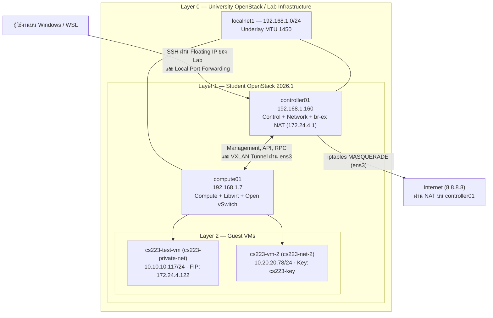
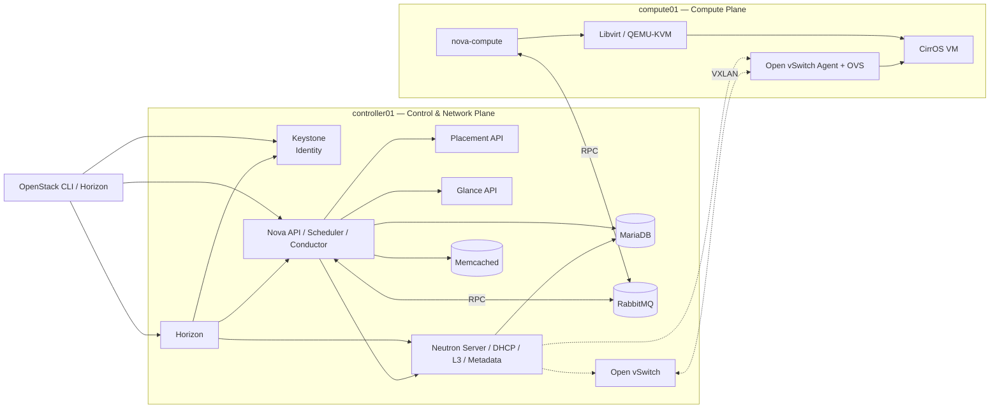
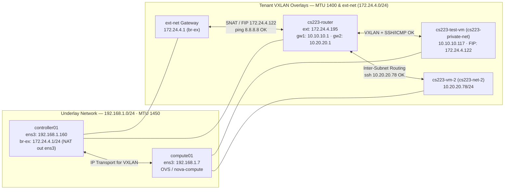
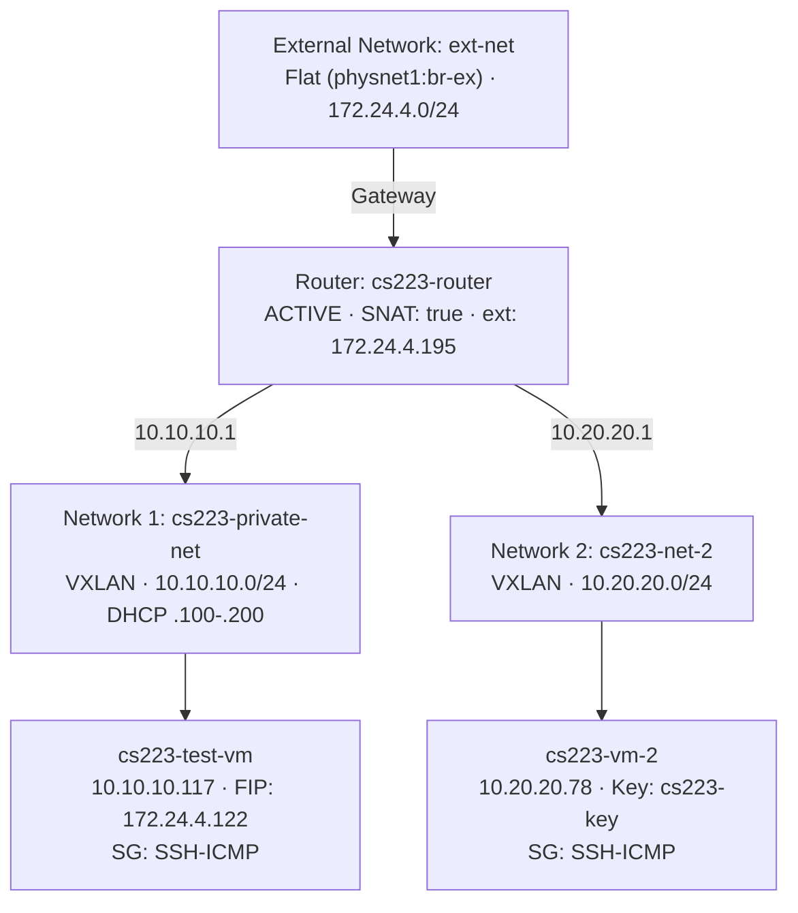
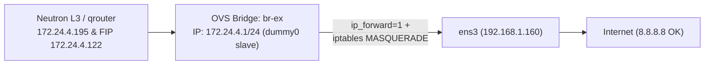
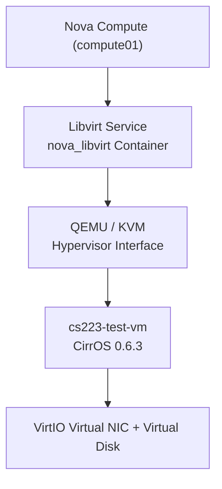
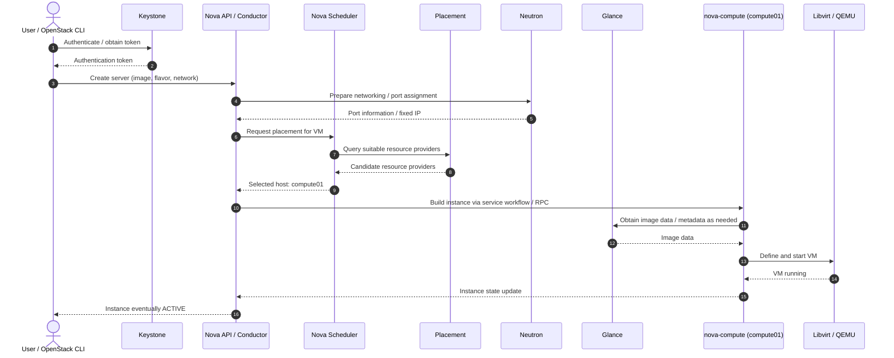
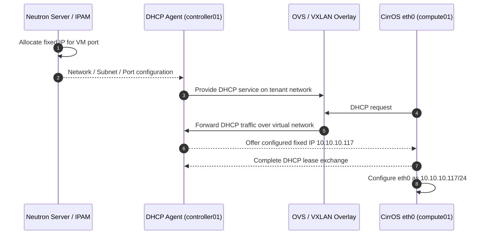
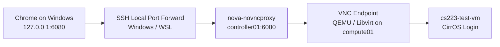

# 02 — System Architecture

> **CS223 Term Project — OpenStack Multinode Deployment**  
> เอกสารสถาปัตยกรรมระบบ OpenStack 2026.1 ที่ติดตั้งด้วย Kolla Ansible บน Ubuntu Server จำนวน 2 Nodes  
> **สถานะอ้างอิง:** ผลการติดตั้งและทดสอบ ณ วันที่ **17 พฤศจิกายน 2026**  
> **ขอบเขต:** Lab / Educational Deployment; ไม่ใช่ High Availability หรือ Production Architecture

[← README](../README.md) · [01 — Project Overview](01-project-overview.md) · [03 — Environment Setup](03-environment-setup.md) · [04 — Kolla Deployment](04-kolla-deployment.md) · [05 — Verification](05-deployment-verification.md) · [07 — Handover](07-handover.md)

---

## สารบัญ

1. [วัตถุประสงค์และแนวทางออกแบบ](#1-วัตถุประสงค์และแนวทางออกแบบ)
2. [ภาพรวมสถาปัตยกรรมแบบหลายชั้น](#2-ภาพรวมสถาปัตยกรรมแบบหลายชั้น)
3. [Node Topology และการแบ่งหน้าที่](#3-node-topology-และการแบ่งหน้าที่)
4. [Service Architecture](#4-service-architecture)
5. [Network Architecture](#5-network-architecture)
6. [Virtualization และ Storage Architecture](#6-virtualization-และ-storage-architecture)
7. [ลำดับการทำงานเมื่อสร้าง VM](#7-ลำดับการทำงานเมื่อสร้าง-vm)
8. [ลำดับการทำงานของ DHCP และ noVNC](#8-ลำดับการทำงานของ-dhcp-และ-novnc)
9. [การเข้าถึง API, CLI และ Horizon](#9-การเข้าถึง-api-cli-และ-horizon)
10. [การออกแบบความพร้อมใช้งานและข้อจำกัด](#10-การออกแบบความพร้อมใช้งานและข้อจำกัด)
11. [หลักฐานที่ยืนยันสถาปัตยกรรม](#11-หลักฐานที่ยืนยันสถาปัตยกรรม)
12. [Configuration Mapping](#12-configuration-mapping)
13. [แนวทางขยายระบบ](#13-แนวทางขยายระบบ)
14. [เอกสารอ้างอิง](#14-เอกสารอ้างอิง)

---

## 1. วัตถุประสงค์และแนวทางออกแบบ

โครงงานนี้สร้างสภาพแวดล้อม **Private Cloud ขนาดเล็ก** เพื่อทดลองใช้งาน OpenStack ในลักษณะ **Multinode** โดยแยกเครื่องให้บริการควบคุมระบบออกจากเครื่องที่ใช้รัน Virtual Machine (VM) จริง และใช้ **Kolla Ansible** จัดการการติดตั้งบริการใน Docker Containers

เป้าหมายด้านสถาปัตยกรรมมี 5 ประการ:

1. **Separation of Concerns:** แยก **Control Plane** ออกจาก **Compute / Data Plane** เพื่อให้ศึกษาบทบาทและความสัมพันธ์ของบริการได้ชัดเจน
2. **Reproducible Deployment:** ใช้ Ansible Inventory และ Kolla Configuration เป็นข้อมูลหลักในการ Deploy แทนการติดตั้งแต่ละ Service ด้วยมือ
3. **Service Integration:** ให้บริการ Identity, Compute, Image, Networking และ Resource Placement ทำงานร่วมกันจนสร้าง VM ได้จริง
4. **Observable Results:** ตรวจสอบได้จาก CLI, Container Health, Hypervisor, Guest Console และ Horizon Dashboard
5. **Lab Safety:** ใช้เครือข่ายเสมือนแยกจากเครือข่ายบริหารจัดการ และไม่อ้างว่ามี External Connectivity หรือ HA ในส่วนที่ยังไม่ได้ทดสอบ

**ขอบเขตการพิสูจน์:** ระบบสามารถ Deploy บริการหลัก สร้าง VM บน `compute01` ให้ CirrOS Boot และรับ IPv4 ผ่าน DHCP รวมถึงเข้าใช้งาน Horizon และ noVNC ได้สำเร็จ ส่วนประสิทธิภาพ ความทนทานต่อความเสียหาย และอินเทอร์เน็ตของ Guest VM **ยังไม่อยู่ในผลทดสอบที่ยืนยันแล้ว**

---

## 2. ภาพรวมสถาปัตยกรรมแบบหลายชั้น

ข้อสำคัญของสภาพแวดล้อมนี้คือ OpenStack ที่ทีมติดตั้ง **ไม่ได้รันบนเครื่อง Bare Metal โดยตรง** แต่รันอยู่ภายใน Ubuntu VMs ที่ได้รับจากโครงสร้างพื้นฐาน OpenStack ของมหาวิทยาลัยอีกชั้นหนึ่ง จึงแยกออกเป็น 3 ชั้นได้ดังนี้:

| ชั้น | ระบบ | สิ่งที่ทำหน้าที่ |
|---|---|---|
| **Layer 0 — Host/Lab Infrastructure** | OpenStack ภายนอกของมหาวิทยาลัย | จัดสรร Ubuntu VMs, เครือข่าย `localnet1` และ Floating IP สำหรับเชื่อมต่อเข้าสู่ VM ของทีม |
| **Layer 1 — Student OpenStack Cloud** | OpenStack 2026.1 + Kolla Ansible | ให้บริการ Keystone, Nova, Neutron, Glance, Placement, Horizon และบริการพื้นฐานอื่น ๆ บน `controller01`/`compute01` |
| **Layer 2 — Guest Workload** | `cs223-test-vm` & `cs223-vm-2` (CirrOS) | VMs ที่สร้างผ่าน OpenStack ของทีมบน 2 เครือข่ายเสมือน (`10.10.10.117` + Floating IP `172.24.4.122`, และ `10.20.20.78`) ทำงานบน Hypervisor ของ `compute01` |

### 2.1 Layered Deployment Diagram



**หมายเหตุการอ่านแผนภาพ:** เส้นทางจาก Windows ไปยัง Controller เป็นการเข้าถึง **Ubuntu VM บน OpenStack ชั้นนอก** เพื่อเปิด Horizon/CLI/SSH แล้วจึงใช้งาน Guest VM (`cs223-test-vm` และ `cs223-vm-2`) ที่อยู่ภายในอีกชั้นหนึ่ง ส่วน Floating IP `172.24.4.122` และ `ext-net` (`172.24.4.0/24`) ใช้สำหรับโครงข่ายภายในของ Inner OpenStack ซึ่งออกอินเทอร์เน็ตผ่าน NAT บน `controller01` (`br-ex` → `ens3`)

### 2.2 เหตุผลที่ใช้สอง Nodes

- การแยก `controller01` และ `compute01` ทำให้เห็นบทบาทของ Nova API/Scheduler และ Nova Compute ชัดเจน
- ลดจำนวน VM ที่ใช้ใน Lab เมื่อเทียบกับสถาปัตยกรรม Production ที่แยก Controller/Network/Storage หลายเครื่อง
- สามารถพิสูจน์ได้ว่า Nova สั่งสร้าง VM **ข้าม Node** ได้จริง
- ยอมรับข้อจำกัดว่าเมื่อ Controller หรือ Compute Node เพียงเครื่องเดียวหยุดทำงาน บริการที่เกี่ยวข้องจะได้รับผลกระทบ

---

## 3. Node Topology และการแบ่งหน้าที่

### 3.1 รายการ Nodes

| คุณสมบัติ | `controller01` | `compute01` |
|---|---|---|
| บทบาทหลัก | Controller, Network, Deployment | Compute |
| Management IP | `192.168.1.160` | `192.168.1.7` |
| ระบบปฏิบัติการ | Ubuntu Server 24.04.3 LTS | Ubuntu Server 24.04.3 LTS |
| Interface หลัก | `ens3` | `ens3` |
| Container Runtime | Docker | Docker |
| ทรัพยากร Lab โดยประมาณ | 4 vCPU, RAM ประมาณ 9.7 GiB | 4 vCPU, RAM ประมาณ 9.7 GiB |
| Host Storage ที่เตรียมไว้ | Root Disk ราว 30 GB และ Disk เพิ่มราว 40 GB สำหรับ `/var/lib/docker` | Root Disk ราว 30 GB และ Disk เพิ่มราว 40 GB สำหรับ `/var/lib/docker` |
| รัน Guest VM | ไม่ใช่หน้าที่หลักของ Node นี้ | ใช่ ผ่าน Nova Compute + Libvirt/QEMU/KVM |

> **ความหมายของ IP:** `192.168.1.160` และ `192.168.1.7` เป็น Private IP ของ Ubuntu VMs ภายใน Lab ของมหาวิทยาลัย ไม่ใช่ Public IP และไม่ใช่ IP ของ CirrOS VM

### 3.2 Inventory Roles ที่ใช้

Kolla Ansible อ่าน Inventory ชื่อ `~/multinode` โดยมีการจัดกลุ่มดังนี้:

```ini
[control]
controller01

[network]
controller01

[compute]
compute01

[monitoring]
controller01

[storage]
controller01

[deployment]
localhost ansible_connection=local
```

ตัวอย่างนี้แสดง **การแมปบทบาท** เท่านั้น ไฟล์ Inventory ที่ใช้จริงยังมี `ansible_host`, `ansible_user` และ `ansible_become` สำหรับการเชื่อมต่อด้วย Ansible; ดูตัวอย่างฉบับเต็มที่ [`config/multinode.example`](../config/multinode.example) เมื่อเพิ่มไฟล์ดังกล่าวเข้ามาใน Repository

**ประเด็นที่มักเข้าใจผิด:** `[monitoring]` และ `[storage]` เป็นกลุ่ม Host ใน Inventory ไม่ได้หมายความว่าเปิดใช้ Prometheus หรือ Cinder แล้ว ใน Deployment นี้ **Prometheus, Cinder และ Heat ไม่ได้เปิดใช้งาน**

### 3.3 Placement ของระบบ Deployment

- เครื่อง `controller01` ทำหน้าที่เป็น **Deployment Host** ด้วย ไม่ได้มี Deployment VM เครื่องที่สาม
- ใช้ Virtual Environment `~/kolla-venv` สำหรับ Kolla Ansible และ `~/openstack-cli-venv` สำหรับ OpenStack CLI
- Ansible ใช้ SSH ติดต่อ `compute01` ผ่าน Management Network
- ไฟล์ Kolla Configuration หลักอยู่บน `controller01` ภายใต้ `/etc/kolla/`

---

## 4. Service Architecture

ระบบแยกได้เป็น **Control Plane**, **Network Services**, **Compute/Hypervisor Plane** และ **Supporting Services** ดังแผนภาพ

### 4.1 Logical Service Diagram



> แผนภาพเป็น **Logical Dependencies** เพื่ออธิบายความสัมพันธ์ ไม่ได้แสดง Protocol ทุกเส้น ไม่ได้แปลว่าบริการทุกตัวสื่อสารกันแบบ Direct TCP Connection ตามลูกศรทุกเส้น และไม่แสดงรายละเอียด Nova Cells ทั้งหมด

### 4.2 บริการหลักและที่ติดตั้ง

| Service / Container ที่เกี่ยวข้อง | Node | บทบาท |
|---|---|---|
| **Keystone** (`keystone`) | Controller | ยืนยันตัวตนและให้ Token; จัดการ Identity/Service Catalog |
| **Horizon** (`horizon`) | Controller | Web Dashboard สำหรับผู้ใช้งานและผู้ดูแลระบบ |
| **Glance** (`glance_api`) | Controller | จัดเก็บ Metadata ของ Image และให้บริการ Image API |
| **Placement** (`placement_api`) | Controller | ติดตาม Resource Providers และ Allocation สำหรับการจัดสรรทรัพยากร |
| **Nova API** (`nova_api`) | Controller | รับคำสั่งบริหารจัดการ VM |
| **Nova Scheduler** (`nova_scheduler`) | Controller | เลือก Compute Host ที่เหมาะสมสำหรับ VM |
| **Nova Conductor** (`nova_conductor`) | Controller | ประสาน Workflow และการเข้าถึงข้อมูล Nova |
| **Nova noVNC Proxy** (`nova_novncproxy`) | Controller | ให้ Browser เชื่อมต่อ VNC Console ของ VM |
| **Neutron Server** (`neutron_server`) | Controller | API/Control Plane สำหรับ Virtual Networking |
| **Neutron DHCP Agent** (`neutron_dhcp_agent`) | Controller | ดูแล DHCP Service ของ Network ที่ได้รับมอบหมาย |
| **Neutron L3 Agent** (`neutron_l3_agent`) | Controller | บริการ Routing สำหรับ `cs223-router` (`10.10.10.1`) บน Network ที่เชื่อมต่อ |
| **Neutron Metadata Agent** (`neutron_metadata_agent`) | Controller | รองรับการส่งข้อมูล Metadata ไปยัง VM |
| **Neutron OVS Agent** (`neutron_openvswitch_agent`) | ทั้งสอง Nodes | ตั้งค่าและรายงานการเชื่อมต่อ Virtual Network ผ่าน OVS |
| **Nova Compute** (`nova_compute`) | Compute | จัดการวงจรชีวิตของ VM บน Hypervisor |
| **Libvirt** (`nova_libvirt`) | Compute | ติดต่อ QEMU/KVM เพื่อสร้างและควบคุม VM |
| **Open vSwitch** (`openvswitch_db`, `openvswitch_vswitchd`) | ทั้งสอง Nodes | Data Plane/Virtual Switching สำหรับ Network |

### 4.3 Supporting Services

| Service | Node | เหตุผลที่มีในระบบ |
|---|---|---|
| MariaDB | Controller | เก็บข้อมูลสถานะและ Configuration ของบริการ OpenStack หลายตัว |
| RabbitMQ | Controller | Message Broker สำหรับการสื่อสารแบบ RPC/Async ระหว่างบริการ |
| Memcached | Controller | Cache ที่บางบริการใช้เพื่อลดงานซ้ำและสนับสนุนการตรวจสอบตัวตน |
| Fluentd | ทั้งสอง Nodes | รวบรวมและส่ง Log ของ Containers ตาม Configuration ของ Kolla |
| Kolla Toolbox / Cron | ทั้งสอง Nodes | เครื่องมือปฏิบัติงานและงานดูแลรักษาที่เกี่ยวข้องกับ Kolla |

**ผลที่ตรวจสอบจริง:** Containers หลักข้างต้นทำงานอยู่บน Node ที่คาดหวัง โดย `proxysql` และ `haproxy` เป็นข้อยกเว้นที่ **หยุดไว้โดยตั้งใจ** สำหรับรูปแบบ Non-HA ของ Lab; ไม่ควรตีความว่าเป็นความผิดพลาดเพียงเพราะ `Exited`

---

## 5. Network Architecture

หัวข้อนี้ต้องแยกให้ชัดระหว่าง **Underlay/Management Network**, **Tenant Overlay Network** และ **External Interface ที่เตรียมไว้สำหรับ Lab**

### 5.1 Network Segmentation

| Network / Purpose | ค่าที่ใช้ | คำอธิบาย |
|---|---|---|
| Underlay / Management | `192.168.1.0/24` | เชื่อม `controller01` กับ `compute01` ภายใน OpenStack ชั้นนอก |
| Controller Management IP | `192.168.1.160` | ใช้เข้าถึงบริการ API, Management และ Tunnel ของ Controller |
| Compute Management IP | `192.168.1.7` | Node ที่รัน Hypervisor และ Guest VM |
| Physical/Outer MTU | `1450` | MTU ของ Underlay `localnet1` ที่ใช้ใน Lab |
| Network/API/Tunnel Interface | `ens3` | Configuration นี้ใช้ Interface เดียวกันสำหรับ Management/API/VXLAN Tunnel |
| Tenant Network 1 | `cs223-private-net` | Neutron Network ชนิด `vxlan` (`10.10.10.0/24`, MTU `1400`, DHCP Pool `.100–.200`) |
| Tenant Network 2 | `cs223-net-2` | Neutron Network ชนิด `vxlan` (`10.20.20.0/24`, MTU `1400`) สำหรับทดสอบ Inter-subnet Routing |
| External Network | `ext-net` | Flat External Network (`physnet1:br-ex`, Subnet `172.24.4.0/24`, Pool `.100–.200`, Gateway `172.24.4.1`) |
| Guest VM #1 / Floating IP | `10.10.10.117` / `172.24.4.122` | `cs223-test-vm` (CirrOS 0.6.3) ผูก Security Group `SSH-ICMP` และ Floating IP |
| Guest VM #2 | `10.20.20.78` | `cs223-vm-2` (CirrOS 0.6.3) บน `cs223-net-2` (Key Pair `cs223-key`, SG `SSH-ICMP`) |
| Virtual Router (`cs223-router`) | `10.10.10.1`, `10.20.20.1`, `172.24.4.195` | เชื่อม 2 Tenant Subnets และ External Gateway `ext-net` (`enable_snat: true`) |
| External Interface & NAT | `dummy0` + `br-ex` (`172.24.4.1/24`) | `dummy0` ผูก OVS `br-ex` และตั้ง `172.24.4.1/24` + `ip_forward=1` + `iptables MASQUERADE` ออก `ens3` แบบ Runtime |

### 5.2 Underlay, VXLAN Overlay และ Multi-Subnet + External NAT



หลักการทำงาน:

1. `ens3` บนทั้งสอง Nodes ใช้ Underlay Network เดียวกัน จึงรองรับการส่ง Traffic ระหว่าง Nodes
2. Open vSwitch สร้างเส้นทาง Virtual Switching สำหรับ Neutron Tenant Network ชนิด VXLAN ทั้ง `cs223-private-net` และ `cs223-net-2`
3. VXLAN ห่อหุ้ม Ethernet Frame จากเครือข่าย Tenant ให้ส่งผ่าน Underlay IP Network ได้ โดยมี MTU **1450 → 1400**
4. `cs223-router` บน `controller01` เชื่อมต่อทั้งสอง Tenant Subnets (`10.10.10.1` และ `10.20.20.1`) จึงทำหน้าที่ Route ระหว่าง `cs223-test-vm` และ `cs223-vm-2` ได้จริง (`ssh cirros@10.20.20.78` สำเร็จ)
5. ขา External Gateway ของ `cs223-router` (`172.24.4.195`) เชื่อมผ่าน Flat Network `ext-net` ไปยัง `br-ex` (`172.24.4.1/24`) บน `controller01` แล้วทำ NAT (`MASQUERADE`) ออกทาง `ens3` ทำให้ `cs223-test-vm` (FIP `172.24.4.122`) ออกอินเทอร์เน็ต (`ping -c 4 8.8.8.8`, `0% packet loss`) และรับ `ssh cirros@172.24.4.122` จาก `controller01` ได้จริง

**ข้อจำกัด:** ค่า IP `172.24.4.1/24` บน `br-ex` และกฎ `iptables MASQUERADE` / `FORWARD` เป็นค่า Runtime บน `controller01` (ไม่ถาวรหาก Host รีบูต) และผลทดสอบเป็นการพิสูจน์ Connectivity (ไม่ใช่ Throughput/Load Benchmark)

### 5.3 Neutron Network Objects ที่สร้างไว้



- `ext-net` สร้างเป็น **External Flat Network** บน `physnet1:br-ex` (`172.24.4.0/24`, Pool `172.24.4.100–172.24.4.200`, Gateway `172.24.4.1`)
- `cs223-private-net` (`10.10.10.0/24`) และ `cs223-net-2` (`10.20.20.0/24`) เป็น **Internal VXLAN Networks** (MTU `1400`) ที่เชื่อมผ่าน `cs223-router`
- Floating IP `172.24.4.122` ผูกเข้ากับพอร์ตของ `cs223-test-vm` (`10.10.10.117`) สถานะ `ACTIVE` ทั้งหมด

### 5.4 สถาปัตยกรรม `dummy0`, `br-ex` และ Runtime NAT บน `controller01`

ฝั่ง `controller01` ตั้งค่า `neutron_external_interface: "dummy0"` ใน Kolla เพื่อสร้าง OVS Bridge `br-ex` โดยไม่ดึง `ens3` (ที่ใช้ Management/SSH) เข้ามาใน Bridge; จากนั้นเมื่อสร้าง `ext-net` บน `physnet1:br-ex` ได้กำหนด IP Gateway `172.24.4.1/24` ให้ Interface ภายใน `br-ex` เปิด `net.ipv4.ip_forward=1` และเพิ่มกฎ `iptables` (`POSTROUTING MASQUERADE` และ `FORWARD` ระหว่าง `br-ex` ↔ `ens3`) แบบ Runtime



วิธีนี้ช่วยให้ Guest VM ใช้ Floating IP และ `ping 8.8.8.8` ได้จริงโดยยังคงความปลอดภัยของ SSH Management บน `ens3`; ทั้งนี้หาก `controller01` รีบูตจะต้องรันคำสั่งตั้ง IP บน `br-ex` และ `iptables` ใหม่ (หรือทำให้ถาวรด้วย Netplan/iptables-persistent หากต้องการใช้ระยะยาว)

---

## 6. Virtualization และ Storage Architecture

### 6.1 Guest Execution Path



คำสั่งที่ใช้กำหนด Virtualization ใน Kolla คือ `nova_compute_virt_type: "kvm"` และเครื่อง `compute01` ตรวจพบ `/dev/kvm` อย่างไรก็ตาม Nova API แสดง `hypervisor_type = QEMU` ซึ่งเป็นชื่อประเภท Hypervisor ที่ Libvirt รายงาน **ไม่ใช่หลักฐานยืนยันหรือปฏิเสธ KVM Acceleration เพียงอย่างเดียว** หากต้องพิสูจน์โหมดเร่งความเร็วจริง ต้องตรวจเพิ่มเติมที่ Libvirt/QEMU Runtime; งานนี้ยังไม่ได้ทำการ Benchmark หรือพิสูจน์ Accelerator ด้วยวิธีนั้น

### 6.2 ทรัพยากรที่สังเกตได้จาก Nova API

ระหว่างทดสอบ ใช้ Hypervisor API Microversion **2.87** เพื่อดูข้อมูลทรัพยากรแบบเดิม ซึ่งรายงาน:

| รายการ | ค่าที่สังเกตได้บน `compute01` |
|---|---:|
| Hypervisor State / Service Status | `up` / `enabled` |
| vCPUs | 4 |
| RAM | 9,945 MB |
| Local Disk | 39 GB |
| Running VMs ก่อนสร้าง Test VM | 0 |

ข้อมูลนี้เป็น **Snapshot จาก Nova Hypervisor API** ณ เวลาที่ทดสอบ ไม่ใช่การรับรองว่าสามารถจัดสรร VM ได้เต็มจำนวนดังกล่าวเสมอ; การตัดสินใจ Scheduling จริงเกี่ยวข้องกับ Placement Allocations, Overcommit และข้อกำหนดของ Flavor ด้วย

### 6.3 Test Workload

| รายการ | ค่าที่ใช้ |
|---|---|
| Instance | `cs223-test-vm` |
| Image | `cirros-0.6.3` |
| Image Format | `qcow2` |
| Flavor | `cs223.tiny` |
| Flavor Resources | 1 vCPU, RAM 512 MB, Root Disk 1 GB |
| Compute Host | `compute01` |
| Instance Status | `ACTIVE` |
| Instance IP | `10.10.10.117` |
| Guest Login | ผ่าน noVNC Console และเปิด Shell ได้ |

### 6.4 Image / Container / Instance Storage

- **Host Storage:** เตรียม Disk เพิ่มบนทั้งสอง Ubuntu VMs และ Mount ที่ `/var/lib/docker` เพื่อจัดเก็บ Container Data ของ Docker
- **Docker Volumes:** Kolla ใช้ Volumes สำหรับข้อมูลถาวรของหลายบริการ เช่น MariaDB, Glance และ Nova Compute; การ Restart Container ไม่จำเป็นต้องเท่ากับการลบ Volumes
- **Glance Image:** อัปโหลด CirrOS จาก `controller01` ไปยัง Glance สำเร็จ (`status=active`) โดยผล Image Metadata ระบุ `stores='file'`
- **Guest Root Disk:** Flavor กำหนด Root Disk 1 GB และ Nova สร้าง Instance บน `compute01`
- **Cinder:** ไม่เปิดใช้งาน จึงยังไม่มีการทดสอบ Block Storage Volume แบบ Cinder

> **สำคัญ:** การมี Docker Volume ไม่เท่ากับมีระบบ Backup หรือ Disaster Recovery; ยังไม่ได้ทดสอบ Backup/Restore หรือการ Recover หลัง Host Failure

---

## 7. ลำดับการทำงานเมื่อสร้าง VM

การสร้าง `cs223-test-vm` เป็นการทดสอบ Integration ของบริการสำคัญหลายตัว ตั้งแต่ผู้ใช้งานส่งคำสั่งจนถึง Guest OS Boot

### 7.1 Sequence Diagram — VM Provisioning



> **ขอบเขตของ Diagram:** แสดงภาพรวมเชิงแนวคิด; ลำดับ API ภายในแบบละเอียดอาจแตกต่างไปตาม Nova Microversion, Driver, Caching, Scheduling และ Cell Workflow ไม่ควรใช้ Diagram นี้แทน Trace ของ RPC หรือ Source Code

### 7.2 หลักฐานสำคัญในแต่ละช่วง

| ช่วง | สิ่งที่ตรวจสอบ | ผลที่ได้จริง |
|---|---|---|
| Authentication | `openstack token issue` | ออก Token ได้สำเร็จ (เผยแพร่เฉพาะสถานะ ไม่เผยแพร่ Token) |
| Scheduling/Compute | `openstack compute service list` | `nova-compute` บน `compute01` = `enabled / up` |
| Hypervisor | `openstack hypervisor list` | `compute01` = `up` |
| Image | `openstack image create/show` | `cirros-0.6.3` = `active` |
| Instance | `openstack server show cs223-test-vm` | `ACTIVE` บน `compute01` |
| Guest Execution | noVNC Console | CirrOS Boot, Login และ Shell ใช้งานได้ |

---

## 8. ลำดับการทำงานของ DHCP และ noVNC

### 8.1 DHCP: จาก Neutron Port สู่ Guest OS



การแจก IP ใน Neutron ไม่ใช่การสุ่ม IP โดย DHCP Server เพียงอย่างเดียว: **Neutron จัดสรร Fixed IP ให้ Port ก่อน** แล้ว DHCP Agent ประกาศข้อมูลดังกล่าวให้ Guest ผ่าน DHCP

Console Log ที่ตรวจพบจริง:

```text
eth0: offered 10.10.10.117 from 10.10.10.100
eth0: leased 10.10.10.117 for 86400 seconds
```

และผลภายใน Guest:

```text
eth0: <BROADCAST,MULTICAST,UP,LOWER_UP> mtu 1400
inet 10.10.10.117/24
```

จึงยืนยันได้ว่า Guest OS รับและตั้งค่า IPv4 ได้จริงในเวลาทดสอบ

### 8.2 noVNC Console Access



สิ่งที่ตรวจสอบแล้ว:

- ทดสอบจาก WSL ด้วย `curl -I http://127.0.0.1:6080/vnc_lite.html` และได้ HTTP `200 OK`
- เปิดหน้า noVNC ผ่าน Chrome ได้ และแสดงการเชื่อมต่อกับ QEMU
- Login เข้า CirrOS แล้วรัน `ip -4 addr show eth0` ได้

**ข้อควรระวัง:** URL สำหรับ noVNC มี Token ที่อาจอนุญาตให้เข้าถึง Console ได้ชั่วคราว ห้าม Commit URL พร้อม Token ลง Public Repository หรือแสดงใน Screenshot ที่ไม่ปิดบัง

---

## 9. การเข้าถึง API, CLI และ Horizon

### 9.1 API / Management Endpoints

ใน Deployment นี้กำหนด `kolla_internal_vip_address: "192.168.1.160"` เป็น **IP เดียวกับ Controller** และปิด Load Balancer สำหรับ Lab แบบ Single Controller ดังนั้นการติดต่อ API หลักใช้ IP ของ Controller โดยตรง ไม่ได้ใช้ VIP ลอยแบบ HA

| วิธีใช้งาน | ตำแหน่ง / Endpoint | สถานะที่ทดสอบ |
|---|---|---|
| Keystone API | `http://192.168.1.160:5000` | ใช้ Authentication ผ่าน CLI สำเร็จ |
| Horizon | `http://192.168.1.160/` | HTTP Redirect ไปหน้า Login และ Login สำเร็จ |
| Nova API | `http://192.168.1.160:8774` | เรียก Compute/Server API ได้ |
| Glance API | `http://192.168.1.160:9292` | อัปโหลด Image สำเร็จ |
| Placement API | `http://192.168.1.160:8780` | Container Healthy; การจัดสรรทรัพยากรร่วมกับ Nova ใช้งานได้ในการสร้าง VM |
| noVNC Proxy | `http://192.168.1.160:6080` | เปิด Console ได้ผ่าน SSH Tunnel |

**ข้อควรแยก:** Endpoint ในตารางเข้าถึงได้ภายใน Lab Network ไม่ได้แปลว่าเข้าถึงโดยตรงจากเครื่อง Windows ทุกเครือข่าย และการใช้ HTTP ภายใน Lab ไม่ได้หมายความว่าเป็นการตั้งค่า TLS แบบ Production

### 9.2 SSH Tunnel จาก Windows / WSL

ผู้ใช้งานบน Windows ไม่มี Route ไปยัง `192.168.1.0/24` โดยตรง จึงใช้ **Floating IP ของ `controller01` บน OpenStack ชั้นนอก** เป็น SSH Jump Point และเปิด Local Port Forwarding

**ตัวอย่างคำสั่งบน WSL (ใช้ Placeholder เพื่อไม่เปิดเผยข้อมูลเชื่อมต่อจริง):**

```bash
# Horizon บน Windows: http://127.0.0.1:8080/
ssh -i ~/.ssh/<SSH_PRIVATE_KEY> \
  -o IdentitiesOnly=yes \
  -o ExitOnForwardFailure=yes \
  -N \
  -L 127.0.0.1:8080:192.168.1.160:80 \
  ubuntu@<CONTROLLER_OUTER_FLOATING_IP>
```

```bash
# noVNC ผ่าน Windows localhost:6080
ssh -i ~/.ssh/<SSH_PRIVATE_KEY> \
  -o IdentitiesOnly=yes \
  -o ExitOnForwardFailure=yes \
  -N \
  -L 127.0.0.1:6080:192.168.1.160:6080 \
  ubuntu@<CONTROLLER_OUTER_FLOATING_IP>
```

- ค่า `127.0.0.1` หมายถึง **เครื่องผู้ใช้งานที่เปิด Tunnel** ไม่ใช่ URL ใช้ร่วมกันทั้งกลุ่มโดยอัตโนมัติ
- คำสั่ง `ssh -N` จะไม่เปิด Remote Shell และมักนิ่งอยู่ขณะ Tunnel ทำงาน
- การเปิด noVNC ต้องใช้ Console URL ที่สร้างขึ้นใหม่ แล้วแทน Host ด้วย `127.0.0.1:6080` โดย **ไม่เผยแพร่ Token**
- ผู้รับงานต่อจำเป็นต้องมีสิทธิ์เข้าถึง SSH และ Credentials ของตนเองผ่านช่องทางปลอดภัย

### 9.3 OpenStack CLI

การทดสอบ CLI ดำเนินการบน `controller01` โดยแยก Client Venv จาก Kolla Ansible Venv:

```bash
(
  source /etc/kolla/admin-openrc.sh
  ~/openstack-cli-venv/bin/openstack server list
)
```

ไฟล์ `admin-openrc.sh` เป็น **ไฟล์ลับ** และใช้เฉพาะเครื่องที่ได้รับอนุญาต ไม่ควรนำขึ้น GitHub โดยตรง รวมถึงไม่ควร Copy คำสั่งที่แสดง Token/Password จริงลง Evidence

---

## 10. การออกแบบความพร้อมใช้งานและข้อจำกัด

### 10.1 Non-HA Architecture

โครงงานนี้มีเพียง **หนึ่ง Controller** และ **หนึ่ง Compute Node** โดยตั้งใจลดความซับซ้อนและใช้ทรัพยากรให้อยู่ในข้อจำกัดของ Lab

| ประเด็น | การตัดสินใจ / ผลกระทบ |
|---|---|
| Controller | เครื่องเดียว → เป็น **Single Point of Failure** ของ API, Database และ Network Services หลายส่วน |
| Compute | เครื่องเดียว → เมื่อ Compute หยุดทำงาน VM ที่รันอยู่บนเครื่องนั้นจะได้รับผลกระทบ |
| HAProxy / Keepalived | ปิดสำหรับสภาพแวดล้อม Non-HA นี้ |
| ProxySQL | Container/Service ที่เหลือจาก Deploy ครั้งแรกถูกหยุด; ไม่ได้ใช้เป็น SQL Proxy ในผลการทดสอบที่สำเร็จ |
| Internal VIP | ตั้งเป็น IP จริงของ `controller01` (`192.168.1.160`), ไม่ได้ใช้ Floating VIP สำหรับ Failover |
| External Uplink | `dummy0` + `br-ex` (`172.24.4.1/24`) + `iptables MASQUERADE` แบบ Runtime ออก `ens3` (ไม่ถาวรหาก Host รีบูต) |
| Persistent Storage / DR | ยังไม่ได้ทดสอบ Backup/Restore หรือ Disaster Recovery |

### 10.2 ปัญหาที่เคยพบ: MariaDB vs ProxySQL

การ Deploy รอบแรกไม่ผ่านเพราะ ProxySQL ใช้ `192.168.1.160:3306` ขณะที่ MariaDB ต้อง Bind พอร์ตเดียวกัน เนื่องจาก Configuration ใช้ IP ของ Controller เป็น Internal VIP

หลังปรับ Configuration สำหรับ Lab, หยุด Kolla-managed systemd Units ของ ProxySQL/HAProxy และรัน Prechecks/Deploy อีกครั้ง ระบบเริ่ม MariaDB ได้และ Deploy สำเร็จ พร้อมผลตรวจสอบ `failed=0`

**สิ่งที่เรียนรู้เชิงสถาปัตยกรรม:** การกำหนด Network Endpoint, VIP และ Proxy บน Single Controller ต้องออกแบบร่วมกัน เพราะบริการหลายตัวไม่สามารถ Bind Port เดียวกันบน IP เดียวกันได้; และการหยุด Docker Container อย่างเดียวอาจไม่เพียงพอหากมี systemd Unit ควบคุมการเริ่มใหม่

ดูเหตุการณ์และคำสั่งตรวจสอบโดยละเอียดที่ [`06-troubleshooting.md`](06-troubleshooting.md) เมื่อจัดทำเอกสารนั้นแล้ว

### 10.3 Security Boundaries

- Public GitHub Repo เก็บได้เฉพาะ **ตัวอย่าง** Configuration ที่ไม่เปิดเผย Credentials
- ห้ามอัปโหลด `/etc/kolla/passwords.yml`, `admin-openrc.sh`, `clouds.yaml`, SSH Private Keys, Tokens และ Raw Logs ที่มี Secrets
- ใช้ SSH Tunnel แบบผูกกับ `127.0.0.1` เพื่อไม่เปิด Port ของ Horizon/noVNC ออกสู่ภายนอกโดยตรง
- Horizon ใน Lab ใช้ HTTP ภายใน Tunnel; ไม่ควรถือว่าได้ตั้งค่า TLS สำหรับ Public Production Endpoint
- Default CirrOS User/Password มีไว้สำหรับทดสอบเท่านั้น ไม่เหมาะใช้เป็นระบบที่เปิดเข้าถึงจากภายนอก
- ข้อมูล IP/Topology ภายในอาจเผยแพร่ได้ตามนโยบายของกลุ่มและผู้ดูแล Lab; ก่อนทำ Public Repository ควรตรวจว่าไม่มีข้อมูลที่ผู้ดูแลระบบถือว่าอ่อนไหว

### 10.4 รายการที่ยังไม่อยู่ในผลการทดสอบ

- HA/Failover ระหว่าง Controllers
- การบันทึกค่า Host NAT (`br-ex` IP และ `iptables`) แบบถาวรข้ามการ Reboot (`controller01`)
- KVM Acceleration Benchmark / Performance Benchmark
- Auto Recovery หลัง Host Reboot, Live Migration, Backup/Restore
- Security Hardening สำหรับ Production

---

## 11. หลักฐานที่ยืนยันสถาปัตยกรรม

รายการต่อไปนี้เป็นหลักฐานจริงที่จัดเก็บไว้ในโฟลเดอร์ `evidence/` แล้ว:

| ประเด็น | ผลการทดสอบจริง | ตำแหน่งหลักฐานใน Repo |
|---|---|---|
| Kolla Deploy | `failed=0`, Exit Status `0` | [`02-deploy-recap.png`](../evidence/01-deployment/02-deploy-recap.png) |
| Container Health | Services หลักบน Controller/Compute รันปกติ | [`01-controller-containers.png`](../evidence/02-services/01-controller-containers.png), [`02-compute-containers.png`](../evidence/02-services/02-compute-containers.png) |
| Nova Integration | Scheduler, Conductor และ Compute = `enabled/up` | [`03-nova-services.png`](../evidence/02-services/03-nova-services.png) |
| Neutron Agent Registration | Agents 5 ตัว = `Alive :-)`, `UP` | [`04-neutron-agents.png`](../evidence/02-services/04-neutron-agents.png) |
| VM Provisioning | `cs223-test-vm` & `cs223-vm-2` = `ACTIVE` บน `compute01` | [`01-instance-active.png`](../evidence/03-vm-validation/01-instance-active.png), [`11-horizon-instances-multi.png`](../evidence/04-horizon/11-horizon-instances-multi.png) |
| noVNC & DHCP | Boot CirrOS, `eth0=10.10.10.117/24`, MTU 1400 | [`02-cirros-console.png`](../evidence/03-vm-validation/02-cirros-console.png), [`03-cirros-network.png`](../evidence/03-vm-validation/03-cirros-network.png) |
| Inter-Subnet Routing | `cs223-test-vm` `ssh` ข้าม `cs223-router` ไป `cs223-vm-2` (`10.20.20.78`) | [`06-vm-ssh-inter-subnet.png`](../evidence/03-vm-validation/06-vm-ssh-inter-subnet.png), [`09-horizon-network-topology-ext.png`](../evidence/04-horizon/09-horizon-network-topology-ext.png) |
| External NAT, FIP & Internet | `br-ex` NAT, `ssh cirros@172.24.4.122`, `ping 8.8.8.8` (`0% loss`) | [`07-controller-br-ex-nat-floating-ip-ssh.jpg`](../evidence/03-vm-validation/07-controller-br-ex-nat-floating-ip-ssh.jpg), [`08-vm-ping-internet.png`](../evidence/03-vm-validation/08-vm-ping-internet.png), [`10-horizon-floating-ips.png`](../evidence/04-horizon/10-horizon-floating-ips.png) |
| Horizon & CLI Summary | ครบ 3 เครือข่าย, Router 3 Interfaces, FIP, 2 VMs | [`01-horizon-dashboard.png`](../evidence/04-horizon/01-horizon-dashboard.png), [`09-cli-multi-network-floating-ip.png`](../evidence/03-vm-validation/09-cli-multi-network-floating-ip.png) |

**ข้อควรระวังภาพหลักฐาน:** ปิดบัง URL ที่มี noVNC Token, รหัสผ่านใน Terminal, Cookie, Authorization Headers และข้อมูลส่วนตัวก่อน Commit

---

## 12. Configuration Mapping

เพื่อให้เอกสาร Architecture ตรวจสอบย้อนหลังกับ Configuration จริงได้ ตารางต่อไปนี้แมปองค์ประกอบกับ Kolla Variables/Files ที่เกี่ยวข้อง

| Architectural Decision | Config / Variable ที่ใช้ | ค่าที่ใช้ใน Lab |
|---|---|---|
| Base Distribution | `kolla_base_distro` | `ubuntu` |
| Management Interface | `network_interface` | `ens3` |
| API Interface | `api_interface` | `ens3` |
| Tunnel Interface | `tunnel_interface` | `ens3` |
| Internal Endpoint IP | `kolla_internal_vip_address` | `192.168.1.160` |
| Neutron Agent Type | `neutron_plugin_agent` | `openvswitch` |
| External Interface | `neutron_external_interface` | `dummy0` |
| HAProxy | `enable_haproxy` | `false` |
| Keepalived | `enable_keepalived` | `false` |
| Load Balancer | `enable_loadbalancer` | `false` |
| ProxySQL | `enable_proxysql` | `false` ใน Configuration ที่ใช้ทดสอบซ้ำ; Service/Container เดิมถูกหยุด |
| Nova Virtualization | `nova_compute_virt_type` | `kvm` |
| Optional Services | `enable_cinder`, `enable_heat` | `false` |
| Neutron Physical MTU | `neutron.conf` → `global_physnet_mtu` | `1450` |
| Neutron Tunnel Path MTU | `ml2_conf.ini` → `path_mtu` | `1450` |
| Ansible Hosts | `~/multinode` | Controller, Network, Monitoring, Storage, Compute, Deployment Groups |

ไฟล์ Configuration **ตัวอย่างที่ตรวจสอบความลับแล้ว** จะอยู่ใน:

- [`config/multinode.example`](../config/multinode.example)
- [`config/globals.example.yml`](../config/globals.example.yml)
- [`config/neutron/neutron.conf.example`](../config/neutron/neutron.conf.example)
- [`config/neutron/ml2_conf.ini.example`](../config/neutron/ml2_conf.ini.example)

> **หมายเหตุ:** หากใช้ Configuration เหล่านี้ Deploy ใหม่ในสภาพแวดล้อมอื่น ต้องทบทวน IP, Network, Interface, MTU และสิทธิ์ของระบบก่อน ไม่ใช่ Copy แล้วคาดว่าจะใช้งานได้ทันที

---

## 13. แนวทางขยายระบบ

ส่วนนี้เป็น **แนวทางในอนาคต** ไม่ใช่งานที่ติดตั้งหรือทดสอบสำเร็จแล้ว

### Phase A — เพิ่มการทดสอบ Network ภายใน

- สร้าง VM เพิ่มอีกหนึ่งเครื่องบน Tenant Network เดียวกัน
- ตรวจสอบการสื่อสาร VM-to-VM และ Security Group Rules
- ตรวจสอบ DHCP Lease/ARP และผลกระทบของ MTU ใน Traffic ข้าม Nodes

### Phase B — เพิ่ม External Connectivity อย่างปลอดภัย

- ออกแบบ Provider Network/Uplink จริงโดยได้รับอนุญาตจากผู้ดูแล Lab ก่อน
- กำหนด Neutron Router, SNAT และ Floating IP สำหรับ Guest อย่างถูกต้อง
- ทดสอบ Internet Egress / Ingress และบันทึก Packet Path

### Phase C — เพิ่ม Reliability และ Operations

- วางแผน Multiple Controllers และ Highly Available Database/API
- ตั้งค่า TLS, Credential Rotation, Least Privilege และ Monitoring
- จัดทำ Backup/Restore, Node Recovery, Resource Monitoring และ Capacity Planning

---

## 14. เอกสารอ้างอิง

**เอกสารของโปรเจกต์**

- [README — CS223 Term Project](../README.md)
- [01 — Project Overview](01-project-overview.md)
- [03 — Environment Setup](03-environment-setup.md)
- [04 — Kolla Deployment](04-kolla-deployment.md)
- [05 — Deployment Verification](05-deployment-verification.md)
- [06 — Troubleshooting](06-troubleshooting.md)
- [07 — Handover](07-handover.md)

**เอกสารทางการสำหรับศึกษา Architecture และ Configuration**

- [Kolla Ansible 2026.1 — Quick Start](https://docs.openstack.org/kolla-ansible/2026.1/user/quickstart)
- [Kolla Ansible 2026.1 — Advanced Configuration](https://docs.openstack.org/kolla-ansible/2026.1/admin/advanced-configuration.html)
- [Kolla Ansible 2026.1 — Neutron Networking](https://docs.openstack.org/kolla-ansible/2026.1/reference/networking/neutron.html)
- [Kolla Ansible 2026.1 — HAProxy Guide](https://docs.openstack.org/kolla-ansible/2026.1/reference/high-availability/haproxy-guide.html)
- [Nova 2026.1 — Administrator Documentation](https://docs.openstack.org/nova/2026.1/admin/)
- [Nova 2026.1 — Scheduling](https://docs.openstack.org/nova/2026.1/reference/scheduling.html)

---

**สรุปสถาปัตยกรรม:** ระบบนี้เป็น OpenStack 2026.1 แบบ **Two-Node, Non-HA Lab** โดยใช้ `controller01` เป็น Control/Network/Deployment Node และ `compute01` เป็น Compute Node สำหรับรัน Guest VM ผ่าน Libvirt/QEMU/KVM ใช้ Management/Underlay เดียวกับ VXLAN Tunnel (`ens3`), มี Tenant Networks `cs223-private-net` (`10.10.10.0/24`) และ `cs223-net-2` (`10.20.20.0/24`) ที่เชื่อมต่อกันผ่าน `cs223-router` และตั้งค่า External Network (`ext-net` `172.24.4.0/24` บน `br-ex` + Runtime NAT ออก `ens3`) ทำให้ทดสอบ Floating IP (`172.24.4.122`), `ssh` ข้าม Subnet/จากภายนอก และ `ping 8.8.8.8` ได้สำเร็จครบถ้วน ขณะที่ HA, Persistent Host NAT ข้าม Reboot, Cinder/Heat และ Production Hardening ยังอยู่นอกขอบเขตการทดลอง
