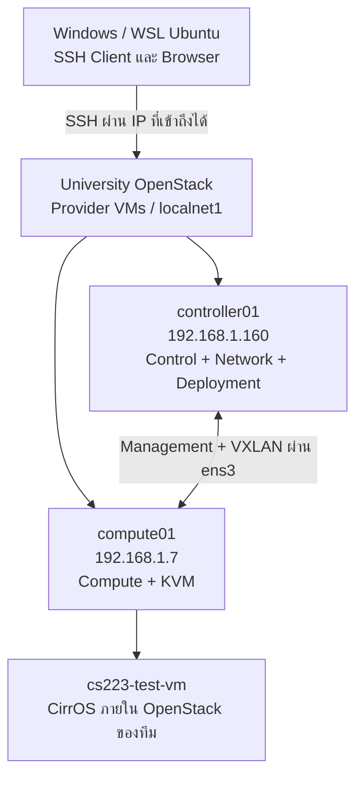
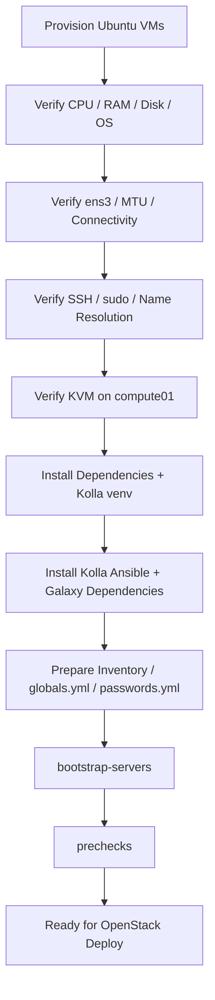
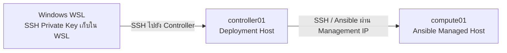

# 03 — Environment Setup

> **CS223 Term Project — OpenStack Multinode Deployment with Kolla Ansible**  
> เอกสารเตรียมสภาพแวดล้อมของ `controller01` และ `compute01` ก่อนเข้าสู่ขั้นตอนติดตั้ง OpenStack 2026.1  
> **สถานะอ้างอิง:** ระบบ Lab ติดตั้งและทดสอบสำเร็จ ณ 17 พฤศจิกายน 2026

[← Project Overview](01-project-overview.md) · [System Architecture](02-architecture.md) · [Kolla Deployment →](04-kolla-deployment.md) · [README](../README.md)

---

## สารบัญ

1. [เป้าหมายและขอบเขตของเอกสาร](#1-เป้าหมายและขอบเขตของเอกสาร)
2. [สภาพแวดล้อมที่ใช้จริง](#2-สภาพแวดล้อมที่ใช้จริง)
3. [ภาพรวมลำดับการเตรียมระบบ](#3-ภาพรวมลำดับการเตรียมระบบ)
4. [ตรวจสอบ Ubuntu และทรัพยากรเครื่อง](#4-ตรวจสอบ-ubuntu-และทรัพยากรเครื่อง)
5. [ตรวจสอบ Disk และ Docker Data Directory](#5-ตรวจสอบ-disk-และ-docker-data-directory)
6. [เตรียม Network Interfaces และ MTU](#6-เตรียม-network-interfaces-และ-mtu)
7. [เตรียม SSH, Hostname และ Sudo](#7-เตรียม-ssh-hostname-และ-sudo)
8. [ตรวจสอบ KVM / Nested Virtualization](#8-ตรวจสอบ-kvm--nested-virtualization)
9. [ติดตั้ง Dependencies และ Python Virtual Environment](#9-ติดตั้ง-dependencies-และ-python-virtual-environment)
10. [ติดตั้ง Kolla Ansible และ Ansible Galaxy Dependencies](#10-ติดตั้ง-kolla-ansible-และ-ansible-galaxy-dependencies)
11. [เตรียม Inventory และ Configuration เบื้องต้น](#11-เตรียม-inventory-และ-configuration-เบื้องต้น)
12. [Bootstrap Host และตรวจสอบความพร้อม](#12-bootstrap-host-และตรวจสอบความพร้อม)
13. [Environment Validation Checklist](#13-environment-validation-checklist)
14. [ปัญหาที่ควรระวัง](#14-ปัญหาที่ควรระวัง)
15. [การจัดเก็บหลักฐานและความปลอดภัย](#15-การจัดเก็บหลักฐานและความปลอดภัย)
16. [เอกสารอ้างอิง](#16-เอกสารอ้างอิง)

---

## 1. เป้าหมายและขอบเขตของเอกสาร

เอกสารนี้อธิบายการเตรียม **Deployment Host, Controller Node และ Compute Node** สำหรับการติดตั้ง OpenStack ด้วย Kolla Ansible ในสภาพแวดล้อมของรายวิชา CS223 Virtualization Technology โดยครอบคลุมการตรวจสอบระบบปฏิบัติการ ทรัพยากร เครือข่าย Storage สิทธิ์การเข้าถึงผ่าน SSH และเครื่องมือที่ใช้ในการ Deploy

เมื่อทำขั้นตอนนี้เสร็จ ควรได้สภาพแวดล้อมที่มีคุณสมบัติหลักดังนี้

- `controller01` สามารถควบคุมการติดตั้งไปยัง `compute01` ผ่าน Ansible ได้
- ทั้งสอง Node ใช้ Ubuntu Server และมี Network/Storage พร้อมรองรับ Container
- Compute Node เข้าถึงอุปกรณ์ `/dev/kvm` เพื่อใช้งาน Virtualization ได้
- มี `~/kolla-venv` สำหรับรัน Kolla Ansible โดยไม่ปะปนกับ System Python
- มี Inventory และ Kolla Configuration สำหรับระบบ **Single Controller + Single Compute**
- `bootstrap-servers` และ `prechecks` สามารถทำงานได้ก่อนเริ่ม `deploy`

> **ขอบเขต:** เอกสารนี้เน้นขั้นตอน **ก่อน Deploy** ส่วนการแก้ปัญหาระหว่าง Deploy, การตรวจสอบบริการ OpenStack, การสร้าง CirrOS VM และการเข้าถึง Horizon จะอธิบายแยกใน [04 — Kolla Deployment](04-kolla-deployment.md), [05 — Deployment Verification](05-deployment-verification.md) และ [06 — Troubleshooting](06-troubleshooting.md)

### ประเภทของข้อมูลในเอกสาร

เพื่อไม่ให้สับสนระหว่างข้อมูลจากระบบจริงกับคู่มือสำหรับทำซ้ำ เอกสารใช้แนวทางดังนี้

- **ค่าที่ตรวจสอบจาก Lab:** เวอร์ชันซอฟต์แวร์, IP, Interface, ขนาดทรัพยากรโดยประมาณ, เส้นทางไฟล์ และผลการทดสอบที่เคยปรากฏใน Log
- **คำสั่งตรวจสอบ:** คำสั่งแบบ Read-only ที่สามารถใช้ดูสถานะบนระบบปัจจุบัน
- **คำสั่งเตรียมระบบตัวอย่าง:** สำหรับสร้างเครื่องใหม่หรือทำซ้ำใน Lab *ไม่ใช่คำสั่งที่ยืนยันว่าถูกรันทุกบรรทัดในครั้งแรก*

**ไม่ควรนำคำสั่งติดตั้งหรือปรับ Network ในเอกสารนี้ไปรันซ้ำบนระบบที่ Deploy สำเร็จแล้วโดยไม่มีเหตุผล** เพราะอาจเปลี่ยนสถานะบริการที่ใช้งานอยู่

---

## 2. สภาพแวดล้อมที่ใช้จริง

### 2.1 Deployment topology

โปรเจกต์นี้ใช้งาน **OpenStack ซ้อนอยู่บน Virtual Machines ของ OpenStack ที่มหาวิทยาลัยจัดเตรียมให้** จึงควรแยกความหมายของ Host ออกเป็นสามระดับ



`controller01` เป็นทั้ง **Deployment Host** (ที่ใช้รันคำสั่ง `kolla-ansible`) และ **Control/Network Node** ของ OpenStack ที่ทีมติดตั้ง ส่วน `compute01` ทำหน้าที่ประมวลผล Virtual Machine ภายใน Cloud ของทีม

### 2.2 Node specifications

| รายการ | `controller01` | `compute01` |
|---|---|---|
| Role หลัก | Control, Network, Monitoring, Storage, Deployment | Compute |
| Operating System | Ubuntu Server 24.04.3 LTS | Ubuntu Server 24.04.3 LTS |
| Management IP ภายใน Lab | `192.168.1.160` | `192.168.1.7` |
| Interface หลัก | `ens3` | `ens3` |
| vCPU ของ Outer VM | ประมาณ 4 vCPU | ประมาณ 4 vCPU |
| RAM ของ Outer VM | ประมาณ 9.7 GiB | ประมาณ 9.7 GiB |
| Root Disk | ประมาณ 30 GB | ประมาณ 30 GB |
| Docker Data Disk | ประมาณ 40 GB, ext4 | ประมาณ 40 GB, ext4 |
| Docker Data Directory | `/var/lib/docker` | `/var/lib/docker` |
| Host user | `ubuntu` | `ubuntu` |
| Compute acceleration | ไม่ใช่ Node ที่ใช้รัน Guest VM | ใช้ `/dev/kvm` และ QEMU/KVM |

> จำนวนทรัพยากรด้านบนเป็นข้อมูลของ Lab นี้ ไม่ใช่ Minimum Requirements สากลสำหรับ OpenStack ทุกแบบ โดยคู่มือ Kolla Ansible 2026.1 ระบุข้อกำหนดขั้นต่ำทั่วไป 8 GB RAM, 40 GB Disk และ 2 Network Interfaces; โปรเจกต์นี้ใช้ `ens3` สำหรับเครือข่ายหลักและ `dummy0` เป็น Interface สำหรับ Lab แทน Physical External Uplink จริง

### 2.3 Software stack

| Layer | ซอฟต์แวร์/รายละเอียดที่ยืนยันจาก Lab |
|---|---|
| Cloud release | OpenStack `2026.1` |
| Automation | Kolla Ansible `22.2.1.dev36` |
| Ansible | `ansible-core 2.19.15` |
| Python ของ Deployment Host | Python 3.12 (`~/kolla-venv`) |
| Container Engine | Docker (เวอร์ชัน Engine ไม่ได้บันทึกในหลักฐานปัจจุบัน) |
| Container Images | Kolla images ชุด `2026.1-ubuntu-noble` |
| Virtualization | Libvirt + QEMU/KVM |
| Software-defined Network | Neutron + Open vSwitch + VXLAN |
| OpenStack Client (ติดตั้งภายหลัง) | `python-openstackclient 9.0.1` ใน `~/openstack-cli-venv` |

สามารถดูสถาปัตยกรรมเต็มได้ใน [02 — System Architecture](02-architecture.md)

### 2.4 ประเภทของ IP ที่ต้องแยกให้ชัดเจน

| ประเภท | ตัวอย่าง | ใช้สำหรับ |
|---|---|---|
| Management/Underlay IP | `192.168.1.160`, `192.168.1.7` | สื่อสารระหว่าง Nodes และบริการภายใน Lab |
| IP สำหรับ SSH จากภายนอก | `<CONTROLLER_ACCESS_IP>` | เข้า `controller01` จาก Windows/WSL ผ่านเครือข่ายมหาวิทยาลัย |
| Kolla API Address ใน Lab | `192.168.1.160` | API Endpoint ภายในของ OpenStack ที่ติดตั้ง |
| Tenant/Guest Subnet | `10.10.10.0/24` | เครือข่าย VM ที่สร้างขึ้นหลัง Deploy |

> ในสภาพแวดล้อมนี้ `kolla_internal_vip_address` ถูกกำหนดเท่ากับ IP ของ Controller จริง และปิด Load Balancer/HA จึง **ไม่ใช่ Virtual IP ที่มี Failover** ห้ามนำค่าลักษณะนี้ไปใช้กับ Production โดยไม่ออกแบบใหม่

---

## 3. ภาพรวมลำดับการเตรียมระบบ



**หมายเหตุเรื่องเครื่องที่ใช้รันคำสั่ง:**

- **Windows/WSL:** ใช้ SSH เพื่อเข้าถึง `controller01`
- **ทั้งสองเครื่อง:** คำสั่งตรวจสอบ Ubuntu, Interface, Storage และ KVM (เฉพาะ Compute)
- **`controller01`:** ติดตั้ง Kolla Ansible, สร้าง Inventory, ตั้งค่า Kolla และรัน Ansible
- **`compute01`:** เป็น Target Host; ไม่จำเป็นต้องติดตั้ง Kolla Ansible CLI แยกอีกชุด

---

## 4. ตรวจสอบ Ubuntu และทรัพยากรเครื่อง

### 4.1 ตรวจสอบเวอร์ชัน Ubuntu และ Kernel

**รันบน: `controller01` และ `compute01` แยกกัน**

```bash
cat /etc/os-release
uname -r
hostnamectl
```

ผลที่ใช้ใน Lab นี้คือ **Ubuntu Server 24.04.3 LTS** ส่วน Kernel Version อาจแตกต่างกันตามการอัปเดต Package จึงควรบันทึกจากเครื่องจริง ไม่กำหนดเลข Kernel โดยคาดเดา

### 4.2 ตรวจสอบ CPU, RAM และ Disk

**รันบน: ทั้งสองเครื่อง**

```bash
lscpu | grep -E 'Architecture|CPU\(s\)|Model name|Virtualization'
free -h
lsblk -o NAME,SIZE,FSTYPE,MOUNTPOINTS
 df -hT / /var/lib/docker
```

> บรรทัด `df` เป็นการดูข้อมูล ไม่ได้ปรับ Partition หรือ Format Disk

**สิ่งที่ต้องตรวจสอบ:**

- สถาปัตยกรรมเป็น `x86_64` และมี vCPU/RAM ตามที่จัดสรร
- Root Filesystem มีพื้นที่เพียงพอสำหรับ OS และ Log
- `/var/lib/docker` มีพื้นที่เพียงพอสำหรับ Kolla Images และ Container Layers
- หากพบว่า Docker ใช้ Root Disk แทน Disk ที่เตรียมไว้ ให้ตรวจสอบ Mount ก่อนเริ่ม Deployment

### 4.3 ตรวจสอบเวลาและ Name Resolution

```bash
timedatectl
getent hosts controller01
getent hosts compute01
```

เวลาเครื่องและการแปลง Hostname เป็น IP มีผลต่อการทำงานร่วมกันของ Authentication, Message Broker และบริการภายใน OpenStack โดยเฉพาะ RabbitMQ ซึ่งต้องสามารถ Resolve ชื่อ Host ได้อย่างถูกต้อง

หาก `getent hosts` ไม่ได้ผล ให้แก้ DNS หรือ `/etc/hosts` ด้วยข้อมูลของระบบที่ใช้งานจริง **อย่าเขียนทับ `/etc/hosts` ทั้งไฟล์โดยอัตโนมัติ**

ตัวอย่าง Mapping สำหรับ Lab นี้:

```text
192.168.1.160 controller01
192.168.1.7   compute01
```

> ค่าตัวอย่างนี้ควรปรับตาม IP ของ Deployment ใหม่ และตรวจสอบว่าไม่ได้ซ้ำกับรายการเดิม

---

## 5. ตรวจสอบ Disk และ Docker Data Directory

### 5.1 การจัดสรรพื้นที่ใน Lab

ทั้งสอง Node ใช้ Root Disk และ Disk สำหรับเก็บข้อมูล Docker แยกกัน โดย Docker Disk ถูก Format เป็น `ext4` และ Mount ที่ `/var/lib/docker`

ข้อดีของการแยกพื้นที่คือ Kolla Images และ Container Layers สามารถขยายตัวได้โดยไม่กินพื้นที่ Root Filesystem มากเกินไป ทั้งนี้การแยก Disk ไม่ใช่การทำ HA หรือ Backup

### 5.2 ยืนยัน Mount Point

**รันบน: ทั้งสองเครื่อง**

```bash
findmnt /var/lib/docker
findmnt -no SOURCE,FSTYPE,TARGET /var/lib/docker
lsblk -f
df -hT /var/lib/docker
```

ผลที่ต้องการ:

- มี Filesystem แยก Mount ที่ `/var/lib/docker`
- Filesystem เป็น `ext4`
- แสดงขนาดประมาณ 40 GB (อาจต่างตาม GiB/GB)

**รันหลัง Docker ติดตั้งแล้ว:**

```bash
sudo docker info --format '{{.DockerRootDir}}'
```

ค่าที่คาดหวังคือ `/var/lib/docker` (เป็นตำแหน่ง Data Root ไม่ได้หมายความว่า Disk แยก Mount ถูกต้องโดยอัตโนมัติ จึงต้องใช้ `findmnt` ตรวจด้วย)

> **ข้อควรระวัง:** ห้ามรัน `mkfs`, `wipefs`, `fdisk`, ย้าย `/var/lib/docker`, แก้ `/etc/fstab` หรือ Restart Docker บนระบบที่มี Container รันอยู่เพียงเพื่อให้ได้ผลเหมือนตัวอย่าง เพราะการจัดการ Disk เหล่านี้มีความเสี่ยงต่อข้อมูล ต้องแยกเป็น Change Plan และตรวจสอบ Device จริงก่อนเสมอ

---

## 6. เตรียม Network Interfaces และ MTU

### 6.1 Underlay Network

Host VMs ของ Lab อยู่บน Network `localnet1` ช่วง `192.168.1.0/24` โดยมี **Underlay MTU = 1450** ซึ่งถูกจำกัดจากเครือข่ายชั้นนอก

| Parameter | Controller | Compute |
|---|---|---|
| Management IP | `192.168.1.160` | `192.168.1.7` |
| Management Interface | `ens3` | `ens3` |
| Tunnel Interface | `ens3` | `ens3` |
| Underlay MTU | `1450` | `1450` |

**รันบน: ทั้งสองเครื่อง**

```bash
ip -br address
ip -d link show ens3
ip route
```

หากต้องการดูเฉพาะ MTU:

```bash
cat /sys/class/net/ens3/mtu
```

> Lab นี้ใช้ Interface เดียวสำหรับ Management/API/Tunnel Traffic เนื่องจากข้อจำกัดของ Outer VM ดังนั้นการแยก Traffic จึงเป็นเชิง Logical ไม่ใช่การแยก Physical NIC

### 6.2 ตรวจสอบการสื่อสารระหว่าง Nodes

**บน `controller01`:**

```bash
ping -c 3 192.168.1.7
```

**บน `compute01`:**

```bash
ping -c 3 192.168.1.160
```

ถ้า ICMP ถูกบล็อกโดย Security Group/Firewall อาจทดสอบ SSH แทนได้ และต้องพิจารณากฎ Network Policy ของระบบชั้นนอกด้วย การ `ping` ไม่ผ่านอย่างเดียวไม่ใช่หลักฐานว่า TCP/SSH ใช้งานไม่ได้

### 6.3 MTU สำหรับ VXLAN

Neutron ใช้ **Open vSwitch + VXLAN** เป็น Tenant Overlay Network โดย IP Packet ภายใน VM ต้องถูก Encapsulate ก่อนส่งบน Underlay จึงต้องเผื่อขนาด Header เพิ่มเติม

ค่าที่ใช้จริง:

```ini
# /etc/kolla/config/neutron/neutron.conf
[DEFAULT]
global_physnet_mtu = 1450
```

```ini
# /etc/kolla/config/neutron/ml2_conf.ini
[ml2]
path_mtu = 1450
```

หลัง Deploy ระบบสร้าง `cs223-private-net` เป็น VXLAN Network ที่มี **MTU 1400** ซึ่งสอดคล้องกับการเผื่อ Overhead จาก Underlay MTU 1450 สำหรับ VXLAN บน IPv4

> ไฟล์ข้างต้นเป็น **Configuration Overrides ที่ต้องวางบน Deployment Host** ไม่ใช่คำสั่งที่ต้องพิมพ์เข้า Shell ข้อมูลตัวอย่างสำหรับ Repository จะอยู่ที่ [`../config/neutron/`](../config/neutron/)

### 6.4 External Interface แบบ Lab: `dummy0`

เนื่องจากไม่มี Physical External NIC สำหรับ Neutron โดยเฉพาะ การทดลองนี้จึงใช้ Interface แบบ Linux Dummy ชื่อ `dummy0` บน `controller01` เพื่อให้ Kolla เชื่อมเข้ากับ `br-ex` โดยไม่แตะ Interface `ens3` ที่ใช้ SSH/Management

**ตรวจสอบบน `controller01`:**

```bash
ip -br link show dummy0
ip -d link show dummy0
```

**ตัวอย่างวิธีสร้างบนเครื่องใหม่เท่านั้น** (ไม่ต้องทำซ้ำหากมีอยู่แล้ว):

```bash
sudo modprobe dummy
sudo ip link add dummy0 type dummy
sudo ip link set dummy0 mtu 1500 up
```

> การสร้างด้วย `ip link add` มีผลเพียง Runtime และอาจหายหลัง Reboot ต้องวางแผน Persistence ด้วย Network Configuration ที่เหมาะสมหากต้องใช้งานระยะยาว **อย่าแก้ `ens3` หรือย้าย Management IP ไปไว้ `br-ex` ตามตัวอย่างทั่วไปโดยไม่ประเมินผลต่อ SSH**

**ข้อจำกัดสำคัญ:** `dummy0` ไม่ใช่ Uplink ไปยัง Physical Network จึง **ยังไม่ยืนยัน External Network / Floating IP / Internet Access จาก VM** ได้จากขั้นตอนนี้

---

## 7. เตรียม SSH, Hostname และ Sudo

### 7.1 รูปแบบการเข้าถึง



SSH จาก Windows จะเข้าถึง `controller01` ผ่าน IP ที่ระบบชั้นนอกกำหนด ส่วน Ansible จะเข้าถึง `compute01` ผ่าน Management IP `192.168.1.7`

### 7.2 ทดสอบ SSH จาก Windows/WSL

**รันบน: WSL Ubuntu (ไม่ใช่ `controller01`)**

```bash
ssh -i ~/.ssh/grp25_key \
  -o IdentitiesOnly=yes \
  ubuntu@<CONTROLLER_ACCESS_IP>
```

ค่า `<CONTROLLER_ACCESS_IP>` ต้องแทนด้วย IP ที่ WSL เข้าถึงเครื่อง Controller ได้จริง และไฟล์ `~/.ssh/grp25_key` เป็นชื่อกุญแจที่ใช้ใน Lab นี้เท่านั้น

ตรวจสอบ Permission ของ Private Key บน WSL:

```bash
chmod 600 ~/.ssh/grp25_key
```

> **ห้ามคัดลอก Private Key ขึ้น GitHub, ส่งผ่านแชต หรือวางใน `docs/`** และเมื่อ SSH แจ้ง Host Key ใหม่ ควรตรวจสอบ Fingerprint จากแหล่งที่เชื่อถือได้ก่อนยอมรับ

### 7.3 ทดสอบ SSH จาก Deployment Host ไปยัง Compute Node

**รันบน: `controller01`**

```bash
ssh -o BatchMode=yes -o ConnectTimeout=5 \
  ubuntu@192.168.1.7 'hostname && whoami'
```

ผลที่คาดหวังคือได้ `compute01` และ `ubuntu` โดย **ไม่ต้องป้อนรหัสผ่าน** หากไม่มี Key-based SSH ต้องให้ผู้ดูแลตั้งค่า Authorized Public Key สำหรับการ Deploy ก่อน ไม่ควรนำ Private Key จาก WSL ไปวางบน Controller โดยพลการ

### 7.4 ตรวจสอบสิทธิ์ Sudo

**รันบน: ทั้งสองเครื่อง**

```bash
whoami
sudo -n true && echo 'PASSWORDLESS SUDO: OK'
```

Ansible Inventory ของโปรเจกต์กำหนด `ansible_become=true` จึงต้องสามารถยกระดับสิทธิ์บน Target Hosts ได้ตามนโยบายของ Lab

### 7.5 ตรวจสอบ SSH Service

```bash
systemctl is-active ssh
ss -ltn '( sport = :22 )'
```

SSH ต้องเปิดให้ Nodes/เครื่องที่ได้รับอนุญาตเท่านั้น ไม่ควรเปิด Port 22 ให้ทั้งอินเทอร์เน็ตโดยไม่จำเป็น

---

## 8. ตรวจสอบ KVM / Nested Virtualization

`compute01` เองเป็น VM ภายใน University OpenStack แต่ต้องรัน VM ของ OpenStack ของทีมซ้อนอีกชั้นหนึ่ง จึงเกี่ยวข้องกับ **Nested Virtualization**

### 8.1 ตรวจสอบ Hardware Virtualization Feature

**รันบน: `compute01` เท่านั้น**

```bash
lscpu | grep -E 'Architecture|Virtualization|CPU\(s\)'
grep -Eom1 'vmx|svm' /proc/cpuinfo
```

- `vmx`: Intel VT-x
- `svm`: AMD-V

หากไม่พบ Flag ต้องตรวจสอบว่าระบบชั้นนอกเปิดเผย Virtualization Extension ให้ VM หรือไม่

### 8.2 ตรวจสอบ KVM Device

```bash
ls -l /dev/kvm
lsmod | grep -E '^kvm'
```

Lab นี้ยืนยันว่า `compute01` **มี `/dev/kvm`** และสามารถใช้ `nova_compute_virt_type: "kvm"` ได้ หลัง Deploy ยังสร้าง CirrOS Instance สำเร็จบน `compute01`

> การมี `/dev/kvm` เป็นเงื่อนไขสำคัญ แต่เพียงอย่างเดียวไม่รับประกันว่า VM ทุกชนิดจะ Boot ได้สมบูรณ์ ต้องตรวจสอบร่วมกับ Nova/Libvirt หลัง Deploy (ดู [05 — Deployment Verification](05-deployment-verification.md))

---

## 9. ติดตั้ง Dependencies และ Python Virtual Environment

> ส่วนนี้แสดง **แนวทางเตรียม Deployment Host ใหม่** ตามเอกสาร Kolla Ansible 2026.1 ไม่จำเป็นต้องรันซ้ำบน `controller01` ที่ติดตั้งและ Deploy สำเร็จแล้ว

### 9.1 อัปเดต Package Index

**รันบน: Deployment Host (`controller01`) ก่อนติดตั้งครั้งแรก**

```bash
sudo apt update
```

### 9.2 ติดตั้งเครื่องมือพื้นฐาน

```bash
sudo apt install -y \
  git \
  python3-dev \
  python3-venv \
  libffi-dev \
  gcc \
  libssl-dev \
  libdbus-glib-1-dev
```

Dependencies เหล่านี้ใช้ในการติดตั้งและรัน Python Packages ของ Kolla Ansible บน Ubuntu สำหรับเครื่องอื่นที่เป็น Managed Hosts ควรปล่อยให้ `bootstrap-servers` จัดการ Host Dependencies ตาม Playbook แทนการติดตั้งทุกอย่างด้วยตนเอง

### 9.3 สร้าง Virtual Environment สำหรับ Kolla Ansible

```bash
python3 -m venv ~/kolla-venv
source ~/kolla-venv/bin/activate
python -m pip install --upgrade pip
```

ตรวจสอบ:

```bash
which python
python --version
```

ควรได้ Python จาก `~/kolla-venv/bin/python` โดย Prompt อาจแสดง `(kolla-venv)`

**เหตุผลที่แยก Virtual Environment:** ลดโอกาสที่การติดตั้ง/อัปเดต Packages ของ Kolla Ansible จะชนกับ Python Packages ของระบบหรือ OpenStack CLI

---

## 10. ติดตั้ง Kolla Ansible และ Ansible Galaxy Dependencies

### 10.1 ติดตั้งตาม OpenStack Release

สำหรับ Release 2026.1 ควรใช้ Ansible Core 2.19 ตามช่วงที่คู่มือเวอร์ชันนี้รองรับ:

```bash
python -m pip install 'ansible-core>=2.19,<2.20.99'
```

**รันบน: `controller01` ภายใน `~/kolla-venv`**

```bash
python -m pip install \
  'git+https://opendev.org/openstack/kolla-ansible@stable/2026.1'
```

คำสั่งนี้เป็น **ตัวอย่างสำหรับติดตั้งใหม่จาก Branch `stable/2026.1`** โดยเวอร์ชันที่ได้อาจเปลี่ยนไปเมื่อมี Commit ใหม่ ไม่ใช่การยืนยันว่าคำสั่งนี้สร้าง `22.2.1.dev36` ได้แบบ Binary-identical ทุกครั้ง หากต้องการทำซ้ำให้ตรงจริง ควรบันทึก Git Commit/Package Versions ของการติดตั้งเดิมและ Pin Versions ที่ทดสอบแล้ว

### 10.2 ติดตั้ง Ansible Galaxy Dependencies

```bash
kolla-ansible install-deps
```

คำสั่งนี้ติดตั้ง Ansible Collections/Roles ที่ Kolla Ansible ต้องใช้ และต้องมี Network Access ไปยังแหล่ง Packages ที่เกี่ยวข้อง

### 10.3 ตรวจสอบ Version

```bash
python -m pip show kolla-ansible | grep -E '^(Name|Version):'
ansible --version | head -n 3
kolla-ansible --help >/dev/null && echo 'KOLLA CLI: OK'
```

ค่าที่เคยตรวจสอบได้จาก Lab:

```text
Kolla Ansible: 22.2.1.dev36
Ansible Core : 2.19.15
Python       : 3.12 (Ubuntu 24.04)
```

### 10.4 แยก Environment สำหรับ OpenStack CLI (ทำหลัง Deploy)

ในโปรเจกต์นี้เรา **ไม่ได้ติดตั้ง OpenStack CLI ใน `kolla-venv`** แต่สร้าง `~/openstack-cli-venv` แยกต่างหากหลัง `post-deploy` เพื่อไม่กระทบ Kolla Dependencies

```bash
/usr/bin/python3 -m venv ~/openstack-cli-venv
~/openstack-cli-venv/bin/python -m pip install \
  python-openstackclient \
  -c https://releases.openstack.org/constraints/upper/2026.1
~/openstack-cli-venv/bin/openstack --version
```

ผลที่ตรวจสอบได้จริงคือ `openstack 9.0.1` โดยไม่จำเป็นต้องติดตั้งส่วนนี้ก่อน `bootstrap-servers`

---

## 11. เตรียม Inventory และ Configuration เบื้องต้น

### 11.1 เตรียม Kolla Configuration Directory

**รันบน: `controller01` สำหรับการตั้งค่าระบบใหม่**

```bash
sudo mkdir -p /etc/kolla
sudo chown "$USER:$USER" /etc/kolla
cp -n ~/kolla-venv/share/kolla-ansible/etc_examples/kolla/* /etc/kolla/
```

`cp -n` ใช้ลดความเสี่ยงจากการเขียนทับไฟล์เดิมบนเครื่องที่มี Configuration อยู่แล้ว อย่างไรก็ตามระบบปัจจุบันติดตั้งสำเร็จแล้ว **ไม่จำเป็นต้องคัดลอก Template ทับซ้ำ**

ไฟล์สำคัญคือ:

- `/etc/kolla/globals.yml`: Global Options และ Network Settings
- `/etc/kolla/passwords.yml`: Service Credentials ที่ใช้ในการ Deploy — **ห้ามเผยแพร่**
- `/etc/kolla/config/neutron/`: Custom Overrides สำหรับ Neutron

### 11.2 Inventory สำหรับ Multinode

Kolla Ansible มี Inventory ตัวอย่าง `all-in-one` และ `multinode` ใน Directory ของ Package ควรใช้ Template ของ **Release เดียวกับที่ติดตั้ง** เพื่อให้ Group/Children Dependencies ครบ

```bash
ls ~/kolla-venv/share/kolla-ansible/ansible/inventory/
```

ตัวอย่าง Host-to-Role Mapping ของ Lab นี้ (แสดงเฉพาะกลุ่มสำคัญ):

```ini
[control]
controller01 ansible_host=192.168.1.160 ansible_user=ubuntu ansible_become=true

[network]
controller01

[compute]
compute01 ansible_host=192.168.1.7 ansible_user=ubuntu ansible_become=true

[monitoring]
controller01

[storage]
controller01

[deployment]
localhost ansible_connection=local
```

ในระบบจริง Inventory ถูกเก็บไว้ที่ `~/multinode` บน `controller01` โดยใช้ Role ตามตาราง:

| Inventory Group | Host |
|---|---|
| `control` | `controller01` |
| `network` | `controller01` |
| `compute` | `compute01` |
| `monitoring` | `controller01` |
| `storage` | `controller01` |
| `deployment` | `localhost` |

> **สำคัญ:** รายการด้านบนแสดงเฉพาะส่วนที่แก้ไขตาม Lab **อย่าแทนที่ Sample Inventory ทั้งไฟล์ด้วยตัวอย่างนี้โดยไม่ตรวจความครบถ้วน** เพราะ Kolla Ansible อาจอาศัย Sections เพิ่มเติมจาก Sample Inventory ของ Release นั้น ๆ

ไฟล์ตัวอย่างสำหรับเผยแพร่ใน Repository: [`../config/multinode.example`](../config/multinode.example)

### 11.3 `globals.yml` ที่ใช้ใน Lab

ค่าหลักที่บันทึกจากระบบที่ใช้งานจริงมีดังนี้:

```yaml
# /etc/kolla/globals.yml — เฉพาะค่าที่ปรับสำหรับ Lab
workaround_ansible_issue_8743: true
kolla_base_distro: "ubuntu"

network_interface: "ens3"
api_interface: "ens3"
tunnel_interface: "ens3"
neutron_external_interface: "dummy0"
neutron_plugin_agent: "openvswitch"

kolla_internal_vip_address: "192.168.1.160"
enable_haproxy: false
enable_keepalived: false
enable_loadbalancer: false
enable_proxysql: false

nova_compute_virt_type: "kvm"
enable_heat: false
enable_cinder: false
```

**อธิบายค่าที่สำคัญ:**

| Key | เหตุผลที่ใช้ |
|---|---|
| `network_interface`, `api_interface` | ให้ Management/API ใช้ `ens3` |
| `tunnel_interface` | ใช้ `ens3` สำหรับ Tunnel Traffic ระหว่าง Nodes |
| `neutron_external_interface` | ใช้ `dummy0` เป็น Interface ทดสอบ ไม่ใช่ Physical Uplink |
| `neutron_plugin_agent` | ใช้ Open vSwitch Backend |
| `kolla_internal_vip_address` | ชี้ API Address ไปยัง IP Controller จริงในรูปแบบ Non-HA |
| `enable_*loadbalancer/haproxy/keepalived/proxysql` | ปิด HA/Proxy Components ที่ทำให้เกิด Port Conflict ใน Lab |
| `nova_compute_virt_type` | ใช้ Hardware-assisted KVM ที่ `compute01` |
| `enable_heat`, `enable_cinder` | ปิดบริการที่ไม่อยู่ในขอบเขตการทดลอง |

ตัวแปร `workaround_ansible_issue_8743` เป็น Workaround ที่ใช้ใน Deployment นี้ ไม่ใช่ค่าที่ทุก Deployment จำเป็นต้องเปิด ควรตรวจสอบความจำเป็นตาม Ansible/Kolla Version ก่อนนำไปใช้ที่อื่น

> การปิด HA/Load Balancer/ProxySQL ใน Lab นี้เป็นการเลือก **Non-HA Architecture** ไม่ใช่รูปแบบแนะนำสำหรับ Production และ `enable_proxysql: false` อย่างเดียวไม่ได้หยุด ProxySQL Unit ที่เคยถูกสร้างไว้จาก Deployment ก่อนหน้า จึงต้องตรวจสอบ Unit/Port เพิ่มในกรณีที่เคย Deploy มาก่อน (ดู [06 — Troubleshooting](06-troubleshooting.md))

ตัวอย่างสำหรับ Repository: [`../config/globals.example.yml`](../config/globals.example.yml)

### 11.4 จัดการ Passwords อย่างปลอดภัย

สำหรับการติดตั้งใหม่ Kolla Ansible มีคำสั่งช่วยสร้าง Service Passwords:

```bash
# สั่งเฉพาะตอนเตรียมระบบใหม่หลังมี /etc/kolla/passwords.yml
kolla-genpwd
chmod 600 /etc/kolla/passwords.yml
```

คำสั่ง `kolla-genpwd` จะปรับข้อมูลใน `passwords.yml` จึง **ไม่ควรรันซ้ำบนระบบที่ Deploy สำเร็จแล้ว** หากไม่มีแผน Rotate Credentials ที่ถูกต้อง เพราะ Service Configuration อาจไม่สอดคล้องกับ Credentials ใหม่

**ห้าม Commit** ไฟล์ต่อไปนี้ขึ้น Public GitHub:

```text
/etc/kolla/passwords.yml
/etc/kolla/admin-openrc.sh
/etc/kolla/clouds.yaml
~/.ssh/* (Private Keys)
```

ห้ามแสดงค่าจากไฟล์เหล่านี้ผ่าน `cat` หรือแนบ Log แบบเต็มโดยไม่ตรวจและลบ Secrets ก่อน

### 11.5 ตรวจสอบความถูกต้องของ Inventory

**รันบน: `controller01` ภายใน `kolla-venv`**

```bash
ansible-inventory -i ~/multinode --graph
ansible -i ~/multinode 'control:compute' -m ping
```

ผลที่คาดหวังคือ Inventory แสดง `controller01` และ `compute01` ในกลุ่มถูกต้อง และ Ansible Ping ของทั้งสอง Host สำเร็จด้วย `pong`

> Ansible `ping` ไม่ใช่ ICMP Ping แต่เป็นการทดสอบการเชื่อมต่อ SSH และการ Execute Python Module บน Target Host

---

## 12. Bootstrap Host และตรวจสอบความพร้อม

หัวข้อนี้เป็น **จุดเชื่อมต่อจาก Environment Setup ไปยัง Deployment** โดยยังไม่ได้รัน Deploy ของบริการ OpenStack

### 12.1 Bootstrap Servers

**รันบน: `controller01` ภายใน `kolla-venv`**

```bash
kolla-ansible bootstrap-servers -i ~/multinode
```

Kolla Ansible จะใช้ Playbook เตรียม Host เช่น Container Runtime, OS Dependencies และการตั้งค่าที่จำเป็นตาม Release/Inventory ที่ระบุ คำสั่งนี้ **มีผลเปลี่ยนระบบ** และไม่ควรรันซ้ำเพียงเพื่อการเก็บภาพหลักฐาน

### 12.2 Prechecks

```bash
kolla-ansible prechecks -i ~/multinode --use-test-images
```

ใช้ตรวจสอบความพร้อมก่อน Deploy เช่น การเข้าถึง Host, Network, Configuration และ Port ที่บริการต้องใช้

**ผลที่บันทึกจาก Lab:** Bootstrap ผ่าน และ Prechecks รอบที่แก้ปัญหาแล้วมี Exit Status `0` ไม่มี Host ที่ `failed` หรือ `unreachable`

> หาก Prechecks ล้มเหลวให้ตรวจ `FAILED!` และ Task ที่เกี่ยวข้องก่อน อย่าใช้การลบ Docker Volumes หรือเริ่มติดตั้งใหม่ทั้งหมดเป็นวิธีแก้ขั้นแรก

### 12.3 ขั้นตอนที่อยู่ในเอกสาร Deployment

หลัง Prechecks ผ่าน จึงเข้าสู่คำสั่ง:

```bash
kolla-ansible deploy -i ~/multinode
kolla-ansible post-deploy -i ~/multinode
```

ใน Lab นี้ทั้ง `deploy` และ `post-deploy` สำเร็จแล้ว คำสั่งนี้แสดงเพื่ออธิบาย Workflow เท่านั้น **ไม่ใช่คำแนะนำให้รันซ้ำตอนนี้** รายละเอียดและหลักฐานอยู่ใน [04 — Kolla Deployment](04-kolla-deployment.md)

---

## 13. Environment Validation Checklist

รายการด้านล่างเป็น Checklist ก่อนเข้าสู่ Deployment; คอลัมน์ Status อ้างอิงผลที่ยืนยันแล้วจาก Lab

| Check | วิธีตรวจสอบ | ผลใน Lab |
|---|---|---|
| Ubuntu Nodes พร้อมใช้งาน | `/etc/os-release`, `hostnamectl` | ✅ ผ่าน |
| CPU/RAM/Disk เพียงพอสำหรับ Lab | `lscpu`, `free -h`, `df -hT` | ✅ ผ่านการ Deploy จริง |
| Docker Disk แยก Mount | `findmnt /var/lib/docker` | ✅ จัดเตรียมไว้ |
| Underlay Interface `ens3` | `ip -br addr` | ✅ ใช้งานได้ |
| Underlay MTU 1450 | `ip link show ens3` | ✅ ตั้งค่าแล้ว |
| Controller/Compute สื่อสารกันได้ | SSH และ Ansible Ping | ✅ ผ่าน |
| Compute รองรับ KVM | `ls -l /dev/kvm` | ✅ พบ Device |
| Kolla Ansible ใน venv | `pip show kolla-ansible` | ✅ `22.2.1.dev36` |
| Ansible พร้อมใช้งาน | `ansible --version` | ✅ Core `2.19.15` |
| Inventory Role Mapping | `ansible-inventory --graph` | ✅ Deploy ผ่าน |
| Configuration และ Passwords พร้อม | ตรวจไฟล์โดยไม่แสดง Secrets | ✅ ใช้งานได้ |
| Bootstrap Servers | Kolla Ansible | ✅ ผ่าน |
| Prechecks | Kolla Ansible | ✅ Exit Status `0` |

**Acceptance Criteria ของ Environment Setup:** ทั้งสอง Nodes ติดต่อกันได้ผ่าน Ansible, Compute Node มี KVM, Environment/Inventory/Kolla Configuration พร้อม และ Prechecks ผ่านก่อนเริ่ม Deploy

---

## 14. ปัญหาที่ควรระวัง

### 14.1 SSH จากผิดเครื่อง

**อาการ:** รันคำสั่ง SSH Tunnel บน `controller01` แล้วหา Private Key `~/.ssh/grp25_key` ไม่พบ

**สาเหตุ:** Key อยู่ใน WSL ของ Windows ไม่ใช่บน Controller

**แนวทาง:** ตรวจ Prompt ก่อนรันคำสั่ง และใช้ WSL เปิด SSH Tunnel จากเครื่องที่เก็บ Key อยู่ **ไม่ต้องคัดลอก Private Key ไปยัง Controller**

### 14.2 Management Interface และ External Interface สับสนกัน

**ความเสี่ยง:** นำ `ens3` ไปเสียบ `br-ex` หรือเปลี่ยน Address ของ `ens3` โดยไม่วางแผน อาจทำให้ SSH เข้าเครื่องไม่ได้

**แนวทาง:** ใช้ `ens3` สำหรับ Management และ `dummy0` เป็น External Interface จำลองตาม Lab เดิม การเพิ่ม Uplink จริงต้องวางแผนเครือข่ายใหม่

### 14.3 MTU ไม่ตรงกับ Outer Network

**อาการที่อาจพบ:** VXLAN Traffic มีปัญหา/Fragmentation หรือ VM ติดต่อกันไม่ได้บางกรณี

**แนวทาง:** ตรวจ Underlay MTU 1450 และ Neutron Overrides ที่กำหนด `global_physnet_mtu`/`path_mtu` เป็น 1450 แทนการใช้ค่า 1500 โดยไม่ตรวจสอบ

### 14.4 KVM ไม่พร้อม

**อาการ:** `/dev/kvm` ไม่มีอยู่ หรือ Nova/Libvirt ไม่สามารถสร้าง VM ด้วย KVM

**แนวทาง:** ตรวจ CPU Flags, `/dev/kvm` และการรองรับ Nested Virtualization ของ University OpenStack ก่อนพิจารณาเปลี่ยน Virt Type

### 14.5 Port Conflict ระหว่าง MariaDB และ ProxySQL

**เหตุการณ์ที่พบจริง:** เมื่อใช้ Address `192.168.1.160` เป็นทั้ง Host IP และ API Address, ProxySQL เดิม Bind Port `3306` ก่อน MariaDB ทำให้ Deploy รอบแรกไม่ผ่าน

**วิธีแก้ที่ใช้ใน Lab:** ปรับการตั้งค่า Non-HA, หยุด Kolla-managed `proxysql`/`haproxy` systemd Services, `daemon-reload`, ตรวจ Port แล้วทำ Prechecks และ Deploy ใหม่จนสำเร็จ

**ไม่ควรแก้ด้วยการลบ MariaDB Volume** เพราะเสี่ยงสูญเสียข้อมูล และไม่แก้ต้นเหตุของ Port Conflict ดูรายละเอียดที่ [06 — Troubleshooting](06-troubleshooting.md)

### 14.6 Software Versions และการทำซ้ำ

- ปฏิบัติตาม Documentation ของ Release `2026.1` เท่าที่เป็นไปได้
- อย่าคัดลอกคำสั่งจาก Release `latest` มาใช้โดยไม่ตรวจ Compatibility
- จด Installed Version จริงในเอกสารเพื่อให้สมาชิกคนอื่นทำซ้ำได้
- `22.2.1.dev36` เป็น Development Build ที่ได้รับจากการติดตั้งเดิม ไม่ใช่ Pin แบบ Immutable; หากต้องการ Reproducibility ควรระบุ Git Commit/Package Lock จากเครื่องจริงเพิ่มเติม

---

## 15. การจัดเก็บหลักฐานและความปลอดภัย

### 15.1 หลักฐาน Environment Setup ที่ควรรวบรวม

ควรบันทึก Screenshot/Output ที่ **ไม่มีข้อมูลลับ** ของหัวข้อเหล่านี้:

1. Hostname และ Ubuntu Version ของ `controller01`/`compute01`
2. Network Interface และ MTU บนทั้งสอง Node
3. Storage Mount (`/var/lib/docker`)
4. `/dev/kvm` บน Compute Node
5. `ansible --version` และ `kolla-ansible` Package Version
6. Ansible Ping ที่สำเร็จ และ Prechecks `PLAY RECAP`

ใน Folder Structure ที่ตกลงกันไว้มีหลักฐาน Prechecks อยู่ที่:

```text
../evidence/01-deployment/01-prechecks.png
```

สำหรับหลักฐาน Environment อื่น ๆ สามารถแทรกในเอกสารนี้แบบ Inline หรือเพิ่ม Folder เฉพาะเมื่อกลุ่มตกลงปรับโครงสร้าง Repository แล้ว โดย **ไม่จำเป็นต้องสร้าง Screenshot ซ้ำหากมี Log ที่ตรวจสอบได้อยู่แล้ว**

### 15.2 แนวทางก่อน Push ขึ้น Public GitHub

- ใช้ [`../config/`](../config/) เก็บ **ไฟล์ตัวอย่างที่ตรวจสอบแล้ว** แทน Credentials จริง
- ปิดบังรหัสผ่าน, Token, SSH Private Key, Internal Certificates, Public Access Tokens และ URL ที่มี Query Token
- ระวัง Log ของ Ansible/Kolla ที่แสดงตัวแปรของ Service ออกมา แม้จะไม่ได้สั่ง `cat passwords.yml` โดยตรง
- อ่าน Diff ก่อน Commit (`git diff --cached`) และตรวจ Screenshot ทุกภาพก่อนอัปโหลด
- อย่าใช้ `.gitignore` เป็นเครื่องมือเดียวในการปกป้อง Secrets เพราะไฟล์ที่เคยถูก Commit แล้วจะยังอยู่ใน Git History

### 15.3 รายการข้อมูลสำหรับ Handover

หลังทำ Environment Setup และ Deploy เสร็จ ข้อมูลที่สมาชิกคนที่ 3 ต้องได้รับ ได้แก่ Node Role/IP ภายใน, วิธีเข้าถึง Controller ผ่าน SSH, ตำแหน่ง `~/multinode` และ `/etc/kolla`, วิธีเปิด `kolla-venv`, และข้อจำกัด Non-HA/External Network ของระบบ

**ส่งรหัสผ่านและสิทธิ์การเข้าถึงผ่านช่องทางปลอดภัยแยกจาก Public Repository** และหลีกเลี่ยงการส่งต่อบัญชี Admin หากสามารถจัดการสิทธิ์ให้เหมาะกับบทบาทผู้ใช้ได้

รายละเอียดดู [07 — Handover](07-handover.md)

---

## 16. เอกสารอ้างอิง

- [Kolla Ansible 2026.1 — Quick Start for Deployment/Evaluation](https://docs.openstack.org/kolla-ansible/2026.1/user/quickstart)
- [Kolla Ansible 2026.1 — Multinode Deployment](https://docs.openstack.org/kolla-ansible/2026.1/user/multinode.html)
- [Kolla Ansible 2026.1 — Operating Kolla](https://docs.openstack.org/kolla-ansible/2026.1/user/operating-kolla.html)
- [Kolla Ansible 2026.1 — Neutron Networking](https://docs.openstack.org/kolla-ansible/2026.1/reference/networking/neutron.html)
- [Kolla Ansible 2026.1 — Advanced Configuration](https://docs.openstack.org/kolla-ansible/2026.1/admin/advanced-configuration.html)
- [OpenStack 2026.1 — Upper Constraints](https://releases.openstack.org/constraints/upper/2026.1)

### เอกสารภายใน Repository

- [README](../README.md)
- [01 — Project Overview](01-project-overview.md)
- [02 — System Architecture](02-architecture.md)
- [04 — Kolla Deployment](04-kolla-deployment.md)
- [05 — Deployment Verification](05-deployment-verification.md)
- [06 — Troubleshooting](06-troubleshooting.md)
- [07 — Handover](07-handover.md)

> **หมายเหตุ:** ลิงก์ไปยังเอกสาร/ไฟล์ตัวอย่าง/ภาพหลักฐานบางรายการจะใช้งานได้หลังจากเพิ่มไฟล์เหล่านั้นลงใน Repository ตามโครงสร้างที่กำหนดครบแล้ว
