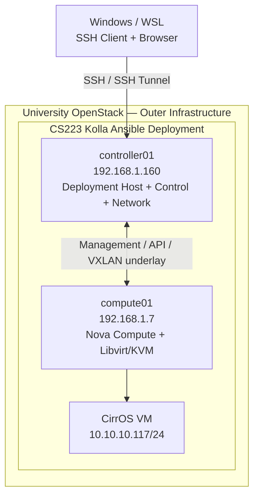
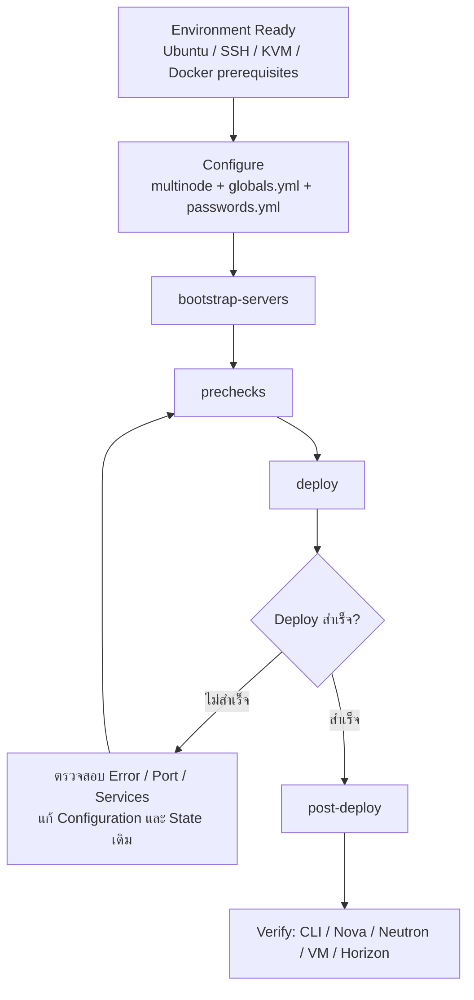
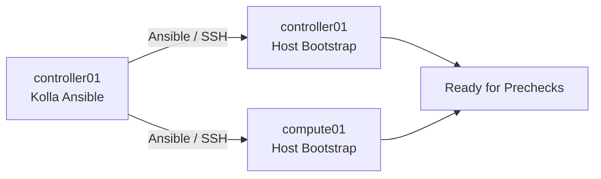
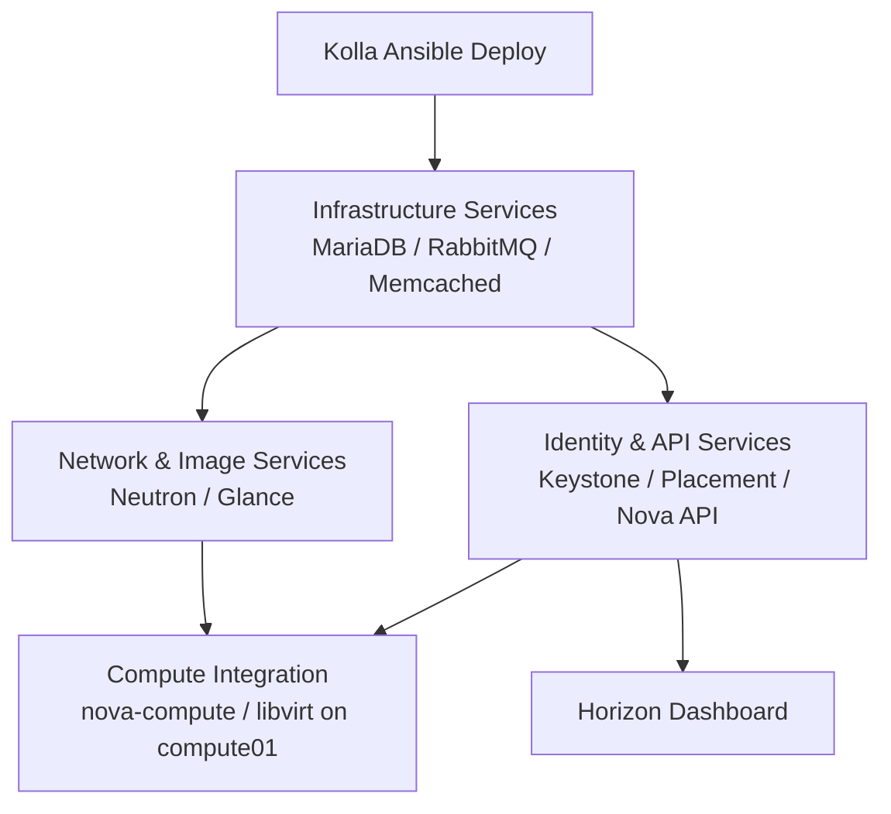
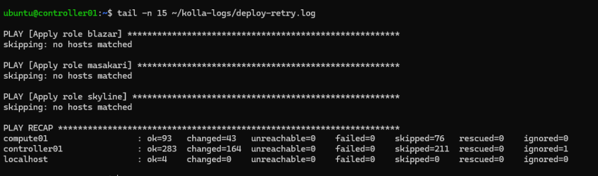

# 04 — Kolla Ansible Deployment

> **CS223 Term Project — OpenStack Multinode Deployment**  
> **เอกสาร:** ขั้นตอนติดตั้งและ Deploy OpenStack ด้วย Kolla Ansible  
> **สภาพแวดล้อมอ้างอิง:** OpenStack 2026.1 / Kolla Ansible 22.2.1.dev36 / Ubuntu 24.04 LTS  
> **สถานะ:** Deploy และ Post-deploy สำเร็จ; มีการยืนยันการทำงานผ่าน OpenStack CLI, CirrOS VM และ Horizon  
> **อ้างอิงผลการทดสอบ:** 17 พฤศจิกายน 2026

เอกสารนี้บันทึกกระบวนการ **Deployment ที่เกิดขึ้นจริง** ในโครงงาน CS223 ตั้งแต่เตรียม Kolla Configuration จนถึงการ Deploy, แก้ปัญหาระหว่าง Deploy, สร้างไฟล์สำหรับใช้ OpenStack API และตรวจสอบบริการที่ติดตั้งสำเร็จ เนื้อหาออกแบบให้ใช้ทั้งเป็น **รายงานการปฏิบัติงานของสมาชิกผู้รับผิดชอบ Installation & Deployment (คนที่ 2)** และเป็นข้อมูลให้สมาชิกคนถัดไปดูแลระบบต่อ

> [!IMPORTANT]
> คำสั่งบางส่วนในหน้านี้เป็น **บันทึกขั้นตอนที่เคยทำ** ไม่ใช่คำสั่งให้รันซ้ำทันที เพราะระบบปัจจุบัน Deploy สำเร็จและมี VM ที่กำลังทำงานแล้ว ควรอ่านคำอธิบายและตรวจสอบผลกระทบก่อนเปลี่ยน Configuration, Reconfigure หรือ Deploy ซ้ำ

---

## สารบัญ

1. [วัตถุประสงค์และขอบเขต](#1-วัตถุประสงค์และขอบเขต)
2. [ผลลัพธ์ของ Deployment](#2-ผลลัพธ์ของ-deployment)
3. [สภาพแวดล้อมและบทบาทของ Nodes](#3-สภาพแวดล้อมและบทบาทของ-nodes)
4. [ลำดับการทำงานของ Kolla Ansible](#4-ลำดับการทำงานของ-kolla-ansible)
5. [ข้อกำหนดก่อนเริ่ม Deployment](#5-ข้อกำหนดก่อนเริ่ม-deployment)
6. [เตรียม Inventory และ Configuration](#6-เตรียม-inventory-และ-configuration)
7. [Bootstrap Servers](#7-bootstrap-servers)
8. [Pre-deployment Checks](#8-pre-deployment-checks)
9. [Deploy OpenStack](#9-deploy-openstack)
10. [ปัญหาระหว่าง Deploy และการแก้ไขจริง](#10-ปัญหาระหว่าง-deploy-และการแก้ไขจริง)
11. [ผลการ Deploy รอบที่สำเร็จ](#11-ผลการ-deploy-รอบที่สำเร็จ)
12. [Post-deployment Configuration](#12-post-deployment-configuration)
13. [ตรวจสอบ OpenStack Services](#13-ตรวจสอบ-openstack-services)
14. [ยืนยันการทำงานด้วย Test VM](#14-ยืนยันการทำงานด้วย-test-vm)
15. [ตรวจสอบ Horizon Dashboard](#15-ตรวจสอบ-horizon-dashboard)
16. [การจัดเก็บหลักฐานสำหรับ GitHub](#16-การจัดเก็บหลักฐานสำหรับ-github)
17. [ข้อควรระวังด้านความปลอดภัยและการปฏิบัติงาน](#17-ข้อควรระวังด้านความปลอดภัยและการปฏิบัติงาน)
18. [เกณฑ์ความสำเร็จและการส่งมอบ](#18-เกณฑ์ความสำเร็จและการส่งมอบ)
19. [เอกสารที่เกี่ยวข้อง](#19-เอกสารที่เกี่ยวข้อง)

---

## 1. วัตถุประสงค์และขอบเขต

### 1.1 วัตถุประสงค์

การ Deploy ครั้งนี้มีเป้าหมายเพื่อสร้างระบบ **Infrastructure as a Service (IaaS)** ด้วย OpenStack แบบ Multinode โดยใช้ **Kolla Ansible** ช่วยจัดการบริการ OpenStack ที่ทำงานใน Containers บน Ubuntu Server และทำให้ระบบสามารถสร้าง Virtual Machine บน Compute Node ได้จริง

ผลสำเร็จที่ต้องการพิสูจน์ประกอบด้วย:

1. Deployment Host สามารถใช้ Ansible เชื่อมต่อและจัดการ Controller/Compute Node ได้
2. Kolla Ansible ทำ Bootstrap, Prechecks และ Deploy จนจบโดยไม่เหลือ Task ที่ล้มเหลว
3. บริการสำคัญ เช่น Keystone, Nova, Neutron, Glance, Placement และ Horizon พร้อมใช้งาน
4. `compute01` ถูกลงทะเบียนและแสดงสถานะ `up` ใน Nova
5. ผู้ดูแลระบบสามารถใช้ OpenStack CLI และ Horizon ได้
6. สามารถสร้าง VM บน Compute Node, Boot เข้าระบบ และรับ IP จาก Neutron DHCP ได้

### 1.2 ขอบเขตของเอกสาร

เอกสารนี้เน้น **การนำระบบขึ้นใช้งาน (Deployment Procedure)** ส่วนการเตรียม OS, Docker, Python Virtual Environment, Host Networking และ Dependencies อธิบายแยกไว้ใน [03 — Environment Setup](03-environment-setup.md) และผลทดสอบเชิงลึกจะอยู่ใน [05 — Deployment Verification](05-deployment-verification.md)

**ไม่อยู่ในขอบเขตที่พิสูจน์แล้ว:** High Availability (HA), การย้าย VM แบบ Live Migration, Production Security Hardening, Cinder Block Storage, Heat Orchestration และการใช้งาน Floating IP/External Network จาก VM ภายในออกสู่ภายนอก

### 1.3 แนวทางการอ่านเอกสาร

- **บันทึกผลจริง:** มีหลักฐานการทำงานจาก Terminal, CLI หรือ Horizon แล้ว
- **คำสั่งตรวจสอบ:** อ่านสถานะของระบบได้โดยทั่วไปโดยไม่ตั้งใจแก้ Configuration
- **คำสั่งติดตั้ง/แก้ไข:** ทำให้ State ของระบบเปลี่ยน ต้องใช้เมื่อสร้าง Lab ใหม่หรือได้รับมอบหมายให้แก้ไขระบบเท่านั้น
- **ผลลัพธ์ตัวอย่าง:** ใช้สื่อความหมายของคำสั่ง ไม่ใช่การกล่าวอ้างว่าเป็น Output ที่เก็บไว้ทุกบรรทัด

---

## 2. ผลลัพธ์ของ Deployment

| รายการ | ผลลัพธ์ที่ยืนยันแล้ว | สถานะ |
|---|---|---|
| Kolla Ansible Prechecks หลังแก้ปัญหา | `PRECHECK EXIT STATUS: 0` | ผ่าน |
| Kolla Ansible Deploy รอบสุดท้าย | `DEPLOY EXIT STATUS: 0` | ผ่าน |
| Ansible Recap รอบ Deploy สำเร็จ | Controller/Compute `failed=0`, `unreachable=0` | ผ่าน |
| Kolla Ansible Post-deploy | ทำงานสำเร็จ | ผ่าน |
| Keystone | ขอ Authentication Token ได้ | ผ่าน |
| Nova | Controller Services และ Compute Service เป็น `up` | ผ่าน |
| Neutron | 5 Agents แสดงสถานะ Alive | ผ่าน |
| Glance | อัปโหลด CirrOS Image และมีสถานะ `active` | ผ่าน |
| VM Provisioning | VM `cs223-test-vm` มีสถานะ `ACTIVE` บน `compute01` | ผ่าน |
| VM Networking | Guest ได้ IP `10.10.10.117/24` | ผ่าน |
| Console | Login เข้าสู่ CirrOS ผ่าน noVNC ได้ | ผ่าน |
| Horizon | เปิดหน้า Login และเข้าสู่ Dashboard ด้วยบัญชี Admin ได้ | ผ่าน |

**สรุป:** งานด้าน **Installation & Deployment** สำเร็จแล้ว ส่วนการจัดทำเอกสารและส่งมอบเป็นขั้นตอนปิดงานของสมาชิกคนที่ 2

---

## 3. สภาพแวดล้อมและบทบาทของ Nodes

### 3.1 Deployment Topology

ระบบ OpenStack ที่ติดตั้งด้วย Kolla Ansible อยู่ **ภายใน Ubuntu VMs อีกชั้นหนึ่ง** ซึ่งสร้างไว้บน OpenStack ของมหาวิทยาลัย จึงเป็นการทดลองบน Virtualized Infrastructure ไม่ใช่การติดตั้ง OpenStack ลงบน Bare Metal โดยตรง



> Diagram นี้แสดงบทบาทของ Nodes และเส้นทางติดต่อหลัก ไม่ได้หมายความว่า CirrOS VM มีการเชื่อมต่อจากอินเทอร์เน็ตโดยตรง

### 3.2 รายการ Nodes

| รายการ | Controller | Compute |
|---|---|---|
| Hostname | `controller01` | `compute01` |
| Management IP | `192.168.1.160` | `192.168.1.7` |
| OS | Ubuntu 24.04 LTS | Ubuntu 24.04 LTS |
| Network Interface | `ens3` | `ens3` |
| Management MTU | 1450 | 1450 |
| Kolla Role | `control`, `network` และกลุ่มสนับสนุน | `compute` |
| บทบาทหลัก | API, Database, Message Queue, Networking, Horizon | Hypervisor, Nova Compute, Guest Execution |

**Deployment Host** คือ `controller01` เอง ไม่ได้ใช้เครื่องที่สามแยกจาก Controller เครื่องนี้ใช้ Virtual Environment ชื่อ `~/kolla-venv` และมี Inventory ที่ `~/multinode`

### 3.3 ความสัมพันธ์ของ IP Address

| IP / CIDR | ใช้สำหรับ |
|---|---|
| `192.168.1.160` | Controller Management/API Address และ Internal VIP แบบ Non-HA |
| `192.168.1.7` | Compute Management Address |
| `192.168.1.0/24` | Underlay/Management Network ของ Lab |
| `10.10.10.0/24` | Tenant Private Subnet ของ CirrOS VM |
| `10.10.10.117` | IP ที่ VM ได้รับผ่าน Neutron DHCP |
| `127.0.0.1:8080` | Local Endpoint สำหรับเปิด Horizon บน Windows เมื่อมี SSH Tunnel |
| `127.0.0.1:6080` | Local Endpoint สำหรับเปิด noVNC เมื่อมี SSH Tunnel |

> `127.0.0.1` อยู่บนคอมพิวเตอร์ที่สร้าง Tunnel ไม่ใช่ IP จริงของ Controller และ `10.10.10.0/24` เป็น Tenant Overlay Network ไม่ใช่ Management Network

---

## 4. ลำดับการทำงานของ Kolla Ansible

Kolla Ansible ใช้ Ansible Playbooks และ Container Images เพื่อตั้งค่า Host และบริการ OpenStack ในลำดับที่พึ่งพากัน เช่น Database, Message Queue, Identity, Compute และ Networking



ใน Lab นี้มี **Deploy รอบแรกที่ล้มเหลว** เนื่องจากการชนกันของ Port `3306` ระหว่าง ProxySQL กับ MariaDB จึงต้องแก้ Configuration และหยุด Services ที่ค้างก่อนทำ Prechecks และ Deploy ซ้ำ **รอบถัดมาสำเร็จ**

### 4.1 ลำดับคำสั่งหลัก

คำสั่งตามแนวทาง OpenStack 2026.1 ที่ใช้กับ Inventory นี้คือ:

```bash
# รันบน controller01 และใช้ kolla-venv
source ~/kolla-venv/bin/activate

kolla-ansible bootstrap-servers -i ~/multinode
kolla-ansible prechecks -i ~/multinode --use-test-images
kolla-ansible deploy -i ~/multinode
kolla-ansible post-deploy -i ~/multinode
```

> [!CAUTION]
> ส่วนนี้เป็นลำดับเพื่อ **อธิบายวิธี Deploy** ไม่ใช่คำแนะนำให้รันชุดคำสั่งดังกล่าวบนระบบที่ทำงานอยู่แล้ว การ Deploy หรือ Reconfigure อาจ Restart หรือเปลี่ยนแปลง Containers และกระทบ VM ที่ใช้งานอยู่

---

## 5. ข้อกำหนดก่อนเริ่ม Deployment

การ Deploy ควรเริ่มเมื่อ Environment Setup ผ่านแล้ว โดยต้องแน่ใจว่า Host สามารถสื่อสารกันได้และมี Virtualization Support ตามที่ Nova Compute ต้องการ

### 5.1 ตรวจสอบ Kolla Environment

**รันบน `controller01`:**

```bash
source ~/kolla-venv/bin/activate

command -v kolla-ansible
kolla-ansible --version
ansible --version | head -n 3
python3 --version
```

สภาพแวดล้อมที่บันทึกไว้ใช้ Kolla Ansible `22.2.1.dev36` สำหรับ OpenStack 2026.1 และ Ansible Core `2.19.15` ทั้งนี้ Version String ของคำสั่งอาจเปลี่ยนหากมีการอัปเดต Package ภายหลัง

### 5.2 ตรวจสอบ Inventory และการเชื่อมต่อ

```bash
ls -l ~/multinode
ansible -i ~/multinode all -m ping
```

**ผลที่ต้องการ:** Host ที่ต้องเชื่อมต่อด้วย Ansible ตอบกลับว่า `pong` หรือการทดสอบเชื่อมต่อผ่านครบโดยไม่เกิด `UNREACHABLE`

> หากติดปัญหา SSH ต้องตรวจดู Key, Hostname Resolution, Firewall และการกำหนด `ansible_user`/`ansible_host` ก่อน อย่าเริ่ม Deploy เพื่อหวังว่าจะทำให้ SSH ใช้งานได้เอง

### 5.3 ตรวจสอบ KVM บน Compute

**รันบน `compute01`:**

```bash
ls -l /dev/kvm
lsmod | grep -E '^kvm'
```

ใน Lab นี้ยืนยันแล้วว่า `compute01` มี `/dev/kvm` และ Nova สามารถใช้งาน Hypervisor ผ่าน QEMU/KVM ได้จริง

### 5.4 ตรวจสอบ Interface ที่กำหนด

**รันบนทั้งสองเครื่องสำหรับ `ens3`:**

```bash
ip -br address show ens3
cat /sys/class/net/ens3/mtu
```

**รันบน `controller01` สำหรับ `dummy0`:**

```bash
ip -br link show dummy0
```

อ้างอิงการเตรียม Network Interface, Underlay MTU และ Docker Storage ได้ที่ [03 — Environment Setup](03-environment-setup.md)

---

## 6. เตรียม Inventory และ Configuration

### 6.1 ตำแหน่ง Configuration สำคัญ

| รายการ | Path บน `controller01` | ความหมาย |
|---|---|---|
| Inventory | `~/multinode` | ระบุ Nodes และกลุ่มบทบาทสำหรับ Ansible |
| Global Configuration | `/etc/kolla/globals.yml` | กำหนด Network, Service Options และ Deployment Settings |
| Service Passwords | `/etc/kolla/passwords.yml` | Passwords ที่ Kolla ใช้กับบริการต่าง ๆ |
| Neutron Override | `/etc/kolla/config/neutron/neutron.conf` | ตั้งค่า Neutron ที่เฉพาะเจาะจงกับ Lab |
| ML2 Override | `/etc/kolla/config/neutron/ml2_conf.ini` | ตั้งค่า Mechanism/MTU ของ ML2 ที่เฉพาะเจาะจงกับ Lab |

**ไฟล์ที่อนุญาตให้เผยแพร่ใน GitHub** ควรเป็นตัวอย่างที่ตรวจข้อมูลลับออกแล้วเท่านั้น เช่น [`config/globals.example.yml`](../config/globals.example.yml) และ [`config/multinode.example`](../config/multinode.example)

### 6.2 Inventory: การจัดกลุ่ม Nodes

การติดตั้งนี้ใช้ Template Inventory ของ Kolla Ansible Release เดียวกับ Package ที่ติดตั้ง แล้วกำหนด Host-to-Role Mapping ดังนี้:

```ini
# ส่วนสรุปการจัดกลุ่มเท่านั้น — ไม่ใช่ Inventory ฉบับสมบูรณ์
[control]
controller01

[network]
controller01

[compute]
compute01

[monitoring]
controller01

[storage]
controller01

[deployment]
localhost ansible_connection=local
```

Ansible ต้องทราบ IP ของ Nodes และบัญชี SSH ด้วย เช่น `controller01` ใช้ `192.168.1.160` และ `compute01` ใช้ `192.168.1.7` ผ่าน User `ubuntu` โดยรายละเอียดใน Inventory ตัวอย่างควรอยู่ใน [`../config/multinode.example`](../config/multinode.example)

> [!NOTE]
> ตัวอย่างด้านบนแสดงเฉพาะการแมปบทบาท ไม่ควรใช้แทน Sample `multinode` ทั้งไฟล์ เพราะ Kolla Ansible มี Inventory Groups และ Child Groups เพิ่มเติมที่จำเป็นต่อบริการอื่น ๆ ทั้งนี้กลุ่ม `[storage]` ไม่ได้หมายความว่า Deployment นี้เปิด Cinder และกลุ่ม `[monitoring]` ไม่ได้หมายความว่าเปิด Prometheus

### 6.3 Global Configuration ที่ใช้จริง

บันทึกค่าหลักจาก `/etc/kolla/globals.yml` ที่กำหนดสำหรับ Lab นี้ไว้ดังนี้:

```yaml
# ตัวอย่างค่าที่ใช้งานใน Lab (ไม่ใช่ globals.yml ทั้งไฟล์)
workaround_ansible_issue_8743: true
kolla_base_distro: "ubuntu"

network_interface: "ens3"
api_interface: "ens3"
tunnel_interface: "ens3"
neutron_external_interface: "dummy0"
neutron_plugin_agent: "openvswitch"

kolla_internal_vip_address: "192.168.1.160"
enable_haproxy: false
enable_keepalived: false
enable_loadbalancer: false
enable_proxysql: false

nova_compute_virt_type: "kvm"
enable_heat: false
enable_cinder: false
```

#### เหตุผลของ Configuration

| Parameter | ค่าที่ตั้ง | เหตุผล |
|---|---|---|
| `network_interface` | `ens3` | Management Interface ของ Host |
| `api_interface` | `ens3` | ใช้ Management Network รับ-ส่ง API Traffic |
| `tunnel_interface` | `ens3` | ใช้ Underlay เดียวกันสำหรับ Tenant Tunnel Traffic |
| `neutron_external_interface` | `dummy0` | ใช้เป็น Lab External Interface โดยไม่ดึง `ens3` ออกจาก Management |
| `neutron_plugin_agent` | `openvswitch` | ใช้ Neutron Open vSwitch Agents |
| `kolla_internal_vip_address` | `192.168.1.160` | ใช้ IP จริงของ Controller เป็น Endpoint ใน Non-HA Lab |
| `enable_haproxy`, `enable_keepalived` | `false` | ไม่ใช้ Virtual IP Failover / HA Load Balancer ใน Lab นี้ |
| `enable_loadbalancer`, `enable_proxysql` | `false` | ปิดส่วนที่ไม่จำเป็นสำหรับ Single-Controller Lab และป้องกันความขัดแย้งกับ MariaDB |
| `nova_compute_virt_type` | `kvm` | ใช้ KVM บน Compute Node ที่มี `/dev/kvm` |
| `enable_cinder`, `enable_heat` | `false` | ไม่อยู่ในขอบเขตการทดสอบหลัก |

`workaround_ansible_issue_8743` เป็น Workaround เฉพาะสภาพแวดล้อมนี้ ไม่ใช่ค่าที่ต้องเปิดในทุกโปรเจกต์

> [!IMPORTANT]
> การตั้ง `enable_proxysql: false` ใน YAML **ไม่ได้ทำให้ systemd Unit ที่สร้างค้างจาก Deployment ก่อนหน้าหยุดโดยอัตโนมัติเสมอไป** ปัญหานี้เกิดขึ้นจริงใน Lab และเป็นเหตุผลสำคัญที่ต้องตรวจสอบ Listener ของ Port `3306` ก่อน Retry; ดู [หัวข้อ 10](#10-ปัญหาระหว่าง-deploy-และการแก้ไขจริง)

### 6.4 Neutron MTU Overrides

เนื่องจาก Underlay ของ VM ชั้นนอกมี MTU `1450` และ Tenant Network ใช้ VXLAN จึงต้องกำหนด Network MTU ให้เผื่อ VXLAN Encapsulation Overhead

```ini
# /etc/kolla/config/neutron/neutron.conf
[DEFAULT]
global_physnet_mtu = 1450
```

```ini
# /etc/kolla/config/neutron/ml2_conf.ini
[ml2]
path_mtu = 1450
```

**ผลที่ตรวจสอบจริง:** เมื่อสร้าง `cs223-private-net` แบบ VXLAN Neutron แสดง MTU `1400` และ Interface `eth0` ภายใน CirrOS แสดง `mtu 1400`

> การตั้ง MTU เป็นเพียงหนึ่งปัจจัยของ Overlay Networking ไม่ได้เป็นการยืนยันว่า Floating IP หรือ External Network ใช้งานได้ อีกทั้ง `dummy0` เป็น Interface สำหรับ Lab ไม่ใช่ Uplink เชื่อมโลกภายนอก

### 6.5 Passwords Configuration

Kolla ใช้ `/etc/kolla/passwords.yml` เก็บ Passwords สำหรับ Service Accounts และ Components ต่าง ๆ โดยสามารถสร้าง Passwords สำหรับ **การติดตั้งใหม่** ด้วยคำสั่ง:

```bash
# ใช้เฉพาะการตั้งต้นระบบใหม่ ไม่ใช่คำสั่งให้รันซ้ำบนระบบปัจจุบัน
kolla-genpwd
```

**ห้ามรัน `kolla-genpwd` ซ้ำโดยไม่มีแผนรองรับบนระบบที่กำลังทำงาน** เพราะอาจเปลี่ยน Credentials ที่ Services ใช้อยู่จนเกิดความไม่สอดคล้องกัน

สำหรับระบบที่ Deploy สำเร็จแล้ว ให้ตรวจเฉพาะว่าไฟล์มีอยู่และมีสิทธิ์เหมาะสม โดยไม่แสดงเนื้อหาหรือเก็บเข้า Log:

```bash
sudo stat -c '%n %a %U:%G' /etc/kolla/passwords.yml
```

**ห้าม Commit** ไฟล์ `passwords.yml`, `admin-openrc.sh`, `clouds.yaml` ที่มี Credentials หรือค่าใน Environment Variables ที่อาจเป็นความลับ

### 6.6 ตรวจสอบก่อนเข้าสู่ขั้นตอน Deploy

ตัวอย่างคำสั่งแบบอ่านอย่างเดียวบน `controller01`:

```bash
ls -l ~/multinode
ls -l /etc/kolla/globals.yml
sudo test -f /etc/kolla/passwords.yml && echo 'password file present'
ls -l /etc/kolla/config/neutron/
```

อย่าคัดลอกเนื้อหาไฟล์ Configuration จริงทั้งหมดไปใส่ใน Public Issue หรือ GitHub เพื่อขอความช่วยเหลือ โดยเฉพาะไฟล์ที่มี Credentials และ Host Access Details

---

## 7. Bootstrap Servers

### 7.1 Bootstrap มีหน้าที่อะไร?

`bootstrap-servers` เป็นขั้นตอนเตรียม Target Hosts ให้พร้อมสำหรับ Kolla Container Deployment ตัวอย่างงานที่เกี่ยวข้อง ได้แก่การติดตั้งหรือปรับ Dependencies และ Docker Environment ให้เหมาะกับ Kolla Ansible ก่อนนำบริการ OpenStack ขึ้นทำงาน



### 7.2 คำสั่งที่ใช้ใน Workflow

**รันบน `controller01` ภายใน `kolla-venv`:**

```bash
kolla-ansible bootstrap-servers -i ~/multinode
```

### 7.3 ตรวจผลอย่างไร?

ดูส่วนท้ายของ Ansible Output โดยเฉพาะ `PLAY RECAP`:

- `unreachable=0`: Ansible เข้าถึง Hosts ที่เกี่ยวข้องได้
- `failed=0`: ไม่มี Task ที่ล้มเหลวในรอบนั้น
- `changed`: มี Task ที่ปรับ State ซึ่งเป็นเรื่องปกติของการ Bootstrap
- `skipped`: Task ที่ไม่เข้าเงื่อนไข ไม่ใช่ Error โดยตัวมันเอง

**ข้อควรระวัง:** Output บางส่วนอาจบันทึก Configuration หรือข้อมูลสำคัญไว้ จึงไม่ควร Push Log ฉบับเต็มที่ยังไม่ได้คัดกรองขึ้น Public Repository

---

## 8. Pre-deployment Checks

### 8.1 จุดประสงค์ของ Prechecks

`prechecks` ตรวจสอบความพร้อมและความถูกต้องของสภาพแวดล้อมก่อน Deploy เช่น Inventory, Networking, Privileges และ Options ของ Services ที่เลือกติดตั้ง เพื่อลดโอกาสเจอข้อผิดพลาดเมื่อเริ่มขั้นตอน Deploy จริง

Prechecks มีความจำเป็น แต่ **การผ่าน Prechecks ไม่ได้การันตีว่า Deploy จะสำเร็จทุกกรณี** เพราะบางปัญหาปรากฏเฉพาะตอน Containers และ Services เริ่มใช้งานจริง

### 8.2 คำสั่งที่ใช้จริงหลังแก้ปัญหา

บน `controller01` มีการเก็บ Output ไว้ใน Local Log Directory:

```bash
mkdir -p ~/kolla-logs
set -o pipefail

kolla-ansible prechecks \
  -i ~/multinode \
  --use-test-images \
  2>&1 | tee ~/kolla-logs/prechecks-after-systemd-fix.log

PRECHECK_RC=${PIPESTATUS[0]}
echo "PRECHECK EXIT STATUS: $PRECHECK_RC"
```

`set -o pipefail` ร่วมกับ `${PIPESTATUS[0]}` ช่วยให้เรารายงาน Exit Status ของคำสั่ง Kolla Ansible โดยตรง ไม่ใช่ Exit Status ของ `tee` ที่อาจสำเร็จแม้ Kolla ล้มเหลว

> `--use-test-images` เป็น Option ที่ใช้ใน Prechecks ของ Lab นี้ ไม่ได้หมายความว่า Test VM CirrOS ได้ถูกสร้างขึ้นในขั้นตอนนี้

### 8.3 ผลลัพธ์ที่บันทึกได้จริง

```text
PLAY RECAP *********************************************************************
compute01   : ok=41  changed=0  unreachable=0  failed=0  skipped=38  rescued=0  ignored=0
controller01: ok=76  changed=0  unreachable=0  failed=0  skipped=75  rescued=0  ignored=0
localhost   : ok=12  changed=0  unreachable=0  failed=0  skipped=14  rescued=0  ignored=0

PRECHECK EXIT STATUS: 0
```

**การแปลผล:** ทั้ง `controller01`, `compute01` และ `localhost` ผ่าน Prechecks โดยไม่มี Task ที่ล้มเหลว และคำสั่งคืนค่า Exit Code `0`

**หลักฐานที่ควรใช้:** [`../evidence/01-deployment/01-prechecks.png`](../evidence/01-deployment/01-prechecks.png) (เมื่อเพิ่ม Screenshot ลง Repository แล้ว)

---

## 9. Deploy OpenStack

### 9.1 การทำงานของคำสั่ง Deploy

`kolla-ansible deploy` ใช้ Ansible Playbooks ในการตั้งค่า Services และจัดการ Containers ของ OpenStack บน Nodes ตาม Inventory และ Configuration ของแต่ละบริการ

ตัวอย่าง Service Dependencies ที่เกี่ยวข้อง:



แผนภาพนี้อธิบาย **ความสัมพันธ์เชิงหน้าที่** ไม่ใช่ลำดับ Playbook Task ที่ตายตัวในทุกเวอร์ชัน

### 9.2 คำสั่ง Deploy ที่ใช้จริง

บน `controller01`:

```bash
mkdir -p ~/kolla-logs
set -o pipefail

kolla-ansible deploy \
  -i ~/multinode \
  2>&1 | tee ~/kolla-logs/deploy.log

DEPLOY_RC=${PIPESTATUS[0]}
echo "DEPLOY EXIT STATUS: $DEPLOY_RC"
```

**ผลการรันรอบแรก:** ไม่สำเร็จ มีข้อผิดพลาดในขั้นตอน MariaDB (รายละเอียดในหัวข้อ 10) จึงไม่ควรใช้ Screenshot รอบแรกเป็นหลักฐานว่าระบบ Deploy สำเร็จ

### 9.3 วิธีอ่าน Progress ของ Playbook

รูปแบบ Output สำคัญ:

```text
PLAY [ชื่อ Play หรือ Stage] ...
TASK [ชื่อ Role : ชื่อ Task] ...
ok: [controller01]
changed: [compute01]
...
PLAY RECAP ...
```

- `ok`: Task สำเร็จและไม่จำเป็นต้องเปลี่ยน State
- `changed`: Task สำเร็จพร้อมเปลี่ยน State ของระบบ
- `skipping`: Task ไม่อยู่ในเงื่อนไขที่ต้องดำเนินการ
- `FAILED`: Task ล้มเหลว ควรดู Context/Role และ Message ก่อนแก้
- `ignored`: มี Error ที่ Playbook ระบุให้ข้ามได้ จึงต้องอ่าน Context เพิ่ม แต่ไม่เท่ากับ Fatal Failure เสมอไป

เวลาประเมินผลสำเร็จควรดูทั้ง `PLAY RECAP`, **Exit Status**, สถานะ Containers และการใช้งานจริงผ่าน API/VM ไม่ใช้เพียงข้อความท้ายสุดว่า Playbook จบ

---

## 10. ปัญหาระหว่าง Deploy และการแก้ไขจริง

หัวข้อนี้เป็น **Case Study ที่เกิดขึ้นจริง** ใน Deployment ครั้งนี้: ProxySQL/HAProxy Services ที่เคยถูกสร้างไว้ก่อนหน้าส่งผลให้ Port `3306` ไม่พร้อมสำหรับ MariaDB ในรูปแบบ Non-HA ที่ใช้ IP Controller เป็น Internal VIP

### 10.1 อาการที่พบ

Deploy รอบแรกหยุดที่ Task ของ MariaDB โดยมี Error:

```text
TASK [mariadb : Check MariaDB service port liveness]
Timeout when waiting for search string MariaDB in 192.168.1.160:3306

RUNNING HANDLER [mariadb : Wait for first MariaDB service port liveness]
FAILED - RETRYING: ...

fatal: [controller01]: FAILED!
```

ส่วนท้ายของ Output รอบแรก:

```text
PLAY RECAP *********************************************************************
compute01   : ok=34  changed=23  unreachable=0  failed=0  skipped=7   rescued=0  ignored=0
controller01: ok=83  changed=47  unreachable=0  failed=1  skipped=96  rescued=0  ignored=1
localhost   : ok=4   changed=0   unreachable=0  failed=0  skipped=0   rescued=0  ignored=0

DEPLOY EXIT STATUS: 2
```

**ความหมาย:** ตัว Playbook ไปต่อไม่ได้ เพราะการตรวจ Port/Protocol ของ MariaDB ไม่ได้รับ Response ตามที่ Task คาดหวัง จึงสิ้นสุดด้วย Exit Code `2` ไม่ใช่การ Deploy สำเร็จ

### 10.2 การวิเคราะห์สาเหตุ

จากการตรวจสอบ State ของ Services พบว่าระบบเคยเริ่ม `proxysql` และ `haproxy` ระหว่างการ Deploy ก่อนหน้า ซึ่งมีความเกี่ยวข้องกับการทำ Load Balancing/Database Proxy ขณะที่ Configuration ที่ต้องการใช้จริงเป็น **Single-Controller, Non-HA** โดยให้ MariaDB ทำงานที่ `192.168.1.160:3306`

สถานการณ์นี้ทำให้เกิดการแย่งใช้หรือขัดแย้งกับ Endpoint/Listener ของ MariaDB แม้ภายหลังจะตั้ง `enable_proxysql: false` แล้วก็ตาม เพราะ Container Services ที่ถูก systemd ควบคุมอยู่อาจยังทำงานจาก State เดิม

> การวิเคราะห์นี้ผูกกับ **เหตุการณ์ใน Lab นี้** ไม่ควรสรุปว่า ProxySQL เป็นปัญหาของ OpenStack หรือ Kolla Ansible ทุก Deployment และไม่ควรปิด ProxySQL/HAProxy ในระบบ Production โดยไม่มีการออกแบบสถาปัตยกรรมใหม่

### 10.3 Configuration ที่เลือกสำหรับ Non-HA Lab

กำหนดค่าใน `/etc/kolla/globals.yml` ให้สอดคล้องกัน:

```yaml
kolla_internal_vip_address: "192.168.1.160"
enable_haproxy: false
enable_keepalived: false
enable_loadbalancer: false
enable_proxysql: false
```

**ข้อควรระวัง:** ในการปรับใช้งานระบบอื่น ให้ตรวจ Version, Role Dependencies และ Network Topology เสมอ ไม่ควรคัดลอกชุดค่าเหล่านี้โดยไม่พิจารณา Architecture ของตนเอง

### 10.4 หยุด Services ที่ค้างอยู่

**วิธีที่ใช้จริงบน `controller01`** เพื่อเคลียร์ State จาก Deployment ที่ล้มเหลว:

```bash
sudo systemctl stop \
  kolla-proxysql-container.service \
  kolla-haproxy-container.service

sudo systemctl daemon-reload
```

การใช้ `systemctl stop` สำคัญกว่าเพียง `docker stop` ในกรณีนี้ เพราะ Services ถูกควบคุมโดย systemd และอาจกลับมาเริ่มใหม่หากหยุด Container อย่างเดียว ส่วน `daemon-reload` เป็นการให้ systemd โหลดข้อมูล Unit ใหม่ ไม่ใช่คำสั่งที่แก้ Port Conflict ด้วยตัวเอง

> [!WARNING]
> **อย่ารันคำสั่งหยุด Services ชุดนี้ซ้ำบนระบบที่ใช้งานจริงโดยไม่มีเหตุจำเป็น** เนื้อหานี้บันทึกการแก้ปัญหาใน Lab ที่ออกแบบเป็น Non-HA โดยเฉพาะ ไม่ใช่คำสั่ง Cleanup มาตรฐานสำหรับ OpenStack ทุกระบบ

### 10.5 ตรวจสอบหลังหยุด Services

บน `controller01` มีการตรวจสอบดังนี้:

```bash
systemctl is-active \
  kolla-proxysql-container.service \
  kolla-haproxy-container.service

sudo ss -ltnp '( sport = :3306 )'
```

ผลที่บันทึกไว้ก่อน Deploy ใหม่:

```text
=== LOAD BALANCER SERVICES ===
inactive
inactive

=== PORT 3306 ===
State  Recv-Q  Send-Q  Local Address:Port  Peer Address:Port  Process
```

การที่ Port `3306` ไม่มี Process จับอยู่ ณ จุดนี้ **เป็นผลที่ตั้งใจให้เกิดก่อน Restart/Bootstrap MariaDB ในรอบ Retry** ไม่ใช่หลักฐานว่า MariaDB กำลังทำงานสำเร็จแล้ว

### 10.6 Retry อย่างมีลำดับ

หลังแก้ Configuration และตรวจว่า Services เดิมไม่ครอบครอง Port แล้ว จึงทำตามลำดับ:

1. รัน Prechecks อีกครั้งเพื่อยืนยันความพร้อมของ Deployment Targets
2. ตรวจ `PLAY RECAP` และ `PRECHECK EXIT STATUS: 0`
3. รัน Deploy ใหม่ด้วย Inventory/Globals ชุดที่แก้ไข
4. ตรวจ Exit Status และสถานะ Services หลัง Deploy

คำสั่งที่ใช้จริงในรอบ Retry:

```bash
set -o pipefail

kolla-ansible deploy \
  -i ~/multinode \
  2>&1 | tee ~/kolla-logs/deploy-retry.log

DEPLOY_RC=${PIPESTATUS[0]}
echo "DEPLOY EXIT STATUS: $DEPLOY_RC"
```

**ผลรอบ Retry:** `DEPLOY EXIT STATUS: 0` และทุก Node มี `failed=0`

### 10.7 บทเรียนที่ได้

- การเปลี่ยนค่าใน Configuration **ไม่จำเป็นต้องลบ Runtime State เดิมทั้งหมดโดยอัตโนมัติ**
- ต้องตรวจ **systemd Units** ควบคู่กับ Docker Containers เมื่อบริการถูกจัดการผ่าน systemd
- การเปิด Port ไม่ได้หมายความว่าเป็น Process ที่ถูกต้อง; ต้องดูว่าใคร Listen อยู่และตอบ Protocol ที่ Service ต้องการหรือไม่
- Exit Status ของ Playbook มีความสำคัญเท่ากับ Summary ของ Tasks
- ควรเก็บหลักฐานทั้ง **สาเหตุ → การแก้ → ผลการทดสอบหลังแก้** เพื่อช่วยให้สมาชิกคนอื่นเข้าใจระบบและแก้ปัญหาในอนาคตได้

บันทึกการวิเคราะห์เชิงลึกควรเก็บเพิ่มใน [06 — Troubleshooting](06-troubleshooting.md)

---

## 11. ผลการ Deploy รอบที่สำเร็จ

### 11.1 Deployment Recap ที่ยืนยันได้

จาก `deploy-retry.log` ส่วนท้ายแสดงผลจริงดังนี้:

```text
PLAY RECAP *********************************************************************
compute01   : ok=93   changed=43   unreachable=0  failed=0  skipped=76   rescued=0  ignored=0
controller01: ok=283  changed=164  unreachable=0  failed=0  skipped=211  rescued=0  ignored=1
localhost   : ok=4    changed=0    unreachable=0  failed=0  skipped=0    rescued=0  ignored=0

DEPLOY EXIT STATUS: 0
```

### 11.2 วิเคราะห์ค่าใน Recap

| Metric | ความหมาย | ข้อสังเกตในผลจริง |
|---|---|---|
| `ok` | จำนวน Tasks ที่สำเร็จ | Controller 283 / Compute 93 |
| `changed` | จำนวน Tasks ที่เปลี่ยน State | Controller 164 / Compute 43 |
| `unreachable` | Hosts ที่ Ansible ติดต่อไม่ได้ | ทั้งสอง Nodes เป็น `0` |
| `failed` | Tasks ที่ล้มเหลวแบบไม่ถูกข้าม | ทั้งสอง Nodes เป็น `0` |
| `skipped` | Tasks ที่ไม่เข้าเงื่อนไข | มีได้ตาม Services ที่เปิด/ปิด |
| `ignored` | Errors ที่ Role อนุญาตให้ข้าม | Controller มี `1`; ไม่ทำให้ Deploy ล้มเหลวในรอบนี้ |
| Exit Status | Return Code ของ Kolla Ansible | `0` = สำเร็จ |

**ประเด็นสำคัญ:** `ignored=1` ไม่ใช่ `failed=1` ต้องดู Context ของ Task หากต้องวิเคราะห์ Warning นั้น แต่ในรอบนี้ Deploy จบด้วย Exit Status `0` และผลทดสอบ OpenStack หลังจากนั้นผ่าน

### 11.3 หลัง Deploy สำเร็จ มีอะไรอยู่บนแต่ละ Node?

| Node | บริการหรือหน้าที่ที่ยืนยันว่าใช้งานได้ |
|---|---|
| `controller01` | API/Control Plane, Keystone, Nova API/Scheduler/Conductor, Neutron Agents, Glance, Horizon, Database และ Supporting Services |
| `compute01` | `nova-compute`, `nova-libvirt`, Open vSwitch และ Runtime ที่ใช้รัน Guest VM |

**หมายเหตุ:** ตารางนี้เป็นภาพรวมตามบทบาท ไม่ใช่รายการ Containers ทุกตัว ในการส่งหลักฐานให้ใช้ผล `docker ps` หรือ `docker ps --format` ที่มีวันที่ตรวจสอบชัดเจน

### 11.4 หลักฐานที่ควรแสดง

- [`../evidence/01-deployment/02-deploy-recap.png`](../evidence/01-deployment/02-deploy-recap.png) — Capture ส่วน `PLAY RECAP` และ `DEPLOY EXIT STATUS: 0` หลัง Retry
- เก็บภาพให้เห็นชื่อ Host (`controller01`, `compute01`) และค่า `failed=0`
- ไม่จำเป็นต้องแนบ Raw Deployment Log ทุกบรรทัด เพราะอาจมี Service Secrets ปะปนอยู่

---

## 12. Post-deployment Configuration

### 12.1 Post-deploy มีหน้าที่อะไร?

หลัง Kolla Deploy สำเร็จ ต้องสร้าง Configuration สำหรับ OpenStack Client โดย Kolla Ansible สามารถสร้างไฟล์ Credential/Client Configuration ที่สัมพันธ์กับ Services ที่ติดตั้งแล้ว

### 12.2 คำสั่งที่ใช้จริง

**รันบน `controller01` ภายใน `kolla-venv`:**

```bash
kolla-ansible post-deploy -i ~/multinode
```

**ผลจริง:** คำสั่งทำงานสำเร็จ และมีไฟล์ Client Configuration ที่ใช้เข้าถึง OpenStack API ได้

### 12.3 ไฟล์ที่ได้หลัง Post-deploy

| File | Path | ใช้สำหรับ |
|---|---|---|
| `clouds.yaml` | `/etc/kolla/clouds.yaml` | OpenStack Client Configuration |
| `admin-openrc.sh` | `/etc/kolla/admin-openrc.sh` | Export ตัวแปรสำหรับ Admin Authentication ใน Shell |

**ตรวจเฉพาะสถานะไฟล์ โดยไม่พิมพ์เนื้อหา:**

```bash
sudo stat -c '%n %a %U:%G' \
  /etc/kolla/clouds.yaml \
  /etc/kolla/admin-openrc.sh
```

ในการทดสอบที่ทำแล้ว ไฟล์ทั้งสองมีสิทธิ์เข้าถึงอย่างจำกัด (Mode `600`)

> [!CAUTION]
> ทั้งสองไฟล์อาจมี **Admin Passwords / Tokens / Sensitive Endpoint Details** ต้องเก็บไว้บนเครื่องที่ได้รับอนุญาต ไม่แนบเข้า GitHub, Pull Request, Issue, Wiki หรือ Screenshot

### 12.4 OpenStack CLI ที่ใช้ในการตรวจสอบ

ระบบนี้มี Python Virtual Environment สำหรับ OpenStack CLI แยกจาก Kolla Ansible:

```text
/home/ubuntu/kolla-venv          # Kolla Ansible และ Ansible
/home/ubuntu/openstack-cli-venv  # OpenStack CLI
```

การแยก Environment ช่วยลดปัญหา Python Package Dependencies ชนกัน และทำให้การตรวจสอบ OpenStack หลัง Deploy ไม่จำเป็นต้องแก้ Python Dependencies ของ Kolla Ansible

ตัวอย่างการใช้ CLI บน `controller01`:

```bash
(
  source /etc/kolla/admin-openrc.sh
  ~/openstack-cli-venv/bin/openstack service list
)
```

ใช้ Subshell `(...)` เพื่อให้ Admin Environment Variables ถูกใช้เฉพาะภายในคำสั่งชุดนั้น แทนการส่งต่อ Variables ไปยัง Shell หลักเป็นเวลานาน

**ห้าม** รัน `env`, `set`, `printenv` หรือ `cat /etc/kolla/admin-openrc.sh` แล้วนำ Output ที่มี Credentials ไปเผยแพร่

---

## 13. ตรวจสอบ OpenStack Services

> หัวข้อนี้สรุปการตรวจสอบหลัง Deploy เพื่อพิสูจน์ว่าระบบตอบสนองได้จริง รายละเอียด Commands/Outputs และ Screenshot เต็มจะอยู่ใน [05 — Deployment Verification](05-deployment-verification.md)

### 13.1 ตรวจสอบ Containers

**บน `controller01` และ `compute01` (รันแยกตาม Host):**

```bash
sudo docker ps --format 'table {{.Names}}\t{{.Status}}\t{{.Image}}'
```

**วิธีอ่านผล:**

- Container ที่ต้องทำงานควรแสดงสถานะ `Up`
- Containers ที่กำหนด Health Check ควรแสดง `(healthy)` เมื่อพร้อมใช้งาน
- หากเห็น `(unhealthy)` หรือ Restarting ต้องตรวจ Logs/Dependencies ของ Container นั้น

**หลักฐาน:** `evidence/02-services/01-controller-containers.png` และ `02-compute-containers.png`

### 13.2 Keystone — Authentication

**บน `controller01`:**

```bash
(
  source /etc/kolla/admin-openrc.sh
  ~/openstack-cli-venv/bin/openstack token issue -f value -c expires
)
```

**ผลที่ตรวจสอบจริง:** Keystone ออก Token ได้ และ Command คืนวันหมดอายุของ Token ตามที่ร้องขอ ถือเป็นหลักฐานว่า Identity API และ Authentication ใช้งานได้

> เลือกดูเฉพาะ `expires` เพื่อไม่ให้ Print ค่า Token จริงลงใน Screenshot หรือ Log

### 13.3 Nova — Compute Services

```bash
(
  source /etc/kolla/admin-openrc.sh
  ~/openstack-cli-venv/bin/openstack compute service list
)
```

ผลที่ตรวจสอบแล้ว:

| Binary | Host | Status/State |
|---|---|---|
| `nova-scheduler` | `controller01` | `enabled` / `up` |
| `nova-conductor` | `controller01` | `enabled` / `up` |
| `nova-compute` | `compute01` | `enabled` / `up` |

อีกคำสั่งหนึ่งที่ใช้แสดง Hypervisor:

```bash
(
  source /etc/kolla/admin-openrc.sh
  ~/openstack-cli-venv/bin/openstack hypervisor list
)
```

**ผลที่ตรวจสอบจริง:** พบ `compute01` และ Hypervisor State เป็น `up`

### 13.4 Neutron — Network Agents

```bash
(
  source /etc/kolla/admin-openrc.sh
  ~/openstack-cli-venv/bin/openstack network agent list
)
```

ผลที่ยืนยันได้:

- Neutron Agents รวม **5 ตัว**
- มี Metadata Agent, DHCP Agent และ L3 Agent บน Controller
- มี Open vSwitch Agent บน Controller และ Compute
- Agent ทั้งห้าแสดง `Alive :-)` / พร้อมทำงาน

### 13.5 Glance — Image Service

```bash
(
  source /etc/kolla/admin-openrc.sh
  ~/openstack-cli-venv/bin/openstack image list
)
```

ในการทดสอบได้อัปโหลด `cirros-0.6.3` ไปยัง Glance และพบ Image สถานะ `active`

### 13.6 ตรวจสอบ API และ Horizon

บน `controller01` ใช้คำสั่ง:

```bash
curl -I --max-time 5 http://192.168.1.160/
```

ผลที่บันทึกไว้:

```http
HTTP/1.1 302 Found
Content-Type: text/html; charset=utf-8
Location: http://192.168.1.160/auth/login/?next=/
```

รหัส HTTP `302 Found` หมายความว่า Horizon Redirect จากหน้าแรกไปยังหน้า Login ตามปกติ การทดสอบ Browser และ Login สำเร็จแยกไว้ในหัวข้อ 15

---

## 14. ยืนยันการทำงานด้วย Test VM

เพียงแค่ Deploy ผ่านยังไม่พอสำหรับพิสูจน์ Compute/Network Integration จึงมีการสร้าง CirrOS VM เพื่อยืนยันว่า Nova, Glance, Neutron, DHCP, KVM และ Console ทำงานร่วมกันได้

### 14.1 ทรัพยากรที่สร้างขึ้น

| Resource | Name / ค่า | ผลลัพธ์ |
|---|---|---|
| Private Network | `cs223-private-net` | Network Type `vxlan`, MTU 1400 |
| Subnet | `cs223-private-subnet` | `10.10.10.0/24` |
| DHCP Allocation Pool | — | `10.10.10.100`–`10.10.10.200` |
| Gateway ที่ตั้งค่าใน Subnet | — | `10.10.10.1` (ยังไม่ยืนยันว่ามี Router ให้ใช้งานจริง) |
| Image | `cirros-0.6.3` | `active` |
| Flavor | `cs223.tiny` | 1 vCPU / 512 MB RAM / 1 GB Disk |
| Instance | `cs223-test-vm` | `ACTIVE` |
| Compute Host | `compute01` | Boot VM สำเร็จ |
| Instance IP | `10.10.10.117` | ได้รับผ่าน DHCP |

> **โปรดทราบ:** การมีค่า Gateway `10.10.10.1` ใน Subnet ไม่ได้พิสูจน์ว่า VM สามารถออกอินเทอร์เน็ตหรือเข้าถึง External Network ได้ เพราะยังไม่ได้สร้าง/ตรวจสอบ Neutron Router และ External Connectivity สำหรับ Lab นี้

### 14.2 ตรวจสอบ VM ผ่าน CLI

**บน `controller01`:**

```bash
(
  source /etc/kolla/admin-openrc.sh
  ~/openstack-cli-venv/bin/openstack server show cs223-test-vm \
    -c name -c status -c addresses -c OS-EXT-SRV-ATTR:host
)
```

ผลตรวจสอบที่ยืนยันแล้ว:

```text
name                cs223-test-vm
status              ACTIVE
addresses           cs223-private-net=10.10.10.117
OS-EXT-SRV-ATTR:host compute01
```

> ตัวอย่างด้านบนสรุปเฉพาะ Fields ที่เกี่ยวข้อง ไม่ใช่ Output Table ของ CLI ที่คัดลอกตรงทุกตัวอักษร

### 14.3 Boot และ Login ผ่าน noVNC

VM Boot เข้าสู่ CirrOS และผู้ดูแลสามารถเปิด noVNC เพื่อ Login เข้าสู่ Guest OS ได้จริง โดยใช้การส่งต่อ Port `6080` ผ่าน SSH Tunnel เนื่องจาก Controller ใช้ Private IP

**รันจาก Windows WSL เพื่อเปิด Tunnel** (เปลี่ยน `YOUR_KEY` และ `YOUR_CONTROLLER_SSH_IP` ตามเครื่องที่ได้รับอนุญาต):

```bash
ssh -i ~/.ssh/YOUR_KEY \
  -o IdentitiesOnly=yes \
  -o ExitOnForwardFailure=yes \
  -N \
  -L 127.0.0.1:6080:192.168.1.160:6080 \
  ubuntu@YOUR_CONTROLLER_SSH_IP
```

บน `controller01` สามารถขอ noVNC Console URL ที่มี Token สำหรับเข้าถึง Console ผ่าน OpenStack CLI (ควรใช้ Token ใหม่สำหรับแต่ละครั้ง และห้ามแชร์ URL เต็ม):

```bash
(
  source /etc/kolla/admin-openrc.sh
  ~/openstack-cli-venv/bin/openstack console url show \
    --novnc -f value -c url cs223-test-vm
)
```

ให้เปลี่ยนส่วน Host ของ URL ไปเป็น `127.0.0.1:6080` สำหรับ Browser ที่เปิด Tunnel โดย **คง Path และ Token เดิมไว้**; Token มีอายุจำกัดและอาจหมดอายุได้

### 14.4 ผล DHCP ภายใน Guest

หลัง Login เข้าสู่ CirrOS มีการรัน:

```bash
ip -4 addr show eth0
```

Output สำคัญที่ยืนยันได้:

```text
2: eth0: <BROADCAST,MULTICAST,UP,LOWER_UP> mtu 1400
    inet 10.10.10.117/24 brd 10.10.10.255
```

ดังนั้นมีหลักฐานว่า:

1. VM Boot และ Login เข้าสู่ Guest OS ได้
2. Interface `eth0` มีสถานะ `UP, LOWER_UP`
3. Neutron DHCP แจก IP `10.10.10.117/24` ให้ Guest สำเร็จ
4. MTU ที่ Guest ใช้เป็น `1400` ตาม Overlay Network Design

**ยังไม่ใช่หลักฐาน:** Internet Egress, Floating IP, VM-to-VM Ping หรือการเข้าถึง VM จาก Network ชั้นนอกโดยตรง

**หลักฐาน:** `evidence/03-vm-validation/01-instance-active.png`, `02-cirros-console.png`, `03-cirros-network.png`

---

## 15. ตรวจสอบ Horizon Dashboard

### 15.1 ทดสอบ Web Service บน Controller

ดังที่ตรวจในหัวข้อ 13.6 HTTP ตอบด้วย `302 Found` และ Redirect ไปยัง `/auth/login/` แสดงว่า Horizon Web Service ตอบสนองต่อ Request ได้

### 15.2 เปิด Dashboard ผ่าน Windows WSL

เนื่องจาก Windows ไม่ได้เข้าถึง Private IP `192.168.1.160` โดยตรง การทดสอบใช้ SSH Tunnel ไปยัง Controller

**เปิด WSL Terminal บน Windows:**

```bash
ssh -i ~/.ssh/YOUR_KEY \
  -o IdentitiesOnly=yes \
  -o ExitOnForwardFailure=yes \
  -N \
  -L 127.0.0.1:8080:192.168.1.160:80 \
  ubuntu@YOUR_CONTROLLER_SSH_IP
```

จากนั้นเปิด Browser:

```text
http://127.0.0.1:8080/
```

หาก Tunnel ทำงานอยู่ จะเห็น Horizon Login Page ของ OpenStack ที่ติดตั้งภายใน Lab

### 15.3 ผลการใช้งานจริง

ผู้ดูแลระบบสามารถ Login ด้วยบัญชี Admin ที่ได้รับอนุญาต และเปิด Horizon Overview ได้สำเร็จ โดย Dashboard แสดงการใช้ทรัพยากรสอดคล้องกับ VM ที่สร้างไว้ เช่น:

| Resource | ค่าในช่วงการทดสอบ |
|---|---|
| Instances | 1 |
| vCPU ที่ใช้ | 1 |
| RAM ที่ใช้ | 512 MB |
| Networks | 1 |
| Ports | 2 |

**หลักฐาน:** [`../evidence/04-horizon/01-horizon-dashboard.png`](../evidence/04-horizon/01-horizon-dashboard.png)

> `127.0.0.1:8080` เปิดได้เฉพาะเครื่องที่มี SSH Tunnel อยู่ สมาชิกคนที่ 3 ต้องสร้าง Tunnel ของตัวเอง และได้รับสิทธิ์ SSH/บัญชี OpenStack อย่างถูกต้องก่อน; อย่าเผยแพร่ Password ผ่าน Public Repository

---

## 16. การจัดเก็บหลักฐานสำหรับ GitHub

### 16.1 แนวทางการจัดกลุ่มหลักฐาน

ให้เก็บ Screenshot ตามชื่อที่กำหนดไว้ใน Repository:

```text
evidence/
├── 01-deployment/
│   ├── 01-prechecks.png
│   ├── 02-deploy-recap.png
│   └── 03-post-deploy.png
├── 02-services/
│   ├── 01-controller-containers.png
│   ├── 02-compute-containers.png
│   ├── 03-nova-services.png
│   └── 04-neutron-agents.png
├── 03-vm-validation/
│   ├── 01-instance-active.png
│   ├── 02-cirros-console.png
│   └── 03-cirros-network.png
└── 04-horizon/
    └── 01-horizon-dashboard.png
```

### 16.2 หลักฐานแต่ละภาพต้องพิสูจน์อะไร?

| Screenshot | สิ่งที่ผู้อ่านควรมองเห็น | สถานะหลักฐาน |
|---|---|---|
| `01-prechecks.png` | `PLAY RECAP` พร้อม `failed=0` และ Exit Status `0` | ต้องนำภาพมาเพิ่ม |
| `02-deploy-recap.png` | `compute01`, `controller01`, `failed=0`, Exit Status `0` | ต้องนำภาพมาเพิ่ม |
| `03-post-deploy.png` | Command `post-deploy` และผลสำเร็จ โดยไม่เปิดเผย Credentials | ต้องนำภาพมาเพิ่ม |
| `01-controller-containers.png` | Container Name และ State บน Controller | ต้องนำภาพมาเพิ่ม |
| `02-compute-containers.png` | Container Name และ State บน Compute | ต้องนำภาพมาเพิ่ม |
| `03-nova-services.png` | `nova-scheduler`, `nova-conductor`, `nova-compute` และสถานะ `up` | ต้องนำภาพมาเพิ่ม |
| `04-neutron-agents.png` | 5 Agents และ Alive State | ต้องนำภาพมาเพิ่ม |
| `01-instance-active.png` | VM Name, `ACTIVE`, Compute Host และ IP | ต้องนำภาพมาเพิ่ม |
| `02-cirros-console.png` | CirrOS Boot/Login ผ่าน noVNC | ต้องนำภาพมาเพิ่ม |
| `03-cirros-network.png` | Output `ip -4 addr show eth0` | ต้องนำภาพมาเพิ่ม |
| `01-horizon-dashboard.png` | Horizon Overview หลัง Login | ต้องนำภาพมาเพิ่ม |

**การใส่ภาพใน Markdown เมื่ออัปโหลดแล้ว** เช่น:

```markdown

```

เอกสารนี้จงใจยังไม่ Embed รูปทั้งหมด เพราะไฟล์ที่กำหนดชื่อไว้ใน Tree ยังไม่ได้รับการยืนยันว่าถูกอัปโหลดครบ การใส่ลิงก์แบบ Embed ล่วงหน้าอาจทำให้รูปขึ้นเป็น Broken Image บน GitHub

### 16.3 หลักฐานจาก Terminal ที่ควรแคปอย่างไร?

1. ให้มีชื่อเครื่องหรือบริบทชัดเจนว่าเป็น `controller01` หรือ `compute01`
2. ให้เห็น Command และ Output ช่วงที่พิสูจน์ผล ไม่จำเป็นต้องแคป Terminal ยาวหลายหน้าจอ
3. ควรให้ค่า `failed=0` และ `EXIT STATUS: 0` อยู่ในภาพเดียวกันสำหรับ Deployment Evidence
4. ตรวจว่าภาพไม่มี Password, Private Key, Token, Console URL หรือข้อมูลที่ไม่ควรเผยแพร่
5. ระบุวันที่/บริบทในคำอธิบายรูปหรือ Commit Message เมื่อจำเป็น

### 16.4 แนะนำคำอธิบายใต้รูป

> **ภาพที่ 1 — Kolla Ansible Prechecks:** ผลตรวจความพร้อมของ Controller และ Compute Node หลังแก้ Port Conflict โดยทุก Host มี `failed=0` และ Exit Status `0`

> **ภาพที่ 2 — Deployment Recap:** ผล Deploy รอบที่สำเร็จ พบ `failed=0` บน Controller และ Compute พร้อม Exit Status `0`

> **ภาพที่ 3 — VM Network Verification:** CirrOS VM ได้รับ IP `10.10.10.117/24` บน `eth0` และใช้ MTU `1400` ตาม VXLAN Network ที่ตั้งค่าไว้

---

## 17. ข้อควรระวังด้านความปลอดภัยและการปฏิบัติงาน

### 17.1 Public Repository และข้อมูลลับ

Repository `CS223-TermProject` เป็น Public ดังนั้นต้องแยก **Documentation** ออกจาก **Operational Secrets** ให้ชัดเจน

| ข้อมูล | แนวทาง |
|---|---|
| `/etc/kolla/passwords.yml` | ห้าม Push; ไม่แสดงเนื้อหา |
| `/etc/kolla/admin-openrc.sh` | ห้าม Push เพราะมี Admin Credentials |
| `/etc/kolla/clouds.yaml` | ห้าม Push หากมี Auth Data |
| SSH Private Key | ห้าม Push หรือแนบ Screenshot |
| noVNC Console URL/Token | ห้ามเผยแพร่ URL เต็มที่ยังใช้งานได้ |
| Raw Ansible/Kolla Logs | ต้องตรวจและ Redact ก่อนนำขึ้น GitHub |
| Configuration Examples | ใช้ตัวอย่างที่ไม่ใส่ Secrets และระบุขอบเขตว่าเป็น Lab เท่านั้น |

`.gitignore` ช่วยป้องกันการเพิ่มไฟล์ใหม่บางประเภท แต่ **ไม่ป้องกัน Secret ที่ Commit ไปแล้ว** หากเผลอเผยแพร่ Password/Token ต้องจัดการเพิกถอนหรือเปลี่ยน Credentials ตามกระบวนการที่เหมาะสม ไม่ใช่เพียงลบออกจาก Commit ล่าสุด

### 17.2 อย่า Deploy ซ้ำเพียงเพื่อถ่ายหลักฐาน

เมื่อระบบผ่าน Deployment และทดสอบ VM/Horizon สำเร็จแล้ว ไม่จำเป็นต้องรัน `bootstrap-servers`, `deploy`, `reconfigure` หรือ Restart Services เพียงเพื่อสร้าง Screenshot ใหม่ ควรใช้ภาพจากการทดสอบเดิมที่ผ่านแล้ว หรือเลือกคำสั่งอ่านสถานะที่ไม่เปลี่ยนระบบ

### 17.3 อย่าใช้ `destroy` เป็นวิธีแก้ไขทั่วไป

`kolla-ansible destroy` เป็นคำสั่งที่อาจทำลาย Deployment และข้อมูลที่เกี่ยวข้อง ไม่ใช่คำสั่งแก้ไข Error ธรรมดา **ห้ามใช้กับ Lab ที่กำลังทำงานโดยไม่มีแผน Backup/Recovery และการอนุมัติที่เหมาะสม**

### 17.4 ข้อจำกัดของระบบ ณ วันที่ทดสอบ

- มี Controller 1 เครื่องและ Compute 1 เครื่อง จึงเป็น **Non-HA**
- ใช้ `ens3` เป็น Interface สำหรับ Management/API/Tunnel Traffic ร่วมกัน
- ใช้ `dummy0` สำหรับ External Interface ใน Lab ไม่ได้ยืนยัน External Uplink จริง
- Tenant Network ของ VM ใช้ VXLAN, MTU `1400`
- ยังไม่ได้ยืนยัน Floating IP, Internet Egress, VM-to-VM Routing, Load Testing และ HA Failover
- การใช้งาน Horizon จาก Windows ในการทดสอบพึ่งพา SSH Tunnel

ข้อจำกัดเหล่านี้ **ไม่ลบล้างผลสำเร็จของ Deployment พื้นฐาน** แต่ควรระบุให้ชัดเจนเมื่อส่งงานหรืออภิปรายความสามารถของระบบ

---

## 18. เกณฑ์ความสำเร็จและการส่งมอบ

### 18.1 Acceptance Criteria

| เกณฑ์ | หลักฐานที่ใช้ยืนยัน | ผลลัพธ์ |
|---|---|---|
| Inventory เชื่อม Nodes ได้ | Ansible และ Kolla Tasks บน Controller/Compute | ผ่าน |
| Bootstrap/Prechecks พร้อม | Prechecks Exit Status `0` | ผ่าน |
| Deploy OpenStack สำเร็จ | Deploy Recap `failed=0`, Exit Status `0` | ผ่าน |
| Post-deploy สำเร็จ | Client Configuration ถูกสร้างและใช้งานได้ | ผ่าน |
| OpenStack Identity API ทำงาน | Keystone Token Issue | ผ่าน |
| Compute Node ทำงาน | Nova `nova-compute` บน `compute01` แสดง `up` | ผ่าน |
| Networking Agents ทำงาน | Neutron 5 Agents Alive | ผ่าน |
| Image Service ทำงาน | CirrOS Image `active` | ผ่าน |
| สร้าง VM ได้จริง | `cs223-test-vm` เป็น `ACTIVE` บน `compute01` | ผ่าน |
| Guest DHCP ทำงาน | CirrOS `eth0 = 10.10.10.117/24` | ผ่าน |
| Console เข้าถึงได้ | Login CirrOS ผ่าน noVNC | ผ่าน |
| Horizon ใช้งานได้ | Browser Login และ Dashboard Overview | ผ่าน |

### 18.2 สิ่งที่คนที่ 2 ต้องส่งมอบให้คนที่ 3

1. **ภาพรวมสถาปัตยกรรม:** Node Roles, IP ภายใน, Network Segmentation และข้อจำกัดของ `dummy0`
2. **Deployment Configuration แบบปลอดภัย:** Inventory/Globals/Neutron Overrides ตัวอย่าง โดยไม่ใส่ Passwords
3. **สถานะระบบ:** Deployment Recap, Nova/Neutron Services, Container Status และหลักฐาน VM/Horizon
4. **วิธีใช้งาน:** ขั้นตอนเข้า `controller01`, วิธีเรียก OpenStack CLI และวิธีเปิด Horizon ผ่าน SSH Tunnel
5. **Known Issues:** Case Study MariaDB/ProxySQL และข้อควรระวังเกี่ยวกับ systemd Units
6. **Access Rights:** จัดการ SSH Key และ OpenStack Credentials ผ่านช่องทางปลอดภัยที่ทีมกำหนด **ไม่ใช่ GitHub Public Repository**

### 18.3 ขอบเขตที่ถือว่าปิดงานแล้ว

เมื่อ Deploy ผ่าน, Post-deploy สำเร็จ, OpenStack CLI ใช้งานได้, Compute Node อยู่ในสถานะ `up`, สร้าง VM และ Login ผ่าน noVNC/Horizon ได้ ถือว่า **Installation & Deployment ส่วนที่ 2 สำเร็จแล้ว**

ส่วนการเพิ่ม Network/Router/Floating IP, ปรับปรุงประสิทธิภาพ, เพิ่ม HA หรือสร้าง Workloads สำหรับทดสอบขั้นสูง เป็นงานขยายต่อที่ต้องกำหนดขอบเขตแยกจาก Deployment พื้นฐาน

---

## 19. เอกสารที่เกี่ยวข้อง

### 19.1 เอกสารภายใน Repository

- [README — Project Overview](../README.md)
- [01 — Project Overview](01-project-overview.md)
- [02 — System Architecture](02-architecture.md)
- [03 — Environment Setup](03-environment-setup.md)
- [05 — Deployment Verification](05-deployment-verification.md) — เตรียมจัดทำ
- [06 — Troubleshooting](06-troubleshooting.md) — เตรียมจัดทำ
- [07 — Handover](07-handover.md) — เตรียมจัดทำ
- [Inventory Example](../config/multinode.example) — เตรียมเพิ่มลง Repository
- [Kolla Globals Example](../config/globals.example.yml) — เตรียมเพิ่มลง Repository

### 19.2 เอกสาร OpenStack อย่างเป็นทางการ

- [Kolla Ansible 2026.1 — Quick Start](https://docs.openstack.org/kolla-ansible/2026.1/user/quickstart)
- [Kolla Ansible 2026.1 — Multinode Deployment](https://docs.openstack.org/kolla-ansible/2026.1/user/multinode.html)
- [Kolla Ansible 2026.1 — Troubleshooting](https://docs.openstack.org/kolla-ansible/2026.1/user/troubleshooting.html)
- [Kolla Ansible 2026.1 — Operating Kolla](https://docs.openstack.org/kolla-ansible/2026.1/user/operating-kolla.html)
- [OpenStack Client Documentation](https://docs.openstack.org/python-openstackclient/latest/)

---

**สรุป:** โครงงาน CS223 สามารถ Deploy OpenStack Multinode ด้วย Kolla Ansible บน `controller01` และ `compute01` ได้สำเร็จ หลังแก้ปัญหา MariaDB/ProxySQL Port Conflict และมีหลักฐานการใช้งานจริงทั้ง CLI, Neutron DHCP, CirrOS VM และ Horizon Dashboard ข้อมูลในเอกสารนี้ใช้เป็นฐานในการตรวจสอบระบบและส่งมอบงานให้สมาชิกคนถัดไปได้
