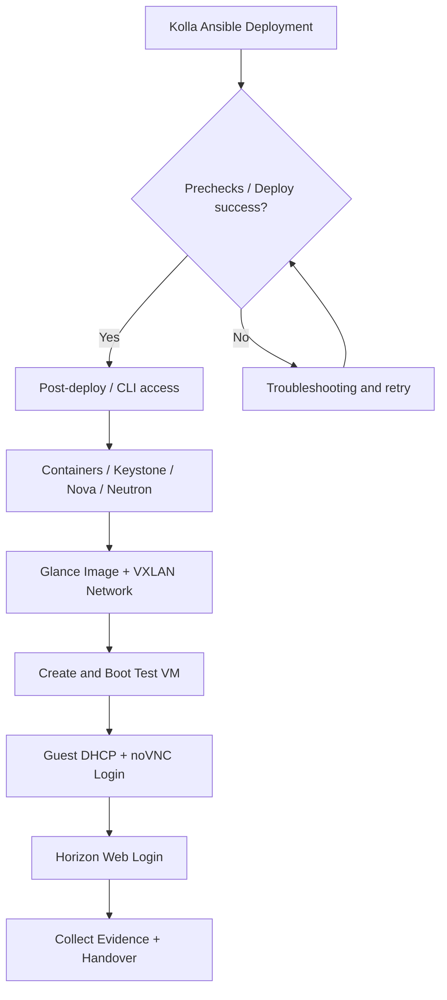
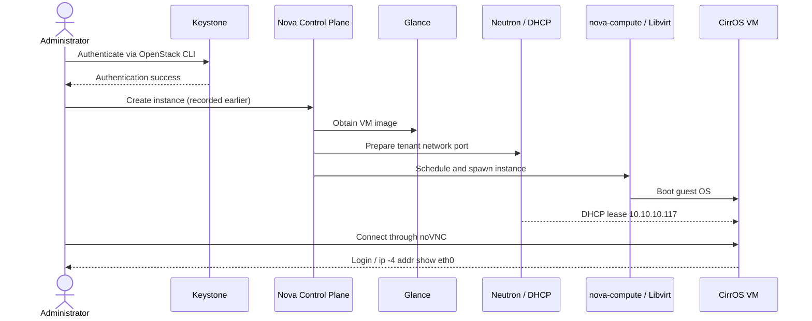
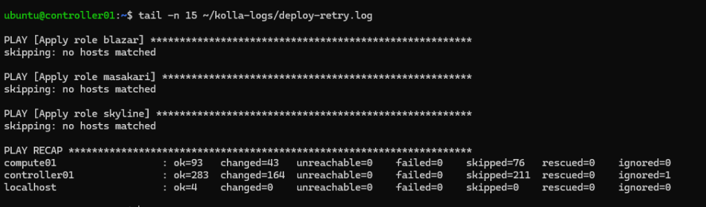

# 05 — Deployment Verification

> **CS223 Term Project — OpenStack Multinode Deployment**  
> **ประเภทเอกสาร:** รายงานตรวจสอบผลการติดตั้งและทดสอบการทำงานของระบบ (Deployment Verification Report)  
> **สภาพแวดล้อม:** OpenStack 2026.1 · Kolla Ansible 22.2.1.dev36 · Ubuntu Server 24.04 LTS  
> **วันที่อ้างอิงผลทดสอบ:** 17 พฤศจิกายน 2026  
> **ผลสรุป:** **PASS — การติดตั้ง OpenStack Multinode และการทดสอบการใช้งานพื้นฐานสำเร็จ**  
> **ขอบเขตการยืนยัน:** Deployment, Core Services, Compute, Tenant Network/DHCP, VM, noVNC และ Horizon

เอกสารนี้รวบรวม **วิธีตรวจสอบ เกณฑ์การผ่าน ผลลัพธ์ที่สังเกตได้จริง และหลักฐาน** ของ OpenStack ที่ติดตั้งด้วย Kolla Ansible บน `controller01` และ `compute01` เพื่อให้สามารถตรวจสอบย้อนกลับได้ว่า Deployment ไม่ได้เพียงจบด้วย Exit Code `0` แต่บริการหลักสามารถทำงานร่วมกันจนสร้างและใช้งาน Virtual Machine (VM) ได้จริง

รายละเอียดการเตรียมเครื่องอยู่ใน [03 — Environment Setup](03-environment-setup.md) และบันทึกขั้นตอนติดตั้งอยู่ใน [04 — Kolla Ansible Deployment](04-kolla-deployment.md) เอกสารฉบับนี้จึงเน้น **การพิสูจน์ผลการทำงาน** ไม่ใช่การสั่ง Deploy ซ้ำ

> [!IMPORTANT]
> ผลในเอกสารเป็น **หลักฐาน ณ ช่วงเวลาที่ทดสอบ** ไม่ใช่การรับประกันว่าสถานะระบบจะคงเดิมตลอดเวลา คำสั่งที่แนะนำสำหรับการตรวจสอบซ้ำส่วนใหญ่เป็นคำสั่งอ่านสถานะ (read-only) และไม่จำเป็นต้องรันซ้ำหากมีหลักฐานเดิมเพียงพอแล้ว

---

## สารบัญ

1. [วัตถุประสงค์และขอบเขต](#1-verification-objectives-and-scope)
2. [สภาพแวดล้อมที่ใช้ตรวจสอบ](#2-test-environment)
3. [วิธีการทดสอบและนิยามสถานะ](#3-verification-methodology)
4. [ภาพรวม Verification Workflow](#4-verification-workflow)
5. [ผล Kolla Prechecks และ Deployment](#5-kolla-ansible-prechecks-and-deployment)
6. [Post-deploy และ OpenStack CLI](#6-post-deploy-and-openstack-cli)
7. [ตรวจสอบ Containers บนทั้งสอง Nodes](#7-container-verification)
8. [Keystone Authentication](#8-keystone-identity-verification)
9. [Nova Compute และ Hypervisor](#9-nova-and-hypervisor-verification)
10. [Neutron Agents](#10-neutron-agent-verification)
11. [Network, Subnet, Port และ DHCP](#11-neutron-network-and-dhcp-verification)
12. [Glance Image และ Flavor](#12-image-and-flavor-verification)
13. [การสร้าง VM และการจัดวางบน Compute](#13-instance-provisioning-verification)
14. [Boot, Console และ Guest Networking](#14-guest-boot-and-network-verification)
15. [Horizon Dashboard](#15-horizon-verification)
16. [วิเคราะห์ผลแบบ End-to-End](#16-end-to-end-verification)
17. [Verification Results Matrix](#17-verification-results-matrix)
18. [Evidence Mapping สำหรับ GitHub](#18-github-evidence-mapping)
19. [แนวทางเตรียม Screenshot](#19-screenshot-preparation-guidelines)
20. [การตรวจสอบซ้ำอย่างปลอดภัย](#20-safe-reverification)
21. [ข้อจำกัดและสิ่งที่ยังไม่ได้พิสูจน์](#21-limitations-and-untested-items)
22. [แนวทางวิเคราะห์เมื่อผลตรวจสอบไม่ผ่าน](#22-diagnostic-guidance)
23. [Acceptance Criteria และ Handover](#23-acceptance-criteria-and-handover)
24. [เอกสารและแหล่งอ้างอิง](#24-references)

---

## 1. Verification Objectives and Scope

### 1.1 วัตถุประสงค์

การตรวจสอบมีเป้าหมายเพื่อพิสูจน์ประเด็นหลักต่อไปนี้

1. Kolla Ansible สามารถ Deploy บริการ OpenStack บน Controller และ Compute Node จนสำเร็จ
2. หลัง Deploy มี Configuration ที่ใช้ Authentication กับ OpenStack API ได้
3. Containers และบริการแกนหลักของ OpenStack อยู่ในสถานะพร้อมใช้งานระหว่างการทดสอบ
4. Nova พบ Compute Node และสามารถ Scheduling/Provisioning VM บน `compute01` ได้
5. Neutron สร้าง VXLAN Tenant Network และแจก IPv4 ให้ VM ผ่าน DHCP ได้
6. Glance จัดเก็บและให้ Nova ใช้ Image ที่อัปโหลดได้
7. VM Boot เข้าระบบปฏิบัติการและผู้ดูแลสามารถ Login ผ่าน noVNC Console ได้
8. Horizon ตอบ HTTP Request และผู้ดูแล Login เข้า Web Dashboard ได้จริง

### 1.2 ขอบเขตการตรวจสอบ

| หมวด | สิ่งที่ตรวจสอบ | ประเภทหลักฐาน |
|---|---|---|
| Deployment | Prechecks, Deploy Recap, Exit Status | Kolla Ansible / Ansible Output |
| Post-deploy | Client Configuration และ OpenStack CLI | Filesystem + CLI |
| Infrastructure | Docker Containers และ Service Status | Host Commands |
| Identity | Keystone Authentication | OpenStack CLI |
| Compute | Nova Services, Hypervisor, Instance Placement | OpenStack CLI |
| Networking | Neutron Agents, VXLAN Network, Subnet, DHCP | CLI + Guest OS |
| Image | Glance Image `active` | OpenStack CLI |
| Guest | VM `ACTIVE`, CirrOS Boot, IPv4/MTU | CLI + noVNC |
| Web UI | Horizon HTTP, Login และ Dashboard | `curl` + Browser |

### 1.3 สิ่งที่ไม่ครอบคลุม

การตรวจสอบนี้ **ไม่ได้ยืนยัน** High Availability, Internet Egress จาก Guest VM, Floating IP ของ OpenStack ชั้นใน, การทำงานของ External Provider Network จริง, Cinder Block Storage, Live Migration, Load/Performance Test, VM-to-VM Connectivity หรือการเข้าถึง Tenant VM จากภายนอกโดยตรง

การมี Neutron L3 Agent อยู่ในสถานะ Alive และการตั้งค่า Gateway ใน Subnet **ไม่เพียงพอ** ที่จะสรุปว่ามี Router และเส้นทางออก Internet ใช้งานได้

---

## 2. Test Environment

### 2.1 ระบบที่ตรวจสอบ

โครงงานสร้าง OpenStack แบบ Multinode **ภายใน Virtual Machines ของ OpenStack อีกชั้นหนึ่ง** โดยมีสอง Nodes

| คุณสมบัติ | `controller01` | `compute01` |
|---|---|---|
| บทบาท | Controller / Deployment Host | Compute Node |
| Host OS | Ubuntu Server 24.04 LTS | Ubuntu Server 24.04 LTS |
| Management IP (ภายใน Lab) | `192.168.1.160` | `192.168.1.7` |
| Management Interface | `ens3` | `ens3` |
| Underlay MTU | `1450` | `1450` |
| บริการเด่น | Keystone, API, Horizon, Nova Control Plane, Neutron, Glance, Database | nova-compute, Libvirt/QEMU/KVM, Open vSwitch |
| เครื่องมือ | Kolla Ansible และ OpenStack CLI | Docker, Libvirt/KVM และ Neutron OVS |

> IP ในตารางเป็น **Management/Underlay Address ของ OpenStack ชั้นใน** ไม่ใช่ IP ของ VM CirrOS และไม่ใช่ IP สำหรับเข้า SSH จาก Windows โดยตรง

### 2.2 Software และ Network Configuration

| รายการ | ค่าที่ใช้จริง |
|---|---|
| OpenStack Release | `2026.1` |
| Kolla Ansible | `22.2.1.dev36` |
| Ansible Core | `2.19.15` |
| OpenStack CLI | `9.0.1` ใน `~/openstack-cli-venv` |
| Container Runtime | Docker |
| Virtualization | Libvirt + QEMU/KVM |
| Neutron Mechanism | Open vSwitch (OVS) |
| Tenant Network Encapsulation | VXLAN |
| Network/API/Tunnel Interface | `ens3` |
| External Interface ใน Lab | `dummy0` (ไม่มี External Uplink จริงที่ยืนยันแล้ว) |
| Kolla Internal VIP | `192.168.1.160` (Controller IP เดียวกันใน Non-HA Lab) |
| Horizon HTTP | `http://192.168.1.160/` จากภายใน Lab |

สำหรับ Configuration รายละเอียด ให้ดู [02 — Architecture](02-architecture.md) และ [04 — Kolla Deployment](04-kolla-deployment.md)

### 2.3 Test Resources ที่สร้างขึ้น

| Resource | Name / Configuration | ผลที่ตรวจสอบแล้ว |
|---|---|---|
| Network | `cs223-private-net` | `ACTIVE`, `vxlan`, MTU `1400` |
| Subnet | `cs223-private-subnet` | `10.10.10.0/24`, DHCP Enabled |
| DHCP Allocation Pool | — | `10.10.10.100`–`10.10.10.200` |
| Subnet Gateway Configuration | — | `10.10.10.1` (ยังไม่มี Router ที่ยืนยันว่าใช้งานจริง) |
| Neutron DHCP Port | — | `10.10.10.100` |
| Glance Image | `cirros-0.6.3` | `active` |
| Flavor | `cs223.tiny` | 1 vCPU, 512 MB RAM, 1 GB Root Disk |
| Instance | `cs223-test-vm` | `ACTIVE` บน `compute01` |
| Guest IPv4 | — | `10.10.10.117/24` |
| Guest MTU | — | `1400` |

ชื่อทรัพยากรเหล่านี้เป็นชื่อที่ใช้อ้างอิงตลอดเอกสาร ไม่ต้องสร้างใหม่เพียงเพื่อทำ Verification

---

## 3. Verification Methodology

### 3.1 หลักการตรวจสอบ

ใช้การตรวจสอบสามระดับเพื่อไม่ให้สรุปจากหลักฐานเพียงประเภทเดียว

1. **Deployment-level evidence:** ยืนยันว่ากระบวนการติดตั้งด้วย Kolla Ansible จบสำเร็จ
2. **Service-level evidence:** ยืนยันว่า OpenStack APIs, Scheduler, Hypervisor และ Network Agents พร้อมใช้งาน
3. **Functional evidence:** ยืนยันว่าผู้ใช้งานสร้าง VM, Boot Guest, ได้รับ IP และใช้ Horizon/noVNC ได้จริง

ตัวอย่าง: `nova-compute` มีสถานะ `up` เป็น Service-level Evidence ส่วน `cs223-test-vm` Boot บน `compute01` เป็น Functional Evidence ที่ช่วยพิสูจน์ว่าหลายบริการทำงานร่วมกัน

### 3.2 การแปลสถานะ

| Status | นิยามในเอกสารนี้ |
|---|---|
| **PASS** | มีผลทดสอบจริงที่สนับสนุนว่าเกณฑ์ผ่าน |
| **NOT TESTED** | ยังไม่มีการทดสอบหรือหลักฐานเพียงพอ ไม่ถือว่า Fail |
| **LIMITATION** | เป็นข้อจำกัดที่ทราบจากสถาปัตยกรรมหรือ Configuration |
| **FAIL** | มีผลตรวจสอบที่ไม่ผ่านเกณฑ์ในรอบนั้นและยังไม่แก้ไข |
| **RESOLVED** | เคย Fail ระหว่างดำเนินงาน แต่แก้ไขและทดสอบใหม่ผ่านแล้ว |

### 3.3 ความแตกต่างระหว่างผลทดสอบกับไฟล์ Screenshot

คำว่า **PASS** ในรายงานหมายถึง **ขั้นตอนเคยทดสอบและผ่านจริง** ส่วนไฟล์ใน `evidence/` เป็น **ไฟล์ภาพที่ต้องจัดเตรียมหรืออัปโหลดแยก**

ดังนั้นรายการ PASS **ไม่ได้หมายความว่า Screenshot ชื่อนั้นอยู่ใน GitHub แล้ว** หากยังไม่ได้เพิ่มภาพ ให้บันทึกสถานะการรวบรวม Evidence แยกจากผลการทดสอบ

### 3.4 การใช้คำสั่งบน `controller01`

OpenStack CLI ติดตั้งอยู่ใน Virtual Environment แยกจาก Kolla Ansible และสามารถใช้ Admin Environment ใน Subshell ได้ดังนี้

```bash
# รันบน controller01 เท่านั้น
(
  source /etc/kolla/admin-openrc.sh
  ~/openstack-cli-venv/bin/openstack server list
)
```

รูปแบบ `(...)` ทำให้ตัวแปรสภาพแวดล้อมสำหรับ Admin อยู่เฉพาะใน Subshell นั้น ๆ

> [!CAUTION]
> อย่าแสดงเนื้อหา `/etc/kolla/admin-openrc.sh`, `/etc/kolla/passwords.yml`, `/etc/kolla/clouds.yaml` หรือค่าของ `OS_PASSWORD` ใน Screenshot และห้ามเผยแพร่ Authentication Token หรือ noVNC Console Token ผ่าน Public GitHub

---

## 4. Verification Workflow



**ผลการทดสอบจริง:** ผ่านจาก Deployment จนถึง VM/Guest Networking และ Horizon Login ครบตาม Workflow ในภาพ

---

## 5. Kolla Ansible Prechecks and Deployment

### 5.1 V-01 — Pre-deployment Checks

**จุดประสงค์:** ตรวจความพร้อมของ Host/Inventory/Network/Services ก่อนติดตั้ง OpenStack

**คำสั่งที่ใช้ในขั้นตอนดำเนินงาน** บน `controller01` ภายใต้ `kolla-venv`:

```bash
kolla-ansible prechecks -i ~/multinode --use-test-images
```

**ผลที่บันทึกได้จริง หลังแก้ปัญหาที่พบระหว่างดำเนินงาน:**

```text
PLAY RECAP *********************************************************************
compute01   : ok=41  changed=0  unreachable=0  failed=0  skipped=38  rescued=0  ignored=0
controller01: ok=76  changed=0  unreachable=0  failed=0  skipped=75  rescued=0  ignored=0
localhost   : ok=12  changed=0  unreachable=0  failed=0  skipped=14  rescued=0  ignored=0

PRECHECK EXIT STATUS: 0
```

**เกณฑ์ผ่าน:** ไม่มี Host ที่ `failed` หรือ `unreachable` และ Kolla Ansible คืน Exit Status `0`

**ผล:** **PASS** — Controller, Compute และ Localhost ผ่านการตรวจสอบ

**Evidence ที่วางแผนเก็บ:** `evidence/01-deployment/01-prechecks.png`

> คำสั่งด้านบนเป็นบันทึกขั้นตอนที่เคยรันสำเร็จ **ไม่จำเป็นต้องรันซ้ำ** บนระบบที่ Deploy สำเร็จแล้วเพียงเพื่อสร้างภาพ

### 5.2 V-02 — Kolla Ansible Deployment

**จุดประสงค์:** ตรวจว่า Kolla Ansible ติดตั้งและกำหนดค่าบริการ OpenStack สำเร็จบนทั้งสอง Nodes

**คำสั่งที่ใช้จริง:**

```bash
kolla-ansible deploy -i ~/multinode
```

**ผล Deploy รอบสุดท้ายที่บันทึกไว้:**

```text
PLAY RECAP *********************************************************************
compute01   : ok=93   changed=43   unreachable=0  failed=0  skipped=76   rescued=0  ignored=0
controller01: ok=283  changed=164  unreachable=0  failed=0  skipped=211  rescued=0  ignored=1
localhost   : ok=4    changed=0    unreachable=0  failed=0  skipped=0    rescued=0  ignored=0

DEPLOY EXIT STATUS: 0
```

**การตีความผล:**

- `failed=0`: ไม่มี Task ที่ล้มเหลวค้างอยู่ใน Play Recap
- `unreachable=0`: Ansible สามารถติดต่อ Hosts ที่อยู่ในรอบ Deploy ได้
- `changed`: จำนวน Tasks ที่มีการเปลี่ยนสถานะตาม Playbook ไม่ใช่ข้อผิดพลาด
- `skipped`: Tasks ที่ไม่เข้าเงื่อนไขหรือไม่ได้เปิดใช้บริการนั้น
- `ignored=1` บน Controller: มี Error ที่ Playbook กำหนดให้ข้ามได้ ต้องดู Context ของ Task เมื่อต้องวิเคราะห์เชิงลึก แต่ **ไม่เท่ากับ `failed=1`**
- `DEPLOY EXIT STATUS: 0`: คำสั่ง Deploy รอบนี้จบสำเร็จ

**เกณฑ์ผ่าน:** `failed=0`, `unreachable=0` และ Exit Status `0`

**ผล:** **PASS**

**Evidence:** `evidence/01-deployment/02-deploy-recap.png`

### 5.3 การแก้ปัญหาก่อน Deploy ผ่าน

การ Deploy รอบแรกเคยมีปัญหา **MariaDB/ProxySQL Port Conflict ที่ TCP 3306** ใน Lab แบบ Non-HA นี้ จากนั้นได้ปรับ Configuration เพื่อไม่เปิด ProxySQL/Load Balancer ที่ไม่จำเป็น และหยุด systemd Services ที่ยังค้างอยู่ ก่อนรันตรวจสอบ/Deploy ใหม่จนผ่าน

การบันทึกประวัตินี้สำคัญ เพราะผลสำเร็จสุดท้ายเกิด **หลัง Troubleshooting และ Retry** ไม่ใช่ผ่านตั้งแต่การรันครั้งแรก

ดูรายละเอียดสาเหตุ คำสั่ง และผลการแก้ไขใน:

- [04 — Kolla Ansible Deployment](04-kolla-deployment.md#10-ปัญหาระหว่าง-deploy-และการแก้ไขจริง)
- [06 — Troubleshooting](06-troubleshooting.md) *(จัดทำในลำดับถัดไป)*

---

## 6. Post-deploy and OpenStack CLI

### 6.1 V-03 — Kolla Ansible Post-deploy

**จุดประสงค์:** เตรียม Client Configuration เพื่อให้ OpenStack CLI สามารถ Authentication และเรียก API ได้

**คำสั่งที่ใช้จริง:**

```bash
kolla-ansible post-deploy -i ~/multinode
```

**ผลที่ยืนยันแล้ว:** คำสั่งสำเร็จและสร้างไฟล์ดังนี้

```text
/etc/kolla/clouds.yaml
/etc/kolla/admin-openrc.sh
```

ไฟล์ทั้งสองมีสิทธิ์แบบจำกัด (`600`) ตามที่ตรวจสอบในช่วงทดสอบ

**คำสั่งตรวจสอบเฉพาะ Metadata ของไฟล์** หากต้องการเก็บหลักฐานเพิ่ม:

```bash
sudo stat -c '%n %a %U:%G' \
  /etc/kolla/clouds.yaml \
  /etc/kolla/admin-openrc.sh
```

**เกณฑ์ผ่าน:** Post-deploy สำเร็จ, มีไฟล์ Client Configuration และนำไปใช้เรียก API ได้

**ผล:** **PASS**

**Evidence:** `evidence/01-deployment/03-post-deploy.png`

> ห้าม `cat` สองไฟล์นี้เพื่อถ่ายภาพหลักฐาน เพราะอาจแสดง Credentials โดยตรง

### 6.2 V-04 — ยืนยันว่าติดต่อ API ผ่าน OpenStack CLI ได้

บน `controller01`:

```bash
(
  source /etc/kolla/admin-openrc.sh
  ~/openstack-cli-venv/bin/openstack service list
)
```

**การแปลผล:** หากคำสั่งแสดงรายการ Services แทน Authentication/Connection Error แสดงว่า CLI เข้าถึง Service Catalog ผ่าน Keystone ได้

**ผลการใช้งานจริง:** OpenStack CLI ถูกใช้ในการตรวจ Token, Nova Services, Neutron Agents, Images, Network และ Instance สำเร็จแล้ว จึงยืนยันการเข้าถึง OpenStack API ผ่าน CLI ได้

**ผล:** **PASS** (ยืนยันจากการใช้งาน CLI หลายคำสั่ง; ไม่ได้อ้างว่ามี Screenshot ของ `service list` แยกต่างหาก)

---

## 7. Container Verification

### 7.1 V-05 — Containers บน Controller

**จุดประสงค์:** ตรวจว่าบริการส่วน Control Plane มี Container ที่ทำงานอยู่

บน `controller01`:

```bash
sudo docker ps --format 'table {{.Names}}\t{{.Status}}\t{{.Image}}'
```

**ตัวอย่างกลุ่มบริการที่ควรพบตาม Role และ Configuration ที่เปิดใช้:** Keystone, Nova API/Scheduler/Conductor, Neutron Server/Agents, Glance, Horizon, MariaDB, RabbitMQ, Memcached และ Open vSwitch

**เกณฑ์การแปลผล:**

- Container ที่ต้องทำงานควรแสดง `Up`
- Container ที่มี Health Check และพร้อมใช้งานควรแสดง `(healthy)`
- สถานะ `Restarting` หรือ `(unhealthy)` ต้องตรวจเพิ่มเติม
- ไม่จำเป็นต้องพบ Containers ของบริการที่ปิดใช้งานใน Configuration

**ผลจากการทดสอบ:** บริการหลักบน Controller ทำงาน และมีผลทดสอบ API/Horizon รองรับข้อสรุปนี้

**ผล:** **PASS** สำหรับ Core Services ที่เกี่ยวข้องกับการทดสอบ

**Evidence:** `evidence/02-services/01-controller-containers.png`

### 7.2 V-06 — Containers บน Compute

**จุดประสงค์:** ตรวจ Runtime ที่ใช้รัน Guest VMs บน `compute01`

บน `compute01`:

```bash
sudo docker ps --format 'table {{.Names}}\t{{.Status}}\t{{.Image}}'
```

**บริการสำคัญ:** Nova Compute, Libvirt และ Open vSwitch ตาม Kolla Configuration

**ผลจากการทดสอบ:** `nova-compute` ลงทะเบียนใน Nova และมี VM `cs223-test-vm` ทำงานบน `compute01` จริง

**เกณฑ์ผ่าน:** Compute Services ทำงานโดยไม่มีสถานะผิดปกติที่ทำให้ VM ใช้งานไม่ได้

**ผล:** **PASS**

**Evidence:** `evidence/02-services/02-compute-containers.png`

> Container `Up` เพียงอย่างเดียวไม่ได้รับประกันว่า API หรือ Guest VM ทำงานได้ จึงต้องพิจารณาผล Nova และ Functional Test ประกอบเสมอ

---

## 8. Keystone Identity Verification

### 8.1 V-07 — Authentication และ Token Issuance

**จุดประสงค์:** ยืนยันว่า Keystone สามารถ Authenticate ผู้ดูแลและออก Token ได้

บน `controller01`:

```bash
(
  source /etc/kolla/admin-openrc.sh
  ~/openstack-cli-venv/bin/openstack token issue -f value -c expires
)
```

คำสั่งเลือกแสดงเฉพาะ **วันหมดอายุของ Token** ไม่แสดง Token ID หรือ Token String

**ผลที่ตรวจสอบจริง:** Keystone ตอบกลับและแสดงค่า Expiration Time ได้

**เกณฑ์ผ่าน:** คำสั่งสำเร็จและมีค่า Expiration ที่ถูกส่งกลับจาก Identity API

**ผล:** **PASS**

**ความสำคัญ:** Keystone เป็นจุดเริ่มต้นของการ Authentication สำหรับคำสั่ง OpenStack CLI และ Login ผ่าน Horizon

---

## 9. Nova and Hypervisor Verification

### 9.1 V-08 — Nova Compute Services

**จุดประสงค์:** ยืนยันว่า Compute Control Plane และ Compute Worker เชื่อมต่อกันและมีสถานะพร้อมใช้งาน

บน `controller01`:

```bash
(
  source /etc/kolla/admin-openrc.sh
  ~/openstack-cli-venv/bin/openstack compute service list
)
```

**รายการที่ตรวจสอบจริง:**

| Binary | Host | Status | State |
|---|---|---|---|
| `nova-scheduler` | `controller01` | `enabled` | `up` |
| `nova-conductor` | `controller01` | `enabled` | `up` |
| `nova-compute` | `compute01` | `enabled` | `up` |

**เกณฑ์ผ่าน:** Services ที่จำเป็นมีสถานะ `enabled` และ `up`

**ผล:** **PASS**

**Evidence:** `evidence/02-services/03-nova-services.png`

**คำอธิบาย:**

- **Nova Scheduler:** เลือก Compute Node ที่เหมาะสมตามความพร้อมของ Resources
- **Nova Conductor:** ประสานงานการดำเนินการของ Compute Services โดยไม่ให้ Compute Worker เข้าถึง Database โดยตรงทุกส่วน
- **Nova Compute:** ติดต่อกับ Virtualization Driver/Libvirt เพื่อจัดการ VM บน Compute Node

### 9.2 V-09 — Hypervisor Registration

**จุดประสงค์:** ยืนยันว่าระบบ Nova พบ Hypervisor ของ `compute01`

```bash
(
  source /etc/kolla/admin-openrc.sh
  ~/openstack-cli-venv/bin/openstack hypervisor list
)
```

**ผลที่ตรวจสอบจริง:** พบ Hypervisor `compute01` และ State เป็น `up`

ในการตรวจสอบรายละเอียด Hypervisor ผ่าน Compute API Microversion `2.87` เคยสังเกตทรัพยากรประมาณ **4 vCPUs, 9,945 MB RAM และ 39 GB Local Disk** ก่อนสร้าง Test VM (ค่าทรัพยากรและการใช้งานอาจเปลี่ยนแปลงตามเวลา)

**เกณฑ์ผ่าน:** พบ Compute Hypervisor และสถานะ `up`

**ผล:** **PASS**

### 9.3 ขอบเขตของผล Nova

ผลนี้พิสูจน์การสื่อสารของ Nova Services และการรับงานบน Compute ได้ ไม่ใช่การทดสอบ Live Migration, Evacuation, Autoscaling หรือ High Availability

---

## 10. Neutron Agent Verification

### 10.1 V-10 — ตรวจสอบ Network Agents

**จุดประสงค์:** ยืนยันว่า Neutron Agents สำหรับจัดการ Network, DHCP, Metadata, L3 และ Open vSwitch มีสถานะ Alive

```bash
(
  source /etc/kolla/admin-openrc.sh
  ~/openstack-cli-venv/bin/openstack network agent list
)
```

**ผลที่ยืนยันจริง:** พบ Neutron Agents จำนวน **5 ตัว** ทั้งหมดแสดง Alive (`:-)`)

| Agent Type | Host | จำนวนที่ตรวจพบ | สถานะ |
|---|---|---:|---|
| Metadata Agent | `controller01` | 1 | Alive |
| DHCP Agent | `controller01` | 1 | Alive |
| L3 Agent | `controller01` | 1 | Alive |
| Open vSwitch Agent | `controller01` | 1 | Alive |
| Open vSwitch Agent | `compute01` | 1 | Alive |
| **รวม** | | **5** | **ผ่านทั้งหมด** |

**เกณฑ์ผ่าน:** Agents ที่จำเป็นแสดง Alive และไม่มี Agent สำคัญ Down ระหว่างการทดสอบ

**ผล:** **PASS**

**Evidence:** `evidence/02-services/04-neutron-agents.png`

### 10.2 ความหมายของ `Alive` และ `UP`

- **Alive:** Neutron Server ได้รับ Heartbeat จาก Agent และเห็นว่ายังทำงานอยู่
- **Administrative State UP:** Agent ถูกเปิดให้ทำงานในระบบ
- ตัวชี้วัดทั้งสองมีประโยชน์ แต่ **ไม่เพียงพอ** ที่จะพิสูจน์ว่า VM สามารถออก Internet หรือสื่อสารข้าม Network ได้

จึงมีการตรวจสอบ Network Objects, DHCP และ Guest IPv4 ในหัวข้อถัดไป

---

## 11. Neutron Network and DHCP Verification

### 11.1 V-11 — Tenant VXLAN Network

**จุดประสงค์:** ตรวจว่า Tenant Network สำหรับ VM ถูกสร้างใน Neutron ด้วยชนิดและ MTU ที่ออกแบบไว้

```bash
(
  source /etc/kolla/admin-openrc.sh
  ~/openstack-cli-venv/bin/openstack network show cs223-private-net \
    -c name -c status -c mtu \
    -c provider:network_type -c provider:segmentation_id
)
```

**ค่าที่เคยตรวจสอบจริง:**

| Field | Observed Value |
|---|---|
| Name | `cs223-private-net` |
| Status | `ACTIVE` |
| Network Type | `vxlan` |
| Segmentation ID | `985` |
| MTU | `1400` |

**เกณฑ์ผ่าน:** Network มีสถานะ `ACTIVE` และสอดคล้องกับการออกแบบ VXLAN/MTU

**ผล:** **PASS**

### 11.2 V-12 — Subnet และ DHCP

```bash
(
  source /etc/kolla/admin-openrc.sh
  ~/openstack-cli-venv/bin/openstack subnet show cs223-private-subnet \
    -c name -c cidr -c enable_dhcp -c gateway_ip -c allocation_pools
)
```

**ผลจากการกำหนดค่าและตรวจสอบ:**

| Field | Value |
|---|---|
| Subnet Name | `cs223-private-subnet` |
| CIDR | `10.10.10.0/24` |
| DHCP | Enabled |
| Allocation Pool | `10.10.10.100`–`10.10.10.200` |
| Gateway IP ที่ระบุใน Subnet | `10.10.10.1` |

Neutron จัด DHCP Port บน Controller ด้วย IP `10.10.10.100` และ Guest VM ได้รับ IP `10.10.10.117`

**เกณฑ์ผ่าน:** Subnet มี DHCP Enabled และ Guest ได้ IP ภายใน Allocation Pool

**ผล:** **PASS**

### 11.3 V-13 — ยืนยัน DHCP ผ่าน Guest จริง

ใน Console Boot Log ของ CirrOS ปรากฏการรับ Lease `10.10.10.117` จาก DHCP Server `10.10.10.100` และการตรวจใน Guest OS พบ IP ดังกล่าวบน `eth0`

**เหตุผลที่ใช้ผลใน Guest:** เพียงมี DHCP Agent `Alive` หรือมี DHCP Port ใน Neutron ยังไม่เท่ากับ Guest ได้รับ IP จริง การอ่าน Network Interface ภายใน VM จึงเป็นหลักฐานเชิง Functional ที่สำคัญ

**ผล:** **PASS**

**Evidence หลัก:** `evidence/03-vm-validation/03-cirros-network.png`

### 11.4 ข้อควรระวังเรื่อง Gateway

แม้ Subnet ระบุ Gateway `10.10.10.1` แต่ในการทดสอบนี้ **ยังไม่ได้ยืนยันว่ามี Neutron Router/Router Interface ที่ตอบสนองบน IP ดังกล่าว** และยังไม่ได้พิสูจน์ External Route

ดังนั้นต้อง **ไม่เขียน** ว่า VM สามารถ Ping Internet หรือใช้ Floating IP ได้จากผล DHCP นี้เพียงอย่างเดียว

---

## 12. Image and Flavor Verification

### 12.1 V-14 — Glance Image

**จุดประสงค์:** ยืนยันว่ามี Image ที่ Nova ใช้สร้าง VM ได้

```bash
(
  source /etc/kolla/admin-openrc.sh
  ~/openstack-cli-venv/bin/openstack image show cirros-0.6.3 \
    -c name -c status -c disk_format -c container_format
)
```

**ผลที่ตรวจสอบจริง:** Image `cirros-0.6.3` ถูกอัปโหลดและมี Status `active` โดยใช้ไฟล์ Disk Image รูปแบบ QCOW2 ที่ตรวจสอบ SHA256 ก่อนอัปโหลด

**เกณฑ์ผ่าน:** Image อยู่ในสถานะ `active` และสามารถใช้ Boot Test Instance ได้

**ผล:** **PASS**

**หมายเหตุ:** การที่ VM Boot จาก Image ได้จริงเป็นหลักฐานเสริมว่าการใช้งาน Glance ร่วมกับ Nova สำเร็จ ไม่ใช่เพียงมี Image Record ในฐานข้อมูล

### 12.2 V-15 — Nova Flavor

```bash
(
  source /etc/kolla/admin-openrc.sh
  ~/openstack-cli-venv/bin/openstack flavor show cs223.tiny \
    -c name -c vcpus -c ram -c disk
)
```

| Property | Value |
|---|---:|
| Flavor | `cs223.tiny` |
| vCPU | 1 |
| RAM | 512 MB |
| Root Disk | 1 GB |

**ผล:** **PASS** — Flavor ถูกสร้างและนำไปใช้กับ Test VM ได้

---

## 13. Instance Provisioning Verification

### 13.1 V-16 — Instance Status และ Placement

**จุดประสงค์:** ยืนยันว่า Nova สามารถจัดวาง VM บน Compute Node ที่ต้องการและ Boot ได้

```bash
(
  source /etc/kolla/admin-openrc.sh
  ~/openstack-cli-venv/bin/openstack server show cs223-test-vm \
    -c name -c status -c addresses -c OS-EXT-SRV-ATTR:host
)
```

**ผลที่ยืนยันจริง (สรุป Fields สำคัญ ไม่ใช่ Output ตรงทุกบรรทัด):**

```text
name                  cs223-test-vm
status                ACTIVE
addresses             cs223-private-net=10.10.10.117
OS-EXT-SRV-ATTR:host  compute01
```

**เกณฑ์ผ่าน:** Instance เป็น `ACTIVE`, มี IP บน Tenant Network และถูกจัดวางบน `compute01`

**ผล:** **PASS**

**Evidence:** `evidence/03-vm-validation/01-instance-active.png`

### 13.2 สิ่งที่ผลนี้สะท้อน

การสร้าง VM จนเป็น `ACTIVE` สนับสนุนว่าบริการสำคัญประสานงานกันได้ ได้แก่

- **Keystone:** ยืนยันสิทธิ์ของ Client
- **Nova API / Scheduler / Conductor:** รับคำขอและจัดการการสร้าง VM
- **Placement:** ให้ข้อมูล Resource Provider สำหรับ Scheduling ตาม Workflow ปกติของ Nova (ยังไม่ได้ทดสอบ Placement API หรือ Allocation โดยตรง)
- **Glance:** จัดเตรียม Image สำหรับ Boot
- **Neutron:** เตรียม Network/Port ของ Instance
- **nova-compute / Libvirt / QEMU-KVM:** สร้างและรัน Guest บน `compute01`

> การใช้ Instance ที่ `ACTIVE` เป็นหลักฐานแบบ End-to-End **ไม่ได้ยืนยัน** ว่าแต่ละ Internal API ของทุก Service ถูกตรวจสอบแยกครบทุก Endpoint

### 13.3 Instance IDs และการตรวจสอบย้อนหลัง

ในช่วงทดสอบ Instance ใช้ชื่อ `cs223-test-vm` และ Nova Server ID:

```text
d345db04-76c1-4407-9460-461505455c9e
```

ตัวระบุนี้ช่วยเทียบ Output หรือ Screenshots ที่เกิดในช่วงทดสอบเดียวกัน หากมีการลบ/สร้าง Instance ใหม่ในภายหลัง ID จะเปลี่ยน จึงควรอ้างอิงผลพร้อมวันที่ตรวจสอบ

---

## 14. Guest Boot and Network Verification

### 14.1 V-17 — CirrOS Boot Log

**จุดประสงค์:** ตรวจว่า Guest OS Boot ถึง Login Prompt และ Network Configuration เริ่มต้นสำเร็จ

บน `controller01`:

```bash
(
  source /etc/kolla/admin-openrc.sh
  ~/openstack-cli-venv/bin/openstack console log show \
    --lines 80 cs223-test-vm
)
```

**ผลที่ตรวจสอบจริง:** CirrOS Boot ถึง Login Prompt และ Boot Log แสดงการได้รับ DHCP Lease สำหรับ IP `10.10.10.117` จาก `10.10.10.100`

**เกณฑ์ผ่าน:** VM Boot ได้ และมี Login Prompt โดยไม่มี Boot Failure ที่ทำให้เข้าระบบไม่ได้

**ผล:** **PASS**

### 14.2 V-18 — noVNC Console Access

**จุดประสงค์:** พิสูจน์ว่า Nova Console Infrastructure และ noVNC สามารถแสดง VM Console จาก Browser ได้

เนื่องจาก Controller อยู่บน Private IP จึงใช้ **SSH Tunnel จาก Windows WSL** ตามรูปแบบต่อไปนี้:

```bash
# รันบน Windows WSL (แทนค่า Placeholder ด้วยข้อมูลที่ได้รับอนุญาต)
ssh -i ~/.ssh/YOUR_SSH_KEY \
  -o IdentitiesOnly=yes \
  -o ExitOnForwardFailure=yes \
  -N \
  -L 127.0.0.1:6080:192.168.1.160:6080 \
  ubuntu@YOUR_CONTROLLER_SSH_IP
```

บน `controller01` สามารถขอ noVNC URL สำหรับ VM ได้ด้วยคำสั่ง OpenStack CLI แต่ **URL เต็มมี Console Token** จึงไม่ควรนำไปใส่รายงานหรือ Screenshot

```bash
(
  source /etc/kolla/admin-openrc.sh
  ~/openstack-cli-venv/bin/openstack console url show \
    --novnc -f value -c url cs223-test-vm
)
```

ตอนเปิดผ่าน Windows ให้เปลี่ยน Host/Port ของ URL ไปเป็น `127.0.0.1:6080` โดยคง Path และ Token ที่ได้ไว้ใน Browser ของผู้ได้รับอนุญาตเท่านั้น

**ผลที่ตรวจสอบจริง:** Browser เชื่อมต่อ noVNC กับ QEMU Console ได้ และเข้าสู่ CirrOS Shell สำเร็จ

**เกณฑ์ผ่าน:** ผู้ดูแลที่มีสิทธิ์สามารถเปิด Console และ Login เข้า Guest OS ได้

**ผล:** **PASS**

**Evidence:** `evidence/03-vm-validation/02-cirros-console.png`

### 14.3 V-19 — ตรวจ IP และ MTU ภายใน CirrOS

**คำสั่งที่รันจริงใน Guest Console:**

```bash
ip -4 addr show eth0
```

**Output สำคัญที่สังเกตได้:**

```text
2: eth0: <BROADCAST,MULTICAST,UP,LOWER_UP> mtu 1400
    inet 10.10.10.117/24 brd 10.10.10.255
```

**การแปลผล:**

| ค่า | ความหมาย |
|---|---|
| `eth0` | Network Interface ของ Guest VM |
| `UP` | Interface ถูกเปิดใช้งานใน Guest |
| `LOWER_UP` | Guest เห็น Link Layer พร้อมทำงาน |
| `mtu 1400` | สอดคล้องกับ Neutron VXLAN Network MTU |
| `10.10.10.117/24` | Guest ได้รับ IPv4 ภายใน Subnet ที่กำหนด |
| `10.10.10.255` | Broadcast Address ของ `10.10.10.0/24` |

**เกณฑ์ผ่าน:** Guest มี Interface พร้อมใช้งานและ IP ที่สอดคล้องกับ Neutron Network/Subnet

**ผล:** **PASS**

**Evidence:** `evidence/03-vm-validation/03-cirros-network.png`

> `UP, LOWER_UP` และ IPv4 Address ไม่ใช่หลักฐานว่า Ping ไป Internet ได้ หรือมีการทดสอบ VM-to-VM Connectivity แล้ว

---

## 15. Horizon Verification

### 15.1 V-20 — Horizon HTTP Response

**จุดประสงค์:** ยืนยันว่า Web Server ของ Horizon ตอบสนอง HTTP Request ได้จากภายใน Lab

รันบน `controller01`:

```bash
curl -I --max-time 5 http://192.168.1.160/
```

**ผลจริงที่บันทึกได้:**

```http
HTTP/1.1 302 Found
Content-Type: text/html; charset=utf-8
Location: http://192.168.1.160/auth/login/?next=/
X-Frame-Options: DENY
Vary: Accept-Language, Cookie
Content-Language: en
Content-Length: 0
Connection: close
```

**การแปลผล:** HTTP `302 Found` พร้อม `Location: /auth/login/` แสดงว่า Horizon ตอบ Request และ Redirect ไปหน้า Login ตาม Workflow ปกติ ไม่ใช่การตอบ Error `5xx`

**เกณฑ์ผ่าน:** HTTP Response สามารถนำไปยังหน้า Login ได้

**ผล:** **PASS**

### 15.2 V-21 — เปิด Horizon จาก Windows

เพราะ `192.168.1.160` อยู่ในเครือข่ายภายใน Lab จึงใช้ SSH Local Port Forwarding จาก Windows WSL:

```bash
# Windows WSL
ssh -i ~/.ssh/YOUR_SSH_KEY \
  -o IdentitiesOnly=yes \
  -o ExitOnForwardFailure=yes \
  -N \
  -L 127.0.0.1:8080:192.168.1.160:80 \
  ubuntu@YOUR_CONTROLLER_SSH_IP
```

จาก Browser บน Windows เปิด:

```text
http://127.0.0.1:8080/
```

**ผลจริง:** แสดงหน้า OpenStack Horizon Login ได้สำเร็จ

**เกณฑ์ผ่าน:** Browser เข้าถึงหน้า Login ได้ผ่าน Tunnel

**ผล:** **PASS**

### 15.3 V-22 — Horizon Authentication และ Dashboard Overview

หลังจากกรอก Credentials ของบัญชี Admin ที่ได้รับอนุญาต สามารถ Login เข้า Horizon Dashboard และเปิดหน้า Overview ได้จริง

**ค่าที่เห็นบน Dashboard ในช่วงทดสอบ:**

| Resource | Observed Value |
|---|---:|
| Instances | 1 จาก Quota 10 |
| vCPU ใช้งาน | 1 จาก Quota 20 |
| RAM ใช้งาน | 512 MB |
| Networks | 1 |
| Ports | 2 |

ค่าในหน้า Dashboard สอดคล้องกับ Instance `cs223-test-vm` ที่สร้างอยู่ในระบบ

**เกณฑ์ผ่าน:** Login สำเร็จและ Dashboard แสดงข้อมูลทรัพยากรของ Project

**ผล:** **PASS**

**Evidence:** `evidence/04-horizon/01-horizon-dashboard.png`

> [!NOTE]
> `127.0.0.1:8080` คือ Address **บนเครื่องผู้ที่เปิด SSH Tunnel** ไม่ใช่ Public Horizon URL ของระบบ คนที่ 3 ต้องมีสิทธิ์เข้า Controller และสร้าง Tunnel เองก่อนใช้งาน

---

## 16. End-to-End Verification

### 16.1 เส้นทางการทำงานที่ได้รับการพิสูจน์



> แผนภาพสรุปลำดับเชิงแนวคิดของ OpenStack Provisioning Workflow พร้อมผลปลายทางที่ได้รับการพิสูจน์ ไม่ได้หมายความว่ามี Tracing Log ของทุก Internal API Call ในภาพ

### 16.2 ทำไมต้องทดสอบ VM จริง?

การที่ Kolla Ansible Deploy สำเร็จและ Containers แสดง `Up` **ยังไม่เพียงพอ** ที่จะพิสูจน์ว่าสามารถให้บริการ IaaS ได้ครบวงจร

การสร้าง `cs223-test-vm` และ Boot จน Login ได้ช่วยยืนยันการทำงานร่วมกันของหลายส่วน:

1. CLI สามารถ Authenticate กับระบบได้
2. Nova รับคำสั่งสร้าง Instance และกำหนด Compute Host ได้
3. Glance Image ถูกนำไปใช้ Boot Guest OS ได้
4. Neutron สร้าง Port/เครือข่ายที่ VM ใช้งานได้
5. Nova Compute และ Libvirt/KVM รัน Guest VM ได้จริง
6. Guest ติดต่อ DHCP และได้รับ IPv4/MTU ที่สอดคล้องกับ Network Design
7. noVNC และ Horizon ให้ผู้ดูแลเข้าถึงระบบผ่าน Web UI ได้

ข้อสรุปนี้จำกัดเฉพาะ **การทำงานพื้นฐานของ Lab** ไม่รวม Internet Egress หรือความสามารถขั้นสูงที่ยังไม่ได้ทดสอบ

---

## 17. Verification Results Matrix

ตารางสรุปนี้เป็นรายการตรวจสอบจากผลที่บันทึกได้จริง ณ วันที่ทดสอบ

| ID | Test Case | เกณฑ์ผ่าน | Observed Result | Status |
|---|---|---|---|---|
| V-01 | Kolla Prechecks | `failed=0`, Exit `0` | Controller/Compute/Localhost ผ่าน | **PASS** |
| V-02 | Kolla Deploy | `failed=0`, Exit `0` | Deploy รอบสุดท้ายสำเร็จ | **PASS** |
| V-03 | Post-deploy | ได้ Client Configuration | `clouds.yaml`, `admin-openrc.sh` | **PASS** |
| V-04 | OpenStack CLI | API Commands ใช้ได้ | เรียก Nova/Neutron/Glance ได้ | **PASS** |
| V-05 | Controller Containers | Core Containers ทำงาน | Services รองรับการใช้งานจริง | **PASS** |
| V-06 | Compute Containers | Compute Runtime ทำงาน | รัน CirrOS VM ได้จริง | **PASS** |
| V-07 | Keystone | Authentication สำเร็จ | `token issue` คืนค่า Expiration | **PASS** |
| V-08 | Nova Services | Services เป็น `up` | Scheduler, Conductor, Compute `up` | **PASS** |
| V-09 | Hypervisor | Compute Hypervisor `up` | พบ `compute01` | **PASS** |
| V-10 | Neutron Agents | Agents Alive | 5 Agents Alive | **PASS** |
| V-11 | Tenant Network | Network `ACTIVE` | VXLAN, MTU `1400` | **PASS** |
| V-12 | Subnet/DHCP | DHCP Enabled | `10.10.10.0/24`, Pool ตามกำหนด | **PASS** |
| V-13 | DHCP Lease | Guest ได้ IP | `10.10.10.117` จาก DHCP | **PASS** |
| V-14 | Glance Image | Image `active` | `cirros-0.6.3` `active` | **PASS** |
| V-15 | Flavor | Resource Definition ใช้งานได้ | `cs223.tiny` | **PASS** |
| V-16 | VM Instance | Instance `ACTIVE` | `cs223-test-vm` บน `compute01` | **PASS** |
| V-17 | CirrOS Boot | Boot ถึง Login Prompt | Boot สำเร็จ | **PASS** |
| V-18 | noVNC Console | เปิด Console / Login ได้ | Login เข้า Guest Shell | **PASS** |
| V-19 | Guest IPv4/MTU | IP และ MTU ถูกต้อง | `10.10.10.117/24`, MTU 1400 | **PASS** |
| V-20 | Horizon HTTP | Web Server ตอบ | HTTP 302 ไป Login | **PASS** |
| V-21 | Horizon Browser | แสดง Login Page | เปิดผ่าน SSH Tunnel ได้ | **PASS** |
| V-22 | Horizon Dashboard | Login และเห็น Overview | Admin Dashboard ใช้งานได้ | **PASS** |

**ผลสรุป:** **22/22 Test Cases ในขอบเขตการทดสอบพื้นฐานผ่าน** ตามผลที่ตรวจสอบไว้ โดยเป็นการนับจาก **รายการ Test Cases ของเอกสารนี้** ไม่ใช่ผลของ Automated Test Suite และไม่รวมความสามารถที่ระบุว่า NOT TESTED

---

## 18. GitHub Evidence Mapping

### 18.1 โครงสร้างหลักฐานที่กำหนดไว้

```text
evidence/
├── 01-deployment/
│   ├── 01-prechecks.png
│   ├── 02-deploy-recap.png
│   └── 03-post-deploy.png
├── 02-services/
│   ├── 01-controller-containers.png
│   ├── 02-compute-containers.png
│   ├── 03-nova-services.png
│   └── 04-neutron-agents.png
├── 03-vm-validation/
│   ├── 01-instance-active.png
│   ├── 02-cirros-console.png
│   └── 03-cirros-network.png
└── 04-horizon/
    └── 01-horizon-dashboard.png
```

### 18.2 Evidence Register

| Evidence File (ตำแหน่งสัมพัทธ์จาก Repository Root) | อธิบายสิ่งที่ต้องเห็น | Test IDs |
|---|---|---|
| `evidence/01-deployment/01-prechecks.png` | Prechecks Recap และ Exit Status `0` | V-01 |
| `evidence/01-deployment/02-deploy-recap.png` | Deploy Recap `controller01`/`compute01`, `failed=0`, Exit `0` | V-02 |
| `evidence/01-deployment/03-post-deploy.png` | ผล Post-deploy หรือการมี Client Configuration โดยไม่เปิดเผย Credentials | V-03–V-04 |
| `evidence/02-services/01-controller-containers.png` | Container Names/Statuses บน `controller01` | V-05 |
| `evidence/02-services/02-compute-containers.png` | Container Names/Statuses บน `compute01` | V-06 |
| `evidence/02-services/03-nova-services.png` | Scheduler/Conductor/Compute แสดง `up` | V-08–V-09 |
| `evidence/02-services/04-neutron-agents.png` | Neutron Agents 5 ตัวแสดง Alive | V-10 |
| `evidence/03-vm-validation/01-instance-active.png` | VM Name, `ACTIVE`, IP และ Compute Host | V-14–V-16 |
| `evidence/03-vm-validation/02-cirros-console.png` | CirrOS Boot และ Login ผ่าน noVNC | V-17–V-18 |
| `evidence/03-vm-validation/03-cirros-network.png` | `ip -4 addr show eth0`, IPv4 `10.10.10.117/24`, MTU 1400 | V-11–V-13, V-19 |
| `evidence/04-horizon/01-horizon-dashboard.png` | Horizon Overview หลัง Login | V-20–V-22 |

> [!IMPORTANT]
> ตารางด้านบนคือ **แผนการเชื่อมหลักฐาน** ไม่ใช่การยืนยันว่าไฟล์ PNG ทั้ง 11 ไฟล์ถูกอัปโหลดเข้า GitHub แล้ว เมื่อจัดเตรียมภาพจริงและตรวจข้อมูลลับเสร็จจึงค่อยนำไฟล์ไปไว้ตามชื่อที่กำหนด

### 18.3 ตัวอย่างการแสดงภาพใน Markdown (หลังอัปโหลดภาพแล้ว)

เมื่อไฟล์หลักฐานมีอยู่จริง สามารถใส่ไว้ในเอกสารนี้ เช่น:

```markdown


*ภาพ: Deploy รอบที่สำเร็จ แสดง failed=0 และ Exit Status 0*
```

ไม่จำเป็นต้อง Embed ทุกภาพไว้หลายตำแหน่งซ้ำ ๆ สามารถแทรกภาพในหัวข้อที่เกี่ยวข้องแล้วใช้ตาราง Evidence Register เป็นดัชนีอ้างอิงก็ได้

### 18.4 Metadata ที่ควรจดประกอบหลักฐาน

ควรระบุอย่างน้อย **วันที่ทดสอบ**, **Node/Command**, **สิ่งที่ภาพพิสูจน์** และ **ผลผ่าน/ไม่ผ่าน** ในคำบรรยายภาพหรือ Commit Message เช่น:

```text
Evidence: Nova compute services
Captured on: 2026-11-17
Host: controller01
Command: openstack compute service list
Result: nova-scheduler, nova-conductor, nova-compute are enabled/up
```

หากวัน Capture ใหม่ต่างจากวันทดสอบเดิม ให้ระบุวันจริงของภาพ ไม่เปลี่ยนวันย้อนหลังให้เหมือนหลักฐานเดิม

---

## 19. Screenshot Preparation Guidelines

### 19.1 แนวทางสำหรับ Terminal Screenshot

1. ให้เห็นบริบทว่ารันบน `controller01`, `compute01` หรือ CirrOS Guest
2. แสดง **Command + Output ที่จำเป็น** ในภาพเดียวกันเมื่อทำได้
3. เน้นค่าที่ใช้พิสูจน์ เช่น `failed=0`, `Exit Status: 0`, `up`, `ACTIVE` หรือ `10.10.10.117/24`
4. เลี่ยงการแสดงคำสั่งที่พิมพ์ Credentials หรือ Secret ออกสู่ Terminal
5. หาก Output ยาว ให้ Crop เฉพาะส่วนสำคัญโดยไม่ตัดข้อความจนเสียบริบท
6. ใช้ภาพเดิมที่บันทึกจากการ Deploy จริงได้ ไม่จำเป็นต้องรัน Deployment ซ้ำ

### 19.2 แนวทางสำหรับ Horizon/Browser Screenshot

- ควรแสดงหน้า Overview หลัง Login ซึ่งเห็นภาพรวม Resources
- ตัด Address Bar ออกเมื่อมี Token/Query String ที่อ่อนไหว
- ไม่แสดง Passwords, Session Cookies, Private Keys หรือ Console Tokens
- ไม่จำเป็นต้องเผยแพร่ทุก URL/IP ของระบบชั้นนอกใน Public Repo
- ตรวจชื่อ Project, Username และข้อมูลที่เกี่ยวข้องก่อนเผยแพร่ตามนโยบายของทีม

### 19.3 ตัวอย่าง Caption ภาษาไทย

**Deployment:**

> ภาพแสดงผล Kolla Ansible Deploy รอบสุดท้ายของ `controller01` และ `compute01` โดย `failed=0`, `unreachable=0` และ Exit Status เป็น `0`

**Nova:**

> ภาพแสดงสถานะ Nova Scheduler, Conductor และ Compute Service ซึ่งอยู่ในสถานะ `enabled/up` และยืนยันว่ามี Compute Node ลงทะเบียนในระบบ

**Guest Network:**

> ภาพแสดงผลคำสั่ง `ip -4 addr show eth0` ภายใน CirrOS โดย Guest ได้รับ IPv4 `10.10.10.117/24` และใช้ MTU `1400` ตาม Tenant Network

**Horizon:**

> ภาพแสดง OpenStack Horizon Dashboard หลังเข้าสู่ระบบสำเร็จ พร้อมจำนวน Instance และทรัพยากรที่ใช้งานระหว่างการทดสอบ

---

## 20. Safe Reverification

ระบบปัจจุบันติดตั้งและทดสอบผ่านแล้ว การตรวจสอบเพื่อทำรายงานเพิ่มเติมควรใช้ **คำสั่งอ่านสถานะเท่านั้น** ไม่เปลี่ยน Configuration และไม่สร้าง/ลบทรัพยากรโดยไม่จำเป็น

### 20.1 Read-only Commands ที่แนะนำ

**บน `controller01`:**

```bash
# สถานะ Containers
sudo docker ps --format 'table {{.Names}}\t{{.Status}}'

# สถานะ Horizon HTTP
curl -I --max-time 5 http://192.168.1.160/

# สถานะ OpenStack Core Services / VM
(
  source /etc/kolla/admin-openrc.sh
  OSC=~/openstack-cli-venv/bin/openstack
  "$OSC" compute service list
  "$OSC" hypervisor list
  "$OSC" network agent list
  "$OSC" image list
  "$OSC" server list
)
```

**บน `compute01`:**

```bash
sudo docker ps --format 'table {{.Names}}\t{{.Status}}'
```

**ภายใน CirrOS Guest (หาก Console ยังคงเปิดใช้งาน):**

```bash
ip -4 addr show eth0
```

คำสั่งเหล่านี้เหมาะสำหรับดูสถานะ ณ ปัจจุบัน แต่ **ไม่ทดแทนผล Deployment Recap เก่าที่บันทึกจากช่วงติดตั้ง**

### 20.2 สิ่งที่ไม่ควรรันซ้ำเพียงเพื่อเก็บหลักฐาน

```bash
# ตัวอย่างคำสั่งที่เปลี่ยน State — ไม่ใช่ Verification Read-only
kolla-ansible bootstrap-servers -i ~/multinode
kolla-ansible deploy -i ~/multinode
kolla-ansible reconfigure -i ~/multinode
kolla-ansible destroy -i ~/multinode
```

การ Deploy/Reconfigure/Destroy ควรมี Change Plan หรือ Restore Plan และตรวจผลกระทบต่อ VM/Services ก่อนดำเนินการ ไม่ควรใช้เพื่อสร้าง Screenshot

---

## 21. Limitations and Untested Items

### 21.1 รายการที่ยังไม่ได้ทดสอบ

| รายการ | สถานะ | เหตุผล / ข้อสังเกต |
|---|---|---|
| VM-to-VM Ping ข้าม Compute Nodes | **NOT TESTED** | Lab มี Test VM เพียงหนึ่งเครื่องและ Compute Node เดียว |
| ICMP/Ping ภายใน Tenant Network ถึง Router | **NOT TESTED** | ไม่ได้ยืนยัน Router Interface ที่ Gateway `10.10.10.1` |
| Floating IP ของ OpenStack ชั้นใน | **NOT TESTED** | ไม่ได้สร้าง/ทดสอบ External Provider Network จริง |
| Guest Internet Access | **NOT TESTED** | `dummy0` ไม่ใช่ Uplink สู่ Internet |
| Inter-network Routing | **NOT TESTED** | ยังไม่มีการทดสอบ Router เชื่อมหลาย Tenant Networks |
| Cinder Volume | **OUT OF SCOPE** | ไม่เปิด Cinder ใน Deployment นี้ |
| Heat Stack | **OUT OF SCOPE** | ไม่เปิด Heat ใน Deployment นี้ |
| High Availability / Failover | **OUT OF SCOPE** | มี Controller เพียงหนึ่งเครื่อง |
| Live Migration | **NOT TESTED** | ยังไม่ได้ทดสอบการย้าย VM |
| Load / Performance Benchmark | **NOT TESTED** | ไม่มีผล Load Test ที่บันทึกไว้ |
| Placement API Allocation Detail | **NOT TESTED DIRECTLY** | ยืนยันได้จาก VM Scheduling ทางอ้อม แต่ไม่ได้อ่าน Placement API โดยตรง |
| Production Security Hardening | **OUT OF SCOPE** | เป็น Lab เพื่อการศึกษา ไม่ใช่ Production Deployment |

### 21.2 ข้อจำกัดทางสถาปัตยกรรม

- **Single Controller:** `controller01` เป็น Single Point of Failure ของ Control Plane
- **Single Compute:** ไม่มี Compute Node อื่นสำหรับรับงานเมื่อ `compute01` ล้มเหลว
- **Shared Underlay Interface:** `ens3` ใช้สำหรับ Management, API และ VXLAN Tunnel
- **Nested Virtualization:** OpenStack ชั้นในทำงานบน VMs ของ OpenStack ชั้นนอก
- **External Interface แบบจำลอง:** `dummy0` ไม่ยืนยันการเข้าถึงเครือข่ายภายนอก
- **HTTP ผ่าน SSH Tunnel:** Horizon ในการทดลองเข้าใช้งานผ่าน Local Port Forwarding แทนการเปิดสู่ Internet

ข้อจำกัดเหล่านี้ไม่ทำให้ผลพื้นฐานที่ผ่านแล้วกลายเป็น Fail แต่ต้องระบุเพื่อให้ผู้อ่านเข้าใจขอบเขตการพิสูจน์อย่างถูกต้อง

---

## 22. Diagnostic Guidance

หัวข้อนี้เป็น **แนวทางวิเคราะห์กรณีต้องตรวจสอบในอนาคต** ไม่ได้หมายความว่าปัญหาเหล่านี้กำลังเกิดกับระบบในวันที่จัดทำรายงาน

| อาการ | ตรวจสอบเบื้องต้น | ข้อควรระวัง |
|---|---|---|
| OpenStack CLI Authentication Error | Keystone / Admin RC / API Reachability | อย่า Print Password/Token |
| Nova `nova-compute` เป็น `down` | Compute Containers, Networking, RabbitMQ | อย่า Restart ทุกบริการทันที |
| Neutron Agent ไม่ Alive | Agent Container, Network Reachability, Configuration | ตรวจว่าปัญหาอยู่บน Node ใด |
| Image `queued`/`saving`/`killed` | Glance API/Backend และ Image Status | อย่าอัปโหลด Image ซ้ำโดยไม่ตรวจข้อมูล |
| Instance `ERROR` | Nova Server Fault, Compute/Libvirt Logs | Log อาจมีข้อมูลละเอียด/Secret |
| VM `ACTIVE` แต่ไม่มี IP ใน Guest | Neutron Port, DHCP Agent, Guest Console Log | แยก Guest OS Issue ออกจาก Neutron Issue |
| noVNC เปิดไม่ได้ | SSH Tunnel, Console Proxy, Token Expiry | URL/Token ไม่ควรแชร์ |
| Horizon เข้าไม่ได้ | `curl -I`, Tunnel, Horizon Containers | HTTP 302 ไป Login เป็นปกติ |
| MariaDB ไม่เริ่ม | Port 3306 Listener/ProxySQL State | อ้างอิงขั้นตอนแก้ไขเดิม ไม่เปลี่ยน Config แบบสุ่ม |

หากจำเป็นต้องใช้ `docker logs`, `journalctl`, `ansible` หรือ Kolla Logs เพื่อวิเคราะห์ ให้เก็บไฟล์ไว้ในพื้นที่ที่ปลอดภัย และตรวจข้อมูลอ่อนไหวก่อนแชร์

รายละเอียดปัญหาระหว่าง Deploy ดู [06 — Troubleshooting](06-troubleshooting.md) เมื่อจัดทำเสร็จ

---

## 23. Acceptance Criteria and Handover

### 23.1 Acceptance Criteria สำหรับงาน Installation & Deployment

| Acceptance Criterion | ตัวชี้วัด | ผล |
|---|---|---|
| Kolla Ansible Prechecks ผ่าน | Exit Status `0` | **PASS** |
| Kolla Ansible Deploy ผ่าน | Controller/Compute `failed=0`, Exit `0` | **PASS** |
| Post-deploy ใช้งานได้ | Client Config สร้างและใช้ได้ | **PASS** |
| Core OpenStack API ทำงาน | Keystone Authentication และ CLI | **PASS** |
| Compute พร้อมใช้งาน | Nova Services / Hypervisor `up` | **PASS** |
| Network Agents พร้อมใช้งาน | Neutron Agents 5 ตัว Alive | **PASS** |
| Image/Flavor ใช้งานได้ | CirrOS Image และ Tiny Flavor | **PASS** |
| VM Boot ได้จริง | `cs223-test-vm` `ACTIVE` บน `compute01` | **PASS** |
| Guest ได้ Network Configuration | `10.10.10.117/24`, MTU 1400 | **PASS** |
| Console ใช้งานได้ | noVNC Login สำเร็จ | **PASS** |
| Horizon ใช้งานได้ | HTTP Response และ Admin Login ผ่าน | **PASS** |

**ข้อสรุป:** งานด้านเทคนิคของส่วน **Installation & Deployment (สมาชิกคนที่ 2)** ผ่าน Acceptance Criteria สำหรับ Lab Multinode ที่กำหนดไว้แล้ว ส่วน **การจัดเตรียม Screenshot ใน GitHub และ Handover** เป็นงานเอกสาร/การส่งมอบที่ต้องดำเนินการแยกจากผลทดสอบ

### 23.2 สิ่งที่ควรส่งมอบให้สมาชิกคนที่ 3

1. สถาปัตยกรรม `controller01` / `compute01` และ Network ที่เกี่ยวข้อง
2. วิธีเข้า Controller ที่ได้รับอนุญาตและเรียก OpenStack CLI ใน Environment ที่ถูกต้อง
3. วิธีเปิด Horizon ผ่าน SSH Tunnel จากเครื่องของสมาชิกคนที่ 3
4. สถานะ Services, Hypervisor, Neutron Agents, Images และ Test Instance ที่ตรวจสอบล่าสุด
5. Configuration Examples ใน `config/` ที่ลบ Secrets แล้ว
6. หลักฐาน `evidence/` และลิงก์เอกสารใน `docs/`
7. Known Issues และข้อจำกัด: `dummy0`, Non-HA, ไม่มี External Egress Test
8. ช่องทางส่ง Credentials หรือ SSH Access **แยกจาก Public GitHub** ตามสิทธิ์ที่ผู้ดูแลกำหนด

### 23.3 ข้อความสรุปสำหรับรายงาน/Presentation

> โครงงานได้ติดตั้ง OpenStack 2026.1 แบบ Multinode ด้วย Kolla Ansible บน Ubuntu Server โดยแบ่งเป็น Controller และ Compute Node ผลการทดสอบพบว่า Kolla Prechecks, Deploy และ Post-deploy สำเร็จ บริการหลักของ OpenStack พร้อมใช้งาน Nova และ Neutron สามารถทำงานร่วมกันจนสร้าง CirrOS VM บน `compute01` ได้จริง VM มีสถานะ `ACTIVE` ได้รับ IPv4 `10.10.10.117/24` ผ่าน DHCP และสามารถ Login ผ่าน noVNC Console ได้ นอกจากนี้ ผู้ดูแลสามารถเข้าสู่ Horizon Dashboard ผ่าน SSH Tunnel ได้สำเร็จ ทั้งนี้ยังไม่ได้ทดสอบการเชื่อมต่อ External Network, Floating IP, Internet Egress และ High Availability

---

## 24. References

### 24.1 เอกสารภายใน Repository

- [README — CS223 Term Project](../README.md)
- [01 — Project Overview](01-project-overview.md)
- [02 — Architecture](02-architecture.md)
- [03 — Environment Setup](03-environment-setup.md)
- [04 — Kolla Ansible Deployment](04-kolla-deployment.md)
- [06 — Troubleshooting](06-troubleshooting.md) *(จะจัดทำต่อ)*
- [07 — Handover](07-handover.md) *(จะจัดทำต่อ)*
- [Evidence Directory](../evidence/) *(เพิ่ม Screenshot จริงตามแผนภายหลัง)*

### 24.2 เอกสารทางการ

- [Kolla Ansible 2026.1 — Quick Start](https://docs.openstack.org/project-deploy-guide/kolla-ansible/2026.1/quickstart.html)
- [OpenStack Command Line Client — Command Reference](https://docs.openstack.org/python-openstackclient/latest/)
- [Nova Documentation](https://docs.openstack.org/nova/latest/)
- [Neutron Documentation](https://docs.openstack.org/neutron/latest/)
- [Glance Documentation](https://docs.openstack.org/glance/latest/)
- [Horizon Documentation](https://docs.openstack.org/horizon/latest/)

---

**สรุปสุดท้าย:** จากการตรวจสอบที่บันทึกไว้ OpenStack Multinode ของโครงงาน CS223 **Deploy สำเร็จและใช้งาน IaaS พื้นฐานได้จริง** ทั้งผ่าน CLI และ Horizon โดยมีหลักฐานระดับ Service และ Functional ครอบคลุม VM Boot, Network/DHCP และ noVNC ส่วนการอัปโหลดภาพหลักฐานเข้าสู่ GitHub ยังเป็นขั้นตอนจัดทำเอกสารที่แยกจากผลการทดสอบ
