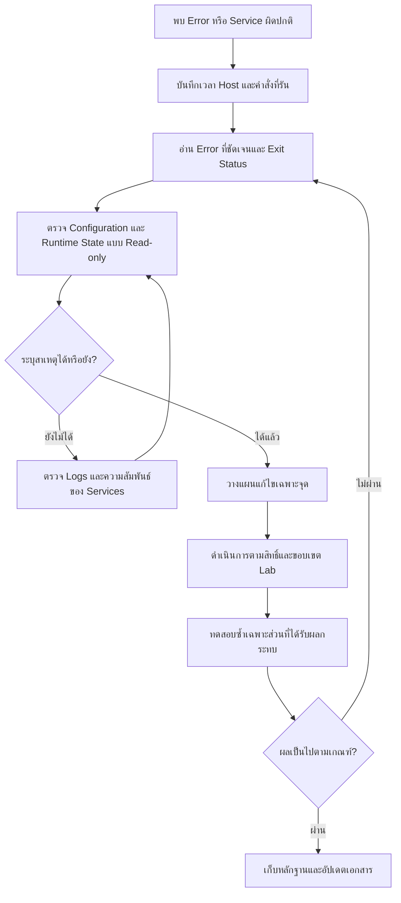
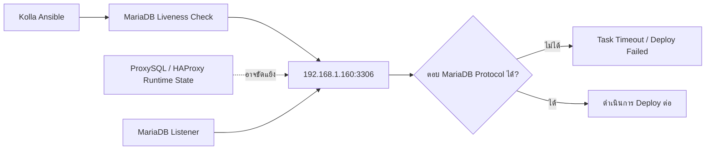

# 06 — Troubleshooting & Lessons Learned

> **CS223 Term Project — OpenStack Multinode with Kolla Ansible**  
> **ประเภทเอกสาร:** บันทึกการแก้ปัญหา (Incident Record) และคู่มือวิเคราะห์ปัญหา (Troubleshooting Runbook)  
> **ระบบอ้างอิง:** OpenStack 2026.1 · Kolla Ansible `22.2.1.dev36` · Ubuntu Server 24.04 LTS  
> **ช่วงเวลาของหลักฐาน:** การติดตั้งและทดสอบจนถึงวันที่ 17 พฤศจิกายน 2026  
> **สถานะปัจจุบันที่ยืนยันแล้ว:** Deploy สำเร็จ, บริการหลักพร้อมใช้งาน, สร้าง VM/รับ DHCP ได้ และ Login Horizon ได้

เอกสารฉบับนี้รวบรวมปัญหาที่พบระหว่างติดตั้ง OpenStack แบบ **Single Controller + Single Compute** ด้วย Kolla Ansible โดยมุ่งให้ผู้อ่านเข้าใจ **อาการ → การตรวจสอบ → สาเหตุ → วิธีแก้ไข → หลักฐานยืนยันผล** มากกว่าการจำคำสั่งแก้ปัญหาเพียงอย่างเดียว

กรณีหลักที่เกิดขึ้นจริงคือ **การชนกันของ MariaDB และ ProxySQL ที่ Port `3306`** ทำให้การ Deploy ครั้งแรกไม่สำเร็จ ขณะเดียวกัน โปรเจกต์นี้มีข้อจำกัดด้านเครือข่ายจากการติดตั้ง OpenStack ซ้อนอยู่บน VM ของระบบภายนอก จึงใช้ **SSH Tunnel** เพื่อเข้าถึง Horizon และ noVNC ผ่าน Browser

> [!IMPORTANT]
> **สถานะหลักฐานของแต่ละหัวข้อไม่เหมือนกัน**
> - **[เกิดขึ้นจริง — แก้แล้ว]**: มีบันทึก Error/การแก้ไข/ผลทดสอบยืนยันในโปรเจกต์
> - **[ข้อจำกัดจริง — มีวิธีใช้งาน]**: ไม่ได้หมายถึง Service เสีย แต่ต้องมีวิธีเข้าถึงหรือข้อจำกัดที่ต้องระบุ
> - **[แนวทางตรวจสอบ — ยังไม่พบเป็น Incident]**: ขั้นตอนเผื่อใช้วิเคราะห์ในอนาคต **ห้ามนำไปเขียนว่าเป็นเหตุการณ์ที่เคยเกิดขึ้นแล้ว**
>
> เนื่องจากระบบ Deploy และทดสอบสำเร็จแล้ว **ไม่ควร Restart, Redeploy, ลบทรัพยากร หรือปรับ Configuration เพียงเพื่อสร้าง Screenshot เพิ่ม** ให้ใช้หลักฐานเดิมเท่าที่มีและตรวจสถานะด้วยคำสั่งแบบ read-only เมื่อจำเป็น

---

## สารบัญ

1. [ขอบเขตและหลักการ Troubleshooting](#1-scope-and-methodology)
2. [สภาพแวดล้อมที่เกี่ยวข้อง](#2-environment-and-components)
3. [ภาพรวมเหตุการณ์และสถานะ](#3-incident-summary)
4. [Incident T-01 — MariaDB/ProxySQL Port 3306](#4-incident-t-01--mariadbproxysql-port-3306)
5. [Case T-02 — การเข้าถึง Horizon ผ่าน SSH Tunnel](#5-case-t-02--horizon-access-via-ssh-tunnel)
6. [Case T-03 — การเข้าถึง noVNC Console](#6-case-t-03--novnc-console-access)
7. [การอ่าน Exit Status และ Ansible Recap](#7-ansible-exit-status-and-recap)
8. [คู่มือตรวจสอบ Service/Container](#8-service-and-container-diagnostics)
9. [แนวทางตรวจสอบ SSH และ Ansible](#9-ssh-and-ansible-diagnostics)
10. [แนวทางตรวจสอบ Nova และ KVM](#10-nova-and-kvm-diagnostics)
11. [แนวทางตรวจสอบ Neutron, DHCP และ MTU](#11-neutron-dhcp-and-mtu-diagnostics)
12. [แนวทางตรวจสอบ Keystone, Glance และ CLI](#12-keystone-glance-and-cli-diagnostics)
13. [หลักการ Retry และการเปลี่ยน Configuration](#13-safe-retry-and-change-management)
14. [คำสั่งที่ไม่ควรใช้โดยไม่มีแผน](#14-high-risk-commands)
15. [การจัดเก็บหลักฐานบน GitHub](#15-github-evidence-and-redaction)
16. [Runbook แบบย่อสำหรับสมาชิกที่รับงานต่อ](#16-quick-runbook-for-handover)
17. [บทเรียนที่ได้รับ](#17-lessons-learned)
18. [สถานะสุดท้ายและสิ่งที่ยังไม่ทดสอบ](#18-final-status-and-limitations)
19. [เอกสารอ้างอิง](#19-references)

---

## 1. Scope and Methodology

### 1.1 วัตถุประสงค์

เอกสารนี้มีเป้าหมาย 5 ประการ

1. บันทึก **Incident ที่เกิดขึ้นจริง** อย่างตรวจสอบย้อนกลับได้ พร้อม Output ที่สำคัญ
2. แสดงว่าการแก้ปัญหาอาศัยหลักฐาน ไม่ใช่การคาดเดาหรือลบระบบแล้วเริ่มใหม่ทันที
3. อธิบายเหตุผลที่การเปลี่ยน `globals.yml` อย่างเดียวอาจยังไม่แก้ **Runtime State** ที่ค้างอยู่
4. จัดทำคำสั่งตรวจสอบที่ใช้กับ Controller/Compute Node ได้เมื่อมีปัญหาในอนาคต
5. เตรียมข้อมูลให้สมาชิกคนที่ 3 รับช่วงต่อได้โดยไม่เปิดเผย Credentials ใน Public Repository

### 1.2 รูปแบบการบันทึกเหตุการณ์

แต่ละ Incident ควรตอบคำถามให้ครบดังนี้

| หัวข้อ | คำถามที่ต้องตอบ |
|---|---|
| Symptom | ผู้ดูแลพบอะไร? มี Error Message/สถานะใด? |
| Impact | บริการใดใช้งานไม่ได้ และขอบเขตกระทบแค่ไหน? |
| Observation | มีคำสั่งหรือ Log ใดสนับสนุนข้อสังเกต? |
| Root Cause | สาเหตุที่หลักฐานสนับสนุนคืออะไร? ระดับความมั่นใจเท่าใด? |
| Resolution | เปลี่ยน Configuration หรือแก้ Runtime อย่างไร? |
| Verification | หลังแก้แล้วตรวจสอบด้วยอะไรจนยืนยันว่าผ่าน? |
| Prevention | ป้องกันการเกิดซ้ำอย่างไร? |
| Evidence | เก็บรูปหรือ Log ที่ใด และลบข้อมูลลับแล้วหรือยัง? |

### 1.3 ลำดับการวิเคราะห์ที่แนะนำ



**หลักสำคัญ:** ควรอ่าน Error/Logs และตรวจ Configuration ก่อน Restart หรือ Deploy ซ้ำ การลบ Container/Volume โดยไม่มีการวิเคราะห์อาจทำให้หลักฐานและข้อมูลสำคัญสูญหาย

---

## 2. Environment and Components

### 2.1 Nodes และบทบาท

| รายการ | ค่าที่ใช้ในโปรเจกต์ | หน้าที่ |
|---|---|---|
| Controller | `controller01` — `192.168.1.160` | API, Control Plane, Horizon, MariaDB, Neutron Agents |
| Compute | `compute01` — `192.168.1.7` | Nova Compute, Libvirt/QEMU/KVM, Guest VM |
| Deployment Host | `controller01` | รัน Kolla Ansible และ OpenStack CLI |
| Windows Client | Windows + WSL | SSH Tunnel สำหรับ Horizon/noVNC |
| Primary management interface | `ens3` | Underlay/Management/Tunnel Traffic ตาม Configuration ของ Lab |
| Experimental external interface | `dummy0` | Interface สำหรับการตั้งค่า Lab ไม่ใช่หลักฐานว่าเชื่อม External Network ได้ |
| Underlay MTU | `1450` | MTU ของเครือข่ายชั้นนอก |
| Tenant Network MTU | `1400` | MTU ของ VXLAN Network ที่ใช้กับ CirrOS |

ตัว Controller และ Compute เองเป็น VM บนระบบ OpenStack ชั้นนอก ดังนั้นที่อยู่ `192.168.1.x` เป็น **Private IP** ของสภาพแวดล้อม Lab ไม่ใช่ที่อยู่ที่เครื่อง Windows ทุกเครื่องต้องเข้าถึงได้โดยตรง

### 2.2 Configuration ที่เกี่ยวกับ Incident หลัก

ค่าที่ใช้งานใน `/etc/kolla/globals.yml` สำหรับ Lab นี้:

```yaml
# ยกมาเฉพาะ Configuration ที่เกี่ยวข้องกับ Troubleshooting
kolla_base_distro: "ubuntu"
kolla_internal_vip_address: "192.168.1.160"
network_interface: "ens3"
neutron_external_interface: "dummy0"

# Single-controller non-HA lab
# ไม่ใช่ชุดค่ามาตรฐานสำหรับ Production
# และห้ามนำไปใช้กับระบบที่ต้องใช้ HA/Load Balancing โดยไม่ออกแบบใหม่
enable_haproxy: false
enable_keepalived: false
enable_loadbalancer: false
enable_proxysql: false

nova_compute_virt_type: "kvm"
workaround_ansible_issue_8743: true
```

> [!NOTE]
> `workaround_ansible_issue_8743: true` เป็นค่าที่ใช้งานในสภาพแวดล้อมนี้ แต่จากหลักฐาน Incident หลัก **ไม่ควรสรุปว่า Workaround นี้เป็นสาเหตุหรือวิธีแก้ปัญหา Port `3306`** โดยตรง

### 2.3 ไฟล์และคำสั่งที่เกี่ยวข้อง

| ตำแหน่ง | ใช้ทำอะไร | ข้อควรระวัง |
|---|---|---|
| `~/multinode` | Ansible Inventory | ตรวจ Role Mapping ก่อนแก้ไข |
| `/etc/kolla/globals.yml` | Global Deployment Settings | ปรับแล้วมีผลต่อการ Deploy ครั้งถัดไป |
| `/etc/kolla/passwords.yml` | Service Credentials | **ห้าม Upload หรือแสดง Output ใน Public Repository** |
| `/etc/kolla/admin-openrc.sh` | OpenStack Admin Environment | มี Credentials; ห้ามเผยแพร่ |
| `/etc/kolla/clouds.yaml` | OpenStack Client Configuration | อาจมี Credentials; ห้ามเผยแพร่ |
| `~/kolla-venv` | Python Venv ของ Kolla Ansible | เปิดใช้งานก่อนรัน `kolla-ansible` |
| `~/openstack-cli-venv` | Python Venv ของ OpenStack CLI | ใช้สำหรับ `openstack` Commands |
| `/var/log/kolla/` | Logs ของ Kolla Services | อาจมีข้อมูลภายใน/ข้อมูลอ่อนไหว |

---

## 3. Incident Summary

| ID | ประเภท | อาการ/ประเด็น | สถานะ | หลักฐานยืนยัน |
|---|---|---|---|---|
| **T-01** | **เกิดขึ้นจริง — แก้แล้ว** | MariaDB ไม่ผ่าน Port Liveness ที่ `192.168.1.160:3306` ระหว่าง Deploy | **RESOLVED** | Deploy รอบแรก Exit `2`, หยุด Proxy Services, Retry Exit `0` |
| **T-02** | **ข้อจำกัดจริง — มีวิธีใช้งาน** | Windows ไม่ใช้ Private IP ของ Horizon ได้โดยตรงในรูปแบบที่ทดสอบ | **WORKAROUND VERIFIED** | SSH Tunnel `8080 → 80`, Login Horizon สำเร็จ |
| **T-03** | **ข้อจำกัดจริง — มีวิธีใช้งาน** | noVNC Endpoint อยู่ภายใน Management Network | **WORKAROUND VERIFIED** | SSH Tunnel `6080 → 6080`, Login CirrOS สำเร็จ |
| D-01 | แนวทางตรวจสอบ | Container/Service ไม่พร้อมหรือ Restart วน | **ไม่ได้ยืนยันว่าเกิดขึ้นเพิ่มเติม** | Runbook สำหรับอนาคต |
| D-02 | แนวทางตรวจสอบ | SSH/Ansible เชื่อม Node ไม่ได้ | **ไม่ได้ยืนยันว่าเป็น Incident ล่าสุด** | Runbook สำหรับอนาคต |
| D-03 | แนวทางตรวจสอบ | Compute ไม่ปรากฏหรือ VM ไม่สามารถ Boot | **ไม่ใช่ปัญหาคงค้าง** | ปัจจุบัน Nova Compute `up` และ VM `ACTIVE` |
| D-04 | แนวทางตรวจสอบ | VM ไม่ได้รับ DHCP หรือ Network ผิดปกติ | **ไม่ใช่ปัญหาคงค้าง** | Guest IP `10.10.10.117/24` |

---

## 4. Incident T-01 — MariaDB/ProxySQL Port 3306

**สถานะ:** **[เกิดขึ้นจริง — แก้ไขสำเร็จ]**  
**ระดับความสำคัญในช่วงเกิดเหตุ:** สูง (Deployment Blocker)  
**Node ที่ได้รับผลกระทบ:** `controller01`  
**องค์ประกอบที่เกี่ยวข้อง:** MariaDB, ProxySQL, HAProxy, Kolla Ansible, systemd  
**Endpoint สำคัญ:** `192.168.1.160:3306`

### 4.1 อาการที่พบ (Symptom)

ระหว่างรัน `kolla-ansible deploy` ในรอบแรก Playbook หยุดที่ Task ตรวจความพร้อมของ MariaDB โดยบันทึกข้อความสำคัญว่า:

```text
TASK [mariadb : Check MariaDB service port liveness]
Timeout when waiting for search string MariaDB in 192.168.1.160:3306

RUNNING HANDLER [mariadb : Wait for first MariaDB service port liveness]
FAILED - RETRYING: ...

fatal: [controller01]: FAILED!
```

ผลสรุปการ Deploy รอบที่ไม่สำเร็จ:

```text
PLAY RECAP *********************************************************************
compute01   : ok=34  changed=23  unreachable=0  failed=0  skipped=7   rescued=0  ignored=0
controller01: ok=83  changed=47  unreachable=0  failed=1  skipped=96  rescued=0  ignored=1
localhost   : ok=4   changed=0   unreachable=0  failed=0  skipped=0   rescued=0  ignored=0

DEPLOY EXIT STATUS: 2
```

**การตีความ:** การ Deploy **ยังไม่สำเร็จ** เพราะ Controller มี `failed=1` และ Exit Status เป็น `2` การที่บาง Node มี `failed=0` ไม่ได้ทำให้ Deployment ทั้งระบบถือว่าผ่าน

### 4.2 ผลกระทบ (Impact)

- Kolla Ansible ไม่สามารถผ่านขั้นตอนเตรียม MariaDB บน `controller01` ได้
- ไม่สามารถถือว่าบริการ OpenStack ทั้งชุดพร้อมใช้งานจาก Deploy รอบนั้น
- ต้องวิเคราะห์ Listener และ Runtime State ก่อน Deploy ต่อ

### 4.3 วิเคราะห์เบื้องต้น (Initial Investigation)

ข้อความ `Timeout when waiting for search string MariaDB` มีความหมายเฉพาะกว่า "เปิด Port ไม่ได้": Task กำลังรอ **Response ที่มีรูปแบบตรงกับสิ่งที่คาดหวังจาก MariaDB** จึงเป็นไปได้ทั้งกรณี Port ไม่เปิด, ถูกจับโดย Process ที่ไม่ใช่ MariaDB, Service ยังไม่พร้อม หรือ Listener/Binding ไม่ตรงกับ Endpoint

การตรวจสอบจึงควรมอง 3 ชั้น:

1. **Configuration** — เปิด/ปิด ProxySQL, HAProxy, Load Balancer อย่างไร และ Internal VIP ชี้ไปที่ใด
2. **Process/Socket** — Process ใดกำลัง Listen ที่ TCP `3306`
3. **Service Lifecycle** — Docker Container ถูกควบคุมโดย systemd หรือมี Unit ที่ค้างจาก Deploy รอบก่อนหรือไม่



### 4.4 สาเหตุที่สอดคล้องกับหลักฐาน (Root Cause)

จากบันทึกการตรวจสอบพบว่าเคยมีบริการ **ProxySQL และ HAProxy** ถูกตั้งให้ทำงานระหว่าง Deployment ก่อนหน้า ขณะที่เป้าหมายสุดท้ายของ Lab คือระบบ **Single Controller แบบไม่ใช้ HA/Load Balancer** ซึ่งต้องการให้ MariaDB รับ Traffic ที่ Endpoint `192.168.1.160:3306`

จึงเกิด **Runtime/Endpoint Conflict ที่เกี่ยวข้องกับบริการ ProxySQL และ Listener ของ MariaDB** แม้ในภายหลังจะเปลี่ยนค่าที่ `globals.yml` เป็น `enable_proxysql: false` แล้ว แต่ systemd Units/Containers ที่สร้างไว้ก่อนหน้านั้นอาจยังคงทำงาน

> [!IMPORTANT]
> ข้อสรุปนี้มีหลักฐานเชิงปฏิบัติจาก **การตรวจ Service State → หยุด Proxy Services → Port ว่าง → Retry สำเร็จ** แต่ไม่ได้หมายความว่ามี Packet Capture หรือ Trace ของการจับ Port ทุกช่วงเวลา จึงควรใช้ถ้อยคำว่า **"สาเหตุที่สอดคล้องกับหลักฐานคือการขัดแย้งของ ProxySQL/MariaDB Endpoint และ Runtime State"** ไม่ใช่อ้างว่าเป็นข้อบกพร่องของ Kolla Ansible ทุกเวอร์ชัน

### 4.5 Configuration ที่เลือกใช้หลังวิเคราะห์

**บน `controller01` ใน `/etc/kolla/globals.yml`:**

```yaml
kolla_internal_vip_address: "192.168.1.160"
enable_haproxy: false
enable_keepalived: false
enable_loadbalancer: false
enable_proxysql: false
```

การเลือกนี้เหมาะกับ **Lab ที่ใช้ Controller เพียงหนึ่งเครื่อง และทดสอบแบบ Non-HA** แต่ไม่ใช่คำแนะนำให้ปิด ProxySQL/HAProxy ใน Production หรือ Cluster ที่ออกแบบ HA อยู่แล้ว

### 4.6 ตรวจสอบ State และ Listener ก่อนแก้

คำสั่งต่อไปนี้เป็นแนวทางตรวจสอบแบบ **read-only** บน `controller01`:

```bash
# สถานะ Units ที่เกี่ยวข้อง
systemctl is-active \
  kolla-proxysql-container.service \
  kolla-haproxy-container.service

# ตรวจว่า Process ใด Listen ที่ TCP Port 3306
sudo ss -ltnp '( sport = :3306 )'

# ตรวจ Container ที่เกี่ยวข้อง
sudo docker ps -a \
  --format 'table {{.Names}}\t{{.Status}}\t{{.Ports}}' \
  --filter 'name=mariadb' \
  --filter 'name=proxysql' \
  --filter 'name=haproxy'
```

`systemctl is-active` อาจคืน Non-zero Exit Code เมื่อ Service เป็น `inactive` ซึ่ง **เป็นผลที่คาดได้ระหว่างการตรวจสอบ** ไม่ใช่เหตุให้ต้องเริ่ม Service ใหม่ทันที

### 4.7 วิธีแก้ไขที่ใช้จริง (Resolution)

หลังแก้ Global Configuration ให้สอดคล้องกับ Architecture แบบ Non-HA ได้หยุด Units ที่เกี่ยวข้องบน `controller01` ดังนี้:

```bash
sudo systemctl stop \
  kolla-proxysql-container.service \
  kolla-haproxy-container.service

sudo systemctl daemon-reload
```

**ทำไมใช้ `systemctl stop`?** เพราะในสภาพแวดล้อมที่ใช้ Kolla systemd Units การสั่ง `docker stop` เพียงอย่างเดียวอาจไม่พอ หาก systemd มีนโยบายเริ่ม Container ใหม่

**ทำไมใช้ `systemctl daemon-reload`?** เพื่อให้ systemd โหลดการกำหนด Unit ใหม่ตามที่มีอยู่ใน Disk **ไม่ใช่คำสั่งแก้ Port Conflict โดยตัวมันเอง**

> [!CAUTION]
> ชุดคำสั่งด้านบนเป็น **บันทึกการแก้ Incident ที่เกิดขึ้นแล้ว** ไม่ใช่ขั้นตอนที่ผู้รับช่วงต่อควรนำไปรันอีกครั้ง ในระบบที่ผ่านการ Deploy แล้ว การหยุด Service ผิดตัวอาจทำให้บริการ OpenStack หยุดทำงาน

### 4.8 ผลหลังหยุด Services

มีการตรวจ Service และ Port อีกครั้ง ผลที่บันทึกได้ระหว่างเตรียม Retry คือ:

```text
=== LOAD BALANCER SERVICES ===
inactive
inactive

=== PORT 3306 ===
State  Recv-Q  Send-Q  Local Address:Port  Peer Address:Port  Process
```

หมายความว่า ณ จุดตรวจสอบ **ไม่มี Process ที่กำลัง Listen Port `3306`** แล้ว จึงพร้อมให้ขั้นตอน Deploy ครั้งถัดไปจัดการ MariaDB ตาม Configuration ใหม่

> [!NOTE]
> **Port ว่างในช่วงก่อน Deploy ไม่เท่ากับ MariaDB Healthy** เพราะในจังหวะนั้น MariaDB อาจยังไม่เริ่มทำงาน ผลสำเร็จต้องยืนยันจากการ Retry และ API/VM Tests หลังติดตั้ง

### 4.9 ตรวจสอบก่อน Retry

ขั้นตอนที่ใช้สำหรับการแก้ครั้งนั้น:

1. ตรวจค่าใน `globals.yml` ว่าปิดบริการ Proxy ที่ไม่ต้องการแล้ว
2. ตรวจ ProxySQL/HAProxy systemd Units ว่าไม่ทำงาน
3. ตรวจ Port `3306` ว่าไม่มี Process เดิมครอบครอง
4. รัน Prechecks อีกครั้งและยืนยัน Exit Status `0`
5. รัน Deploy ใหม่ด้วย Inventory เดิมที่ถูกต้อง

ตัวอย่างการเก็บ Exit Status ที่ไม่ถูกบดบังด้วย `tee`:

```bash
# รันเฉพาะเมื่อมีแผน Retry ที่อนุมัติแล้ว; ไม่จำเป็นบนระบบปัจจุบัน
set -o pipefail

kolla-ansible deploy -i ~/multinode \
  2>&1 | tee ~/kolla-logs/deploy-retry.log

DEPLOY_RC=${PIPESTATUS[0]}
echo "DEPLOY EXIT STATUS: $DEPLOY_RC"
```

**ข้อสังเกต:** ต้องมี `~/kolla-logs/` ก่อนรันคำสั่งตัวอย่าง และ Exit Code ควรอ่านจากคำสั่ง `kolla-ansible` ไม่ใช่สรุปจากการที่ `tee` เขียน Log สำเร็จ

### 4.10 ผลลัพธ์หลังแก้ไข (Verification)

Deploy รอบที่แก้ไขแล้วมีผล:

```text
PLAY RECAP *********************************************************************
compute01   : ok=93   changed=43   unreachable=0  failed=0  skipped=76   rescued=0  ignored=0
controller01: ok=283  changed=164  unreachable=0  failed=0  skipped=211  rescued=0  ignored=1
localhost   : ok=4    changed=0    unreachable=0  failed=0  skipped=0    rescued=0  ignored=0

DEPLOY EXIT STATUS: 0
```

หลังจากนั้นยังยืนยันการทำงานผ่านผลทดสอบอื่นที่ **แยกจากการจบ Playbook** ได้แก่:

- `kolla-ansible post-deploy -i ~/multinode` สำเร็จ
- Keystone ออก Token ได้
- Nova Scheduler/Conductor และ `nova-compute` บน `compute01` อยู่ในสถานะ `up`
- Neutron Agents จำนวน 5 รายการอยู่ในสถานะ `UP`
- สร้าง CirrOS Instance `cs223-test-vm` สถานะ `ACTIVE` บน `compute01`
- Guest ได้รับ IP `10.10.10.117/24`
- Login ผ่าน noVNC และ Horizon Dashboard สำเร็จ

**ข้อสรุป:** Incident นี้เป็น **RESOLVED** และ Deployment ทำงานได้ในขอบเขต Lab ที่ทดสอบแล้ว

### 4.11 ป้องกันปัญหาเกิดซ้ำ (Prevention)

- ตรวจ `globals.yml` ก่อน Deploy ว่า **HA/Non-HA Settings** สอดคล้องกับสถาปัตยกรรม
- หากเปลี่ยน `enable_*` ที่เกี่ยวกับ Infrastructure ให้ตรวจ **Container และ systemd Unit เดิม** ด้วย
- ตรวจ Service/Port Owner ก่อนสรุปว่าปัญหาเกิดจาก Firewall
- เก็บ Exit Status รวมถึง `PLAY RECAP` ทุกครั้งที่ Deploy หรือ Retry
- เปลี่ยน Configuration อย่างมีบันทึก ไม่แก้หลายปัจจัยพร้อมกันจนระบุสาเหตุไม่ได้
- ไม่ใช้ `docker rm`, `volume rm`, `kolla-ansible destroy` เป็นทางลัดเมื่อยังไม่ทราบต้นเหตุ

### 4.12 หลักฐานที่ควรใช้ในรายงาน

| หลักฐาน | ใช้ยืนยันอะไร | ตำแหน่งที่แนะนำ |
|---|---|---|
| Deploy รอบแรก Exit `2` | แสดงอาการและผลกระทบ | อธิบายเป็นข้อความในเอกสารนี้ หรือแนบ Log ที่ Redact แล้ว |
| Service State/Port `3306` | แสดงการขัดแย้งและการจัดการ Runtime | แนบข้อความสรุป ไม่ต้องเผยแพร่ Raw Log |
| Retry Recap Exit `0` | ยืนยันว่า Deploy สำเร็จหลังแก้ | `../evidence/01-deployment/02-deploy-recap.png` |
| OpenStack Services/VM/Horizon | ยืนยันว่า Service ใช้งานได้จริง | `../evidence/02-services/`, `03-vm-validation/`, `04-horizon/` |

> **ข้อเท็จจริงเกี่ยวกับ Repository:** ตำแหน่งด้านบนเป็น **ชื่อไฟล์ที่วางแผนไว้** ต้องนำ Screenshot จริงมาวาง และตรวจข้อมูลลับก่อน Push ขึ้น GitHub

---

## 5. Case T-02 — Horizon Access via SSH Tunnel

**สถานะ:** **[ข้อจำกัดจริง — มีวิธีใช้งานที่พิสูจน์แล้ว]**  
**ประเด็น:** Controller ใช้ Management IP ส่วนตัว ขณะที่ Browser อยู่บน Windows

### 5.1 ทำไมเปิด Private IP จาก Windows โดยตรงจึงไม่ใช่วิธีหลัก

Horizon ทำงานที่ `192.168.1.160:80` ภายใน Lab ซึ่ง Windows Client ไม่ได้อยู่ใน Network Segment เดียวกันโดยตรงในรูปแบบการทดสอบนี้ อย่างไรก็ตาม ผู้ดูแลมีสิทธิ SSH เข้า Controller ผ่านช่องทางที่จัดเตรียมไว้ได้

**ดังนั้นปัญหาอยู่ที่เส้นทางเข้าถึงจาก Client ไม่ใช่ข้อพิสูจน์ว่า Horizon เสีย**

### 5.2 ตรวจสอบที่ Controller

บน `controller01` ได้ทดสอบ:

```bash
curl -I --max-time 5 http://192.168.1.160/
```

ผลที่บันทึกได้:

```http
HTTP/1.1 302 Found
Content-Type: text/html; charset=utf-8
Location: http://192.168.1.160/auth/login/?next=/
```

HTTP `302 Found` คือ Redirect ไปหน้า Login **ไม่ใช่ Failure ของ Horizon** จากนั้นมีการทดสอบ Login ผ่าน Browser จริงสำเร็จอีกชั้นหนึ่ง

### 5.3 วิธีเข้าถึงที่พิสูจน์แล้ว

เปิด **WSL Terminal บน Windows** (ไม่ใช่ Terminal ที่ SSH เข้า `controller01` อยู่แล้ว):

```bash
ssh -i ~/.ssh/YOUR_KEY \
  -o IdentitiesOnly=yes \
  -o ExitOnForwardFailure=yes \
  -N \
  -L 127.0.0.1:8080:192.168.1.160:80 \
  ubuntu@YOUR_CONTROLLER_SSH_IP
```

จากนั้นเปิด Browser บน Windows:

```text
http://127.0.0.1:8080/
```

**คำอธิบาย Port Forwarding**

```text
Windows Browser
    |
    v
127.0.0.1:8080  (WSL/Windows Local Tunnel)
    |
    |  SSH Connection to Controller
    v
controller01 -> 192.168.1.160:80 -> Horizon
```

- `-L` คือสร้าง Local Port Forwarding
- `-N` คือเปิด SSH เพื่อทำ Tunnel โดยไม่เปิด Remote Shell; Terminal จึงดูเหมือนค้างทั้งที่กำลังทำงานปกติ
- `-o ExitOnForwardFailure=yes` ช่วยให้ SSH แจ้งข้อผิดพลาดเมื่อสร้าง Local Forwarding ไม่ได้
- `127.0.0.1:8080` เป็น **Local Address ของเครื่องที่สร้าง Tunnel** ไม่ใช่ URL ที่แชร์ให้สมาชิกคนอื่นใช้ได้ทันที

### 5.4 ผลการทดสอบจริง

1. หน้า Horizon Login แสดงบน Chrome
2. Login ด้วยบัญชี Admin ที่ได้รับอนุญาตสำเร็จ
3. Dashboard Overview แสดง Instances `1`, vCPU ใช้ `1`, RAM ใช้ `512 MB`, Networks `1`, Ports `2`

จึงถือว่า **Horizon ทำงานและเข้าถึงผ่าน SSH Tunnel ได้จริง**

### 5.5 หากเปิด Browser ไม่ได้ในอนาคต

| อาการ | ตรวจสอบเบื้องต้น | แนวทาง |
|---|---|---|
| SSH Tunnel ไม่เริ่ม | `ssh -v` / ข้อความ Error | ตรวจ Key, SSH Access, Firewall ตามสิทธิ |
| Local Port `8080` ถูกใช้งาน | `ss -ltn '( sport = :8080 )'` บน WSL | เลือก Local Port อื่นที่ว่าง เช่น `18080` |
| Browser Connection Refused | SSH Tunnel ยังอยู่หรือไม่ | เปิด Tunnel ค้างไว้และตรวจ Local Port |
| `302 Found` | ดูค่า `Location` | ปกติถ้าชี้หน้า Login; อย่าตีความเป็น Service Error |
| Login ไม่ผ่าน | ตรวจ Account/Domain และ Keystone | ไม่เผย Password ในแชตหรือ Screenshot |
| Redirect กลับ Private IP | ตรวจ Redirect URL/Host Configuration | วิเคราะห์แยก ไม่ปรับ Host/Security Setting แบบสุ่ม |

**หมายเหตุ:** ตารางนี้เป็น **แนวทางเผื่อเกิดปัญหา** ไม่ได้อ้างว่าอาการทั้งหมดเกิดขึ้นจริงในโปรเจกต์

---

## 6. Case T-03 — noVNC Console Access

**สถานะ:** **[ข้อจำกัดจริง — มีวิธีใช้งานที่พิสูจน์แล้ว]**  
**ประเด็น:** noVNC Endpoint อยู่ที่ Private IP/Port `6080`

### 6.1 บริบทของการทดสอบ

หลังสร้าง `cs223-test-vm` ด้วย Nova ได้สำเร็จ ตัว VM ถูกจัดวางบน `compute01` และมีสถานะ `ACTIVE` แต่การเปิด Console URL ตรง ๆ จาก Browser ที่อยู่นอก Management Network อาจเข้าถึง Private IP ไม่ได้

จึงใช้ SSH Tunnel สำหรับ **TCP Port `6080`** เช่นเดียวกับ Horizon แต่เปลี่ยน Destination Port

### 6.2 เปิด Tunnel ผ่าน WSL

```bash
ssh -i ~/.ssh/YOUR_KEY \
  -o IdentitiesOnly=yes \
  -o ExitOnForwardFailure=yes \
  -N \
  -L 127.0.0.1:6080:192.168.1.160:6080 \
  ubuntu@YOUR_CONTROLLER_SSH_IP
```

หาก Horizon ใช้ Tunnel ที่ Local Port `8080` อยู่แล้ว สามารถเปิด **WSL Terminal อีกหน้าต่าง** สำหรับ noVNC โดยไม่ต้องปิด Tunnel เดิม

### 6.3 ตรวจสอบ noVNC Web Endpoint

บน WSL สามารถตรวจแบบไม่ใช้ Token ได้ว่า Web Endpoint ตอบ HTTP หรือไม่:

```bash
curl -I --max-time 5 http://127.0.0.1:6080/vnc_lite.html
```

ในการทดสอบจริง Endpoint ตอบ `HTTP 200` แล้วจึงดำเนินการขอ Console URL ของ VM

### 6.4 ขอ URL ด้วย OpenStack CLI

**บน `controller01`:**

```bash
(
  source /etc/kolla/admin-openrc.sh
  ~/openstack-cli-venv/bin/openstack console url show \
    --novnc -f value -c url cs223-test-vm
)
```

URL ที่ได้จะมี **Console Token** อยู่ใน Query/Path ตามรูปแบบของบริการ ให้เปลี่ยนเฉพาะส่วน Host/Port จาก `192.168.1.160:6080` ไปเป็น `127.0.0.1:6080` และคง Path กับ Token เดิมไว้

> [!WARNING]
> **ห้าม Commit หรือแชร์ Console URL เต็ม** เพราะ Token ใช้สำหรับเข้าถึง Console ได้ในช่วงอายุที่กำหนด และอาจปรากฏบน Address Bar ใน Screenshot แม้จะไม่ได้แสดง Password ของ Guest ก็ตาม

### 6.5 ผลการใช้งานจริง

จาก Browser noVNC แสดง Console ของ `cs223-test-vm`; Login เข้าสู่ CirrOS สำเร็จและตรวจ Network Interface ได้:

```bash
ip -4 addr show eth0
```

ผลสำคัญ:

```text
2: eth0: <BROADCAST,MULTICAST,UP,LOWER_UP> mtu 1400
    inet 10.10.10.117/24 brd 10.10.10.255
```

สิ่งที่ยืนยันได้คือ **VM Boot + Console + Authentication ภายใน Guest + DHCP/Interface** ไม่ใช่หลักฐานว่ามี Floating IP หรือเชื่อมต่ออินเทอร์เน็ตได้

### 6.6 จุดตรวจสอบเมื่อ Console ไม่เปิด

1. ตรวจว่า Instance มีสถานะ `ACTIVE` และ Nova Compute พร้อมใช้งาน
2. ตรวจว่าพอร์ต Local `6080` เปิดโดย SSH Tunnel อยู่
3. ตรวจ HTTP Endpoint ด้วย `curl` ก่อนใช้ Console URL
4. ขอ URL ใหม่เมื่อ Token หมดอายุ
5. ตรวจว่า Browser ใช้ URL ที่เปลี่ยนเป็น `127.0.0.1:6080` แล้ว
6. หากหน้าจอ Console เชื่อมต่อแต่ Guest ไม่ Boot ให้ตรวจ Console Log/VM State แยกจากปัญหา Network ของ noVNC

---

## 7. Ansible Exit Status and Recap

การวิเคราะห์ Deployment ต้องดูทั้ง **Task ที่ Fail**, **PLAY RECAP** และ **Process Exit Status** ไม่ควรดูข้อความท้ายสุดเพียงบรรทัดเดียว

### 7.1 ความหมายของค่าใน Recap

| Field | ความหมาย | วิธีอ่าน |
|---|---|---|
| `ok` | Tasks ที่สำเร็จ | สูงไม่ได้รับประกันว่าทุก Task ผ่าน |
| `changed` | Tasks ที่เปลี่ยน State | ไม่ใช่ Error |
| `unreachable` | SSH/Transport ไม่สามารถติดต่อ Host | ต้องตรวจ Network/SSH/Inventory |
| `failed` | Tasks ที่ Fail แบบไม่ถูกข้าม | `failed>0` ต้องตรวจ Task ที่เกี่ยวข้อง |
| `skipped` | Tasks ที่ไม่เข้าเงื่อนไข | ปกติได้ตาม Service/Role Settings |
| `ignored` | Tasks ที่ Fail แต่ Playbook อนุญาตให้ข้าม | ต้องดู Context ไม่ใช่ตีความเท่ากับ `failed` |
| Exit Status | ผลลัพธ์โดยรวมของคำสั่ง | `0` หมายถึง Command สำเร็จ |

ใน Incident T-01 รอบแรก **Controller `failed=1`, Exit `2`** แต่รอบ Retry **ทุก Node `failed=0`, Exit `0`** แม้ Controller ยังมี `ignored=1` ใน Recap

### 7.2 ทำไมต้องระวัง `tee`

Pipeline อย่าง `command | tee file.log` อาจทำให้ผู้ใช้เข้าใจผิดหากตรวจ Exit Status ของตัว `tee` แทนคำสั่งหลัก จึงควรใช้ `set -o pipefail` หรืออ่าน `${PIPESTATUS[0]}` ทันทีหลัง Pipeline ใน Bash

**ตัวอย่างการบันทึกผลสำหรับการเปลี่ยนระบบครั้งถัดไป** (ไม่ใช่คำสั่งให้รันขณะนี้):

```bash
set -o pipefail
kolla-ansible prechecks -i ~/multinode 2>&1 | tee prechecks.log
PRECHECK_RC=${PIPESTATUS[0]}
echo "PRECHECK EXIT STATUS: $PRECHECK_RC"
```

> ไม่ควร Upload `prechecks.log` หรือ `deploy.log` ฉบับเต็มโดยไม่ตรวจข้อมูลลับ เพราะ Ansible Task Output อาจมี Inventory, Tokens หรือ Config Values ที่ไม่เหมาะเผยแพร่

---

## 8. Service and Container Diagnostics

**สถานะ:** **[แนวทางตรวจสอบ — ไม่ใช่ Incident เพิ่มเติม]**

### 8.1 ตรวจภาพรวม Container (Controller หรือ Compute)

```bash
sudo docker ps --format 'table {{.Names}}\t{{.Status}}\t{{.Image}}'

# รวม Container ที่หยุดแล้ว
sudo docker ps -a --format 'table {{.Names}}\t{{.Status}}'
```

สิ่งที่ควรสังเกต:

- Container สำคัญที่ควร Running กลับเป็น `Exited` หรือไม่
- มี Container Restart วนหรือ `unhealthy` หรือไม่
- ชื่อ Image/Tag สอดคล้องกับ Release ที่ Deploy หรือไม่

### 8.2 ตรวจ Systemd Units ของ Kolla

```bash
systemctl --no-pager --type=service --all 'kolla-*.service'

# ตัวอย่างตรวจ Unit เฉพาะตัว
systemctl status kolla-proxysql-container.service --no-pager
```

การตรวจ Unit มีประโยชน์เมื่อ Service ถูก systemd จัดการ หาก `docker stop` แล้ว Process กลับมาทำงานซ้ำ ให้ตรวจ **Restart Policy และ Unit Ownership** ก่อนแก้อีกครั้ง

### 8.3 อ่าน Logs อย่างระมัดระวัง

```bash
# อ่านท้าย stdout/stderr ของ Container ที่ระบุชื่อแล้ว
sudo docker logs --tail 80 <container-name>

# ตรวจตำแหน่ง Log ของ Kolla
sudo ls -lah /var/log/kolla/

# อ่าน Log Service ที่ทราบชื่อและตรวจสิทธิแล้ว
sudo tail -n 80 /var/log/kolla/<service>/<log-file>
```

> `<container-name>`, `<service>`, `<log-file>` เป็น Placeholder ต้องแทนด้วยค่าจริงก่อนรัน และ **อย่านำ Raw Log ไป Push** โดยไม่ได้ Redact

### 8.4 คำถามเมื่อ Container ไม่พร้อม

1. Container ขึ้นอยู่หรือหยุดไปแล้ว?
2. Service มี Healthcheck หรือไม่ และ Failure เริ่มเมื่อใด?
3. Host มี CPU/RAM/Disk เพียงพอหรือไม่?
4. Service ต้องรอ MariaDB/RabbitMQ/Keystone หรือ Endpoint อื่นหรือไม่?
5. มี Port Conflict หรือ Hostname/DNS/Interface ผิดหรือไม่?
6. เป็น Service ที่ Configuration ตั้งใจปิดอยู่แล้วหรือไม่?

---

## 9. SSH and Ansible Diagnostics

**สถานะ:** **[แนวทางตรวจสอบ — ไม่ได้อ้างว่า SSH ล้มเหลวในระบบปัจจุบัน]**

Kolla Multinode ใช้การเชื่อมต่อ SSH/Ansible จาก Deployment Host ไปยัง Target Hosts ถ้าเชื่อมไม่ได้ จะกระทบ Bootstrap, Prechecks และ Deploy

### 9.1 ตรวจ Inventory

บน `controller01` ใน `kolla-venv`:

```bash
ansible-inventory -i ~/multinode --graph
ansible-inventory -i ~/multinode --list > /tmp/cs223-inventory-inspect.json
```

**ระวัง:** ไฟล์ JSON จาก Inventory อาจมีตัวแปรอ่อนไหว อย่า Upload ขึ้น Public Repository

### 9.2 ตรวจ SSH/Ansible Reachability

```bash
# อ่านสถานะโดยไม่เปลี่ยนระบบ
ansible -i ~/multinode 'control:compute' -m ping
```

หากพบ `UNREACHABLE` ให้ไล่ตรวจ:

- IP ที่ Inventory ชี้ไปยัง Host จริงหรือไม่
- ชื่อ User/SSH Key/Permissions ถูกต้องหรือไม่
- Security Group/Firewall ของ Outer OpenStack อนุญาต SSH ตามที่ออกแบบหรือไม่
- Route ระหว่าง Controller และ Compute ใช้งานได้หรือไม่
- sudo/become ตั้งค่าตรงกับสิทธิของ Account หรือไม่

### 9.3 จุดที่มักสับสน: รัน SSH จากเครื่องใด

- `ansible ...` และ `kolla-ansible ...` รันจาก **`controller01`** ตามโครงสร้างโปรเจกต์นี้
- SSH Tunnel เพื่อให้ Browser ของผู้ใช้เปิด Horizon/noVNC ต้องรันจาก **Windows WSL**
- การเปิด `ssh -N -L ...` แล้ว Terminal ไม่มี Prompt กลับมา **เป็นพฤติกรรมปกติ** ตราบใดที่ Tunnel ยังทำงาน

---

## 10. Nova and KVM Diagnostics

**สถานะ:** **[แนวทางตรวจสอบ — ปัจจุบัน VM Boot สำเร็จแล้ว]**

### 10.1 ยืนยัน Nova Services

บน `controller01`:

```bash
(
  source /etc/kolla/admin-openrc.sh
  ~/openstack-cli-venv/bin/openstack compute service list
)
```

ในการทดสอบจริงพบ `nova-scheduler` และ `nova-conductor` บน Controller เป็น `up` และ `nova-compute` บน `compute01` เป็น `up`

### 10.2 ตรวจ Instance Placement/State

```bash
(
  source /etc/kolla/admin-openrc.sh
  ~/openstack-cli-venv/bin/openstack server show cs223-test-vm \
    -c name -c status -c addresses -c OS-EXT-SRV-ATTR:host
)
```

ผลที่ยืนยันแล้ว:

```text
name                cs223-test-vm
status              ACTIVE
addresses           cs223-private-net=10.10.10.117
OS-EXT-SRV-ATTR:host compute01
```

> ข้อความข้างต้นเป็นการสรุป Fields ที่ตรวจพบ ไม่ได้คัดลอก Table Format ทุกอักขระจาก CLI

### 10.3 ตรวจ KVM ใน Compute Host

บน `compute01`:

```bash
ls -l /dev/kvm
lsmod | grep '^kvm'
```

หากในอนาคตพบว่า VM Boot ไม่ได้ ให้ตรวจทั้ง **KVM Device, Nested Virtualization ของ Outer VM, Libvirt Container, Nova Logs, Quota, Image และ Scheduling** โดยไม่สรุปจาก Error ข้อความเดียว

**สิ่งที่พิสูจน์แล้วในโปรเจกต์นี้:** Compute Host รองรับ KVM เพียงพอให้ CirrOS VM Boot ได้จริง

---

## 11. Neutron, DHCP and MTU Diagnostics

**สถานะ:** **[แนวทางตรวจสอบ — Tenant DHCP ปัจจุบันผ่านแล้ว]**

### 11.1 ตรวจ Network Agents

```bash
(
  source /etc/kolla/admin-openrc.sh
  ~/openstack-cli-venv/bin/openstack network agent list
)
```

ผลที่ทดสอบจริง: Agent 5 รายการทำงานเป็น `UP` ได้แก่ Metadata Agent, OVS Agent บน Controller/Compute, DHCP Agent และ L3 Agent บน Controller

### 11.2 ตรวจ Network และ Subnet

```bash
(
  source /etc/kolla/admin-openrc.sh
  ~/openstack-cli-venv/bin/openstack network show cs223-private-net \
    -c name -c status -c mtu -c provider:network_type
  ~/openstack-cli-venv/bin/openstack subnet show cs223-private-subnet \
    -c name -c cidr -c enable_dhcp -c gateway_ip
)
```

สภาพที่ยืนยันแล้ว:

| Item | ค่า |
|---|---|
| Tenant Network | `cs223-private-net` |
| Type | `vxlan` |
| Network MTU | `1400` |
| Subnet | `10.10.10.0/24` |
| DHCP | Enabled |
| Allocation Pool | `10.10.10.100`–`10.10.10.200` |
| VM IP | `10.10.10.117` |
| Guest Interface | `eth0`, `UP`, MTU `1400` |

### 11.3 DHCP ไม่ได้หมายความว่า External Routing ใช้งานได้

Subnet ระบุ Gateway IP เป็น `10.10.10.1` แต่ **ยังไม่ได้พิสูจน์ว่ามี Neutron Router ที่เชื่อม External Network จริง** และ `dummy0` เป็น Interface สำหรับ Lab ไม่ใช่ External Provider Network ที่มี Upstream Routing พร้อมใช้งาน

ดังนั้นหากในอนาคต VM `ping` ออกอินเทอร์เน็ตไม่ได้ **อย่าเพิ่งสรุปว่า DHCP ล้มเหลว** ให้แยกตรวจ:

- VM ได้รับ IP ภายใน Tenant Network หรือไม่
- L2 Overlay/VXLAN ข้าม Host ได้หรือไม่
- Neutron Router/Route/NAT ถูกสร้างและผูก Network แล้วหรือยัง
- External Interface มี Upstream Connectivity จริงหรือไม่
- Security Group Rules อนุญาต Traffic ที่ต้องการหรือไม่

### 11.4 MTU และ VXLAN

ระบบ Lab นี้มี Underlay MTU `1450` และ Tenant MTU `1400` การตั้ง MTU ให้รองรับ Encapsulation ช่วยลดโอกาส Packet Fragmentation/Drop แต่ **ไม่ได้พิสูจน์ว่าเส้นทาง Network ทุกชนิดทดสอบผ่านแล้ว**

ตัวอย่างการตรวจบน Host:

```bash
ip -d link show ens3
ip link show dummy0
```

และบน CirrOS Guest:

```bash
ip -4 addr show eth0
```

ไม่ควรปรับ MTU, Neutron Agent Settings หรือ Bridge Mapping ระหว่างที่ระบบทำงานอยู่โดยไม่มีแผนเปลี่ยนระบบ

---

## 12. Keystone, Glance and CLI Diagnostics

**สถานะ:** **[แนวทางตรวจสอบ — บริการหลักผ่านการตรวจแล้ว]**

### 12.1 CLI อยู่คนละ Virtual Environment กับ Kolla Ansible

บน Controller มีสองสภาพแวดล้อมที่เกี่ยวข้อง:

- `~/kolla-venv` — ใช้ Kolla Ansible และ Dependencies
- `~/openstack-cli-venv` — ใช้ `openstack` CLI สำหรับเรียก OpenStack API

จึงแนะนำให้ระบุ Absolute Path ของ OpenStack CLI ชัดเจน:

```bash
~/openstack-cli-venv/bin/openstack --version
```

หาก `openstack: command not found` ใน Shell ที่เปิด `kolla-venv` อยู่ **ไม่ได้หมายความว่า OpenStack API ล่ม** อาจเป็นเพียง PATH/Virtual Environment ไม่ตรง

### 12.2 ตรวจ Keystone โดยไม่แสดง Token

```bash
(
  source /etc/kolla/admin-openrc.sh
  ~/openstack-cli-venv/bin/openstack token issue -f value -c expires
)
```

ผลสำเร็จควรแสดงเวลา Expiration ของ Token โดยไม่ต้องพิมพ์ Token หรือ Password ลงใน Screenshot

> หลีกเลี่ยงการรัน `env | grep OS_` แล้วแชร์ผล เพราะอาจแสดง `OS_PASSWORD` และตัวแปร Authentication อื่น

### 12.3 ตรวจ Glance Image

```bash
(
  source /etc/kolla/admin-openrc.sh
  ~/openstack-cli-venv/bin/openstack image show cirros-0.6.3 \
    -c name -c status -c disk_format
)
```

หลักฐานจริงในโปรเจกต์: Image `cirros-0.6.3` มีสถานะ `active` และสามารถใช้ Boot VM ได้สำเร็จ

### 12.4 แยกปัญหา Authentication กับ Connectivity

| อาการในอนาคต | ความหมายที่เป็นไปได้ | จุดเริ่มตรวจสอบ |
|---|---|---|
| `openstack: command not found` | PATH/Venv | ใช้ Absolute Path ของ CLI |
| `Unauthorized (401)` | Credentials/Token/Endpoint | ตรวจวิธี Source Environment และ Account |
| `Forbidden (403)` | Policy/Role/Scope | ตรวจ Scope และสิทธิ ไม่ใช่รีสตาร์ต API ทันที |
| Connection Timeout | Network/Endpoint/Service Listener | ตรวจ IP, URL, Port, Routing และ Container |
| Image ไม่ `active` | Glance Upload/Processing/Storage | ตรวจ Image State และ Glance Logs |

ตารางนี้เป็น **แนวทางทั่วไปสำหรับอนาคต** ไม่ใช่ Error ที่ยืนยันว่าเกิดขึ้นระหว่างการทดสอบล่าสุด

---

## 13. Safe Retry and Change Management

### 13.1 ก่อนแก้ Configuration

1. ยืนยันว่าปัญหาเกิดขึ้นจริงและส่งผลต่อผู้ใช้งานอะไรบ้าง
2. ระบุ Host/Service ที่ต้องแก้ให้แคบที่สุด
3. เก็บ Output/เวลา/Configuration Differences ที่ไม่เป็นความลับ
4. เตรียมวิธีกลับค่าเดิม (Rollback Plan)
5. ตรวจว่าการแก้จะกระทบ VM ที่กำลัง Running หรือไม่
6. ขออนุญาตสมาชิกทีมก่อนเปลี่ยนระบบร่วมกัน

### 13.2 Checklist ก่อน Retry Deployment

- [ ] อ่าน Task ที่ Fail และหา Error Message ต้นเหตุ
- [ ] ตรวจ `globals.yml` และ Inventory ที่เกี่ยวข้อง
- [ ] ตรวจ Listener/Container/Unit ที่อาจค้างจาก State เดิม
- [ ] มี Disk/Memory เพียงพอ และ Remote Hosts ติดต่อกันได้
- [ ] กำหนดขอบเขตการเปลี่ยนและ Rollback แล้ว
- [ ] ยืนยันว่า Prechecks ผ่านก่อน Retry (หากเหมาะกับเหตุการณ์)
- [ ] เก็บ Exit Status และ `PLAY RECAP` หลังดำเนินการ
- [ ] ตรวจ API/VM/Network ที่ได้รับผลกระทบหลังการแก้

### 13.3 ทำไมไม่ควร Deploy ซ้ำทันที

Kolla Ansible รองรับการเรียก Deploy ใหม่ในหลายสถานการณ์ แต่หากสาเหตุเป็น Host Configuration, Port Conflict หรือ Dependency ที่ยังไม่ถูกแก้ การรันซ้ำอาจได้ Error เดิมและเพิ่มความสับสนจาก Runtime State มากขึ้น

**สำหรับโปรเจกต์นี้ ไม่ต้อง Retry อีก** เพราะหลังแก้ T-01 ได้ Deploy สำเร็จ และทดสอบ API/VM/Horizon ผ่านแล้ว

---

## 14. High-Risk Commands

คำสั่งต่อไปนี้อาจเหมาะกับการซ่อมหรือรื้อระบบในบางสถานการณ์ แต่ **ไม่ใช่ขั้นตอน Troubleshooting แรก** สำหรับ Lab ที่ทำงานสำเร็จแล้ว

| คำสั่ง/การกระทำ | ความเสี่ยง |
|---|---|
| `kolla-ansible destroy` | รื้อ Deployment; ทำให้ Services หยุด/สูญเสีย State ตามขอบเขตคำสั่ง |
| `docker rm -f ...` | ลบ Container ขณะทำงานหรือทำลายหลักฐานที่ควรเก็บ |
| `docker volume rm ...` | อาจลบข้อมูลถาวร เช่น Database/Service State |
| `docker system prune --volumes` | อาจลบ Docker Resources และ Volumes ที่จำเป็น |
| `mkfs`, `wipefs`, `fdisk` | เสี่ยงทำให้ข้อมูลบน Disk สูญหาย |
| Restart Docker แบบไม่วางแผน | กระทบ Kolla Containers หลายบริการพร้อมกัน |
| เปลี่ยน MTU/OVS Bridge/Netplan ทันที | อาจทำให้ SSH หรือ Tenant Network ขาดการเชื่อมต่อ |
| ปิด ProxySQL/HAProxy ในระบบ HA | อาจทำให้ Database/API Endpoint ใช้งานไม่ได้ |
| Regenerate `passwords.yml` บนระบบที่ใช้งาน | ทำให้ Credentials ไม่ตรงกับ Services ที่ Deploy แล้ว |

**ไม่ควรใช้คำสั่งเหล่านี้เพียงเพื่อถ่าย Screenshot หรือทำเอกสารประกอบรายงาน**

---

## 15. GitHub Evidence and Redaction

### 15.1 Evidence ที่มีการวางแผนตาม Repository

```text
CS223-TermProject/
├── docs/
│   ├── 04-kolla-deployment.md
│   ├── 05-deployment-verification.md
│   └── 06-troubleshooting.md        <-- เอกสารปัจจุบัน
└── evidence/
    ├── 01-deployment/
    │   ├── 01-prechecks.png
    │   ├── 02-deploy-recap.png
    │   └── 03-post-deploy.png
    ├── 02-services/
    │   ├── 01-controller-containers.png
    │   ├── 02-compute-containers.png
    │   ├── 03-nova-services.png
    │   └── 04-neutron-agents.png
    ├── 03-vm-validation/
    │   ├── 01-instance-active.png
    │   ├── 02-cirros-console.png
    │   └── 03-cirros-network.png
    └── 04-horizon/
        └── 01-horizon-dashboard.png
```

ชื่อไฟล์ทั้งหมดข้างต้นเป็น **โครงสร้างเป้าหมาย** ไม่ใช่การยืนยันว่า Screenshot ถูก Commit เข้า GitHub แล้ว

### 15.2 Evidence Map สำหรับ Incident T-01

| ลำดับ | ต้องการพิสูจน์ | แนวทางแสดงหลักฐาน |
|---|---|---|
| 1 | มี Error ที่ Port `3306` | ข้อความ Error สั้น ๆ ที่ Redact แล้วในหัวข้อ 4.1 |
| 2 | มีการตรวจ Runtime/Port | อธิบายผล `inactive` และ `ss` ตามบันทึกจริง |
| 3 | Deploy สำเร็จหลังแก้ | `../evidence/01-deployment/02-deploy-recap.png` |
| 4 | Services กลับมาพร้อมใช้งาน | `../evidence/02-services/03-nova-services.png` และ `04-neutron-agents.png` |
| 5 | สร้าง VM และ Login ได้ | `../evidence/03-vm-validation/02-cirros-console.png` |

### 15.3 Evidence Map สำหรับ Horizon/noVNC

| ประเด็น | หลักฐานแนะนำ |
|---|---|
| Horizon Web/Login/Overview | `../evidence/04-horizon/01-horizon-dashboard.png` |
| VM Boot และ noVNC | `../evidence/03-vm-validation/02-cirros-console.png` |
| Guest ได้ IP/MTU | `../evidence/03-vm-validation/03-cirros-network.png` |

### 15.4 สิ่งที่ห้ามเผยแพร่

- `passwords.yml`, `admin-openrc.sh`, `clouds.yaml` ฉบับจริง
- SSH Private Key และ Passphrase
- `OS_PASSWORD`, Application Credentials, API Tokens, noVNC Console Token
- Full Console URL ที่มี Query String/Token
- Raw Kolla/Ansible Logs ที่ยังไม่ได้ตรวจความลับ
- ข้อมูลส่วนบุคคลหรือ Infrastructure Details ที่ไม่จำเป็นต่อรายงาน

ควร **Crop หรือปิดบัง Address Bar** ในภาพ Browser ที่แสดง noVNC Token และควรตรวจภาพ Terminal ก่อน Commit ว่ามี Sensitive Values หรือไม่

### 15.5 รูปแบบ Caption ที่ใช้ในรายงาน

ตัวอย่าง:

> **Figure T-01 — Successful Deployment Retry:** ผล `PLAY RECAP` หลังแก้ปัญหา MariaDB/ProxySQL แสดง `failed=0` ทั้ง Controller และ Compute และคำสั่ง Deploy คืน Exit Status `0`

> **Figure T-02 — VM Guest Networking:** ผล `ip -4 addr show eth0` ภายใน CirrOS แสดง `10.10.10.117/24` และ MTU `1400` ซึ่งสอดคล้องกับ VXLAN Tenant Network ที่กำหนด

---

## 16. Quick Runbook for Handover

สำหรับสมาชิกคนที่ 3 ที่ต้องตรวจระบบต่อ ให้เริ่มจาก **คำสั่งแบบอ่านสถานะ** ตามลำดับ ไม่ต้อง Deploy ใหม่

### 16.1 ขั้นที่ 1 — ยืนยัน Controller/Compute API

**รันบน `controller01`:**

```bash
(
  source /etc/kolla/admin-openrc.sh
  ~/openstack-cli-venv/bin/openstack compute service list
  ~/openstack-cli-venv/bin/openstack network agent list
)
```

### 16.2 ขั้นที่ 2 — ยืนยัน Test VM

```bash
(
  source /etc/kolla/admin-openrc.sh
  ~/openstack-cli-venv/bin/openstack server show cs223-test-vm \
    -c name -c status -c addresses -c OS-EXT-SRV-ATTR:host
)
```

### 16.3 ขั้นที่ 3 — ยืนยัน Horizon HTTP

```bash
curl -I --max-time 5 http://192.168.1.160/
```

`302 Found` ที่ Redirect ไปหน้า Login เป็นผลที่คาดได้

### 16.4 ขั้นที่ 4 — เข้าผ่าน Browser ของผู้รับช่วงต่อ

สร้าง SSH Tunnel จากเครื่อง Client ของตนเองโดยใช้ SSH Key และ Controller SSH IP ที่ได้รับสิทธิ์อย่างถูกต้อง:

```bash
ssh -i ~/.ssh/YOUR_KEY \
  -o IdentitiesOnly=yes \
  -o ExitOnForwardFailure=yes \
  -N \
  -L 127.0.0.1:8080:192.168.1.160:80 \
  ubuntu@YOUR_CONTROLLER_SSH_IP
```

แล้วเปิด `http://127.0.0.1:8080/` บนเครื่องที่มี Tunnel

### 16.5 ขั้นที่ 5 — หากพบ Error ใหม่

บันทึกข้อมูลต่อไปนี้ก่อนดำเนินการแก้ไข:

```text
Incident ID:
Date/Time (timezone):
Host/Node:
Command or user action:
Exact error message (redacted):
Affected services:
Read-only checks and observed results:
Suspected cause (clearly marked as hypothesis):
Action taken (if approved):
Result after action:
Evidence path:
```

ไม่ส่ง Credentials ผ่าน GitHub Issues, Public Pull Requests หรือข้อความที่แนบ Screenshots โดยไม่ปิดบังข้อมูลลับ

---

## 17. Lessons Learned

### 17.1 Configuration State ไม่เท่ากับ Runtime State

การตั้ง `enable_proxysql: false` เปลี่ยน **Desired Configuration** ของ Deployment แต่ไม่ได้พิสูจน์ว่า Process และ systemd Units ที่เกิดขึ้นก่อนหน้าจะหยุดหรือถูกลบโดยอัตโนมัติ ดังนั้นการตรวจ Runtime จึงสำคัญมากในระบบ Infrastructure-as-Code

### 17.2 Port เปิดอยู่ไม่เท่ากับ Service พร้อมใช้งาน

TCP Port ที่มี Listener อยู่ไม่ได้รับประกันว่า Process ที่ฟังอยู่คือ Service ที่ถูกต้อง หรือจะตอบ Protocol ที่ Task คาดหวังได้ การตรวจ MariaDB จึงต้องมองทั้ง **Port Ownership, Protocol Response และ Lifecycle**

### 17.3 Deploy สำเร็จไม่เท่ากับ User Workload สำเร็จ

`DEPLOY EXIT STATUS: 0` ยืนยันว่า Playbook จบตามเงื่อนไข แต่ระบบต้องตรวจ Keystone/Nova/Neutron/Glance และทดลอง VM เพื่อพิสูจน์ว่า Service ทำงานร่วมกันได้จริง ในโปรเจกต์นี้การสร้าง CirrOS และรับ DHCP ได้ช่วยยืนยัน End-to-End ขั้นพื้นฐาน

### 17.4 ต้องแยกข้อจำกัด Network ออกจาก Service Failure

การที่ Browser บน Windows เข้า IP `192.168.1.160` ตรง ๆ ไม่ได้ไม่ได้แปลว่า Horizon เสีย เมื่อเปิดผ่าน SSH Tunnel และ Login สำเร็จ จึงพิสูจน์ได้ว่า Application ทำงานปกติในเส้นทางที่ได้รับอนุญาต

### 17.5 อย่าอ้างว่าทดสอบเกินหลักฐาน

การมี IPv4/MTU ใน Guest ไม่ได้เท่ากับการมี External Internet, Floating IP, VM-to-VM Communication, Live Migration หรือ High Availability ต้องแยกสิ่งที่ทดสอบจริงออกจากสิ่งที่ยังไม่ได้ทดสอบทุกครั้ง

### 17.6 Security เป็นส่วนหนึ่งของ Documentation

Logs และ Screenshots มีคุณค่าต่อการตรวจสอบ แต่ก็อาจมี Secret/Token ดังนั้นเอกสารที่ดีต้องมีวิธี Redact และไม่เก็บ Credentials ลง Public Git History

---

## 18. Final Status and Limitations

### 18.1 สถานะสุดท้ายของระบบที่ยืนยันแล้ว

| หมวด | ผลการทดสอบ |
|---|---|
| Kolla Deployment | **PASS** — Exit Status `0`; Controller และ Compute `failed=0` |
| Post-deploy | **PASS** — สร้าง Client Configuration ได้ |
| Keystone | **PASS** — Authentication/Token Issue ใช้งานได้ |
| Nova | **PASS** — Scheduler/Conductor/Compute `up` |
| Neutron | **PASS** — Agents 5 ตัว `UP` |
| Glance | **PASS** — CirrOS Image `active` และ Boot VM ได้ |
| Test VM | **PASS** — `cs223-test-vm` สถานะ `ACTIVE` บน `compute01` |
| Guest DHCP | **PASS** — `10.10.10.117/24`, MTU `1400` |
| noVNC | **PASS** — เปิด Console และ Login Guest ได้ |
| Horizon | **PASS** — HTTP `302` ไปหน้า Login; Browser Login สำเร็จ |
| Incident T-01 | **RESOLVED** — แก้ Runtime/Port Conflict แล้ว Retry สำเร็จ |

### 18.2 ข้อจำกัดที่ต้องระบุไว้

- การติดตั้งใช้ **Single Controller + Single Compute** ไม่ได้ทดสอบ High Availability
- ใช้ `dummy0` ในการตั้งค่า External Interface ของ Lab; ยังไม่ได้ยืนยัน External Provider Network/Internet Egress หรือ Floating IP ภายใน OpenStack ที่ Deploy
- ยังไม่มีหลักฐานทดสอบ VM-to-VM Traffic ข้าม Compute Nodes, Live Migration หรือ Failover
- ผลของ Dashboard/Compute/Agents เป็น Snapshot ในช่วงการทดสอบ ไม่รับประกันสถานะหลังจากนั้นโดยไม่ตรวจใหม่

### 18.3 สรุปผล

**เหตุการณ์ MariaDB/ProxySQL Port `3306` ได้รับการแก้ไขแล้ว** และผลการทดสอบหลังแก้ยืนยันว่า OpenStack Multinode ทำงานได้ตามขอบเขต Deployment พื้นฐานที่กำหนด ส่วนการเชื่อมต่อ External Network/HA เป็นงานเพิ่มเติมที่ต้องวางแผนและทดสอบแยกต่างหาก ไม่ใช่ปัญหาคงค้างของ Incident T-01

---

## 19. References

### 19.1 เอกสารภายใน Repository

- [01 — Project Overview](01-project-overview.md) — วัตถุประสงค์และขอบเขต
- [02 — Architecture](02-architecture.md) — Node Roles, Network Topology และ Service Architecture
- [03 — Environment Setup](03-environment-setup.md) — สภาพแวดล้อมก่อน Deploy
- [04 — Kolla Ansible Deployment](04-kolla-deployment.md) — ขั้นตอน Deploy และลำดับการแก้ Incident
- [05 — Deployment Verification](05-deployment-verification.md) — ผลทดสอบและหลักฐาน
- [07 — Handover](07-handover.md) — ข้อมูลส่งต่อให้สมาชิกคนที่ 3 (ไฟล์ที่จะจัดทำภายหลัง)

### 19.2 เอกสาร OpenStack อย่างเป็นทางการ

- [Kolla Ansible 2026.1 — Troubleshooting Guide](https://docs.openstack.org/kolla-ansible/2026.1/user/troubleshooting.html)
- [Kolla Ansible 2026.1 — Quick Start](https://docs.openstack.org/project-deploy-guide/kolla-ansible/2026.1/quickstart.html)
- [Kolla Ansible 2026.1 — Operating Kolla](https://docs.openstack.org/kolla-ansible/2026.1/user/operating-kolla.html)
- [Kolla Ansible 2026.1 — Multinode Deployment](https://docs.openstack.org/kolla-ansible/2026.1/user/multinode.html)

> **หมายเหตุด้านแหล่งข้อมูล:** รายละเอียด Incident T-01 และผลทดสอบของโปรเจกต์อ้างอิงจากบันทึกการทำงานและ Output ใน Lab นี้ ส่วนคำสั่ง/แนวทางวิเคราะห์ทั่วไปอ้างอิงหลักการปฏิบัติงานกับ OpenStack/Kolla Ansible ที่ใช้เพื่อรองรับการแก้ปัญหาในอนาคต

---

**Document status:** Prepared for `docs/06-troubleshooting.md` — ตรวจภาพหลักฐานและ Redact ก่อน Commit ขึ้น Public GitHub
