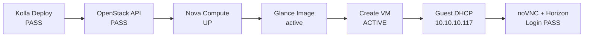
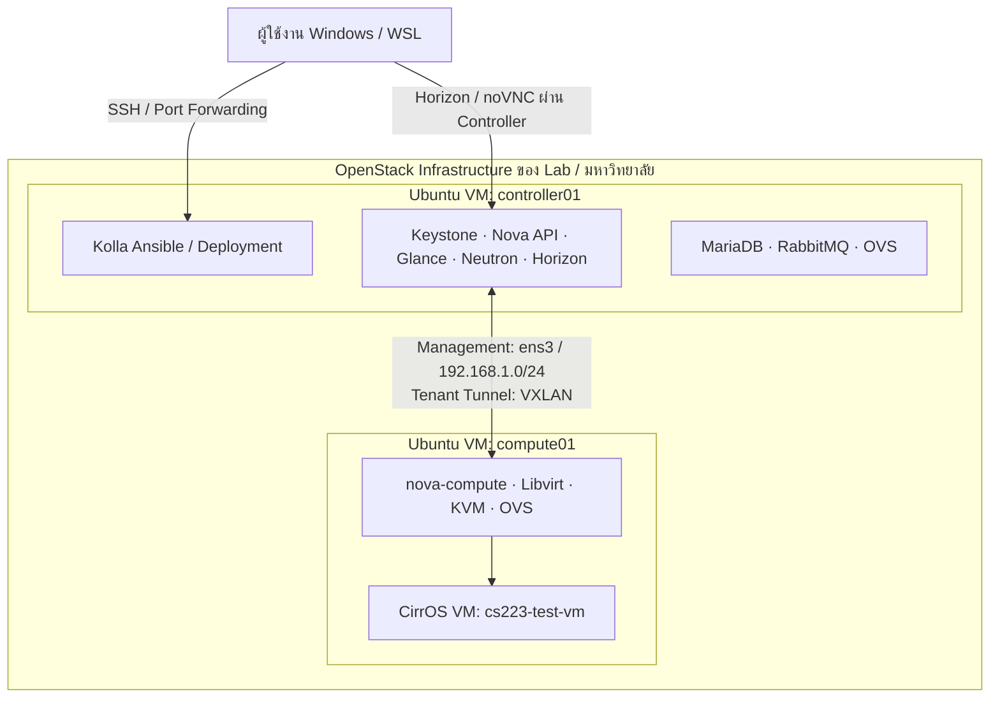
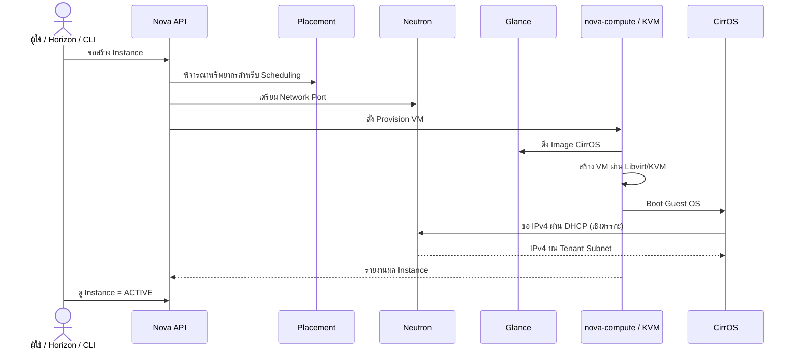
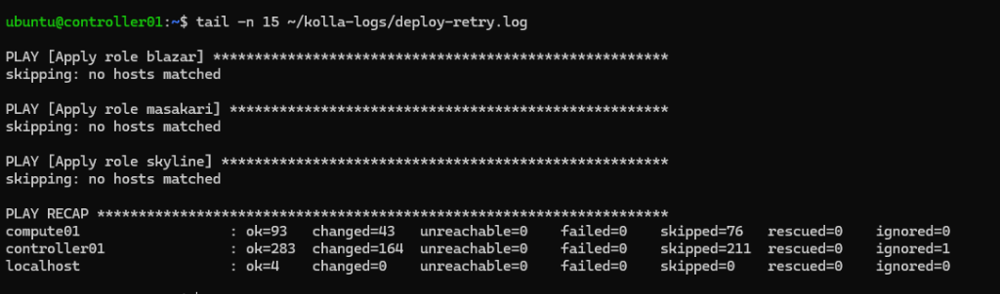
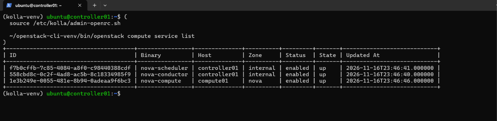
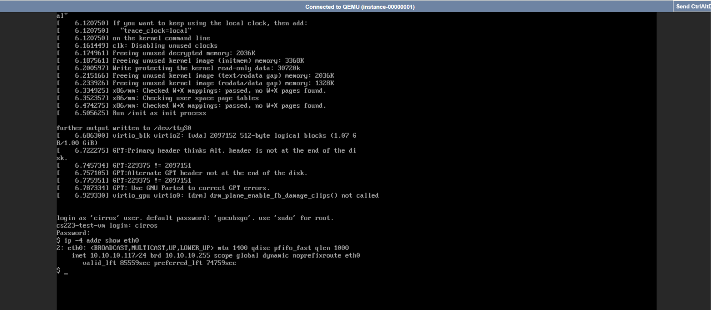
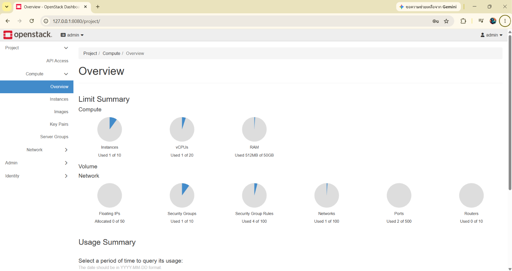

# 07 — Operations Handover & Knowledge Transfer

> **CS223 Term Project — OpenStack 2026.1 Multinode Deployment**  
> **เอกสารส่งมอบงาน:** ส่วน Installation & Deployment (สมาชิกคนที่ 2) → สมาชิกที่รับงานต่อ (คนที่ 3)  
> **ข้อมูลอ้างอิงล่าสุด:** 17 พฤศจิกายน 2026 (Asia/Bangkok)  
> **สถานะ:** งานติดตั้งและทดสอบพื้นฐาน **เสร็จสิ้น**; การรวบรวมภาพหลักฐานและการส่งมอบสิทธิ์เข้าถึง **ต้องดำเนินการแยกต่างหาก**

> [!IMPORTANT]
> เอกสารนี้จัดทำสำหรับ **Public GitHub Repository** และอ้างอิงสภาพแวดล้อม Lab ที่ทดสอบแล้ว ไม่ได้ยืนยันสถานะของ Server แบบ Real-time หากมีการ Reboot, เปลี่ยน Configuration, ลบ VM หรือแก้ไข Network หลังวันที่ระบุ ผู้รับมอบควรตรวจสอบสถานะใหม่ก่อนดำเนินงานต่อ

---

## สารบัญ

1. [วัตถุประสงค์และขอบเขตการส่งมอบ](#1-วัตถุประสงค์และขอบเขตการส่งมอบ)
2. [สรุปสำหรับผู้รับมอบงาน (Quick Handover)](#2-สรุปสำหรับผู้รับมอบงาน-quick-handover)
3. [สถานะระบบที่ส่งมอบ (Verified Baseline)](#3-สถานะระบบที่ส่งมอบ-verified-baseline)
4. [สถาปัตยกรรมและ Node Inventory](#4-สถาปัตยกรรมและ-node-inventory)
5. [Software Stack และ Configuration Baseline](#5-software-stack-และ-configuration-baseline)
6. [OpenStack Services และ Dependencies](#6-openstack-services-และ-dependencies)
7. [รายการทรัพยากรที่สร้างไว้ (Resource Inventory)](#7-รายการทรัพยากรที่สร้างไว้-resource-inventory)
8. [วิธีเข้าถึงระบบและขอสิทธิ์ (Access Guide)](#8-วิธีเข้าถึงระบบและขอสิทธิ์-access-guide)
9. [ขั้นตอนตรวจสุขภาพระบบแบบ Read-only](#9-ขั้นตอนตรวจสุขภาพระบบแบบ-read-only)
10. [การใช้งาน Horizon, CLI และ VM ที่มีอยู่](#10-การใช้งาน-horizon-cli-และ-vm-ที่มีอยู่)
11. [ปัญหาที่เคยพบและแนวทางรับมือ](#11-ปัญหาที่เคยพบและแนวทางรับมือ)
12. [ข้อจำกัด ความเสี่ยง และสิ่งที่ยังไม่ทดสอบ](#12-ข้อจำกัด-ความเสี่ยง-และสิ่งที่ยังไม่ทดสอบ)
13. [ข้อมูลที่ต้องส่งผ่านช่องทางส่วนตัว](#13-ข้อมูลที่ต้องส่งผ่านช่องทางส่วนตัว)
14. [หลักฐานและไฟล์ที่ต้องจัดเตรียมใน GitHub](#14-หลักฐานและไฟล์ที่ต้องจัดเตรียมใน-github)
15. [ลำดับรับมอบและเริ่มงานของคนที่ 3](#15-ลำดับรับมอบและเริ่มงานของคนที่-3)
16. [Change Management และการดูแลต่อเนื่อง](#16-change-management-และการดูแลต่อเนื่อง)
17. [Handover Acceptance Checklist](#17-handover-acceptance-checklist)
18. [Troubleshooting Quick Reference](#18-troubleshooting-quick-reference)
19. [คำถามที่พบบ่อย (FAQ)](#19-คำถามที่พบบ่อย-faq)
20. [เอกสารอ้างอิงและจุดเชื่อมโยง](#20-เอกสารอ้างอิงและจุดเชื่อมโยง)

---

## 1. วัตถุประสงค์และขอบเขตการส่งมอบ

### 1.1 เป้าหมายของเอกสาร

เอกสารนี้ใช้เป็นจุดเริ่มต้นให้สมาชิกที่รับช่วงงานต่อสามารถเข้าใจสถานะของ OpenStack Lab โดยไม่ต้องย้อนอ่านประวัติการติดตั้งทั้งหมด เอกสารตอบคำถามหลัก 6 ข้อ:

1. **ระบบติดตั้งอะไรไว้แล้ว?** — Software, Nodes, OpenStack Services และ Network
2. **ระบบทำงานถึงขั้นไหนแล้ว?** — ผล Deploy, Service Health, VM Boot, DHCP และ Horizon
3. **เข้าถึงระบบอย่างไร?** — SSH, OpenStack CLI, Horizon และ noVNC
4. **มีทรัพยากรใดอยู่ในระบบบ้าง?** — Image, Flavor, Network, Subnet และ VM
5. **มีอะไรที่ต้องระวัง?** — Credentials, Port 3306, `dummy0`, Non-HA และขอบเขตที่ยังไม่ทดสอบ
6. **จะเริ่มรับงานต่อได้อย่างไร?** — ขั้นตอนตรวจสุขภาพระบบและรายการรับมอบ

### 1.2 ขอบเขตความรับผิดชอบ

| ผู้เกี่ยวข้อง | บทบาทในช่วงส่งมอบ | รายการที่เกี่ยวข้อง |
|---|---|---|
| **สมาชิกคนที่ 2** | ผู้จัดเตรียมและติดตั้งระบบ (Deployment Owner ในช่วงที่ผ่านมา) | Configuration, Kolla Ansible Deployment, Troubleshooting, Verification, Documentation |
| **สมาชิกคนที่ 3** | ผู้รับมอบระบบและดำเนินงานส่วนถัดไป | ตรวจสอบการเข้าถึง, ทบทวน Baseline, ดำเนินงานตามขอบเขตที่กลุ่มมอบหมาย |
| **สมาชิกอื่นในกลุ่ม** | ผู้เกี่ยวข้องกับงานภาพรวม | ตรวจสอบ Architecture, งานที่ต้องพึ่งพาระบบ และหลักฐานการส่งงาน |

> [!NOTE]
> ขอบเขตเชิงเทคนิค **ของคนที่ 3 ยังไม่ได้ระบุอย่างละเอียดในข้อมูลที่ใช้จัดทำเอกสารนี้** จึงไม่กำหนดว่าเขาต้องทำ Floating IP, ติดตั้ง Service เพิ่ม หรือเปลี่ยน Network โดยอัตโนมัติ ให้ยึดโจทย์และข้อตกลงของกลุ่มเป็นหลัก

### 1.3 สิ่งที่ถือว่าส่งมอบ

การส่งมอบที่ครบถ้วนประกอบด้วย **(ก) ระบบที่ทดสอบแล้ว**, **(ข) เอกสาร**, **(ค) หลักฐานการทำงาน**, **(ง) สิทธิ์การเข้าถึงที่ส่งผ่านช่องทางปลอดภัย**, และ **(จ) การยืนยันว่าผู้รับมอบตรวจสอบระบบได้ด้วยตนเอง**

การ Deploy ผ่านเพียงอย่างเดียวไม่เท่ากับการส่งมอบสิทธิ์และเอกสารครบถ้วน

---

## 2. สรุปสำหรับผู้รับมอบงาน (Quick Handover)

### 2.1 สถานะ ณ วันที่บันทึก

| หัวข้อ | สถานะล่าสุดที่ยืนยันได้ | หมายเหตุ |
|---|---|---|
| Kolla Ansible Deployment | **PASS** | `DEPLOY EXIT STATUS: 0` และ `failed=0` ทั้งสอง Nodes |
| Kolla Ansible Post-deploy | **PASS** | สร้าง Client Configuration สำหรับ OpenStack CLI แล้ว |
| Keystone | **PASS** | ขอ Authentication Token ได้ |
| Nova Compute | **PASS** | `nova-scheduler`, `nova-conductor`, `nova-compute` แสดง `up` |
| Hypervisor | **PASS** | `compute01` แสดงสถานะ `up` |
| Neutron | **PASS** | Agents 5 ตัวแสดง `UP` และ `Alive :-)` |
| Glance | **PASS** | `cirros-0.6.3` สถานะ `active` |
| VM Provisioning | **PASS** | `cs223-test-vm` สถานะ `ACTIVE` อยู่ที่ `compute01` |
| Tenant DHCP | **PASS** | Guest ได้รับ IPv4 `10.10.10.117/24` |
| noVNC | **PASS** | เปิด Console และ Login เข้า CirrOS ได้ |
| Horizon | **PASS** | เปิดผ่าน SSH Tunnel และ Login เข้าหน้า Overview ได้ |
| GitHub Evidence | **อยู่ระหว่างเตรียม** | ต้องนำภาพ Screenshot จริงมาตรวจและ Commit |
| Access/Credentials Handover | **ยังต้องประสานงาน** | ต้องจัดส่งแยกจาก Public Repository |

### 2.2 อ่านเฉพาะส่วนไหนก่อนดี?

หากต้องเริ่มใช้งานทันที ให้อ่านตามลำดับ:

1. **[หัวข้อ 8](#8-วิธีเข้าถึงระบบและขอสิทธิ์-access-guide)** — วิธี SSH, เปิด Horizon และ CLI
2. **[หัวข้อ 9](#9-ขั้นตอนตรวจสุขภาพระบบแบบ-read-only)** — คำสั่งเช็กระบบโดยไม่แก้ไขอะไร
3. **[หัวข้อ 7](#7-รายการทรัพยากรที่สร้างไว้-resource-inventory)** — VM, Network และ Image ที่มีอยู่
4. **[หัวข้อ 12](#12-ข้อจำกัด-ความเสี่ยง-และสิ่งที่ยังไม่ทดสอบ)** — สิ่งที่ไม่ควรคาดหวังจากระบบปัจจุบัน
5. **[หัวข้อ 17](#17-handover-acceptance-checklist)** — Checklist ก่อนรับมอบอย่างเป็นทางการ

### 2.3 สิ่งที่ **ไม่ต้องทำซ้ำ** เมื่อรับมอบ

- ไม่ต้องติดตั้ง Ubuntu ใหม่
- ไม่ต้องสร้าง Python Virtual Environment ใหม่บนเครื่องเดิม
- ไม่ต้องรัน `bootstrap-servers`, `prechecks`, `deploy` หรือ `post-deploy` ใหม่เพื่อพิสูจน์ผลเดิม
- ไม่ต้อง Upload Image หรือสร้าง Test VM ซ้ำเพื่อยืนยันว่า Provisioning ทำงานได้
- ไม่ต้องแก้ `globals.yml`, `passwords.yml` หรือ Neutron Configuration ก่อนตรวจสถานะระบบปัจจุบัน

> **เหตุผล:** ระบบมี Baseline ที่ผ่านการทดสอบแล้ว การเปลี่ยนแปลงหรือ Deploy ซ้ำโดยไม่จำเป็นอาจทำให้ข้อมูลการทดสอบและสถานะบริการคลาดเคลื่อน

---

## 3. สถานะระบบที่ส่งมอบ (Verified Baseline)

### 3.1 Deployment Result

ผลจาก **Deployment รอบสุดท้ายที่สำเร็จ**:

```text
PLAY RECAP *********************************************************************
compute01   : ok=93   changed=43   unreachable=0  failed=0  skipped=76   rescued=0  ignored=0
controller01: ok=283  changed=164  unreachable=0  failed=0  skipped=211  rescued=0  ignored=1

DEPLOY EXIT STATUS: 0
```

ค่า `ignored=1` บน Controller เป็น Task ที่ Ansible ทำเครื่องหมายว่า Ignored ไม่ใช่ `failed=1` จึงต้องอ่านร่วมกับ Exit Status ของ Playbook และผลทดสอบบริการหลัง Deploy

รอบแรกเคยมีปัญหา MariaDB/ProxySQL และจบด้วย `DEPLOY EXIT STATUS: 2` แต่ได้แก้ไขและ Deploy รอบใหม่จนผ่านแล้ว รายละเอียดอยู่ที่ [06-troubleshooting.md](06-troubleshooting.md)

### 3.2 Functional Verification

การทดสอบระดับ Functional ผ่านตามลำดับ:



หลักฐานสำคัญที่สุดคือ VM ไม่เพียงมีสถานะ `ACTIVE` ใน Nova เท่านั้น แต่ยัง **Boot ถึง Login Prompt**, Login ผ่าน noVNC ได้ และคำสั่ง `ip -4 addr show eth0` ภายใน Guest แสดง IPv4 ที่สอดคล้องกับ Neutron

### 3.3 นิยามสถานะในเอกสาร

| สถานะ | ความหมาย |
|---|---|
| **PASS** | มีผลการทดสอบจริงรองรับ ณ ช่วงเวลาที่ระบุ |
| **NOT VERIFIED** | ยังไม่มีการทดสอบที่ใช้ยืนยันความสามารถนั้น |
| **NOT CONFIGURED** | ยังไม่ได้ตั้งค่าองค์ประกอบที่จำเป็นใน Baseline นี้ |
| **PENDING HANDOVER** | งานจัดเอกสาร/ข้อมูลหรือการส่งมอบยังไม่ครบ |
| **CURRENT UNKNOWN** | ไม่ได้ตรวจสถานะแบบ Real-time ในขณะอ่านเอกสาร |

> [!IMPORTANT]
> สถานะ **PASS** ไม่ได้หมายถึง Service จะยังคง `up` ทุกเวลา และไม่ใช่ผลการทดสอบ Production Readiness, Security Hardening, High Availability หรือ Internet Connectivity

---

## 4. สถาปัตยกรรมและ Node Inventory

### 4.1 Layered Architecture

ระบบของโครงงานทำงานอยู่ภายใน VM ที่ได้รับจาก **OpenStack ชั้นนอกของห้อง Lab** อีกชั้นหนึ่ง และสร้าง VM CirrOS ภายใน OpenStack ที่ทีมติดตั้ง:



แผนภาพเป็น **Logical Diagram** ไม่ใช่รายการ Docker Container ทุกตัวหรือ Packet Capture ของระบบ

### 4.2 Node Inventory

| รายการ | Controller | Compute |
|---|---|---|
| Hostname | `controller01` | `compute01` |
| Role | Control Plane / Network / Deployment | Hypervisor / VM Execution |
| OS | Ubuntu Server 24.04.3 LTS | Ubuntu Server 24.04.3 LTS |
| Management IP ใน Lab | `192.168.1.160` | `192.168.1.7` |
| Management Interface | `ens3` | `ens3` |
| Underlay MTU | 1450 | 1450 |
| Container Runtime | Docker | Docker |
| Key Services | Keystone, Nova API/Scheduler/Conductor, Neutron, Glance, Placement, Horizon, MariaDB, RabbitMQ | `nova-compute`, Libvirt/QEMU-KVM, Open vSwitch |
| Deployment Environment | `~/kolla-venv` | ไม่มีการใช้เป็นเครื่องสั่ง Deploy หลัก |
| OpenStack CLI Environment | `~/openstack-cli-venv` | ไม่ได้กำหนดให้เป็นเครื่องใช้งาน CLI หลัก |

> [!NOTE]
> IP ที่แสดงเป็น Private Address ของสภาพแวดล้อม Lab ซึ่งใช้บันทึก Topology ที่ทดสอบแล้ว ที่อยู่เหล่านี้ไม่ใช่ Public Endpoints และอาจเปลี่ยนเมื่อมีการสร้าง VM ภายนอกใหม่หรือปรับเครือข่าย

### 4.3 Network Segments

| Segment / Object | ค่าใน Baseline | จุดประสงค์ |
|---|---|---|
| Management / Underlay | `192.168.1.0/24` | Controller–Compute Communication และ API ภายใน Lab |
| Underlay Interface | `ens3` | `network_interface`, `api_interface`, `tunnel_interface` |
| Underlay MTU | `1450` | ลดขนาดจาก Ethernet MTU ปกติของบาง Lab |
| Tenant Network | `cs223-private-net` | เครือข่ายภายในสำหรับ Instances |
| Network Type | VXLAN | Overlay สำหรับ Tenant Network |
| Tenant Network MTU | `1400` | รองรับ Tunnel Overhead |
| Subnet | `cs223-private-subnet` | `10.10.10.0/24` |
| DHCP Pool | `10.10.10.100`–`10.10.10.200` | แจก IP ให้ Guest |
| Subnet Gateway Field | `10.10.10.1` | ระบุไว้ใน Subnet แต่ยังไม่มี Neutron Router รองรับ |
| Lab External Interface | `dummy0` บน Controller | ใช้ประกอบการทดลอง `br-ex` ไม่ใช่ Physical Uplink |

> **ข้อจำกัดสำคัญ:** การที่ Subnet ระบุ Gateway `10.10.10.1` ไม่ได้ยืนยันว่ามี Router ที่ตอบสนองที่ IP นี้ และการสร้าง VM บน VXLAN ได้ไม่เท่ากับการมี Internet Egress

---

## 5. Software Stack และ Configuration Baseline

### 5.1 Software Versions

| Component | เวอร์ชัน / ชุดที่ใช้ |
|---|---|
| OpenStack | **2026.1** |
| Kolla Ansible | **22.2.1.dev36** |
| Ansible Core | **2.19.15** |
| Ubuntu Server | **24.04.3 LTS** |
| Python สำหรับ Deployment | Python 3.12 ผ่าน Virtual Environment |
| OpenStack Client | **python-openstackclient 9.0.1** |
| Virtualization | **Libvirt / QEMU-KVM** |
| Network Backend | **Neutron + Open vSwitch + VXLAN** |
| Container Platform | Docker / Kolla Container Images |
| Test Guest | CirrOS **0.6.3**, x86_64 `qcow2` |

เวอร์ชันเป็นค่าที่บันทึกได้ตอนดำเนินโครงงาน ไม่ใช่คำสั่งให้ Upgrade ให้ตรงกับเวอร์ชันนี้ทุกครั้ง

### 5.2 ตำแหน่งไฟล์ที่ใช้จริงบน `controller01`

| Path | วัตถุประสงค์ | ข้อควรระวัง |
|---|---|---|
| `~/multinode` | Ansible Inventory สำหรับ Multinode | มีข้อมูล Host/SSH; ตรวจและ Sanitize ก่อนเผยแพร่ |
| `~/kolla-venv/` | Python Venv สำหรับ Kolla Ansible | ไม่ควร Commit ทั้ง Venv |
| `~/openstack-cli-venv/` | Python Venv สำหรับ OpenStack CLI | ไม่ควร Commit ทั้ง Venv |
| `/etc/kolla/globals.yml` | Global Deployment Configuration | ตรวจข้อมูล Host/IP และค่าที่เป็นความลับก่อนแชร์ |
| `/etc/kolla/passwords.yml` | รหัสผ่านของ Services | **ห้าม Commit หรือส่งเป็น Public Attachment** |
| `/etc/kolla/config/neutron/` | Neutron Override Configuration | ต้องทบทวนก่อนแก้/แชร์ |
| `/etc/kolla/admin-openrc.sh` | OpenStack Admin Environment Variables | **มี Credentials จริง** |
| `/etc/kolla/clouds.yaml` | OpenStack Client Cloud Configuration | **อาจมี Credentials จริง** |

### 5.3 Global Configuration สำคัญ

ค่าที่ใช้งานใน Baseline แบบ **Single Controller, Non-HA**:

```yaml
# ตัวอย่างสรุปเฉพาะค่าที่เกี่ยวข้อง ไม่ใช่ globals.yml ทั้งไฟล์
kolla_base_distro: "ubuntu"
network_interface: "ens3"
api_interface: "ens3"
tunnel_interface: "ens3"
neutron_external_interface: "dummy0"
neutron_plugin_agent: "openvswitch"

kolla_internal_vip_address: "192.168.1.160"
enable_haproxy: false
enable_keepalived: false
enable_loadbalancer: false
enable_proxysql: false

nova_compute_virt_type: "kvm"
enable_heat: false
enable_cinder: false
workaround_ansible_issue_8743: true
```

> [!CAUTION]
> ตัวอย่างข้างต้นเป็นสรุปจาก Lab นี้ **ไม่ใช่ Production Reference Configuration** โดยเฉพาะการใช้ VIP เท่ากับ Controller IP, การปิด Load Balancer/ProxySQL และการใช้ `dummy0` ผู้รับมอบไม่ควรนำไปใช้กับ Environment อื่นโดยไม่ประเมิน Architecture ใหม่

### 5.4 Source of Truth ของ Configuration

ลำดับที่ควรยึดเมื่อตรวจสอบ Configuration:

1. **Runtime/Live State** — ใช้คำสั่ง Read-only อ่านสิ่งที่กำลังทำงานจริง
2. **Effective Configuration ที่ Controller** — `/etc/kolla/` และ Inventory ปัจจุบัน (สำหรับผู้มีสิทธิ์)
3. **GitHub Example Files** — `config/` เป็นตัวอย่างเพื่อประกอบการอธิบาย ไม่ใช่แหล่งเก็บความลับหรือ Configuration ฉบับเต็ม
4. **เอกสารนี้** — Snapshot ของการติดตั้งและการทดสอบ ณ วันที่ 17 พฤศจิกายน 2026

หากข้อมูลใน GitHub ไม่ตรงกับ Runtime ให้ตรวจสอบผู้แก้ไขและบันทึก Change ก่อนปรับให้ตรงกัน

---

## 6. OpenStack Services และ Dependencies

### 6.1 Service Inventory

| Service | หน้าที่ | ตำแหน่งหลักที่เกี่ยวข้อง | ผลที่ยืนยันได้ |
|---|---|---|---|
| **Keystone** | Identity และ Token | Controller | ขอ Token ได้ |
| **Nova API** | รับคำขอจัดการ VM | Controller | สร้าง VM ได้ |
| **Nova Scheduler** | เลือก Compute Host | Controller | `enabled / up` |
| **Nova Conductor** | ประสานงาน Nova Backend | Controller | `enabled / up` |
| **Nova Compute** | จัดการการรัน VM | Compute | `enabled / up` |
| **Placement** | จัดการ Resource Providers และ Allocation | Controller | Hypervisor ถูกพบและ Scheduling ทำงานใน Test Case |
| **Glance** | Image Catalog และ Image Access | Controller | CirrOS Image `active` |
| **Neutron** | Network API, DHCP, L3, Metadata, OVS | Controller + Compute | Agents 5 ตัว `UP`/`Alive` |
| **Horizon** | Web Dashboard | Controller | Login และ Overview สำเร็จ |
| **MariaDB** | SQL Database ของ Services | Controller | ทำงานหลังแก้ Port Conflict |
| **RabbitMQ** | Messaging ระหว่าง Services | Controller | ทำงานในช่วงตรวจสอบ Deployment |
| **Memcached** | Caching | Controller | ทำงานในช่วงตรวจสอบ Deployment |
| **Open vSwitch** | Virtual Switching | Controller + Compute | Network Agents ทำงานและ VM ได้ IP |

> ตำแหน่งด้านบนแสดงบทบาทหลักตามการติดตั้งนี้ ไม่ใช่รายการ Container ทุกตัว และผลตรวจสอบเป็น Snapshot ไม่ใช่ระบบ Monitoring ต่อเนื่อง

### 6.2 เส้นทางการทำงานของ VM



แผนภาพนี้อธิบายกระบวนการเชิงแนวคิด ไม่ใช่ Trace ที่บันทึก Message/API Call ทุกครั้งจากระบบจริง

---

## 7. รายการทรัพยากรที่สร้างไว้ (Resource Inventory)

### 7.1 OpenStack Objects

| Resource Type | Name | ค่าที่บันทึกได้ | สถานะช่วงทดสอบ |
|---|---|---|---|
| Image | `cirros-0.6.3` | CirrOS 0.6.3 x86_64, QCOW2 | `active` |
| Flavor | `cs223.tiny` | 1 vCPU / 512 MB RAM / 1 GB Root Disk | สร้างแล้ว |
| Network | `cs223-private-net` | Private VXLAN, MTU 1400 | `ACTIVE` |
| Subnet | `cs223-private-subnet` | `10.10.10.0/24` | DHCP Enabled |
| Instance | `cs223-test-vm` | CirrOS / `cs223.tiny` | `ACTIVE` |
| Compute Host | `compute01` | Libvirt/QEMU-KVM | `up` |

### 7.2 OpenStack Resource IDs (Snapshot)

UUID ใช้ช่วยค้นหาทรัพยากรเดิมใน Lab; หากมีการลบแล้วสร้างใหม่ UUID จะเปลี่ยน ดังนั้นควรตรวจสอบด้วย CLI ทุกครั้งก่อนทำงานที่เปลี่ยนแปลงทรัพยากร

| Resource | UUID ที่บันทึกไว้ |
|---|---|
| `cs223-private-net` | `64a96481-1b53-47dc-b5c2-b83dd9ec0a8b` |
| `cs223.tiny` | `9b671969-f373-46f1-a1f4-75a52d5ed8f1` |
| `cirros-0.6.3` | `333a4477-df6b-4ef1-a2c2-50d247a5dff6` |
| `cs223-test-vm` | `d345db04-76c1-4407-9460-461505455c9e` |

### 7.3 Neutron Network Details

| Property | Value |
|---|---|
| Network | `cs223-private-net` |
| Network Type | `vxlan` |
| Segmentation ID ในช่วงทดสอบ | `985` |
| Network MTU | `1400` |
| Subnet | `cs223-private-subnet` |
| CIDR | `10.10.10.0/24` |
| DHCP | Enabled |
| Allocation Pool | `10.10.10.100`–`10.10.10.200` |
| Gateway Field | `10.10.10.1` |
| DHCP Port ที่สังเกตได้ | `10.10.10.100` |
| Test VM Fixed IP | `10.10.10.117` |

### 7.4 VM ที่ยืนยันการทำงาน

**Instance:** `cs223-test-vm`

```text
Nova status        : ACTIVE
Compute host       : compute01
Network            : cs223-private-net
Observed guest IP  : 10.10.10.117/24
Guest interface    : eth0
Guest MTU          : 1400
Image              : cirros-0.6.3
Flavor             : cs223.tiny
```

ผลที่พบใน noVNC Guest Console:

```text
$ ip -4 addr show eth0
2: eth0: <BROADCAST,MULTICAST,UP,LOWER_UP> mtu 1400
    inet 10.10.10.117/24 brd 10.10.10.255
```

> ไม่มีหลักฐานว่ามีการทดสอบ Guest-to-Internet หรือ Router Gateway `10.10.10.1` สำเร็จแล้ว จึงไม่ควรใช้ผลนี้อ้างว่า VM สามารถเข้าถึงอินเทอร์เน็ต

---

## 8. วิธีเข้าถึงระบบและขอสิทธิ์ (Access Guide)

### 8.1 หลักการสำคัญก่อนเริ่ม

- สมาชิกที่รับมอบต้องมีสิทธิ์ใช้งานระบบตามข้อตกลงของกลุ่มและนโยบาย Lab
- ห้ามคัดลอก SSH Private Key ของคนอื่นลง GitHub หรือส่งผ่านช่องทางที่ไม่ปลอดภัย
- บัญชี OpenStack และบัญชี SSH เป็น **คนละระบบ Authentication**
- IP ของ Controller ใน Management Network เป็น Private IP; การเข้าจาก Windows ใช้วิธี SSH ผ่าน Endpoint ที่ได้รับสิทธิ์ แล้วสร้าง Local Port Forward
- อย่าส่งค่า `OS_PASSWORD`, Token, `clouds.yaml`, `passwords.yml` หรือ URL noVNC ที่มี Token ใน Issue/PR/README/รูปภาพ

### 8.2 ข้อมูล Access ที่ต้องได้รับก่อนทำตามขั้นตอน

ผู้รับมอบควรได้รับข้อมูล **ผ่านช่องทางส่วนตัวที่ปลอดภัย**:

| ข้อมูลที่ต้องได้รับ | ตัวอย่างรูปแบบ (ไม่ใช่ค่าจริง) | ผู้จัดเตรียม |
|---|---|---|
| SSH Endpoint สำหรับเข้าถึง Controller | `<CONTROLLER_SSH_ADDRESS>` | ผู้ดูแล Lab / เจ้าของสิทธิ์ |
| SSH Username | `ubuntu` หากเป็น Account ที่อนุญาต | ผู้ดูแล Lab |
| วิธี Authentication | SSH Key ของตนเองหรือวิธีที่ Lab อนุญาต | ผู้ดูแล Lab |
| OpenStack Username | `admin` หรือบัญชี Role ที่ได้รับมอบหมาย | OpenStack Admin |
| OpenStack Password | ส่งผ่าน Secret Manager หรือช่องทางส่วนตัว | OpenStack Admin |
| OpenStack Domain/Project | ตามบัญชีที่ผู้รับมอบได้รับ | OpenStack Admin |
| สิทธิ์ใช้งาน `controller01` / `compute01` | SSH / Sudo ตามความจำเป็น | ผู้ดูแล Lab |

> การส่งมอบไม่ควรจบที่การแจ้งชื่อไฟล์ `admin-openrc.sh` เพราะผู้รับมอบอาจยังไม่มี SSH/Sudo Access และไม่ควรเปิดสิทธิ์เกินความจำเป็นเพียงเพื่อทดสอบระบบ

### 8.3 เข้า Controller ผ่าน SSH จาก Windows WSL

**รันบน:** Windows → WSL Ubuntu (ไม่ใช่ Terminal ของ `controller01`)

```bash
ssh -i ~/.ssh/YOUR_SSH_KEY \
  -o IdentitiesOnly=yes \
  ubuntu@YOUR_CONTROLLER_SSH_ADDRESS
```

เมื่อเชื่อมต่อได้แล้ว ให้ยืนยันว่า Terminal อยู่บนเครื่องที่ถูกต้อง:

```bash
hostname
whoami
```

ผลที่คาดหวังสำหรับ Lab นี้คือ `hostname` แสดง `controller01` และ User เป็นบัญชีที่ได้รับอนุญาต

### 8.4 เข้า Horizon ผ่าน SSH Tunnel

**รันบน:** Windows WSL Terminal อีกหน้าต่างหนึ่ง และ **เปิดหน้าต่างนั้นค้างไว้** ระหว่างใช้งาน Browser

```bash
ssh -i ~/.ssh/YOUR_SSH_KEY \
  -o IdentitiesOnly=yes \
  -o ExitOnForwardFailure=yes \
  -N \
  -L 127.0.0.1:8080:192.168.1.160:80 \
  ubuntu@YOUR_CONTROLLER_SSH_ADDRESS
```

อธิบายคำสั่ง:

| Option | ความหมาย |
|---|---|
| `-i` | ใช้ SSH Private Key ที่มีสิทธิ์จริงของผู้ใช้ |
| `-o IdentitiesOnly=yes` | เลือก Identity ที่กำหนดอย่างชัดเจน |
| `-o ExitOnForwardFailure=yes` | ออกจาก SSH เมื่อสร้าง Port Forward ไม่สำเร็จ |
| `-N` | เปิด SSH Connection เพื่อ Forward Port โดยไม่เข้าสู่ Remote Shell |
| `-L 127.0.0.1:8080:192.168.1.160:80` | Forward Local Port 8080 ไปยัง Horizon HTTP Port 80 บน Controller |

จากนั้นเปิด Browser บน Windows:

```text
http://127.0.0.1:8080/
```

**ผลที่เคยทดสอบสำเร็จ:** เห็นหน้า Horizon Login และสามารถ Sign In ไปยัง Project Overview ได้

**ข้อสังเกต:** Terminal ที่ใช้ `ssh -N -L` จะดูเหมือนหยุดรออยู่โดยไม่มี Prompt; เป็นพฤติกรรมปกติของ SSH Tunnel การปิด Terminal หรือกด `Ctrl+C` จะยุติ Tunnel

**HTTP Check จาก Controller:**

```bash
curl -I --max-time 5 http://192.168.1.160/
```

ผลที่เคยสังเกต:

```text
HTTP/1.1 302 Found
Location: http://192.168.1.160/auth/login/?next=/
```

`302 Found` ที่ Redirect ไปหน้า Login **ไม่ใช่ Error** หาก Browser ถูก Redirect ไป Private IP ที่เครื่องเข้าถึงไม่ได้ ให้ตรวจการ Redirect/Host Configuration ตาม [06-troubleshooting.md](06-troubleshooting.md) แทนการเปิด Firewall โดยไม่จำเป็น

### 8.5 ใช้ OpenStack CLI บน Controller

CLI ถูกติดตั้งไว้ที่ `~/openstack-cli-venv` แยกจาก `~/kolla-venv` เพื่อหลีกเลี่ยง Dependency Conflicts

**รันบน:** `controller01` หลัง SSH เข้าเครื่องแล้ว

```bash
(
  source /etc/kolla/admin-openrc.sh
  ~/openstack-cli-venv/bin/openstack --version
  ~/openstack-cli-venv/bin/openstack compute service list
)
```

เนื่องจาก `admin-openrc.sh` มี Credentials จริง ควรใช้ใน Subshell `(...)` เพื่อลดการค้างของ Environment Variables ใน Shell ปัจจุบัน และไม่ควรพิมพ์ `env`, `set`, `cat` หรือ `grep OS_PASSWORD` ลงใน Terminal ที่กำลังจะ Screenshot

> [!IMPORTANT]
> ตัวอย่างนี้ใช้ Admin Environment ที่มีอยู่จริงบนเครื่อง Lab สำหรับผู้ที่ได้รับอนุญาตเท่านั้น หากมีบัญชีของคนที่ 3 แยกต่างหาก ควรใช้บัญชีดังกล่าวตามหลัก Least Privilege แทน

### 8.6 เข้า noVNC Console ของ VM ผ่าน SSH Tunnel

ใช้เมื่อจำเป็นต้องดู Console ของ `cs223-test-vm` ไม่จำเป็นต้องทำทุกครั้งที่ตรวจสถานะระบบ

**ขั้นที่ 1 — รันบน Windows WSL:**

```bash
ssh -i ~/.ssh/YOUR_SSH_KEY \
  -o IdentitiesOnly=yes \
  -o ExitOnForwardFailure=yes \
  -N \
  -L 127.0.0.1:6080:192.168.1.160:6080 \
  ubuntu@YOUR_CONTROLLER_SSH_ADDRESS
```

**ขั้นที่ 2 — รันบน `controller01`:**

```bash
(
  source /etc/kolla/admin-openrc.sh
  ~/openstack-cli-venv/bin/openstack console url show \
    --novnc -f value -c url cs223-test-vm |
  sed 's#http://192\.168\.1\.160:6080#http://127.0.0.1:6080#'
)
```

**ขั้นที่ 3 — เปิด URL ที่ได้รับใน Browser:** Console URL มี Token แบบชั่วคราว ต้องใช้ URL ล่าสุดที่ OpenStack ออกให้ และต้องเก็บเป็นความลับ

> [!WARNING]
> ห้าม Commit Console URL ที่มี Token, ถ่าย Screenshot ให้เห็น Token ใน Address Bar หรือส่ง Token ไปยังช่องทางสาธารณะ การเปิดหน้า `vnc_lite.html` ตรง ๆ โดยไม่มี Console Token ไม่เท่ากับการเชื่อมต่อ Guest ที่ได้รับอนุญาต

**ผลที่เคยยืนยันแล้ว:** เปิดหน้า QEMU Console, Login เข้าสู่ CirrOS Shell และดู IPv4 ของ `eth0` ได้

### 8.7 เข้า Compute Node

หากงานที่รับช่วงต่อจำเป็นต้องตรวจ Runtime บน Compute ให้ SSH จากจุดที่ Lab อนุญาตเท่านั้น ตัวอย่างเมื่อ Controller มีสิทธิ์ SSH ไป Compute:

```bash
# รันบน controller01 เฉพาะเมื่อได้รับสิทธิ์แล้ว
ssh ubuntu@192.168.1.7
hostname
```

ควรตรวจให้แน่ใจว่า Hostname แสดง `compute01` ก่อนรันคำสั่งตรวจ Docker/Libvirt และ **อย่าคาดเดาว่าคีย์ SSH ของทุกคนจะใช้ได้เหมือนกัน**

---

## 9. ขั้นตอนตรวจสุขภาพระบบแบบ Read-only

### 9.1 แนวคิด

สำหรับการรับมอบครั้งแรก ให้เริ่มจากคำสั่งที่ **อ่านสถานะอย่างเดียว** และหลีกเลี่ยงคำสั่งที่เปลี่ยน Configuration, สร้าง/ลบ VM, Restart Services หรือ Deploy ซ้ำ

### 9.2 ขั้นที่ 1 — ตรวจว่ากำลังอยู่บน Node ที่ถูกต้อง

```bash
hostname
whoami
cat /etc/os-release | grep PRETTY_NAME
ip -br addr show ens3
```

**คาดหวัง:** รันบน `controller01` และเห็น Management Interface `ens3` ของ Lab

### 9.3 ขั้นที่ 2 — ตรวจ Docker Containers

**บน `controller01`:**

```bash
sudo docker ps --format 'table {{.Names}}\t{{.Status}}'
```

**บน `compute01`:**

```bash
sudo docker ps --format 'table {{.Names}}\t{{.Status}}'
```

**คาดหวัง:** เห็น Services หลักของแต่ละ Node ในสถานะ Running; รายการที่ติดตั้ง Health Check ควรไม่มีสถานะ `unhealthy`

ข้อควรระวัง: สถานะ `Up` ของ Container ไม่ได้ยืนยันด้วยตัวเองว่า API ของ Service ใช้งานได้ จึงต้องตรวจ API/Agent เพิ่มเติม

### 9.4 ขั้นที่ 3 — ตรวจ Keystone และ Nova

**บน `controller01`:**

```bash
(
  source /etc/kolla/admin-openrc.sh
  ~/openstack-cli-venv/bin/openstack token issue -f value -c expires
  ~/openstack-cli-venv/bin/openstack compute service list
  ~/openstack-cli-venv/bin/openstack hypervisor list
)
```

**คาดหวัง:**

- `token issue` คืนค่าเวลาหมดอายุของ Token ได้
- `nova-scheduler` และ `nova-conductor` ที่ `controller01` เป็น `up`
- `nova-compute` ที่ `compute01` เป็น `up`
- `hypervisor list` เห็น `compute01` สถานะ `up`

> ค่า `token issue` ที่เลือกแสดงเฉพาะ `expires` ไม่ได้แสดง Token จริง เหมาะกว่าการ Screenshot ผล Token ทั้งก้อน

### 9.5 ขั้นที่ 4 — ตรวจ Neutron

```bash
(
  source /etc/kolla/admin-openrc.sh
  ~/openstack-cli-venv/bin/openstack network agent list
  ~/openstack-cli-venv/bin/openstack network show cs223-private-net
  ~/openstack-cli-venv/bin/openstack subnet show cs223-private-subnet
)
```

**คาดหวัง:**

- Agents 5 ตัว (Metadata, OVS, DHCP, L3, OVS) มีสถานะ `UP` และ `Alive :-)`
- `cs223-private-net` ยังอยู่ในสถานะ `ACTIVE`
- Subnet มี CIDR `10.10.10.0/24` และ DHCP Enabled

การที่ L3 Agent เป็น `UP` ไม่ได้แปลว่ามี Neutron Router สำหรับ Guest ถูกสร้างแล้ว

### 9.6 ขั้นที่ 5 — ตรวจ Image, Flavor และ Instance

```bash
(
  source /etc/kolla/admin-openrc.sh
  ~/openstack-cli-venv/bin/openstack image list
  ~/openstack-cli-venv/bin/openstack flavor list
  ~/openstack-cli-venv/bin/openstack server list
  ~/openstack-cli-venv/bin/openstack server show cs223-test-vm
)
```

**คาดหวัง:** Image `cirros-0.6.3`, Flavor `cs223.tiny` และ Server `cs223-test-vm` ยังอยู่ โดย Instance ควรเป็น `ACTIVE` หากไม่มีการเปลี่ยนแปลงหลังทดสอบ

### 9.7 ขั้นที่ 6 — ตรวจ Horizon HTTP

```bash
curl -I --max-time 5 http://192.168.1.160/
```

**คาดหวัง:** ได้ HTTP Response จาก Horizon (เคยได้ `302 Found` ไปหน้า Login) หากได้ `5xx`, Timeout หรือ Connection Refused ค่อยเปิด Troubleshooting Guide

### 9.8 ขั้นที่ 7 — ตรวจ GUI เฉพาะเมื่อจำเป็น

เปิด Horizon ผ่าน Tunnel ตาม [หัวข้อ 8.4](#84-เข้า-horizon-ผ่าน-ssh-tunnel) จากนั้นดู Overview หรือรายการ Instances โดยไม่แก้ไข Configuration และไม่ลบทรัพยากรเดิม

### 9.9 Read-only Checklist แบบสรุป

| ลำดับ | รายการ | เกณฑ์สังเกต | หากไม่ตรง |
|---|---|---|---|
| 1 | SSH Controller | Login ได้, Hostname ถูกต้อง | ตรวจ SSH Endpoint/Key/สิทธิ์ |
| 2 | Docker | Containers หลัก Running | ตรวจ Container/Systemd |
| 3 | Keystone | Token Expiry อ่านได้ | ตรวจ API/Keystone |
| 4 | Nova | Scheduler/Conductor/Compute `up` | ตรวจ Nova Services/Compute |
| 5 | Neutron | Agents 5 ตัว Alive/UP | ตรวจ Agent/OVS/DHCP |
| 6 | Glance | CirrOS Image `active` | ตรวจ Image/Glance |
| 7 | VM | `cs223-test-vm` `ACTIVE` | ตรวจ Server/Fault/Logs |
| 8 | Horizon | เปิด Login/Overview ได้ | ตรวจ HTTP/SSH Tunnel |

> [!TIP]
> ทุกครั้งที่ตรวจรอบใหม่ควรบันทึกวันที่ เวลา และผู้ตรวจ เพื่อแยก **ผลตรวจใหม่** ออกจาก **ผลที่บันทึกเมื่อ 17 พฤศจิกายน 2026**

---

## 10. การใช้งาน Horizon, CLI และ VM ที่มีอยู่

### 10.1 เลือกเครื่องมือให้เหมาะกับงาน

| งาน | เครื่องมือที่เหมาะสม |
|---|---|
| ดู Instances/Networks/Images ด้วย GUI | Horizon |
| ตรวจ Service/Agent/Hypervisor | OpenStack CLI |
| ตรวจ Docker Container และ Host Resource | SSH + Docker/Linux Commands |
| ดู Boot Process และ Shell ของ Guest | noVNC Console |
| ตรวจ Log เชิงลึก | Docker/Service Logs โดยตรวจข้อมูลลับก่อนแชร์ |

### 10.2 งานที่ทำได้โดยไม่สร้าง Resource ใหม่

**ใน Horizon:**

1. Login ด้วยบัญชีที่ได้รับสิทธิ์
2. เลือก Project ที่เกี่ยวข้อง
3. เปิด **Compute → Instances** เพื่อตรวจ VM เดิม
4. เปิด **Network → Networks** เพื่อตรวจ Tenant Network
5. เปิด **Compute → Images** หรือหน้า Image ที่ใช้งานได้ตาม Dashboard Version
6. บันทึก Screenshot โดยซ่อน Session/Token/ข้อมูลลับ

ชื่อเมนูอาจแตกต่างกันเล็กน้อยตามเวอร์ชัน Horizon และสิทธิ์ของบัญชีผู้ใช้

**ใน CLI:**

```bash
(
  source /etc/kolla/admin-openrc.sh
  ~/openstack-cli-venv/bin/openstack server list
  ~/openstack-cli-venv/bin/openstack network list
  ~/openstack-cli-venv/bin/openstack subnet list
  ~/openstack-cli-venv/bin/openstack image list
  ~/openstack-cli-venv/bin/openstack flavor list
)
```

คำสั่งชุดนี้อ่านรายการทรัพยากร ไม่ได้สร้างหรือเปลี่ยนแปลง Resource

### 10.3 ก่อนสร้าง VM/Network เพิ่ม

ให้ตรวจสอบร่วมกับกลุ่มก่อนว่า:

- งานที่คนที่ 3 รับผิดชอบต้องการ Resource เพิ่มจริงหรือไม่
- มี Quota เพียงพอหรือไม่
- จะใช้ Test VM เดิมหรือสร้างใหม่เพื่อแยกผลการทดสอบ
- Network/Subnet ที่จะใช้ซ้ำมีผลต่อการทดลองเดิมอย่างไร
- มีการวางแผน Naming Convention และ Evidence ใหม่หรือยัง

**ไม่ควรลบ `cs223-test-vm`** โดยไม่ปรึกษากลุ่ม เพราะ VM นี้เป็นหลักฐานสำคัญว่า Deployment สร้าง Guest ได้จริง

---

## 11. ปัญหาที่เคยพบและแนวทางรับมือ

### 11.1 Case ที่เกิดขึ้นจริง: MariaDB/ProxySQL Port Conflict

**อาการ:** Deployment รอบแรกเกิดปัญหาการเข้าถึง MariaDB Endpoint ที่ `192.168.1.160:3306` จบด้วย Exit Status `2`

**สิ่งที่ตรวจพบ:** ProxySQL ที่ยังทำงานอยู่ในระบบซึ่งมี systemd Units จัดการ สามารถแย่งใช้หรือขัดแย้งกับการใช้งาน Port `3306` ของ MariaDB ได้ แม้ Configuration ภายหลังจะปิด ProxySQL แล้วก็ตาม

**แนวทางแก้ที่เคยใช้จริง:**

1. ตรวจสอบ Listener/Service State ของ Port `3306`
2. ตั้งค่า Non-HA ให้สอดคล้องกับ Topology ของ Lab โดยปิด Load Balancer/ProxySQL
3. หยุด Kolla systemd Units ของ ProxySQL/HAProxy ที่ค้างจาก Deployment ก่อนหน้า
4. Reload systemd หลังปรับสถานะ Units
5. ตรวจสอบว่า MariaDB พร้อมใช้งานก่อน Retry
6. Deploy รอบใหม่จนจบด้วย Exit Status `0`

**คำสั่งอ่านสถานะเท่านั้น:**

```bash
sudo ss -ltnp | grep ':3306' || true
sudo systemctl status kolla-proxysql-container.service --no-pager
sudo systemctl status kolla-haproxy-container.service --no-pager
sudo docker ps --format 'table {{.Names}}\t{{.Status}}'
```

> [!CAUTION]
> **ห้ามสั่ง Stop/Disable/Mask, ลบ Container หรือ Restart MariaDB โดยอัตโนมัติ** เพียงเพราะเห็นชื่อ Unit ดังกล่าวในเอกสารนี้ การแก้ไขต้องอิง Runtime ที่เกิดปัญหาจริงและแผนการเปลี่ยนแปลงที่ได้รับอนุญาต

รายละเอียดแบบ Step-by-step: [06 — Troubleshooting](06-troubleshooting.md)

### 11.2 Horizon เข้าผ่าน Browser โดยตรงไม่ได้

**บริบท:** Controller ใช้ Private Management IP จึงไม่สามารถคาดหวังว่า Browser ของผู้ใช้จะเข้าถึง IP `192.168.1.160` ได้ตรง ๆ จากทุก Network

**วิธีที่ใช้สำเร็จ:** SSH Local Port Forward จาก WSL ไปยัง `192.168.1.160:80` แล้วเปิด `http://127.0.0.1:8080/`

**ตรวจเมื่อมีปัญหา:**

- SSH Tunnel ยังเปิดอยู่หรือไม่
- Local Port `8080` ถูกโปรแกรมอื่นใช้หรือไม่
- Horizon ยังตอบ `curl -I` จาก Controller หรือไม่
- Browser ถูก Redirect ไป Private IP แทน Localhost หรือไม่
- Credential หรือสิทธิ์ Project ถูกต้องหรือไม่

### 11.3 noVNC เข้า Console ไม่ได้

**บริบท:** noVNC Proxy ทำงานที่ Port `6080` ใน Network ภายในของ Controller

**วิธีที่ใช้สำเร็จ:** Local Port Forward จาก WSL และขอ Console URL ใหม่ด้วย OpenStack CLI

**ตรวจเมื่อมีปัญหา:**

- `cs223-test-vm` ยังคง `ACTIVE` หรือไม่
- SSH Tunnel Port `6080` ยังเปิดอยู่หรือไม่
- Console URL Token หมดอายุหรือถูกใช้ไม่ถูกต้องหรือไม่
- ใช้ URL ล่าสุดและ Redirect Host เป็น Localhost แล้วหรือไม่
- noVNC Proxy/Web Endpoint ตอบสนองหรือไม่

### 11.4 Troubleshooting Cases อื่น

กรณี Nova, Neutron, DHCP, Keystone, Glance, Containers, SSH, Ansible และ KVM ที่ระบุใน [06-troubleshooting.md](06-troubleshooting.md) เป็น **Diagnostic Guides** ที่เตรียมไว้ ไม่ได้หมายความว่าเป็น Incident จริงทั้งหมดที่เคยเกิดขึ้นในโปรเจกต์

---

## 12. ข้อจำกัด ความเสี่ยง และสิ่งที่ยังไม่ทดสอบ

### 12.1 Scope ที่ได้รับการพิสูจน์แล้ว

- ติดตั้ง OpenStack ด้วย Kolla Ansible บน 2 Nodes
- Service หลักตอบสนอง/รายงานสถานะได้ตาม Test Case
- Compute Node ใช้ KVM และ Boot Guest ได้
- Neutron VXLAN และ DHCP รองรับ Test Instance ภายใน Network ที่สร้าง
- ใช้ Horizon, OpenStack CLI และ noVNC ผ่านช่องทางที่ทดสอบแล้ว

### 12.2 Scope ที่ **ยังไม่ยืนยัน**

| ความสามารถ | สถานะ | ผลกระทบต่อการทำงานต่อ |
|---|---|---|
| Neutron Router ที่ใช้เป็น Guest Gateway | **NOT CONFIGURED ใน Baseline** | ไม่ควรอ้างว่ามี Router ให้ Guest ใช้งานจริง |
| External Network ที่ต่อ Physical/Provider Uplink ได้ | **NOT VERIFIED** | `dummy0` ไม่ใช่ Uplink จริง |
| Floating IP ของ **Guest VM ภายใน** | **NOT VERIFIED** | ไม่ควรคาดหวังว่าจะ SSH/ICMP จากภายนอกเข้า Guest ได้ |
| Guest → Internet Egress | **NOT VERIFIED** | ต้องออกแบบ Router/NAT/Provider Network เพิ่มหากโจทย์กำหนด |
| VM-to-VM Connectivity | **NOT VERIFIED** | ยังไม่มีผล Ping/Traffic Test ระหว่าง Guest หลายเครื่อง |
| Live Migration | **NOT VERIFIED** | Lab มี Compute ที่ยืนยันเพียงเครื่องเดียว |
| High Availability / Failover | **NOT CONFIGURED** | Controller เป็น Single Point of Failure |
| Full Security Hardening | **NOT VERIFIED** | ไม่ควรใช้เป็น Production Environment |
| Long-running Load/Performance Test | **NOT VERIFIED** | ผลที่มีเป็น Functional Tests |
| Behavior หลัง Reboot/Infrastructure Change | **CURRENT UNKNOWN** | ต้องตรวจ Runtime State ใหม่หลังการเปลี่ยนแปลง |

> [!IMPORTANT]
> Floating IP ของ VM `controller01` ใน **OpenStack ชั้นนอก** ใช้เป็นช่องทาง SSH เข้า Lab เท่านั้น **ไม่ใช่ Floating IP ของ `cs223-test-vm`** ที่อยู่ใน OpenStack ชั้นใน และไม่ควรสับสนสองส่วนนี้

### 12.3 ความเสี่ยงที่ควรสื่อสารล่วงหน้า

**Single Controller / Non-HA:** หาก Controller หยุดทำงาน API, Database, Horizon และ Network Services ที่พึ่งพา Controller จะได้รับผลกระทบ

**Nested Virtualization:** KVM ทำงานอยู่ภายใน VM ของ OpenStack ชั้นนอก จึงขึ้นกับการเปิดเผย Virtualization Extension และนโยบายของ Lab

**Shared Underlay:** Management และ VXLAN Tunnel ใช้ `ens3` ภายใต้ MTU 1450 การเปลี่ยน MTU อาจกระทบ Container/Guest Communication

**`dummy0` และ `br-ex`:** ใช้สำหรับการตั้งค่า Lab ที่ยังไม่ต่อ External Network จริง ห้ามเปลี่ยน `ens3` ให้เป็น External Interface โดยไม่วิเคราะห์ผลกระทบต่อ Management Connectivity

**Credentials:** การใช้บัญชี Admin ร่วมกันเพิ่มความเสี่ยงและลดความสามารถในการตรวจสอบผู้กระทำ หาก Lab รองรับควรสร้างบัญชี/Role แยกสำหรับสมาชิก

### 12.4 สิ่งที่ควรออกแบบก่อนต่อยอด External Connectivity

หากงานถัดไปกำหนดให้ Guest เข้าถึงภายนอกหรือใช้ Floating IP ผู้รับมอบต้องพิจารณาอย่างน้อย:

1. ข้อกำหนดของผู้ดูแล OpenStack ชั้นนอกและนโยบาย Security Group/Port Security
2. Provider Network / VLAN / Bridge Mapping ที่มีอยู่จริงใน Lab
3. Neutron Router, External Gateway และ NAT/Floating IP Plan
4. IP Address Management และการป้องกันชนกับ Network ของมหาวิทยาลัย
5. MTU End-to-End, Routing และ Firewall Rules
6. แผน Rollback หากเปลี่ยน Network แล้ว SSH เข้า Nodes ไม่ได้

ส่วนนี้เป็น **แนวทางการออกแบบในอนาคต** ไม่ใช่สิ่งที่ได้ติดตั้งและทดสอบแล้ว

---

## 13. ข้อมูลที่ต้องส่งผ่านช่องทางส่วนตัว

### 13.1 Public vs Private Handover

| ข้อมูล | เผยแพร่บน Public GitHub ได้หรือไม่? | วิธีที่ควรจัดการ |
|---|---|---|
| Logical Architecture และ Service Roles | **ได้** | ใช้ Mermaid/Markdown |
| Software Versions และคำสั่ง Read-only | **ได้** | ไม่ใส่ Secret ใน Command Example |
| Configuration ตัวอย่างที่ Sanitize แล้ว | **ได้** | เก็บใน `config/` |
| Screenshot ที่ตรวจแล้วว่าไม่มี Secret | **ได้** | เก็บใน `evidence/` |
| SSH Private Key | **ห้าม** | ให้สมาชิกสร้าง/ใช้ Key ของตนเองตามนโยบาย Lab |
| `/etc/kolla/passwords.yml` | **ห้าม** | เก็บเฉพาะบน Host ที่ปลอดภัย |
| `/etc/kolla/admin-openrc.sh` | **ห้าม** | ให้ผู้มีสิทธิ์ใช้บน Controller ไม่คัดลอกลง Repo |
| `/etc/kolla/clouds.yaml` ที่มี Credentials | **ห้าม** | ใช้เฉพาะในสภาพแวดล้อมที่อนุญาต |
| OpenStack Password, Token, noVNC Console URL | **ห้าม** | ส่งผ่านช่องทางส่วนตัว/เครื่องมือจัดเก็บ Secret |
| Raw Logs ที่อาจมี Token/Cookie/Password | **ยังไม่ควร** | Sanitize และตรวจด้วยคนก่อนเผยแพร่ |
| External Access Endpoint / SSH Details | **ควรจำกัด** | ส่งให้เฉพาะผู้ได้รับอนุญาตตามนโยบาย Lab |

### 13.2 ตัวอย่างรายการที่ต้องประสานงานนอก GitHub

- [ ] ผู้รับมอบได้รับสิทธิ์ SSH เข้า Controller
- [ ] ผู้รับมอบทราบขั้นตอนการพิสูจน์ตัวตนที่ Lab อนุญาต
- [ ] มีช่องทางขอสิทธิ์เข้าถึง Compute เมื่อจำเป็น
- [ ] ผู้รับมอบมี OpenStack Account/Role และ Project ที่เหมาะสม
- [ ] ผู้รับมอบเข้าถึง Horizon ได้เอง ไม่ต้องใช้ Console Session เดิมของผู้ส่งมอบ
- [ ] มีช่องทางติดต่อผู้ดูแลกรณี Credential หมดอายุ/Access ถูกยกเลิก
- [ ] ไม่มีการโพสต์รหัสผ่านหรือ Token ลง GitHub Issue/Commit History

### 13.3 วิธีปฏิบัติที่แนะนำ

1. ใช้บัญชีของสมาชิกคนที่ 3 เองเมื่อสามารถทำได้ แทนการส่งต่อ SSH Private Key หรือใช้บัญชี Admin ร่วมกัน
2. หากต้องมอบ Credential ชั่วคราว ให้ส่งผ่านช่องทางที่ได้รับอนุญาตและเปลี่ยน/ยกเลิกเมื่อไม่จำเป็น
3. จำกัดสิทธิ์ตามงานจริง (Least Privilege)
4. ตรวจ Screenshot และ Log ก่อน Push ทุกครั้ง รวมถึง Browser Address Bar และ Shell History ที่อาจมี Secret
5. หากเคย Commit Secret ให้ถือว่า Secret นั้นรั่วแล้ว และประสานผู้ดูแลเพื่อ Rotate/Invalidate ไม่ใช่เพียงลบไฟล์จาก Commit ล่าสุด

---

## 14. หลักฐานและไฟล์ที่ต้องจัดเตรียมใน GitHub

### 14.1 โครงสร้าง Repository ที่ตกลงใช้

```text
CS223-TermProject/
├── README.md
├── .gitignore
├── docs/
│   ├── 01-project-overview.md
│   ├── 02-architecture.md
│   ├── 03-environment-setup.md
│   ├── 04-kolla-deployment.md
│   ├── 05-deployment-verification.md
│   ├── 06-troubleshooting.md
│   └── 07-handover.md
├── config/
│   ├── multinode.example
│   ├── globals.example.yml
│   └── neutron/
│       ├── neutron.conf.example
│       └── ml2_conf.ini.example
├── evidence/
│   ├── 01-deployment/
│   ├── 02-services/
│   ├── 03-vm-validation/
│   └── 04-horizon/
└── scripts/
    └── verify-deployment.sh
```

### 14.2 Evidence Checklist

> [!NOTE]
> ตารางนี้ระบุ **ชื่อไฟล์เป้าหมายที่ต้องอัปโหลด** ไม่ได้ยืนยันว่าไฟล์ Screenshot เหล่านี้มีอยู่แล้วใน GitHub แม้ผลการทดสอบที่เกี่ยวข้องจะผ่านไปแล้วก็ตาม

| Evidence Path (เทียบจาก Repository Root) | สิ่งที่ภาพควรแสดง | สถานะการจัดไฟล์ |
|---|---|---|
| `evidence/01-deployment/01-prechecks.png` | Prechecks Recap, ไม่มี Failed Hosts | ต้องตรวจ/อัปโหลด |
| `evidence/01-deployment/02-deploy-recap.png` | Controller/Compute `failed=0`, Exit Status `0` | ต้องตรวจ/อัปโหลด |
| `evidence/01-deployment/03-post-deploy.png` | Post-deploy สำเร็จ โดยไม่แสดง Secrets | ต้องตรวจ/อัปโหลด |
| `evidence/02-services/01-controller-containers.png` | Containers บน Controller | ต้องตรวจ/อัปโหลด |
| `evidence/02-services/02-compute-containers.png` | Containers บน Compute | ต้องตรวจ/อัปโหลด |
| `evidence/02-services/03-nova-services.png` | Nova Scheduler/Conductor/Compute `up` | ต้องตรวจ/อัปโหลด |
| `evidence/02-services/04-neutron-agents.png` | Neutron Agents `UP` และ Alive | ต้องตรวจ/อัปโหลด |
| `evidence/03-vm-validation/01-instance-active.png` | VM `ACTIVE` / Host / Network | ต้องตรวจ/อัปโหลด |
| `evidence/03-vm-validation/02-cirros-console.png` | Guest Boot หรือ Login ผ่าน Console | ต้องตรวจ/อัปโหลด |
| `evidence/03-vm-validation/03-cirros-network.png` | `eth0`, `10.10.10.117/24`, MTU 1400 | ต้องตรวจ/อัปโหลด |
| `evidence/04-horizon/01-horizon-dashboard.png` | Horizon Overview หลัง Login | ต้องตรวจ/อัปโหลด |

### 14.3 วิธีเตรียม Screenshot ก่อน Commit

1. เลือกภาพที่ยืนยัน Test Case ได้ชัดเจน ไม่จำเป็นต้องเก็บภาพซ้ำกันหลายรูป
2. ครอบภาพให้เห็นคำสั่งและ Output สำคัญ แต่ไม่ตัด Context จนตีความผิด
3. ลบ/ปิดทับ Token, Credentials, Sensitive URLs, Browser Session, Private Data ของบุคคลอื่น และข้อมูลที่นโยบาย Lab ไม่อนุญาตเผยแพร่
4. ใช้ชื่อไฟล์ตามตารางเพื่อให้ลิงก์ในเอกสารตรงกับ Repository
5. ตรวจว่า GitHub Render ภาพได้จริงหลัง Commit
6. หลีกเลี่ยงการนำ Raw Screenshot ที่มี Secret ขึ้น Repository แม้จะตั้งใจลบภายหลัง

### 14.4 ตัวอย่างการอ้างอิงภาพจากไฟล์นี้

เมื่อเพิ่ม Screenshot แล้ว สามารถอ้างรูปจาก `docs/07-handover.md` ด้วย Relative Path:

```markdown




```

**ไม่ฝังรูปเหล่านี้โดยตรงในเอกสารฉบับปัจจุบัน** เพราะลิงก์จะ Broken จนกว่าไฟล์ Screenshot จริงจะถูกเพิ่มลง Repository

### 14.5 Configuration Examples และ Script

เอกสารที่วางแผนไว้ใน `config/` ได้แก่ `multinode.example`, `globals.example.yml` และ Neutron Examples เพื่อแสดง Architecture/Configuration ที่ใช้โดยไม่เผยแพร่ Credentials; ส่วน `scripts/verify-deployment.sh` ใช้รวมคำสั่ง Read-only Verification หากสร้างในขั้นตอนถัดไป

ไฟล์เหล่านี้ยังต้องตรวจ Syntax, ตรวจ Secret และทดลองใช้งานก่อนอ้างว่าเป็น Reproducible Automation ที่สมบูรณ์

---

## 15. ลำดับรับมอบและเริ่มงานของคนที่ 3

### 15.1 ขั้นตอนที่แนะนำ

```mermaid
flowchart TD
    A["รับเอกสารและขอบเขตงาน"] --> B["รับสิทธิ์ผ่านช่องทางส่วนตัว"]
    B --> C["SSH เข้า Controller"]
    C --> D["ตรวจสุขภาพระบบแบบ Read-only"]
    D --> E{ "ผลตรวจตรงกับ Baseline?" }
    E -->|"ใช่"| F["เข้า Horizon / ตรวจ Resource เดิม"]
    E -->|"ไม่"| G["บันทึกอาการและอ้าง Troubleshooting"]
    G --> H["ประสานเจ้าของระบบก่อนแก้ไข"]
    F --> I["ตกลงขอบเขตงานถัดไปกับกลุ่ม"]
    I --> J["ทำงานต่อ พร้อมบันทึก Evidence / Changes"]
```

### 15.2 ช่วง A — รับเอกสารและสิทธิ์

- อ่าน README, Architecture และ Handover
- รับ SSH Access และ OpenStack Account อย่างถูกต้อง
- ยืนยันว่าเข้า Controller ได้ด้วยบัญชีของผู้รับมอบ
- ทราบข้อจำกัดของระบบก่อนเริ่มทดลอง

### 15.3 ช่วง B — ตรวจ Baseline เดิม

- ตรวจ Containers ของ Controller/Compute
- ตรวจ Keystone, Nova และ Neutron
- ตรวจรายการ VM, Network, Subnet, Image และ Flavor ที่มีอยู่
- ตรวจ Horizon ผ่าน SSH Tunnel
- เปรียบเทียบผลกับ [05-deployment-verification.md](05-deployment-verification.md)

ถ้าผลตรวจต่างจากเดิม ให้บันทึก **วันที่/เวลา, Command, Output ที่ Sanitize แล้ว และสถานะปัจจุบัน** ก่อนแก้ไข

### 15.4 ช่วง C — เริ่มงานใหม่ตามขอบเขตที่ได้รับ

- ยืนยัน Requirement ว่าจะ **ใช้ Resource เดิม** หรือ **สร้าง Resource ใหม่**
- ระบุ Owner ของแต่ละการเปลี่ยนแปลง
- วางแผน Test Cases และ Evidence ใหม่
- หลีกเลี่ยงกระทบ VM เดิมและ Management Connectivity
- บันทึกผลลงเอกสาร/Commit อย่างมีลำดับ

### 15.5 การส่งงานกลับหรือส่งต่อคนถัดไป

เมื่อผู้รับมอบทำงานของตนเสร็จ ให้เพิ่มเติม:

1. สิ่งที่เปลี่ยนแปลงจาก Baseline
2. Resource ที่เพิ่ม/ลบ/แก้ไข
3. ผลการทดสอบและ Screenshot ใหม่
4. ปัญหาและวิธีแก้ไข
5. ข้อจำกัดที่ยังเหลืออยู่
6. ผู้รับผิดชอบงานถัดไปและสิทธิ์การเข้าถึงที่จำเป็น

---

## 16. Change Management และการดูแลต่อเนื่อง

### 16.1 ก่อนเปลี่ยนแปลงระบบ

| คำถาม | เหตุผล |
|---|---|
| เปลี่ยนอะไร? | กำหนด Scope ที่ชัดเจน |
| ทำไมต้องเปลี่ยน? | เชื่อมกับ Requirement ไม่ใช่ทดลองโดยไม่มีเป้าหมาย |
| กระทบ Node/Service/VM ไหน? | ลดโอกาสทำให้ Deployment เดิมเสีย |
| มีหลักฐานก่อนเปลี่ยนหรือยัง? | ช่วย Compare และ Rollback |
| มีวิธีกลับสู่สถานะเดิมหรือไม่? | ลดผลกระทบเมื่อเกิด Error |
| ใครอนุมัติและใครรับผิดชอบ? | ให้ทีมติดตามการเปลี่ยนแปลงได้ |

### 16.2 ตัวอย่าง Change Log Template

ใช้ตารางนี้ใน Issue/PR หรือเอกสารที่กลุ่มเลือก:

| Date/Time (ICT) | Owner | Change | Before | After | Verification | Notes |
|---|---|---|---|---|---|---|
| YYYY-MM-DD HH:MM | `<member>` | `<change description>` | `<baseline>` | `<new state>` | `<pass/fail>` | `<link to evidence>` |

### 16.3 สิ่งที่ควรตรวจหลัง Reboot

ระบบไม่ได้มีหลักฐานว่าผ่าน **Reboot Recovery Test** ครบทุกส่วนแล้ว หากมีการ Restart VM ชั้นนอกหรือ Host ให้ตรวจใหม่อย่างน้อย:

1. IP ของ Controller/Compute และการสื่อสารผ่าน `ens3`
2. Docker Containers บนทั้งสอง Nodes
3. Listener ของ MariaDB Port `3306` และสถานะ Kolla Systemd Units ที่เกี่ยวข้อง
4. Keystone / Nova / Neutron Agents
5. VM `cs223-test-vm` และ Horizon
6. SSH Tunnel/Access Path จากเครื่องผู้ใช้

> การตรวจหลัง Reboot ไม่ใช่คำสั่งให้ Reboot ตอนนี้ หากไม่มี Requirement ให้ทดสอบ Recovery ควรคงระบบที่ทำงานอยู่ไว้ก่อน

### 16.4 สิ่งที่ไม่ควรทำโดยไม่แจ้งกลุ่ม

- Run `kolla-ansible destroy`, `reconfigure`, `deploy` หรือ Playbook ที่เปลี่ยน State โดยไม่ได้เตรียมแผน
- ลบ/Replace `/etc/kolla/passwords.yml`, `globals.yml` หรือ `~/multinode`
- ลบ VM, Image, Flavor หรือ Network ที่ใช้เป็นหลักฐาน
- เปลี่ยน `ens3`, `dummy0`, OVS Bridges หรือ MTU โดยไม่วิเคราะห์ Network Path
- Stop/Disable Docker/Systemd Services ที่ยังถูกใช้โดย OpenStack
- เปิด Port Management/API สู่เครือข่ายภายนอกโดยไม่มีการอนุมัติ
- Publish Raw Logs, Token หรือ Secret ลง GitHub

---

## 17. Handover Acceptance Checklist

### 17.1 Checklist สำหรับผู้ส่งมอบ (คนที่ 2)

- [x] ติดตั้ง Kolla Ansible บน Multinode สำเร็จ
- [x] Prechecks ผ่าน
- [x] Deploy สำเร็จ โดยมี `failed=0` และ Exit Status `0`
- [x] Post-deploy สำเร็จ
- [x] ตรวจ OpenStack APIs และ Compute Services ผ่าน
- [x] ตรวจ Neutron Agents และ DHCP ผ่าน
- [x] สร้างและ Boot `cs223-test-vm` สำเร็จ
- [x] ตรวจ IPv4 ภายใน CirrOS Guest สำเร็จ
- [x] เปิด noVNC Console และ Horizon ได้
- [x] จัดทำเอกสาร Handover ฉบับนี้
- [ ] ตรวจและเพิ่ม Screenshot ที่กำหนดไว้ใน `evidence/`
- [ ] จัดทำ Configuration Examples ใน `config/` และตรวจ Secret
- [ ] ยืนยันสิทธิ์ SSH/OpenStack ของคนที่ 3 ผ่านช่องทางส่วนตัว
- [ ] ได้รับการยืนยันจากคนที่ 3 ว่าสามารถตรวจระบบได้ด้วยตนเอง

### 17.2 Checklist สำหรับผู้รับมอบ (คนที่ 3)

- [ ] อ่าน README, Architecture, Verification และ Handover
- [ ] ได้รับ SSH Access ที่ถูกต้อง
- [ ] SSH เข้า `controller01` ได้
- [ ] ตรวจ `compute01` ได้ตามสิทธิ์ที่จำเป็น
- [ ] เปิด Horizon ด้วย Account ที่ได้รับอนุญาตได้
- [ ] ใช้ OpenStack CLI ตรวจ Status โดยไม่เผยแพร่ Credentials ได้
- [ ] ยืนยันสถานะ Nova, Neutron, Image, Network และ VM เดิมได้
- [ ] เข้าใจข้อจำกัด `dummy0`, Non-HA และการไม่มี Router ใน Baseline
- [ ] ทราบวิธีดู Troubleshooting Guide เมื่อพบ Error
- [ ] ตกลงขอบเขตงาน/Change Plan ถัดไปกับกลุ่มแล้ว
- [ ] ยืนยันรับมอบผ่านช่องทางที่กลุ่มใช้งาน

### 17.3 เกณฑ์ที่ถือว่ารับมอบเสร็จ

การส่งมอบถือว่าครบเมื่อ **ผู้รับมอบมีสิทธิ์เข้าถึงตามงานจริง สามารถตรวจสถานะระบบหลักได้เอง เข้าใจข้อจำกัด และมีหลักฐาน/เอกสารที่อ้างอิงได้** ไม่ใช่แค่ได้รับลิงก์ GitHub

---

## 18. Troubleshooting Quick Reference

| อาการ | ตรวจอะไรเป็นอันดับแรก | เอกสารที่เกี่ยวข้อง |
|---|---|---|
| SSH เข้า Controller ไม่ได้ | Network Path, SSH Endpoint, Key, User, Security Rules | [Environment Setup](03-environment-setup.md) |
| Controller Containers ไม่ Running | `sudo docker ps`, Systemd Unit, Resource Usage | [Troubleshooting](06-troubleshooting.md) |
| API ติดต่อไม่ได้ / Keystone Token ออกไม่ได้ | OpenStack CLI Environment, API, Keystone Container | [Verification](05-deployment-verification.md) |
| Port `3306` มี Conflict | `ss -ltnp`, MariaDB/ProxySQL Units | [Troubleshooting](06-troubleshooting.md) |
| `nova-compute` Down | Nova Service, Compute Container, Libvirt/KVM | [Troubleshooting](06-troubleshooting.md) |
| Neutron Agent Down | Agent List, OVS/DHCP Containers, Underlay Interface | [Troubleshooting](06-troubleshooting.md) |
| VM ไม่เป็น `ACTIVE` | Server Detail/Fault, Hypervisor, Image, Port | [Verification](05-deployment-verification.md) |
| Guest ไม่มี IP | Network/Subnet/DHCP Port, DHCP Agent, Console | [Architecture](02-architecture.md) |
| Horizon เปิดไม่ได้ | SSH Tunnel + `curl -I` บน Controller | [Troubleshooting](06-troubleshooting.md) |
| noVNC เปิดไม่ได้ | Port Forward 6080, Console URL Token ล่าสุด | [Troubleshooting](06-troubleshooting.md) |
| Guest ออก Internet ไม่ได้ | ตรวจว่ามี Router/External Network จริงหรือไม่ | [Architecture](02-architecture.md) |

> [!NOTE]
> หากพบปัญหาใหม่ ควรบันทึกอาการและหลักฐานก่อนลงมือแก้ไข และไม่ควรสมมติว่าปัญหาทุกครั้งมีสาเหตุเหมือน Incident เก่า

---

## 19. คำถามที่พบบ่อย (FAQ)

### Q1: ระบบติดตั้งเสร็จแล้วหรือยัง?

**เสร็จแล้วสำหรับงาน Installation & Deployment และการทดสอบ Functional Baseline** ตามผลที่บันทึกไว้เมื่อ 17 พฤศจิกายน 2026 ส่วนเอกสารภาพหลักฐานบน GitHub และการมอบสิทธิ์ให้คนที่ 3 เป็นงานส่งมอบที่ต้องจัดการเพิ่มเติม

### Q2: คนที่ 3 จำเป็นต้อง Deploy ซ้ำหรือไม่?

**ไม่จำเป็น** หากกำลังใช้ Environment เดิมที่ยังทำงานได้และไม่มี Requirement ให้ติดตั้งใหม่ ควรเริ่มด้วย Read-only Verification ตามหัวข้อ 9

### Q3: ทำไมต้องใช้ SSH Tunnel เพื่อเปิด Horizon?

เพราะ Horizon ใช้ Management Address ภายใน Lab (`192.168.1.160`) การ Forward Port ผ่าน SSH ทำให้ Browser บน Windows เข้าใช้งานผ่าน Localhost ได้โดยไม่ต้องเปิด Horizon Port ตรงออกสู่ภายนอก

### Q4: URL `http://127.0.0.1:8080/` ส่งให้เพื่อนเปิดได้เลยไหม?

**ไม่ได้** `127.0.0.1` หมายถึงเครื่องของผู้เปิด URL เอง เพื่อนต้องมีสิทธิ์ SSH และสร้าง Tunnel จากเครื่องของตนก่อน

### Q5: `10.10.10.117` เป็น IP ของ Controller หรือไม่?

**ไม่ใช่** เป็น IPv4 ที่ Neutron DHCP จัดให้ `cs223-test-vm` ภายใน Tenant Network ส่วน Controller ใช้ Management IP `192.168.1.160`

### Q6: มี Floating IP ให้ `cs223-test-vm` แล้วหรือยัง?

**ยังไม่ได้ยืนยันหรือกำหนด External Connectivity ให้ Inner Guest VM ใน Baseline นี้** ไม่ควรสับสนกับ Floating IP ของ `controller01` ที่เป็น VM ใน OpenStack ชั้นนอก

### Q7: Horizon แสดง Instances = 1 แปลว่าระบบ Production Ready ไหม?

**ไม่ใช่** แปลว่าใน Project มี Instance ที่ถูกนับอยู่ 1 เครื่อง ณ ช่วงเวลาที่เปิดหน้า Overview โดยยังไม่ได้ทดสอบ HA, Failure Recovery, Security Hardening หรือ Load/Performance แบบ Production

### Q8: ถ้าอยากสร้าง Test VM ใหม่ ต้องลบตัวเดิมหรือไม่?

**ไม่จำเป็น** และไม่ควรลบตัวเดิมโดยไม่ประสานกลุ่ม เพราะเป็น Resource ที่ใช้ยืนยันผล Deployment แล้ว ควรตรวจ Quota และ Requirement ของงานใหม่ก่อน

### Q9: ถ้าเอกสารกับ Runtime ไม่ตรงกัน ควรเชื่ออะไร?

ให้เชื่อ **ผลตรวจ Runtime ที่ทำใหม่โดยผู้ได้รับอนุญาต** แล้วจึงดู Configuration ปัจจุบันและประวัติการเปลี่ยนแปลง เอกสารเป็น Snapshot ของช่วงที่บันทึกไว้ ไม่ได้อัปเดตตามเครื่องโดยอัตโนมัติ

### Q10: สามารถ Push `passwords.yml` ขึ้น GitHub Private Repo ได้ไหม?

**ไม่ควร** แม้ Repository จะเป็น Private ก็ตาม ไฟล์นี้มี Credentials ของหลาย Services ควรจัดเก็บบนระบบที่ควบคุมสิทธิ์ได้อย่างเหมาะสม และใช้ Example File ใน GitHub แทน

---

## 20. เอกสารอ้างอิงและจุดเชื่อมโยง

### 20.1 ภายใน Repository

| ไฟล์ | หน้าที่ |
|---|---|
| [README](../README.md) | หน้าแรกของโครงงานและสรุปสถานะ |
| [01 — Project Overview](01-project-overview.md) | เป้าหมาย ขอบเขตและบทบาทผู้รับผิดชอบ |
| [02 — Architecture](02-architecture.md) | Nodes, Networks, Services และ VM Flows |
| [03 — Environment Setup](03-environment-setup.md) | การเตรียม Host และ Dependencies |
| [04 — Kolla Deployment](04-kolla-deployment.md) | ขั้นตอน Deploy และผลลัพธ์ |
| [05 — Deployment Verification](05-deployment-verification.md) | Test Cases, CLI Verification และ Evidence Mapping |
| [06 — Troubleshooting](06-troubleshooting.md) | Incident จริงและ Diagnostic Guides |
| [07 — Handover](07-handover.md) | เอกสารฉบับนี้ |
| [`config/`](../config/) | ตัวอย่าง Configuration หลังสร้างและ Sanitize แล้ว |
| [`evidence/`](../evidence/) | Screenshots ที่ผ่านการตรวจแล้วและอัปโหลดภายหลัง |
| [`scripts/`](../scripts/) | Read-only Verification Script ที่จะจัดทำในขั้นถัดไป |

### 20.2 Official Documentation

- [OpenStack Documentation](https://docs.openstack.org/)
- [Kolla Ansible Documentation](https://docs.openstack.org/kolla-ansible/latest/)
- [OpenStack Client Documentation](https://docs.openstack.org/python-openstackclient/latest/)
- [OpenStack Networking (Neutron)](https://docs.openstack.org/neutron/latest/)
- [OpenStack Compute (Nova)](https://docs.openstack.org/nova/latest/)

> เอกสารทางการที่ลิงก์เป็น `latest` อาจไม่ตรงกับเวอร์ชัน OpenStack **2026.1** ที่ใช้ใน Lab ทุกจุด หากต้องการทำซ้ำให้ตรวจเอกสาร/Constraints ตาม Release และเวอร์ชันที่ใช้งานจริงก่อน

---

## สรุปการส่งมอบ (Handover Summary)

**สิ่งที่เสร็จสมบูรณ์:**

- ติดตั้ง OpenStack 2026.1 ด้วย Kolla Ansible บน `controller01` + `compute01`
- ผ่าน Deployment/Service Verification และ Boot CirrOS Guest บน Compute
- ยืนยันการแจก IP ผ่าน Neutron DHCP และการใช้งาน noVNC/Horizon
- จัดทำแนวทาง Access, Operational Checks และคำเตือนด้าน Security สำหรับผู้รับมอบ

**สิ่งที่ต้องปิดงานด้านเอกสารและการส่งต่อ:**

- เพิ่ม Screenshot จริงภายใต้ `evidence/` หลังตรวจและปิดทับข้อมูลลับ
- เตรียม Example Configurations ใน `config/` และ Script ที่ตั้งใจจะใช้ใน Repository
- ประสานผู้ดูแลเพื่อให้คนที่ 3 มี SSH/OpenStack Access ที่เหมาะสม
- ให้คนที่ 3 ยืนยันผล Read-only Verification และรับมอบระบบ

**ข้อจำกัดที่ต้องระบุทุกครั้งเมื่อส่งงาน:** ระบบเป็น **Non-HA Lab**, ใช้ `dummy0` เป็น External Interface สำหรับการทดลอง และ **ยังไม่ได้ยืนยัน Guest Floating IP, Internet Egress หรือ External Networking แบบใช้งานจริง**

> **Final Handover Statement:** *Installation & Deployment Baseline: Verified and Completed. Documentation Evidence & Access Transfer: Pending Team Coordination.*
